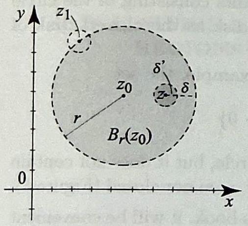

# Editorial records

Reading note: 2.1 Regions of the Complex Plane.md

Original OCR/PDF and before-recovery snapshot are preserved. This record documents the recovery edits; formatting does not authorize changes to author wording. No Index admission was performed.

## 1. Callout 32: restore source title/wording without book numbering; retain actual corrections and necessary source context.

### Before

````text
> [!definition] Open Disk (Neighborhood) in the Complex Plane
> Let $r>0$ be a positive real number and $z_{0}$ a point in the plane. The $r$-neighborhood of $z_{0}$ is the set of all complex numbers $z$ satisfying
>
> $$
> \left|z-z_{0}\right|<r .
> $$
>
> We denote this set by $B_{r}\left(z_{0}\right)$.
````
### After

````text
> [!definition] open set
> Let $r>0$ be a positive real number and $z_{0}$ a point in the plane. The $r$-neighborhood of $z_{0}$ is the set of all complex numbers $z$ satisfying
>
> $$
> \left|z-z_{0}\right|<r .
> $$
>
> We denote this set by $B_{r}\left(z_{0}\right)$.
````

## 2. Callout 33: restore source title/wording without book numbering; retain actual corrections and necessary source context.

### Before

````text
> [!definition] Interior and Boundary Points in the Complex Plane
> Let $S$ be a subset of the complex numbers. A point $z_{0}$ in $S$ is called an interior point of $S$ if we can find a neighborhood of $z_{0}$ that is wholly contained in $S$. A point $z$ in the complex plane is called a boundary point of $S$ if every neighborhood of $z$ contains at least one point in $S$ and at least one point not in $S$. The set of all boundary points of $S$ is called the boundary of $S$.
````
### After

````text
> [!definition] interior and boundary points
> Let $S$ be a subset of the complex numbers. A point $z_{0}$ in $S$ is called an interior point of $S$ if we can find a neighborhood of $z_{0}$ that is wholly contained in $S$. A point $z$ in the complex plane is called a boundary point of $S$ if every neighborhood of $z$ contains at least one point in $S$ and at least one point not in $S$. The set of all boundary points of $S$ is called the boundary of $S$.
````

## 3. Callout 34: restore source title/wording without book numbering; retain actual corrections and necessary source context.

### Before

````text
> [!definition] Open Subset of the Complex Plane
> A subset $S$ of the complex numbers is called open if every point in $S$ is an interior point of $S$.
````
### After

````text
> [!definition] open set
> A subset $S$ of the complex numbers is called open if every point in $S$ is an interior point of $S$.
````

## 4. Callout 35: restore source title/wording without book numbering; retain actual corrections and necessary source context.

### Before

````text
> [!convention] Set Membership Notation
> If a point $z$ is in a set $S$, we say that $z$ is an element of $S$ and write $z \in S$. If $z$ does not belong to $S$, we will write $z \notin S$.
````
### After

````text
> [!convention] element
> If a point $z$ is in a set $S$, we say that $z$ is an element of $S$ and write $z \in S$. If $z$ does not belong to $S$, we will write $z \notin S$.
````

## 5. Callout 36: restore source title/wording without book numbering; retain actual corrections and necessary source context.

### Before

````text
> [!definition] Union of Two Sets
> Let $A$ and $B$ be sets. The union of $A$ and $B$, denoted $A \cup B$, is the set
>
> $$
> A \cup B=\{z: z \in A \text { or } z \in B\} .
> $$
````
### After

````text
> [!definition] union of two sets
> Let $A$ and $B$ be sets. The union of $A$ and $B$, denoted $A \cup B$, is the set
>
> $$
> A \cup B=\{z: z \in A \text { or } z \in B\} .
> $$
````

## 6. Callout 37: restore source title/wording without book numbering; retain actual corrections and necessary source context.

### Before

````text
> [!definition] Intersection of Two Sets
> Let $A$ and $B$ be sets. The intersection of $A$ and $B$, denoted $A \cap B$, is the set
>
> $$
> A \cap B=\{z: z \in A \text { and } z \in B\} .
> $$
````
### After

````text
> [!definition] intersection of two sets
> Let $A$ and $B$ be sets. The intersection of $A$ and $B$, denoted $A \cap B$, is the set
>
> $$
> A \cap B=\{z: z \in A \text { and } z \in B\} .
> $$
````

## 7. Callout 38: restore source title/wording without book numbering; retain actual corrections and necessary source context.

### Before

````text
> [!definition] Disjoint Sets and Set Difference
> Two sets $A$ and $B$ are disjoint if $A \cap B=\emptyset$. The set difference between $A$ and $B$ is the set
>
> $$
> A \backslash B=\{z: z \in A \text { and } z \notin B\} .
> $$
````
### After

````text
> [!definition] disjoint set
> Two sets $A$ and $B$ are disjoint if $A \cap B=\emptyset$. The set difference between $A$ and $B$ is the set
>
> $$
> A \backslash B=\{z: z \in A \text { and } z \notin B\} .
> $$
````

## 8. Callout 39: restore source title/wording without book numbering; retain actual corrections and necessary source context.

### Before

````text
> [!definition] Subset Relation
> We will say that $A$ is a subset of $B$ or that $B$ contains $A$ and write $A \subset B$ or $B \supset A$ if every element of $A$ is also an element of $B: z \in A \Rightarrow z \in B$.
````
### After

````text
> [!definition] subset
> We will say that $A$ is a subset of $B$ or that $B$ contains $A$ and write $A \subset B$ or $B \supset A$ if every element of $A$ is also an element of $B: z \in A \Rightarrow z \in B$.
````

## 9. Callout 40: restore source title/wording without book numbering; retain actual corrections and necessary source context.

### Before

````text
> [!definition] Polygonally Connected Subset of the Complex Plane
> A subset $S$ of the complex plane is called polygonally connected if any two points in $S$ can be joined by a polygonal line consisting of a finite number of line segments joined end to end and wholly contained in $S$.
````
### After

````text
> [!definition] polygonally connected
> A subset $S$ of the complex plane is called polygonally connected if any two points in $S$ can be joined by a polygonal line consisting of a finite number of line segments joined end to end and wholly contained in $S$.
````

## 10. Callout 41: restore source title/wording without book numbering; retain actual corrections and necessary source context.

### Before

````text
> [!definition] Region (Domain) in the Complex Plane
> A nonempty subset $S$ of the complex plane is a region (domain) if it is open and connected. For open subsets of the plane, connectedness is equivalent to polygonal connectedness.
````
### After

````text
> [!definition] region (or domain)
> A nonempty subset $S$ of the complex plane is called a region (or domain) if it is open and connected.
````

## 11. Callout 42: restore source title/wording without book numbering; retain actual corrections and necessary source context.

### Before

````text
> [!proposition] Connectedness Characterization of a Plane Region
> A nonempty open subset $S$ of the complex plane is a region if and only if it cannot be written as the disjoint union of two nonempty open subsets. Equivalently, if $S$ is a region (nonempty connected open subset of $\mathbb{C}$ ) and $S=A \cup B$, where $A$ and $B$ are open and disjoint, then either $A=\emptyset$ or $B=\emptyset$.
````
### After

````text
> [!proposition] Characterization of Regions
> A nonempty open subset $S$ of the complex plane is a region if and only if it cannot be written as the disjoint union of two nonempty open subsets. Equivalently, if $S$ is a region (nonempty connected open subset of $\mathbb{C}$ ) and $S=A \cup B$, where $A$ and $B$ are open and disjoint, then either $A=\emptyset$ or $B=\emptyset$.
````

## 12. Move editorial commentary out of the reading note.

### Before

````text
*Editorial note: The source uses “connected” for polygonal connectedness. These agree for open subsets of the plane, but not for arbitrary subsets; the standalone title states the precise property.*
````
### After

````text

````

## Source-to-current comparison

Source: /Users/gradyclopton/Documents/ChatGPT/Mathematics/asmar-admission-20261107/baseline/Chapter 02 Analytic Functions/2.1 Regions of the Complex Plane.md

This exact comparison preserves the full change evidence, including formatting, OCR corrections, restored source wording, and required standalone context. The entries above explain the recovery edits. The comparison is not a claim that every difference is a correction; component serialization, callout wrapping, and printed labels outside callouts are formatting.

`````diff
--- /Users/gradyclopton/Documents/ChatGPT/Mathematics/asmar-admission-20261107/baseline/Chapter 02 Analytic Functions/2.1 Regions of the Complex Plane.md
+++ /Users/gradyclopton/ObsidianVaults/complex_analysis/Books/Asmar Applied Complex Analysis with Applications to Differential Equations/Chapter 02 Analytic Functions/2.1 Regions of the Complex Plane.md
@@ -1,3 +1,4 @@
+
 ## Topics to Review
 
 In this chapter we will present the fundamental definition of a derivative of a function of a complex variable. Like the definition from calculus, here the derivative will be defined as the limit of a difference quotient (although its existence will have consequences that have no analog in calculus). So it is helpful to review the basic definitions from calculus of limits, continuity, and derivatives.
@@ -47,10 +48,18 @@
 
 
 
-> [!figure] Figure 1
-> 
-> 
-> An $r$-neighborhood $B_{r}\left(z_{0}\right)$ does not include the points on the circle $\left|z-z_{0}\right|=r$.
+```scientific-figure
+id: 24b1a257-56bc-41f6-b521-353b9c7e1bc5
+numbered: false
+title: ""
+caption: "**Figure 1.** An $r$-neighborhood $B_{r}\\left(z_{0}\\right)$ does not include the points on the circle $\\left|z-z_{0}\\right|=r$."
+captionVisible: true
+captionPosition: below
+columns: 1
+panels:
+  - path: Books/Asmar Applied Complex Analysis with Applications to Differential Equations/Chapter 02 Analytic Functions/images/af4f9593-dec7-4bc0-8d78-d25500419ec9-02_486_557_1188_109.jpg
+    caption: ""
+```
 
 
 
@@ -100,13 +109,14 @@
 One very useful definition in this book is that of a neighborhood of a point. It is the analog of an open interval in one dimension.
 
 
+<!-- Source label: open set -->
 > [!definition] open set
 > Let $r>0$ be a positive real number and $z_{0}$ a point in the plane. The $r$-neighborhood of $z_{0}$ is the set of all complex numbers $z$ satisfying
-> 
+>
 > $$
 > \left|z-z_{0}\right|<r .
 > $$
-> 
+>
 > We denote this set by $B_{r}\left(z_{0}\right)$.
 
 
@@ -114,10 +124,18 @@
 
 
 
-> [!figure] Figure 1
-> 
-> 
-> An $r$-neighborhood $B_{r}\left(z_{0}\right)$ does not include the points on the circle $\left|z-z_{0}\right|=r$.
+```scientific-figure
+id: 2f9bfa39-fbcc-447c-8057-9c56623ade52
+numbered: false
+title: ""
+caption: "**Figure 1.** An $r$-neighborhood $B_{r}\\left(z_{0}\\right)$ does not include the points on the circle $\\left|z-z_{0}\\right|=r$."
+captionVisible: true
+captionPosition: below
+columns: 1
+panels:
+  - path: Books/Asmar Applied Complex Analysis with Applications to Differential Equations/Chapter 02 Analytic Functions/images/af4f9593-dec7-4bc0-8d78-d25500419ec9-02_486_557_1188_109.jpg
+    caption: ""
+```
 
 
 Sometimes we will not specify the value of $r$ and will simply refer to $B_{r}\left(z_{0}\right)$ as a neighborhood of $z_{0}$.
@@ -128,16 +146,25 @@
 B_{r}^{\prime}\left(z_{0}\right)=\left\{z: 0<\left|z-z_{0}\right|<r\right\} .
 $$
 
+<!-- Source label: interior and boundary points -->
 > [!definition] interior and boundary points
 > Let $S$ be a subset of the complex numbers. A point $z_{0}$ in $S$ is called an interior point of $S$ if we can find a neighborhood of $z_{0}$ that is wholly contained in $S$. A point $z$ in the complex plane is called a boundary point of $S$ if every neighborhood of $z$ contains at least one point in $S$ and at least one point not in $S$. The set of all boundary points of $S$ is called the boundary of $S$.
 
 From the definitions, every point in $S$ is either an interior point or a boundary point. If a point is an interior point of $S$, then it cannot be a boundary point of $S$. Also, while an interior point of $S$ is necessarily a point in $S$, a boundary point of $S$ need not be in $S$.
 
 
-> [!figure] Figure 2
-> 
-> 
-> The point $z$ is an interior point of $B_{r}\left(z_{0}\right)$, while $z_{1}$ is a boundary point.
+```scientific-figure
+id: 6b89c834-ddea-41e7-b692-e2f13297da3d
+numbered: false
+title: ""
+caption: "**Figure 2.** The point $z$ is an interior point of $B_{r}\\left(z_{0}\\right)$, while $z_{1}$ is a boundary point."
+captionVisible: true
+captionPosition: below
+columns: 1
+panels:
+  - path: Books/Asmar Applied Complex Analysis with Applications to Differential Equations/Chapter 02 Analytic Functions/images/af4f9593-dec7-4bc0-8d78-d25500419ec9-03_461_506_637_125.jpg
+    caption: ""
+```
 
 
 
@@ -229,10 +256,18 @@
 
 
 
-> [!figure] Figure 2
-> 
-> 
-> The point $z$ is an interior point of $B_{r}\left(z_{0}\right)$, while $z_{1}$ is a boundary point.
+```scientific-figure
+id: 76d22226-0863-4de7-bdff-21c3c16c5b52
+numbered: false
+title: ""
+caption: "**Figure 2.** The point $z$ is an interior point of $B_{r}\\left(z_{0}\\right)$, while $z_{1}$ is a boundary point."
+captionVisible: true
+captionPosition: below
+columns: 1
+panels:
+  - path: Books/Asmar Applied Complex Analysis with Applications to Differential Equations/Chapter 02 Analytic Functions/images/af4f9593-dec7-4bc0-8d78-d25500419ec9-03_461_506_637_125.jpg
+    caption: ""
+```
 
 
 
@@ -574,6 +609,7 @@
 
 We come now to an important definition.
 
+<!-- Source label: open set -->
 > [!definition] open set
 > A subset $S$ of the complex numbers is called open if every point in $S$ is an interior point of $S$.
 
@@ -584,11 +620,18 @@
 - Any $r$-neighborhood, $B_{r}\left(z_{0}\right)$, is open. We just verified in Example 1(a) that every point in $B_{r}\left(z_{0}\right)$ is an interior point.
 - The set of all $z$ such that $\left|z-z_{0}\right|>r$ is open. This set is called a neighborhood of $\infty$. To justify this terminology, see Exercise 23.
 
-> [!figure] Figure 3
-> 
-> 
-> 
-> A closed disk includes its boundary, the circle $\left|z-z_{0}\right|=r$.
+```scientific-figure
+id: 86ae16df-06a5-4704-884d-4ec5a1eca2d5
+numbered: false
+title: ""
+caption: "**Figure 3.** A closed disk includes its boundary, the circle $\\left|z-z_{0}\\right|=r$."
+captionVisible: true
+captionPosition: below
+columns: 1
+panels:
+  - path: Books/Asmar Applied Complex Analysis with Applications to Differential Equations/Chapter 02 Analytic Functions/images/af4f9593-dec7-4bc0-8d78-d25500419ec9-04_520_523_270_86.jpg
+    caption: ""
+```
 
 
 An $r$-neighborhood, $B_{r}\left(z_{0}\right)$, is more commonly called an open disk of radius $r$, centered at $z_{0}$.
@@ -610,50 +653,57 @@
 contains the boundary points on the upper semicircle, but it does not contain the points on the $x$-axis. Hence, this set is neither open nor closed (Figure 4).
 
 
-> [!figure] Figure 4
-> 
-> 
-> A set that is neither open nor closed.
-> 
+```scientific-figure
+id: 992610ec-390d-4e9b-a24f-6988cd319e34
+numbered: false
+title: ""
+caption: "**Figure 4.** A set that is neither open nor closed."
+captionVisible: true
+captionPosition: below
+columns: 1
+panels:
+  - path: Books/Asmar Applied Complex Analysis with Applications to Differential Equations/Chapter 02 Analytic Functions/images/af4f9593-dec7-4bc0-8d78-d25500419ec9-04_529_529_1006_89.jpg
+    caption: ""
+```
 
 
 For our next topic and for use throughout this book, it will be convenient to introduce some set notation. 
 
 
-> [!notation] element
-> If a point $z$ is in a set $S$, we say that $z$ is an element of $S$ and write $z \in S$. If $z$ does not belong to $S$, we will write $z \notin S$. Let $A$ and $B$ be two sets of complex numbers. 
-
-
-
+<!-- Source label: element -->
+> [!convention] element
+> If a point $z$ is in a set $S$, we say that $z$ is an element of $S$ and write $z \in S$. If $z$ does not belong to $S$, we will write $z \notin S$.
+
+
+
+<!-- Source label: union of two sets -->
 > [!definition] union of two sets
-> The union of $A$ and $B$, denoted $A \cup B$, is the set
-> 
+> Let $A$ and $B$ be sets. The union of $A$ and $B$, denoted $A \cup B$, is the set
+>
 > $$
 > A \cup B=\{z: z \in A \text { or } z \in B\} .
 > $$
-> 
-> 
-
+
+<!-- Source label: intersection of two sets -->
 > [!definition] intersection of two sets
-> The intersection of $A$ and $B$, denoted $A \cap B$, is the set
-> 
+> Let $A$ and $B$ be sets. The intersection of $A$ and $B$, denoted $A \cap B$, is the set
+>
 > $$
 > A \cap B=\{z: z \in A \text { and } z \in B\} .
 > $$
-> 
-
+
+<!-- Source label: disjoint set -->
 > [!definition] disjoint set
 > Two sets $A$ and $B$ are disjoint if $A \cap B=\emptyset$. The set difference between $A$ and $B$ is the set
-> 
+>
 > $$
 > A \backslash B=\{z: z \in A \text { and } z \notin B\} .
 > $$
-> 
-
-
+
+
+<!-- Source label: subset -->
 > [!definition] subset
 > We will say that $A$ is a subset of $B$ or that $B$ contains $A$ and write $A \subset B$ or $B \supset A$ if every element of $A$ is also an element of $B: z \in A \Rightarrow z \in B$.
-> 
 
 
 
@@ -723,22 +773,31 @@
 
 whose domain of definition is $(0,1) \cup(2,3)$. We have $f^{\prime}(x)=0$ for all $x$ in $(0,1) \cup(2,3)$, but clearly $f$ is not constant. This example shows you how crucial connectedness is in calculus. For subsets of the plane, one way to define connectedness is as follows.
 
-> [!definition] polygonally connected (or connected)
-> A subset $S$ of the complex plane is called polygonally connected or connected if any two points in $S$ can be joined by a polygonal line consisting of a finite number of line segments joined end to end and wholly contained in $S$ (Figure 6).
-
-
-> [!figure] Figure 6
-> 
-> 
-> Joining two points in a connected region by a polygonal line.
-> 
+<!-- Source label: polygonally connected (or connected) -->
+> [!definition] polygonally connected
+> A subset $S$ of the complex plane is called polygonally connected if any two points in $S$ can be joined by a polygonal line consisting of a finite number of line segments joined end to end and wholly contained in $S$.
+
+
+```scientific-figure
+id: 76e312e1-b271-4c11-afc0-680bb80572d5
+numbered: false
+title: ""
+caption: "**Figure 6.** Joining two points in a connected region by a polygonal line."
+captionVisible: true
+captionPosition: below
+columns: 1
+panels:
+  - path: Books/Asmar Applied Complex Analysis with Applications to Differential Equations/Chapter 02 Analytic Functions/images/af4f9593-dec7-4bc0-8d78-d25500419ec9-06_508_562_1818_97.jpg
+    caption: ""
+```
 
 
 The following definition combines two important properties.
 
 
+<!-- Source label: region (or domain) -->
 > [!definition] region (or domain)
- > A nonempty subset $S$ of the complex plane is called a region (or domain) if it is open and connected.
+> A nonempty subset $S$ of the complex plane is called a region (or domain) if it is open and connected.
 
 
 
@@ -751,7 +810,8 @@
 Connected open sets or regions have the following useful characterization, which is intuitively clear. Its proof is left as an exercise.
 
 
-> [!proposition] Proposition 1: Characterization of Regions
+<!-- Source label: Proposition 1: Characterization of Regions -->
+> [!proposition] Characterization of Regions
 > A nonempty open subset $S$ of the complex plane is a region if and only if it cannot be written as the disjoint union of two nonempty open subsets. Equivalently, if $S$ is a region (nonempty connected open subset of $\mathbb{C}$ ) and $S=A \cup B$, where $A$ and $B$ are open and disjoint, then either $A=\emptyset$ or $B=\emptyset$.
 
 Here are some useful examples of regions.
@@ -768,10 +828,18 @@
 
 
 
-> [!figure] Figure 5
-> 
-> 
-> An open annulus $A_{r_{1}, r_{2}}\left(z_{0}\right)$ is a region. Note how two arbitrary points $A$ and $B$ in $A_{r_{1}, r_{2}}\left(z_{0}\right)$ can be joined by a polygonal line contained in the annulus.
+```scientific-figure
+id: ca8ac0ff-737d-477d-a9e8-c5a120ddc14c
+numbered: false
+title: ""
+caption: "**Figure 5.** An open annulus $A_{r_{1}, r_{2}}\\left(z_{0}\\right)$ is a region. Note how two arbitrary points $A$ and $B$ in $A_{r_{1}, r_{2}}\\left(z_{0}\\right)$ can be joined by a polygonal line contained in the annulus."
+captionVisible: true
+captionPosition: below
+columns: 1
+panels:
+  - path: Books/Asmar Applied Complex Analysis with Applications to Differential Equations/Chapter 02 Analytic Functions/images/af4f9593-dec7-4bc0-8d78-d25500419ec9-05_455_500_1415_104.jpg
+    caption: ""
+```
 
 
 - The open upper half-plane $\{z: \operatorname{Im} z>0\}$ is a region.
@@ -949,7 +1017,8 @@
 ++++
 
 
-> [!theorem] Theorem 1
+<!-- Source label: Theorem 1 -->
+> [!theorem] Vanishing Partial Derivatives Imply Constancy on a Plane Region
 > Suppose that $u$ is a real-valued function defined over a region $\Omega$ such that $u_{x}(x, y)=0$ and $u_{y}(x, y)=0$ for all $(x, y)$ in $\Omega$. Then $u(x, y)$ is constant for all $(x, y)$ in $\Omega$.
 
 
@@ -1072,7 +1141,7 @@
 |z|=1.
 $$
 
-![[Pasted image 20260408042948.png|300]]
+![[Books/Asmar Applied Complex Analysis with Applications to Differential Equations/Chapter 02 Analytic Functions/images/Pasted image 20260408042948.png|300]]
 
 
 ```mathematica
@@ -1110,7 +1179,7 @@
 
 
 
-![[Pasted image 20260408043054.png|300]]
+![[Books/Asmar Applied Complex Analysis with Applications to Differential Equations/Chapter 02 Analytic Functions/images/Pasted image 20260408043054.png|300]]
 
 
 ```mathematica
@@ -1136,7 +1205,7 @@
 $$
 
 
-![[Pasted image 20260408043120.png|300]]
+![[Books/Asmar Applied Complex Analysis with Applications to Differential Equations/Chapter 02 Analytic Functions/images/Pasted image 20260408043120.png|300]]
 
 
 
@@ -1173,7 +1242,7 @@
 
 
 
-![[Pasted image 20260408043158.png|300]]
+![[Books/Asmar Applied Complex Analysis with Applications to Differential Equations/Chapter 02 Analytic Functions/images/Pasted image 20260408043158.png|300]]
 
 
 
@@ -1211,7 +1280,7 @@
 is the open right half-plane. It is open, because the inequality is strict. It is not closed, because it does not contain its boundary line $\operatorname{Re} z=0$. It is connected, since any two points in the half-plane can be joined by a line segment lying wholly in the half-plane. Therefore it is a region.
 
 
-![[Pasted image 20260408044012.png|300]]
+![[Books/Asmar Applied Complex Analysis with Applications to Differential Equations/Chapter 02 Analytic Functions/images/Pasted image 20260408044012.png|300]]
 
 
 ```mathematica
@@ -1229,7 +1298,7 @@
 
 ##### problem 6
 
-![[Pasted image 20260408044048.png|300]]
+![[Books/Asmar Applied Complex Analysis with Applications to Differential Equations/Chapter 02 Analytic Functions/images/Pasted image 20260408044048.png|300]]
 
 
 The set
@@ -1276,7 +1345,7 @@
 
 
 
-![[Pasted image 20260408044159.png|300]]
+![[Books/Asmar Applied Complex Analysis with Applications to Differential Equations/Chapter 02 Analytic Functions/images/Pasted image 20260408044159.png|300]]
 
 
 
@@ -1309,7 +1378,7 @@
 
 
 
-![[Pasted image 20260408044242.png|300]]
+![[Books/Asmar Applied Complex Analysis with Applications to Differential Equations/Chapter 02 Analytic Functions/images/Pasted image 20260408044242.png|300]]
 
 ```mathematica
 Show[
@@ -1342,7 +1411,7 @@
 
 
 
-![[Pasted image 20260408045023.png|300]]
+![[Books/Asmar Applied Complex Analysis with Applications to Differential Equations/Chapter 02 Analytic Functions/images/Pasted image 20260408045023.png|300]]
 
 ```mathematica
 Show[
@@ -1374,7 +1443,7 @@
 is the open disk of radius $1$ centered at $-5-i$. It is open, not closed, and connected. Hence it is a region.
 
 
-![[Pasted image 20260408044538.png|300]]
+![[Books/Asmar Applied Complex Analysis with Applications to Differential Equations/Chapter 02 Analytic Functions/images/Pasted image 20260408044538.png|300]]
 
 
 ```mathematica
@@ -1415,7 +1484,7 @@
 
 
 
-![[Pasted image 20260408044602.png|300]]
+![[Books/Asmar Applied Complex Analysis with Applications to Differential Equations/Chapter 02 Analytic Functions/images/Pasted image 20260408044602.png|300]]
 
 
 ```mathematica
@@ -1446,7 +1515,7 @@
 is the exterior of the closed disk of radius $1$ centered at $3i$. It is open, because the inequality is strict. It is not closed, because it does not contain the circle $|z-3i|=1$. It is connected, since any two points in the exterior can be joined by a polygonal path staying outside the disk. Therefore it is a region.
 
 
-![[Pasted image 20260408044623.png|300]]
+![[Books/Asmar Applied Complex Analysis with Applications to Differential Equations/Chapter 02 Analytic Functions/images/Pasted image 20260408044623.png|300]]
 
 
 ```mathematica
@@ -1882,11 +1951,18 @@
 > 
 > 
 > 
-> > [!figure] Figure 7
-> > 
-> > 
-> > Figure 7 For Exercise 22.
-> > 
+> ```scientific-figure
+> id: 9eb290e1-9a4c-4139-8035-d789f93a39db
+> numbered: false
+> title: ""
+> caption: "**Figure 7.** For Exercise 22."
+> captionVisible: true
+> captionPosition: below
+> columns: 1
+> panels:
+>   - path: Books/Asmar Applied Complex Analysis with Applications to Differential Equations/Chapter 02 Analytic Functions/images/af4f9593-dec7-4bc0-8d78-d25500419ec9-07_469_509_1748_88.jpg
+>     caption: ""
+> ```
 > 
 > 
 
@@ -2248,12 +2324,20 @@
 > x=\frac{x_{1}}{1-x_{3}}, \quad y=\frac{x_{2}}{1-x_{3}}
 > $$
 > 
-> > [!figure] Figure 8
-> > 
-> > 
-> > 
-> > 
-> > Figure 8 Stereographic projection and the Riemann sphere. For $|z|>1$, the point $z^{*}$ is in the northern hemisphere. For $|z|<1$, the point $z^{*}$ is in the southern hemisphere. For $|z|=1$, the points $z$ and $z^{*}$ are coincident.
+> ```scientific-figure
+> id: ad51bf69-c77e-42f5-ab35-7c6768f5eff8
+> numbered: false
+> title: ""
+> caption: "**Figure 8.** Stereographic projection and the Riemann sphere. For $|z|>1$, the point $z^{*}$ is in the northern hemisphere. For $|z|<1$, the point $z^{*}$ is in the southern hemisphere. For $|z|=1$, the points $z$ and $z^{*}$ are coincident."
+> captionVisible: true
+> captionPosition: below
+> columns: 2
+> panels:
+>   - path: Books/Asmar Applied Complex Analysis with Applications to Differential Equations/Chapter 02 Analytic Functions/images/af4f9593-dec7-4bc0-8d78-d25500419ec9-08_296_545_830_103.jpg
+>     caption: ""
+>   - path: Books/Asmar Applied Complex Analysis with Applications to Differential Equations/Chapter 02 Analytic Functions/images/af4f9593-dec7-4bc0-8d78-d25500419ec9-08_292_541_1164_105.jpg
+>     caption: ""
+> ```
 > 
 > 
 > 
@@ -2613,7 +2697,7 @@
 
 
 
-![[Pasted image 20260408052337.png|500]]
+![[Books/Asmar Applied Complex Analysis with Applications to Differential Equations/Chapter 02 Analytic Functions/images/Pasted image 20260408052337.png|500]]
 
 
 ```mathematica

`````
