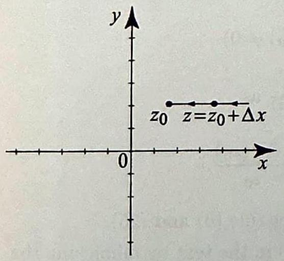
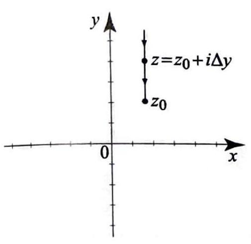
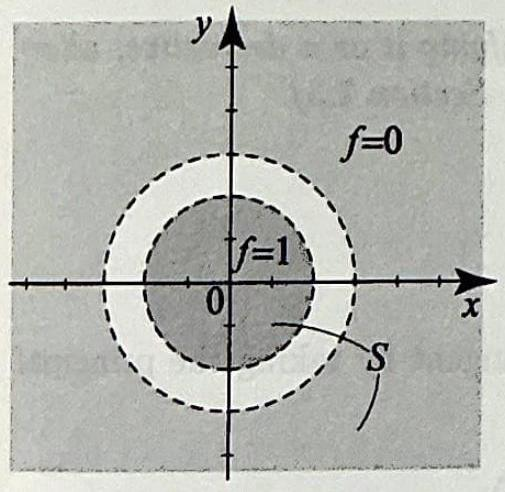

> [!review]
> 1. The existence of a complex derivative is far more restrictive than the existence of partial derivatives. What hidden relationship between the real and imaginary parts of $f=u+$ iv can be uncovered by computing $f^{\prime}\left(z_0\right)$ along two different approach paths and forcing the results to agree, and what can be said about the continuity of those partial derivatives? Prove your answer.
> 2. Conversely, what conditions on $u$ and $v$ are sufficient to guarantee that $f=u+i v$ is analytic on an open set, and why is this converse form often more useful in applications than the forward direction?

##### problem 1

The hidden relationship is that, if

$$
f(z)=u(x,y)+iv(x,y)
$$

is analytic, then the real and imaginary parts cannot vary independently. They must satisfy the Cauchy-Riemann equations

$$
u_x=v_y
\qquad\text{and}\qquad
u_y=-v_x.
$$

Moreover, in the presentation of this section, the partial derivatives

$$
u_x,\quad u_y,\quad v_x,\quad v_y
$$

are continuous.

The reason these relations appear is that the derivative

$$
f'(z_0)
$$

must have the same value no matter how $z$ approaches $z_0$. Write

$$
z_0=x_0+iy_0.
$$

Since $f$ is analytic at $z_0$, the derivative exists:

$$
f'(z_0)
=\lim_{z\to z_0}\frac{f(z)-f(z_0)}{z-z_0}
=\lim_{\Delta z\to 0}\frac{f(z_0+\Delta z)-f(z_0)}{\Delta z}.
$$

Now approach $z_0$ along the $x$-direction, so that

$$
\Delta z=\Delta x.
$$

Then

$$
\begin{aligned}
f'(z_0)
&=\lim_{\Delta x\to 0}\frac{f(x_0+\Delta x+iy_0)-f(x_0+iy_0)}{\Delta x}\\
&=\lim_{\Delta x\to 0}\frac{\bigl(u(x_0+\Delta x,y_0)+iv(x_0+\Delta x,y_0)\bigr)-\bigl(u(x_0,y_0)+iv(x_0,y_0)\bigr)}{\Delta x}\\
&=\lim_{\Delta x\to 0}\left(\frac{u(x_0+\Delta x,y_0)-u(x_0,y_0)}{\Delta x}+i\,\frac{v(x_0+\Delta x,y_0)-v(x_0,y_0)}{\Delta x}\right)\\
&=\lim_{\Delta x\to 0}\frac{u(x_0+\Delta x,y_0)-u(x_0,y_0)}{\Delta x}
+i\lim_{\Delta x\to 0}\frac{v(x_0+\Delta x,y_0)-v(x_0,y_0)}{\Delta x}\\
&=u_x(x_0,y_0)+iv_x(x_0,y_0).
\end{aligned}
$$

Next approach $z_0$ along the $y$-direction, so that

$$
\Delta z=i\Delta y.
$$

Then

$$
\begin{aligned}
f'(z_0)
&=\lim_{\Delta y\to 0}\frac{f(x_0+i(y_0+\Delta y))-f(x_0+iy_0)}{i\Delta y}\\
&=\lim_{\Delta y\to 0}\frac{\bigl(u(x_0,y_0+\Delta y)+iv(x_0,y_0+\Delta y)\bigr)-\bigl(u(x_0,y_0)+iv(x_0,y_0)\bigr)}{i\Delta y}\\
&=\lim_{\Delta y\to 0}\left(\frac{u(x_0,y_0+\Delta y)-u(x_0,y_0)}{i\Delta y}+i\,\frac{v(x_0,y_0+\Delta y)-v(x_0,y_0)}{i\Delta y}\right)\\
&=\lim_{\Delta y\to 0}\left(-i\,\frac{u(x_0,y_0+\Delta y)-u(x_0,y_0)}{\Delta y}+\frac{v(x_0,y_0+\Delta y)-v(x_0,y_0)}{\Delta y}\right)\\
&=\lim_{\Delta y\to 0}\frac{v(x_0,y_0+\Delta y)-v(x_0,y_0)}{\Delta y}
-i\lim_{\Delta y\to 0}\frac{u(x_0,y_0+\Delta y)-u(x_0,y_0)}{\Delta y}\\
&=v_y(x_0,y_0)-iu_y(x_0,y_0).
\end{aligned}
$$

But both computations represent the same complex number $f'(z_0)$. Therefore

$$
u_x(x_0,y_0)+iv_x(x_0,y_0)=v_y(x_0,y_0)-iu_y(x_0,y_0).
$$

Equating real and imaginary parts gives

$$
\begin{aligned}
u_x(x_0,y_0)&=v_y(x_0,y_0),\\
v_x(x_0,y_0)&=-u_y(x_0,y_0).
\end{aligned}
$$

That is,

$$
u_x=v_y
\qquad\text{and}\qquad
u_y=-v_x.
$$

So the existence of the complex derivative forces a very rigid compatibility between the real and imaginary parts. This is exactly the hidden relation the review question is asking about.

As for continuity, the section states that because $f$ is analytic, $f'$ is continuous. From the two formulas

$$
f'(z)=u_x(x,y)+iv_x(x,y)
$$

and

$$
f'(z)=v_y(x,y)-iu_y(x,y),
$$

it follows that

$$
u_x,\quad v_x,\quad u_y,\quad v_y
$$

are all continuous.

##### problem 2

Conversely, a sufficient condition for

$$
f=u+iv
$$

to be analytic on an open set $S$ is that the partial derivatives of $u$ and $v$ are continuous on $S$ and satisfy the Cauchy-Riemann equations throughout $S$:

$$
u_x=v_y
\qquad\text{and}\qquad
u_y=-v_x.
$$

Under these hypotheses, $f$ is analytic on $S$.

This converse form is often more useful in applications than the forward direction because, in practice, it is usually much easier to compute

$$
u_x,\quad u_y,\quad v_x,\quad v_y
$$

and check

$$
u_x=v_y,
\qquad
u_y=-v_x,
$$

than it is to return to the definition

$$
f'(z_0)=\lim_{\Delta z\to 0}\frac{f(z_0+\Delta z)-f(z_0)}{\Delta z}
$$

and prove directly that this limit exists and is independent of the way $\Delta z$ tends to $0$.

So the forward direction explains what analyticity forces, while the converse gives a practical test for analyticity. That is why, as the article says, the converse is especially useful in applications: to establish that a function is analytic, one often verifies the Cauchy-Riemann equations together with continuity of the partial derivatives rather than attacking the complex difference quotient directly.

+++++

The fact that the derivative of $\bar{z}$ does not exist (Example 4, Section 2.3) should tell you that there is something special about complex-valued functions with derivatives. As you will see, the existence of the derivative implies special relationships between the real and imaginary parts of the functions. These relationships are known as the Cauchy-Riemann equations, which we now derive.

Suppose that $f(z)=f(x+i y)=u(x, y)+i v(x, y)$ is analytic in an open set $S$ and let $z_{0}=x_{0}+i y_{0}=\left(x_{0}, y_{0}\right)$ be a point in $S$. Consequently, the derivative at $z_{0}$ exists and is given by

$$
f^{\prime}\left(z_{0}\right)=\lim _{z \rightarrow z_{0}} \frac{f(z)-f\left(z_{0}\right)}{z-z_{0}}=\lim _{\Delta z \rightarrow 0} \frac{f\left(z_{0}+\Delta z\right)-f\left(z_{0}\right)}{\Delta z}
$$

To derive the Cauchy-Riemann equations, we will simply compute this limit Suppose that $z$ approaches $z_{0}$ along the direction of the $x$-axis, as in _Figure 1_ . 
Then $z=z_{0}+\Delta x=\left(x_{0}+\Delta x, y_{0}\right), \Delta z=z-z_{0}=\Delta x$, and (1) becomes

$$
\begin{aligned}
& \text { 2) } f^{\prime}\left(z_{0}\right)=\lim _{\Delta x \rightarrow 0} \frac{f\left(x_{0}+\Delta x+i y_{0}\right)-f\left(x_{0}+i y_{0}\right)}{\Delta x} \\
& =\lim _{\Delta x \rightarrow 0}\left(\frac{u\left(x_{0}+\Delta x, y_{0}\right)-u\left(x_{0}, y_{0}\right)}{\Delta x}+i \frac{v\left(x_{0}+\Delta x, y_{0}\right)-v\left(x_{0}, y_{0}\right)}{\Delta x}\right) \\
& =\lim _{\Delta x \rightarrow 0} \frac{u\left(x_{0}+\Delta x, y_{0}\right)-u\left(x_{0}, y_{0}\right)}{\Delta x}+i \lim _{\Delta x \rightarrow 0} \frac{v\left(x_{0}+\Delta x, y_{0}\right)-v\left(x_{0}, y_{0}\right)}{\Delta x},
\end{aligned}
$$

where the last step is justified by Theorem 3, Section 2.2, which asserts that the limit of a complex-valued function exists if and only if the limits of its real and imaginary parts exist. 

> [!figure] Figure 1
> 
> 
> Figure 1 For $z$ approaching $z_{0}$ in the direction of the $x$ axis, $\Delta z=\Delta x$.

Recognizing the last two limits on the right as the partial derivatives with respect to $x$ of $u$ and $v$ (see (2) and (3), Section 2.1), we obtain
which is an expression of the derivative of $f$ in terms of the partial derivatives with respect to $x$ of $u$ and $v$. We now repeat the preceding steps, going back to (1) and taking the limit as $z$ approaches $z_{0}$ from the direction of the $y$ axis, as in _Figure 2_. Then $z=z_{0}+i \Delta y=\left(x_{0}, y_{0}+\Delta y\right), \Delta z=z-z_{0}=i \Delta y$. Proceed as in (2), note that $i \Delta y \rightarrow 0$ if and only if $\Delta y \rightarrow 0$, and obtain

$$
\begin{aligned}
& f^{\prime}\left(z_{0}\right)=\lim _{\Delta y \rightarrow 0} \frac{f\left(x_{0}+i\left(y_{0}+\Delta y\right)\right)-f\left(x_{0}+i y_{0}\right)}{i \Delta y} \\
= & \lim _{\Delta y \rightarrow 0}\left(\frac{u\left(x_{0}, y_{0}+\Delta y\right)-u\left(x_{0}, y_{0}\right)}{i \Delta y}+i \frac{v\left(x_{0}, y_{0}+\Delta y\right)-v\left(x_{0}, y_{0}\right)}{i \Delta y}\right) \\
= & \lim _{\Delta y \rightarrow 0} \frac{v\left(x_{0}, y_{0}+\Delta y\right)-v\left(x_{0}, y_{0}\right)}{\Delta y}-i \lim _{\Delta y \rightarrow 0} \frac{u\left(x_{0}, y_{0}+\Delta y\right)-u\left(x_{0}, y_{0}\right)}{\Delta y},
\end{aligned}
$$

where in the last step we have used $1 / i=-i$ and rearranged the terms. 

> [!figure] Figure 2
> 
> 
> Figure 2 For $z$ approaching $z_{0}$ in the direction of the $y$ axis, $\Delta z=i \Delta y$.

Recognizing the partial derivatives with respect to $y$ of $v$ and $u$, we obtain

$$
f^{\prime}\left(z_{0}\right)=\frac{\partial v}{\partial y}\left(x_{0}, y_{0}\right)-i \frac{\partial u}{\partial y}\left(x_{0}, y_{0}\right),
$$

which is this time an expression of the derivative of $f$ in terms of the partial derivatives with respect to $y$ of $u$ and $v$. Now comes the startling result. Equate real and imaginary parts in (3) and (5) and get

> [!equation] The Cauchy-Reimann Equations
> 
> $$
> \frac{\partial u}{\partial x}=\frac{\partial v}{\partial y} \quad \text { and } \quad \frac{\partial u}{\partial y}=-\frac{\partial v}{\partial x}
> $$
> 

Thus, in order for $f$ to be analytic, $u$ and $v$ must satisfy the Cauchy-Riemann equations. Moreover, since $f$ is analytic, $f^{\prime}$ is continuous, and it follows from (3) and (5) and Theorem 4(iv), Section 2.2, that $\frac{\partial u}{\partial x}, \frac{\partial v}{\partial x}, \frac{\partial u}{\partial y}$, and $\frac{\partial v}{\partial y}$ are all continuous. The converse of these statements is also true. In applications, we will need the converse, since to establish the analyticity of a function, it is often easier to check the Cauchy-Riemann equations and the continuity of the partial derivatives. Because the proof of the converse requires advanced topics from calculus of several variables, we postpone it until Section 2.6, where it will be treated in detail. Let us now summarize our discussion
and proceed with the applications. To simplify the notation, we will denote partial derivatives with subscripts, $\frac{\partial u}{\partial x}=u_{x}, \frac{\partial u}{\partial y}=u_{y}$, and so on.

> [!review]
> 1. How can the analyticity of $f=u+i v$ on an open set be characterized in terms of the partial derivatives of $u$ and $v$ ?
> 2. If $f=u+i v$ is analytic on an open set, how can the derivative $f^{\prime}(z)$ be expressed in terms of the partial derivatives of $u$ and $v$ ? Give two equivalent expressions.

##### problem 1

The analyticity of

$$
f=u+iv
$$

on an open set is characterized by the Cauchy-Riemann theorem: $f$ is analytic on the open set if and only if the partial derivatives of $u$ and $v$ are continuous there and satisfy the Cauchy-Riemann equations

$$
u_x=v_y
\qquad\text{and}\qquad
u_y=-v_x.
$$

So analyticity is equivalent to two requirements taken together:

$$
\text{continuity of }u_x,u_y,v_x,v_y
$$

and

$$
u_x=v_y,\qquad u_y=-v_x.
$$

##### problem 2

If

$$
f=u+iv
$$

is analytic on an open set, then its derivative can be written in either of the two equivalent forms

$$
f'(z)=u_x(x,y)+iv_x(x,y)
$$

or

$$
f'(z)=v_y(x,y)-iu_y(x,y).
$$

These two expressions agree because, for an analytic function, the Cauchy-Riemann equations hold:

$$
u_x=v_y
\qquad\text{and}\qquad
v_x=-u_y.
$$

Thus the derivative may be computed either from the partial derivatives with respect to $x$ or from the partial derivatives with respect to $y$.

+++++

> [!theorem] Theorem 1: The Cauchy-Reimann Equations
> The function $f(z)=u(x, y)+i v(x, y)$ is analytic in an open set $S$ if and only if the partial derivatives of $u$ and $v$ are continuous and satisfy the Cauchy-Riemann equations
> (7)
> 
> $$
> u_{x}=v_{y} \quad \text { and } \quad u_{y}=-v_{x} .
> $$
> 
> The derivative $f^{\prime}(z)$ is given as either of
> 
> $$
> f^{\prime}(z)=u_{x}(x, y)+i v_{x}(x, y) \text { or } f^{\prime}(z)=v_{y}(x, y)-i u_{y}(x, y) .
> $$
> 

The Cauchy-Riemann equations appeared in 1821 in the early work of Cauchy on integrals of complex-valued functions. Their connection to the existence of the derivative, as stated in Theorem 1, appeared in 1851 in the doctoral dissertation of the great German mathematician, Bernhard Riemann (1826-1866). As it should be obvious to any one who has studied calculus, Riemann's work shaped the development of modern calculus. His study of complex functions was motivated by his work in hydrodynamics, fluid flow and other applied problems. Some of these applications and their connection to the Cauchy-Riemann equations will be explored in the following section and Chapter 6.

Our first example is perhaps the most important example of an analytic function.

> [!exercise] Exercise 1: $e^z$ is entire.
> 
> 1.) Show that $e^{z}$ is entire and
> 
> $$
> \frac{d}{d z} e^{z}=e^{z} .
> $$
> 
> 
> 2.) Show that if $f(z)$ is analytic on an open set, then $e^{f(z)}$ is analytic on that set and
> 
> $$
> \frac{d}{d z} e^{f(z)}=f^{\prime}(z) e^{f(z)}
> $$
> 
> 

##### solution

We treat the two parts separately.

##### problem 1

To show that

$$
e^z
$$

is entire, write

$$
z=x+iy.
$$

Then

$$
\begin{aligned}
e^z
&=e^{x+iy}\\
&=e^x e^{iy}\\
&=e^x(\cos y+i\sin y).
\end{aligned}
$$

So the real and imaginary parts are

$$
u(x,y)=e^x\cos y
\qquad\text{and}\qquad
v(x,y)=e^x\sin y.
$$

Now compute the partial derivatives:

$$
\begin{aligned}
u_x&=\frac{\partial}{\partial x}(e^x\cos y)=e^x\cos y,\\
u_y&=\frac{\partial}{\partial y}(e^x\cos y)=-e^x\sin y,\\
v_x&=\frac{\partial}{\partial x}(e^x\sin y)=e^x\sin y,\\
v_y&=\frac{\partial}{\partial y}(e^x\sin y)=e^x\cos y.
\end{aligned}
$$

Therefore

$$
u_x=v_y
\qquad\text{and}\qquad
u_y=-v_x.
$$

The partial derivatives are continuous everywhere in $\mathbb C$, so by the Cauchy-Riemann theorem,

$$
e^z
$$

is analytic everywhere. Hence $e^z$ is entire.

To compute its derivative, use either formula from Theorem 1:

$$
\begin{aligned}
\frac{d}{dz}e^z
&=u_x+iv_x\\
&=e^x\cos y+i e^x\sin y\\
&=e^x(\cos y+i\sin y)\\
&=e^z.
\end{aligned}
$$

Thus

$$
\frac{d}{dz}e^z=e^z.
$$

##### problem 2

Now suppose that

$$
f(z)
$$

is analytic on an open set $S$.

Since part (1) shows that the exponential function is entire, it is analytic at every complex number. Therefore we may compose it with $f$. Because the composition of analytic functions is analytic wherever the inside function is analytic, it follows that

$$
e^{f(z)}
$$

is analytic on $S$.

To compute its derivative, apply the chain rule:

$$
\begin{aligned}
\frac{d}{dz}e^{f(z)}
&=\left(\frac{d}{dw}e^w\right)\bigg|_{w=f(z)}\cdot f'(z)\\
&=e^{f(z)}f'(z).
\end{aligned}
$$

Hence

$$
\frac{d}{dz}e^{f(z)}=f'(z)e^{f(z)}.
$$

++++

Combining the chain rule with the result of Example 1, we see that $e^{f(z)}$ is analytic wherever $f(z)$ is analytic and

$$
\frac{d}{d z} e^{f(z)}=f^{\prime}(z) e^{f(z)}
$$

> [!exercise] Exercise 2: $\sin z$ is entire.
> Show that $\sin z$ is entire and
> 
> $$
> \frac{d}{d z} \sin z=\cos z
> $$
> 

##### solution

Write

$$
z=x+iy.
$$

Then

$$
\begin{aligned}
\sin z
&=\sin(x+iy)\\
&=\sin x\cos(iy)+\cos x\sin(iy).
\end{aligned}
$$

Now use

$$
\cos(iy)=\cosh y
\qquad\text{and}\qquad
\sin(iy)=i\sinh y.
$$

Thus

$$
\begin{aligned}
\sin z
&=\sin x\cosh y+i\cos x\sinh y.
\end{aligned}
$$

So the real and imaginary parts are

$$
u(x,y)=\sin x\cosh y
\qquad\text{and}\qquad
v(x,y)=\cos x\sinh y.
$$

Now compute the partial derivatives:

$$
\begin{aligned}
u_x&=\frac{\partial}{\partial x}(\sin x\cosh y)=\cos x\cosh y,\\
u_y&=\frac{\partial}{\partial y}(\sin x\cosh y)=\sin x\sinh y,\\
v_x&=\frac{\partial}{\partial x}(\cos x\sinh y)=-\sin x\sinh y,\\
v_y&=\frac{\partial}{\partial y}(\cos x\sinh y)=\cos x\cosh y.
\end{aligned}
$$

Therefore

$$
u_x=v_y
\qquad\text{and}\qquad
u_y=-v_x.
$$

Since these partial derivatives are continuous everywhere in $\mathbb C$, the Cauchy-Riemann theorem shows that

$$
\sin z
$$

is analytic everywhere. Hence $\sin z$ is entire.

To compute its derivative, use

$$
\begin{aligned}
\frac{d}{dz}\sin z
&=u_x+iv_x\\
&=\cos x\cosh y+i(-\sin x\sinh y)\\
&=\cos x\cosh y-i\sin x\sinh y.
\end{aligned}
$$

But

$$
\begin{aligned}
\cos z
&=\cos(x+iy)\\
&=\cos x\cos(iy)-\sin x\sin(iy)\\
&=\cos x\cosh y-\sin x(i\sinh y)\\
&=\cos x\cosh y-i\sin x\sinh y.
\end{aligned}
$$

Therefore

$$
\frac{d}{dz}\sin z=\cos z.
$$

++++

Following the methods of Example 2, we can check the analyticity and compute the derivatives of $\cos z, \tan z$, and all other trigonometric and hyperbolic functions. Among the elementary functions, we are then left with
the logarithm and those functions defined using the logarithm, such as complex powers. To handle them, we will appeal to Theorem 4, Section 2.3.

> [!exercise] Exercise 3: $\log z$ is analytic except on the branch cut.
> Show that the principal branch of the logarithm, $\log z$, is analytic on $\mathbb{C} \backslash(-\infty, 0]$, and that
> 
> $$
> \frac{d}{d z} \log z=\frac{1}{z}
> $$
> 
> Thus the familiar formula from calculus still holds.

##### solution

For the principal branch of the logarithm, we write

$$
z=x+iy=re^{i\theta},
$$

where

$$
r=|z|=\sqrt{x^2+y^2}
$$

and the principal argument satisfies

$$
-\pi<\theta<\pi.
$$

Thus the principal branch is

$$
\log z=\ln r+i\theta.
$$

This function is defined only when

$$
r>0
$$

and when the argument can be chosen continuously with

$$
-\pi<\theta<\pi.
$$

That excludes the origin and the negative real axis. Therefore the principal branch is defined on

$$
\mathbb C\setminus(-\infty,0].
$$

To show that it is analytic there, write

$$
\log z=u(x,y)+iv(x,y),
$$

where

$$
u(x,y)=\ln r=\frac12\ln(x^2+y^2)
$$

and

$$
v(x,y)=\operatorname{Arg} z.
$$

On the slit plane, the principal argument can be written piecewise as

$$
v(x,y)=
\begin{cases}
\arctan(y/x), & x>0,\\[4pt]
\pi+\arctan(y/x), & x<0,\ y>0,\\[4pt]
-\pi+\arctan(y/x), & x<0,\ y<0.
\end{cases}
$$

The added constants $\pm\pi$ do not affect the partial derivatives, so throughout the slit plane we may compute the derivatives of $v$ from the $\arctan(y/x)$ part.

First compute the partial derivatives of $u$:

$$
\begin{aligned}
u_x
&=\frac{\partial}{\partial x}\left(\frac12\ln(x^2+y^2)\right)\\
&=\frac12\cdot\frac{1}{x^2+y^2}\cdot 2x\\
&=\frac{x}{x^2+y^2},
\end{aligned}
$$

and

$$
\begin{aligned}
u_y
&=\frac{\partial}{\partial y}\left(\frac12\ln(x^2+y^2)\right)\\
&=\frac12\cdot\frac{1}{x^2+y^2}\cdot 2y\\
&=\frac{y}{x^2+y^2}.
\end{aligned}
$$

Now compute the partial derivatives of $v$. Since

$$
v(x,y)=\arctan(y/x)
$$

up to an additive constant on each piece of the domain, we have

$$
\begin{aligned}
v_x
&=\frac{1}{1+(y/x)^2}\cdot\frac{\partial}{\partial x}\left(\frac{y}{x}\right)\\
&=\frac{1}{1+y^2/x^2}\cdot\left(-\frac{y}{x^2}\right)\\
&=\frac{x^2}{x^2+y^2}\cdot\left(-\frac{y}{x^2}\right)\\
&=-\frac{y}{x^2+y^2},
\end{aligned}
$$

and

$$
\begin{aligned}
v_y
&=\frac{1}{1+(y/x)^2}\cdot\frac{\partial}{\partial y}\left(\frac{y}{x}\right)\\
&=\frac{1}{1+y^2/x^2}\cdot\frac{1}{x}\\
&=\frac{x^2}{x^2+y^2}\cdot\frac{1}{x}\\
&=\frac{x}{x^2+y^2}.
\end{aligned}
$$

Therefore

$$
u_x=\frac{x}{x^2+y^2}=v_y
$$

and

$$
u_y=\frac{y}{x^2+y^2}=-\left(-\frac{y}{x^2+y^2}\right)=-v_x.
$$

So the Cauchy-Riemann equations hold on

$$
\mathbb C\setminus(-\infty,0].
$$

The partial derivatives are continuous there, because their denominators are

$$
x^2+y^2,
$$

which never vanish on the slit plane. Hence, by the Cauchy-Riemann theorem, the principal branch of $\log z$ is analytic on

$$
\mathbb C\setminus(-\infty,0].
$$

To compute its derivative, use the formula

$$
f'(z)=u_x+iv_x.
$$

Then

$$
\begin{aligned}
\frac{d}{dz}\log z
&=u_x+iv_x\\
&=\frac{x}{x^2+y^2}+i\left(-\frac{y}{x^2+y^2}\right)\\
&=\frac{x-iy}{x^2+y^2}.
\end{aligned}
$$

Now simplify:

$$
\begin{aligned}
\frac{x-iy}{x^2+y^2}
&=\frac{x-iy}{(x+iy)(x-iy)}\\
&=\frac{1}{x+iy}\\
&=\frac{1}{z}.
\end{aligned}
$$

Therefore

$$
\frac{d}{dz}\log z=\frac{1}{z}.
$$

Thus the familiar calculus formula remains valid on the domain of analyticity of the principal branch.

++++

> [!review]
> 1. Where is each branch $\log _\alpha z$ of the logarithm analytic, and what is its derivative? Prove your answer.
> 2. For a complex constant $a \neq 0$, where is the principal branch of the power $z^a=e^{a \log z}$ analytic, and what is its derivative? Prove your answer.

##### problem 1

Each branch

$$
\log_\alpha z
$$

of the logarithm is analytic on the complex plane with its branch cut removed. If the branch cut is the ray at angle $\alpha$, then the domain of analyticity is

$$
\mathbb C\setminus\{re^{i\alpha}:r\ge 0\}.
$$

On that domain, the derivative is

$$
\frac{d}{dz}\log_\alpha z=\frac{1}{z}.
$$

To justify this, write

$$
z=re^{i\theta},
$$

where $\theta$ is chosen continuously on the slit plane determined by the branch. Then

$$
\log_\alpha z=\ln r+i\theta.
$$

This has exactly the same local form as the principal branch of the logarithm; only the allowed interval for $\theta$ changes. Since the added branch constant changes the argument by integer multiples of $2\pi$, it does not change the partial derivatives. Therefore the same Cauchy-Riemann computation used for the principal branch applies on the slit plane for $\log_\alpha z$ as well, and shows that the function is analytic there.

The derivative is then computed in the same way:

$$
\begin{aligned}
\frac{d}{dz}\log_\alpha z
&=u_x+iv_x\\
&=\frac{x-iy}{x^2+y^2}\\
&=\frac{1}{x+iy}\\
&=\frac{1}{z}.
\end{aligned}
$$

So every branch of the logarithm is analytic away from its branch cut, with derivative $1/z$.

##### problem 2

Let

$$
z^a=e^{a\log z},
$$

where $a\ne 0$ is a complex constant and $\log z$ denotes the principal branch of the logarithm.

Since the principal branch of $\log z$ is analytic on

$$
\mathbb C\setminus(-\infty,0],
$$

and the exponential function is entire, the composition

$$
z^a=e^{a\log z}
$$

is analytic on

$$
\mathbb C\setminus(-\infty,0].
$$

Now differentiate using the chain rule:

$$
\begin{aligned}
\frac{d}{dz}z^a
&=\frac{d}{dz}e^{a\log z}\\
&=e^{a\log z}\cdot\frac{d}{dz}(a\log z)\\
&=e^{a\log z}\cdot a\frac{d}{dz}\log z\\
&=e^{a\log z}\cdot a\frac{1}{z}\\
&=a\frac{e^{a\log z}}{z}\\
&=a\frac{z^a}{z}\\
&=az^{a-1}.
\end{aligned}
$$

Thus the principal branch of the power is analytic on the slit plane

$$
\mathbb C\setminus(-\infty,0]
$$

and satisfies

$$
\frac{d}{dz}z^a=az^{a-1},
$$

where both sides are interpreted using principal branches.

+++++

Using the method of Example 3, we can show that any branch of the logarithm, $\log _{\alpha} z$, is analytic everywhere except at its branch cut (the ray at angle $\alpha$ ), and

$$
\frac{d}{d z} \log _{\alpha} z=\frac{1}{z}
$$

As a consequence, any function constructed from the logarithms according to rules that preserve analyticity will be analytic on an appropriate domain. As an illustration, take the principal branch of a power,

$$
z^{a}=e^{a \log z} \quad(\text { where } a \neq 0 \text { is a complex number }) .
$$

Since $\log z$ is analytic except at its branch cut, and $e^{z}$ is entire, it follows that $z^{a}$ is analytic, except at the branch cut of $\log z$. To compute its derivative, we use the chain rule and the derivatives of $e^{z}$ and $\log z$ and get

$$
\frac{d}{d z} z^{a}=a z^{a-1}
$$

with principal branches of the power on both sides.
We started this section with the example of $\bar{z}$ and how it fails to be analytic at all points. This should be obvious now from the Cauchy-Riemann equations. If you write $\bar{z}=x-i y$, then $u_{x}=1, v_{y}=-1$, showing that the Cauchy-Riemann equations do not hold at any point. As our next example illustrates, we can use the Cauchy-Riemann equations to show the failure of analyticity in less obvious situations.

> [!exercise] Exercise 4: Failure of analyticity
> Use the Cauchy-Riemann equations to show that $f(z)=x^{2}+i(2 y+x)$ fails to be analytic at all points.

##### solution

Write

$$
f(z)=x^2+i(2y+x)
$$

in the form

$$
f(z)=u(x,y)+iv(x,y),
$$

where

$$
u(x,y)=x^2
\qquad\text{and}\qquad
v(x,y)=2y+x.
$$

Now compute the partial derivatives:

$$
\begin{aligned}
u_x&=2x,\\
u_y&=0,\\
v_x&=1,\\
v_y&=2.
\end{aligned}
$$

For analyticity, the Cauchy-Riemann equations would require

$$
u_x=v_y
\qquad\text{and}\qquad
u_y=-v_x.
$$

That is, we would need

$$
2x=2
$$

and

$$
0=-1.
$$

The second equation is impossible at every point. Therefore the Cauchy-Riemann equations fail everywhere.

Hence

$$
f(z)=x^2+i(2y+x)
$$

is not analytic at any point of $\mathbb C$.

++++

> [!review]
> 1. If the Cauchy-Riemann equations hold at a single point of a function's domain, is the function necessarily analytic at that point?
> 2. If an analytic function has zero derivative throughout a region $\Omega$, what can be concluded about the function on $\Omega$ ? Prove your answer.
> 3. Is it possible for a non-constant analytic function to have zero derivative throughout its domain?
> 4. If two analytic functions on a region have the same real part, or the same imaginary part, what can be concluded about their relationship on the region? Prove your answer.

##### problem 1

No. If the Cauchy-Riemann equations hold at only a single point, that does not imply that the function is analytic at that point.

Analyticity is a local property on an open neighborhood. The Cauchy-Riemann equations must hold in a neighborhood of the point, together with the needed regularity assumptions, in order to conclude analyticity. So agreement at one isolated point is not enough.

##### problem 2

If an analytic function has zero derivative throughout a region

$$
\Omega,
$$

then the function is constant on $\Omega$.

To prove this, write

$$
f(z)=u(x,y)+iv(x,y).
$$

Since

$$
f'(z)=0
$$

for every $z\in\Omega$, and since for an analytic function

$$
f'(z)=u_x+iv_x,
$$

we get

$$
u_x=0
\qquad\text{and}\qquad
v_x=0
$$

throughout $\Omega$.

Because $f$ is analytic, the Cauchy-Riemann equations also hold:

$$
u_x=v_y
\qquad\text{and}\qquad
u_y=-v_x.
$$

Using

$$
u_x=0
\qquad\text{and}\qquad
v_x=0,
$$

we obtain

$$
v_y=u_x=0
\qquad\text{and}\qquad
u_y=-v_x=0.
$$

Therefore

$$
u_x=u_y=0
\qquad\text{and}\qquad
v_x=v_y=0
$$

everywhere on $\Omega$.

So both the real part $u$ and the imaginary part $v$ have zero partial derivatives throughout the region. Hence neither $u$ nor $v$ changes as one moves through the connected set $\Omega$. Therefore both are constant on $\Omega$, and so

$$
f=u+iv
$$

is constant on $\Omega$.

##### problem 3

No. A non-constant analytic function cannot have zero derivative throughout its domain, provided the domain is a region.

Indeed, problem 2 shows that if an analytic function satisfies

$$
f'(z)=0
$$

everywhere on a region, then the function must be constant there. So zero derivative everywhere forces constancy.

The only way to have derivative zero everywhere and still not be constant is for the domain to fail to be connected. That is why connectedness is built into the definition of region and is essential in Theorem 2.

##### problem 4

If two analytic functions on a region have the same real part, or the same imaginary part, then they differ by a constant:

$$
f(z)=g(z)+c
$$

for some constant $c$.

To prove this, first suppose

$$
\operatorname{Re} f=\operatorname{Re} g
$$

on the region $\Omega$. Consider the difference

$$
h(z)=f(z)-g(z).
$$

Then $h$ is analytic on $\Omega$, and its real part is

$$
\operatorname{Re} h=\operatorname{Re} f-\operatorname{Re} g=0.
$$

So we may write

$$
h(z)=0+i\,v(x,y)=iv(x,y).
$$

Thus its real part is identically zero. For $h$, the Cauchy-Riemann equations become

$$
u_x=v_y
\qquad\text{and}\qquad
u_y=-v_x.
$$

But here

$$
u=0,
$$

so

$$
u_x=0
\qquad\text{and}\qquad
u_y=0.
$$

Hence

$$
v_y=0
\qquad\text{and}\qquad
v_x=0.
$$

Therefore $v$ is constant on the region, so

$$
h(z)=ic
$$

for some real constant $c$. Equivalently,

$$
f(z)=g(z)+ic.
$$

This is of the form

$$
f(z)=g(z)+c
$$

with $c$ constant.

Now suppose instead that

$$
\operatorname{Im} f=\operatorname{Im} g.
$$

Then for the same difference

$$
h(z)=f(z)-g(z),
$$

we have

$$
\operatorname{Im} h=0.
$$

So write

$$
h(z)=u(x,y)+i0=u(x,y).
$$

Applying the Cauchy-Riemann equations to $h$ gives

$$
u_x=0
\qquad\text{and}\qquad
u_y=0,
$$

so $u$ is constant on the region. Therefore

$$
h(z)=c
$$

for some real constant $c$, and hence again

$$
f(z)=g(z)+c.
$$

So in either case, equality of real parts or equality of imaginary parts forces the two analytic functions to differ by a constant on the region.

+++++

The Cauchy-Riemann equations may hold only at one point (see Exercise 13 for an illustration). This does not imply that the function is analytic at that point, since analyticity requires that these equations be satisfied in a neighborhood.

The final applications show how the Cauchy-Riemann equations can be used to derive important results of theoretical nature.

> [!theorem] Theorem 2
> Suppose that $f(z)=u(x, y)+i v(x, y)$ is analytic in a region (open and connected) $\Omega$ and $f^{\prime}(z)=0$ for all $z$ in $\Omega$. Then $f$ is constant in $\Omega$.

The connectedness of $\Omega$ in the theorem is essential. For example, the function $f$, defined on the set $S$ in _Figure 3_, by

$$
f(z)= \begin{cases}1 & \text { if }|z|<2 \\ 0 & \text { if }|z|>3\end{cases}
$$

has zero derivative but is not constant.

> [!figure] Figure 3
> 
> 
> Figure 3 A nonconstant function with zero derivative. Its domain of definition is the nonconnected shaded area.

> [!corollary] Corollary 3 
> Suppose that $f$ and $g$ are analytic in a region $\Omega$. If either $\operatorname{Re} f=\operatorname{Re} g$ on $\Omega$ or $\operatorname{Im} f=\operatorname{Im} g$ on $\Omega$, then $f(z)=g(z)+c$ on $\Omega$, where $c$ is a constant.

**Proof** 

# Exercises 2.4

> [!exercise] Exercise 5
> In problems 1-14, use the Cauchy-Riemann equations (Theorem 1) to determine the set on which the given function is analytic and compute its derivative using either one of equations (8).
> 
> 1. $z$.
> 2. $z^{2}$.
> 3. $e^{z^{2}}$.
> 4. $2 x+3 i y$.
> 5. $e^{\bar{z}}$.
> 6. $\frac{y-i x}{x^{2}+y^{2}}$.
> 7. $\left(\frac{1}{z+1}\right)^{2}$.
> 8. $\frac{z}{z-i}$.
> 9. $z e^{z}$.
> 10. $\cos z$.
> 11. $\tan z$.
> 12. $\cosh z$.
> 13. $|z|^{2}$.
> 14. $\frac{x^{4}+i 2 x y\left(x^{2}+y^{2}\right)-y^{4}+x-i y}{x^{2}+y^{2}}$.
> 
> 

##### solution

##### problem 1

For

$$
f(z)=z=x+iy,
$$

we have

$$
u(x,y)=x,
\qquad
v(x,y)=y.
$$

Then

$$
u_x=1,\quad u_y=0,\quad v_x=0,\quad v_y=1.
$$

So

$$
u_x=v_y
\qquad\text{and}\qquad
u_y=-v_x
$$

everywhere. Hence $f$ is analytic on all of $\mathbb C$, and

$$
f'(z)=u_x+iv_x=1.
$$

##### problem 2

For

$$
f(z)=z^2=(x+iy)^2=(x^2-y^2)+i(2xy),
$$

we have

$$
u(x,y)=x^2-y^2,
\qquad
v(x,y)=2xy.
$$

Then

$$
u_x=2x,\quad u_y=-2y,\quad v_x=2y,\quad v_y=2x.
$$

Thus

$$
u_x=v_y
\qquad\text{and}\qquad
u_y=-v_x
$$

everywhere. Therefore $z^2$ is analytic on $\mathbb C$, and

$$
f'(z)=u_x+iv_x=2x+i2y=2z.
$$

##### problem 3

Since

$$
z^2
$$

is analytic on $\mathbb C$ and

$$
e^w
$$

is entire, the composition

$$
f(z)=e^{z^2}
$$

is analytic on all of $\mathbb C$.

Its derivative is

$$
\begin{aligned}
f'(z)
&=\frac{d}{dz}e^{z^2}\\
&=e^{z^2}\frac{d}{dz}(z^2)\\
&=2ze^{z^2}.
\end{aligned}
$$

##### problem 4

For

$$
f(z)=2x+3iy,
$$

we have

$$
u(x,y)=2x,
\qquad
v(x,y)=3y.
$$

Then

$$
u_x=2,\quad u_y=0,\quad v_x=0,\quad v_y=3.
$$

Since

$$
u_x\ne v_y,
$$

the Cauchy-Riemann equations fail everywhere. Thus $f$ is analytic nowhere.

##### problem 5

For

$$
f(z)=e^{\bar z}=e^{x-iy}=e^x(\cos y-i\sin y),
$$

we have

$$
u(x,y)=e^x\cos y,
\qquad
v(x,y)=-e^x\sin y.
$$

Then

$$
u_x=e^x\cos y,
\qquad
u_y=-e^x\sin y,
$$

and

$$
v_x=-e^x\sin y,
\qquad
v_y=-e^x\cos y.
$$

The Cauchy-Riemann equations would require

$$
e^x\cos y=-e^x\cos y
$$

and

$$
-e^x\sin y=-(-e^x\sin y)=e^x\sin y.
$$

These become

$$
\cos y=0
\qquad\text{and}\qquad
\sin y=0,
$$

which can never hold simultaneously. Therefore $e^{\bar z}$ is analytic nowhere.

##### problem 6

For

$$
f(z)=\frac{y-ix}{x^2+y^2},
$$

write

$$
u(x,y)=\frac{y}{x^2+y^2},
\qquad
v(x,y)=\frac{-x}{x^2+y^2},
$$

defined for

$$
z\ne 0.
$$

Now compute:

$$
\begin{aligned}
u_x
&=\frac{\partial}{\partial x}\left(y(x^2+y^2)^{-1}\right)\\
&=y(-1)(x^2+y^2)^{-2}(2x)\\
&=-\frac{2xy}{(x^2+y^2)^2},
\end{aligned}
$$

$$
\begin{aligned}
u_y
&=\frac{(x^2+y^2)-2y^2}{(x^2+y^2)^2}\\
&=\frac{x^2-y^2}{(x^2+y^2)^2},
\end{aligned}
$$

$$
\begin{aligned}
v_x
&=\frac{-(x^2+y^2)+2x^2}{(x^2+y^2)^2}\\
&=\frac{x^2-y^2}{(x^2+y^2)^2},
\end{aligned}
$$

and

$$
\begin{aligned}
v_y
&=\frac{2xy}{(x^2+y^2)^2}.
\end{aligned}
$$

So the Cauchy-Riemann equations require

$$
-\frac{2xy}{(x^2+y^2)^2}=\frac{2xy}{(x^2+y^2)^2}
$$

and

$$
\frac{x^2-y^2}{(x^2+y^2)^2}=-\frac{x^2-y^2}{(x^2+y^2)^2}.
$$

Equivalently,

$$
xy=0
\qquad\text{and}\qquad
x^2-y^2=0.
$$

These force

$$
x=y=0,
$$

but the function is not even defined there. Hence the Cauchy-Riemann equations fail at every point of its domain, so $f$ is analytic nowhere.

##### problem 7

The function

$$
f(z)=\left(\frac{1}{z+1}\right)^2=\frac{1}{(z+1)^2}
$$

is analytic wherever

$$
z+1\ne 0,
$$

that is, on

$$
\mathbb C\setminus\{-1\}.
$$

Its derivative is

$$
\begin{aligned}
f'(z)
&=\frac{d}{dz}(z+1)^{-2}\\
&=-2(z+1)^{-3}\\
&=-\frac{2}{(z+1)^3}.
\end{aligned}
$$

##### problem 8

The function

$$
f(z)=\frac{z}{z-i}
$$

is analytic wherever

$$
z-i\ne 0,
$$

that is, on

$$
\mathbb C\setminus\{i\}.
$$

Its derivative is

$$
\begin{aligned}
f'(z)
&=\frac{(z-i)\cdot 1-z\cdot 1}{(z-i)^2}\\
&=\frac{z-i-z}{(z-i)^2}\\
&=-\frac{i}{(z-i)^2}.
\end{aligned}
$$

##### problem 9

Since both

$$
z
\qquad\text{and}\qquad
e^z
$$

are entire, their product

$$
f(z)=ze^z
$$

is entire.

Its derivative is

$$
\begin{aligned}
f'(z)
&=(ze^z)'\\
&=1\cdot e^z+z\cdot e^z\\
&=(z+1)e^z.
\end{aligned}
$$

##### problem 10

The function

$$
f(z)=\cos z
$$

is entire. Its derivative is

$$
\begin{aligned}
f'(z)
&=-\sin z.
\end{aligned}
$$

##### problem 11

The function

$$
f(z)=\tan z=\frac{\sin z}{\cos z}
$$

is analytic wherever

$$
\cos z\ne 0.
$$

The zeros of $\cos z$ are

$$
z=\frac{\pi}{2}+k\pi,
\qquad k\in\mathbb Z.
$$

So $\tan z$ is analytic on

$$
\mathbb C\setminus\left\{\frac{\pi}{2}+k\pi:k\in\mathbb Z\right\}.
$$

Its derivative is

$$
\begin{aligned}
f'(z)
&=\left(\frac{\sin z}{\cos z}\right)'\\
&=\frac{\cos z\cos z-\sin z(-\sin z)}{\cos^2 z}\\
&=\frac{\cos^2 z+\sin^2 z}{\cos^2 z}\\
&=\frac{1}{\cos^2 z}\\
&=\sec^2 z.
\end{aligned}
$$

##### problem 12

The function

$$
f(z)=\cosh z
$$

is entire. Its derivative is

$$
\begin{aligned}
f'(z)
&=\sinh z.
\end{aligned}
$$

##### problem 13

For

$$
f(z)=|z|^2=x^2+y^2,
$$

we have

$$
u(x,y)=x^2+y^2,
\qquad
v(x,y)=0.
$$

Thus

$$
u_x=2x,\quad u_y=2y,\quad v_x=0,\quad v_y=0.
$$

The Cauchy-Riemann equations require

$$
2x=0
\qquad\text{and}\qquad
2y=0.
$$

So they hold only at

$$
(x,y)=(0,0).
$$

But analyticity requires the equations to hold in a neighborhood, not merely at one point. Hence $|z|^2$ is analytic nowhere.

##### problem 14

Let

$$
f(z)=\frac{x^{4}+i\,2xy(x^{2}+y^{2})-y^{4}+x-iy}{x^{2}+y^{2}}.
$$

For

$$
z\ne 0,
$$

we simplify the numerator:

$$
\begin{aligned}
x^{4}-y^{4}+i\,2xy(x^{2}+y^{2})+x-iy
&=(x^{2}+y^{2})(x^{2}-y^{2}+2ixy)+(x-iy)\\
&=(x^{2}+y^{2})z^{2}+(x-iy).
\end{aligned}
$$

Since

$$
\frac{x-iy}{x^{2}+y^{2}}=\frac{1}{x+iy}=\frac{1}{z},
$$

we get

$$
\begin{aligned}
f(z)
&=\frac{(x^{2}+y^{2})z^{2}+(x-iy)}{x^{2}+y^{2}}\\
&=z^{2}+\frac{x-iy}{x^{2}+y^{2}}\\
&=z^{2}+\frac{1}{z}.
\end{aligned}
$$

Therefore $f$ is analytic on

$$
\mathbb C\setminus\{0\}.
$$

Its derivative is

$$
\begin{aligned}
f'(z)
&=\frac{d}{dz}\left(z^{2}+\frac{1}{z}\right)\\
&=2z-\frac{1}{z^{2}}.
\end{aligned}
$$

++++

> [!exercise] Exercise 6
> In problems 15-26, use properties of the derivative to compute the derivative of the given function and determine the set on which it is analytic. In problems 23-26, use the principal branch of the power.
> 15. $z e^{z^{2}}$.
> 16. $\left(1+e^{z}\right)^{5}$.
> 17. $\sin z \cos z$.
> 18. $\log (z+1)$.
> 19. $\frac{\log (3 z-1)}{z^{2}+1}$.
> 20. $\sinh (3 z+i)$.
> 21. $\cosh \left(z^{2}+3 i\right)$.
> 22. $\log _{\frac{\pi}{2}}(z+1)$.
> 23. $z^{i}$.
> 24. $(z+1)^{1 / 2}$.
> 25. $\frac{1}{(z-i)^{1 / 2}}$.
> 26. $z^{z}$.

##### solution

##### problem 15

The function

$$
f(z)=ze^{z^2}
$$

is a product of entire functions, so it is analytic on all of

$$
\mathbb C.
$$

Differentiate using the product rule:

$$
\begin{aligned}
f'(z)
&=(z)'e^{z^2}+z\left(e^{z^2}\right)'\\
&=e^{z^2}+z\left(e^{z^2}\cdot 2z\right)\\
&=e^{z^2}+2z^2e^{z^2}\\
&=(1+2z^2)e^{z^2}.
\end{aligned}
$$

##### problem 16

The function

$$
f(z)=\left(1+e^z\right)^5
$$

is analytic everywhere because $e^z$ is entire and powers of analytic functions are analytic.

Hence the set of analyticity is

$$
\mathbb C.
$$

Differentiate by the chain rule:

$$
\begin{aligned}
f'(z)
&=5\left(1+e^z\right)^4\frac{d}{dz}(1+e^z)\\
&=5\left(1+e^z\right)^4e^z.
\end{aligned}
$$

##### problem 17

The function

$$
f(z)=\sin z\cos z
$$

is a product of entire functions, so it is analytic on

$$
\mathbb C.
$$

Differentiate:

$$
\begin{aligned}
f'(z)
&=(\sin z)'\cos z+\sin z(\cos z)'\\
&=\cos z\cos z+\sin z(-\sin z)\\
&=\cos^2 z-\sin^2 z.
\end{aligned}
$$

So

$$
f'(z)=\cos^2 z-\sin^2 z=\cos(2z).
$$

##### problem 18

For

$$
f(z)=\log(z+1),
$$

we use the principal branch of the logarithm. The principal logarithm is analytic when its argument avoids the branch cut

$$
(-\infty,0].
$$

So we require

$$
z+1\notin(-\infty,0].
$$

Equivalently,

$$
z\notin(-\infty,-1].
$$

Therefore $f$ is analytic on

$$
\mathbb C\setminus(-\infty,-1].
$$

Differentiate by the chain rule:

$$
\begin{aligned}
f'(z)
&=\frac{1}{z+1}\cdot\frac{d}{dz}(z+1)\\
&=\frac{1}{z+1}.
\end{aligned}
$$

##### problem 19

Consider

$$
f(z)=\frac{\log(3z-1)}{z^2+1}.
$$

The denominator vanishes at

$$
z=\pm i,
$$

so those points must be excluded.

Also, for the principal logarithm we must have

$$
3z-1\notin(-\infty,0].
$$

That condition is equivalent to

$$
z\notin(-\infty,1/3].
$$

Therefore $f$ is analytic on

$$
\mathbb C\setminus\Bigl((-\infty,1/3]\cup\{i,-i\}\Bigr).
$$

Now differentiate using the quotient rule:

$$
\begin{aligned}
f'(z)
&=\frac{(z^2+1)\dfrac{d}{dz}\log(3z-1)-\log(3z-1)\dfrac{d}{dz}(z^2+1)}{(z^2+1)^2}\\
&=\frac{(z^2+1)\left(\dfrac{1}{3z-1}\cdot 3\right)-\log(3z-1)(2z)}{(z^2+1)^2}\\
&=\frac{\dfrac{3(z^2+1)}{3z-1}-2z\log(3z-1)}{(z^2+1)^2}.
\end{aligned}
$$

##### problem 20

The function

$$
f(z)=\sinh(3z+i)
$$

is analytic everywhere because $\sinh z$ is entire.

So the set of analyticity is

$$
\mathbb C.
$$

Differentiate:

$$
\begin{aligned}
f'(z)
&=\cosh(3z+i)\cdot\frac{d}{dz}(3z+i)\\
&=3\cosh(3z+i).
\end{aligned}
$$

##### problem 21

The function

$$
f(z)=\cosh(z^2+3i)
$$

is a composition of entire functions, so it is analytic on

$$
\mathbb C.
$$

Differentiate:

$$
\begin{aligned}
f'(z)
&=\sinh(z^2+3i)\cdot\frac{d}{dz}(z^2+3i)\\
&=\sinh(z^2+3i)\cdot 2z\\
&=2z\,\sinh(z^2+3i).
\end{aligned}
$$

##### problem 22

For

$$
f(z)=\log_{\pi/2}(z+1),
$$

the branch cut of $\log_{\pi/2}$ is the ray of angle

$$
\frac{\pi}{2},
$$

that is, the nonnegative imaginary axis

$$
\{ir:r\ge 0\}.
$$

Thus we must exclude the points for which

$$
z+1=ir,\qquad r\ge 0.
$$

Equivalently,

$$
z=-1+ir,\qquad r\ge 0.
$$

Hence the function is analytic on

$$
\mathbb C\setminus\{-1+ir:r\ge 0\}.
$$

Its derivative is

$$
\begin{aligned}
f'(z)
&=\frac{1}{z+1}\cdot\frac{d}{dz}(z+1)\\
&=\frac{1}{z+1}.
\end{aligned}
$$

##### problem 23

Using the principal branch,

$$
z^i=e^{i\log z}.
$$

Since the principal logarithm is analytic on

$$
\mathbb C\setminus(-\infty,0],
$$

it follows that $z^i$ is analytic on

$$
\mathbb C\setminus(-\infty,0].
$$

Differentiate by the chain rule:

$$
\begin{aligned}
\frac{d}{dz}z^i
&=\frac{d}{dz}e^{i\log z}\\
&=e^{i\log z}\cdot i\frac{1}{z}\\
&=iz^{\,i-1}.
\end{aligned}
$$

##### problem 24

Using the principal branch,

$$
f(z)=(z+1)^{1/2}=e^{\frac12\log(z+1)}.
$$

This is analytic whenever

$$
z+1\notin(-\infty,0],
$$

that is, on

$$
\mathbb C\setminus(-\infty,-1].
$$

Differentiate:

$$
\begin{aligned}
f'(z)
&=\frac{1}{2}(z+1)^{-1/2}\cdot\frac{d}{dz}(z+1)\\
&=\frac{1}{2}(z+1)^{-1/2}\\
&=\frac{1}{2(z+1)^{1/2}}.
\end{aligned}
$$

##### problem 25

Write

$$
f(z)=\frac{1}{(z-i)^{1/2}}=(z-i)^{-1/2},
$$

using the principal branch.

This is analytic whenever

$$
z-i\notin(-\infty,0].
$$

So we must exclude the horizontal ray

$$
\{x+i:x\le 0\}.
$$

Therefore $f$ is analytic on

$$
\mathbb C\setminus\{x+i:x\le 0\}.
$$

Differentiate:

$$
\begin{aligned}
f'(z)
&=-\frac12(z-i)^{-3/2}\cdot\frac{d}{dz}(z-i)\\
&=-\frac12(z-i)^{-3/2}\\
&=-\frac{1}{2(z-i)^{3/2}}.
\end{aligned}
$$

##### problem 26

Using the principal branch,

$$
f(z)=z^z=e^{z\log z}.
$$

Since $\log z$ is analytic on

$$
\mathbb C\setminus(-\infty,0],
$$

the function $z^z$ is analytic on

$$
\mathbb C\setminus(-\infty,0].
$$

Now differentiate:

$$
\begin{aligned}
f'(z)
&=\frac{d}{dz}e^{z\log z}\\
&=e^{z\log z}\cdot\frac{d}{dz}(z\log z)\\
&=e^{z\log z}\left((z)'\log z+z\frac{d}{dz}\log z\right)\\
&=e^{z\log z}\left(\log z+z\cdot\frac{1}{z}\right)\\
&=e^{z\log z}(\log z+1)\\
&=z^z(\log z+1).
\end{aligned}
$$

++++

> [!exercise] Exercise 7
> In problems 27-30, compute the given limit by identifying it as a derivative; alternatively, you may use L'Hospital's rule (problem 27, Section 2.3).
> 27. $\lim _{z \rightarrow 0} \frac{\sin z}{z}$.
> 28. $\lim _{z \rightarrow 0} \frac{e^{z}-1}{z}$.
> 29. $\lim _{z \rightarrow 0} \frac{\log (z+1)}{z}$.
> 30. $\lim _{z \rightarrow i} \frac{1+i z}{z(z-i)}$.
> 

##### solution

##### problem 27

Write the limit as

$$
\lim_{z\to 0}\frac{\sin z-\sin 0}{z-0}.
$$

This is exactly the derivative of $\sin z$ at $z=0$. Therefore

$$
\begin{aligned}
\lim_{z\to 0}\frac{\sin z}{z}
&=\sin'(0)\\
&=\cos 0\\
&=1.
\end{aligned}
$$

##### problem 28

Write

$$
\lim_{z\to 0}\frac{e^z-1}{z}
=\lim_{z\to 0}\frac{e^z-e^0}{z-0}.
$$

This is the derivative of $e^z$ at $z=0$. Hence

$$
\begin{aligned}
\lim_{z\to 0}\frac{e^z-1}{z}
&=(e^z)'_{\,z=0}\\
&=e^0\\
&=1.
\end{aligned}
$$

##### problem 29

We rewrite the limit as

$$
\lim_{z\to 0}\frac{\log(z+1)-\log 1}{z-0}.
$$

This is the derivative of

$$
f(z)=\log(z+1)
$$

at

$$
z=0.
$$

From the derivative formula for the logarithm,

$$
f'(z)=\frac{1}{z+1},
$$

so

$$
\begin{aligned}
\lim_{z\to 0}\frac{\log(z+1)}{z}
&=f'(0)\\
&=\frac{1}{0+1}\\
&=1.
\end{aligned}
$$

##### problem 30

First simplify the numerator:

$$
1+iz=i(z-i).
$$

Therefore

$$
\frac{1+iz}{z(z-i)}=\frac{i(z-i)}{z(z-i)}=\frac{i}{z},
$$

for

$$
z\ne i.
$$

So the limit becomes

$$
\lim_{z\to i}\frac{i}{z}.
$$

Since $i/z$ is analytic at $z=i$, we may evaluate directly:

$$
\begin{aligned}
\lim_{z\to i}\frac{1+iz}{z(z-i)}
&=\lim_{z\to i}\frac{i}{z}\\
&=\frac{i}{i}\\
&=1.
\end{aligned}
$$

++++

> [!exercise] Exercise 8
> 31. Define the principal branch of the inverse tangent by taking the principal branch of the logarithm in (13), Section 1.7:
> 
> $$
> \tan ^{-1} z=\frac{i}{2} \log \left(\frac{1-i z}{1+i z}\right)
> $$
> 
> Compute the derivative of $\tan ^{-1} z$. 32. Complete the proof of Corollary 1 by treating the case $\operatorname{Im} f=\operatorname{Im} g$ on $\Omega$.

##### solution

##### problem 31

We are given the principal branch

$$
\tan^{-1}z=\frac{i}{2}\log\left(\frac{1-iz}{1+iz}\right).
$$

Let

$$
w(z)=\frac{1-iz}{1+iz}.
$$

Then

$$
\tan^{-1}z=\frac{i}{2}\log(w(z)).
$$

Differentiate using the chain rule:

$$
\begin{aligned}
\frac{d}{dz}\tan^{-1}z
&=\frac{i}{2}\cdot \frac{1}{w(z)}\,w'(z).
\end{aligned}
$$

So we first compute $w'(z)$:

$$
\begin{aligned}
w'(z)
&=\frac{(1+iz)\dfrac{d}{dz}(1-iz)-(1-iz)\dfrac{d}{dz}(1+iz)}{(1+iz)^2}\\
&=\frac{(1+iz)(-i)-(1-iz)(i)}{(1+iz)^2}\\
&=\frac{-i-i^2z-i+i^2z}{(1+iz)^2}\\
&=\frac{-i+z-i-z}{(1+iz)^2}\\
&=\frac{-2i}{(1+iz)^2}.
\end{aligned}
$$

Now divide by $w(z)$:

$$
\begin{aligned}
\frac{w'(z)}{w(z)}
&=\frac{-2i}{(1+iz)^2}\cdot \frac{1+iz}{1-iz}\\
&=\frac{-2i}{(1+iz)(1-iz)}\\
&=\frac{-2i}{1-i^2z^2}\\
&=\frac{-2i}{1+z^2}.
\end{aligned}
$$

Therefore

$$
\begin{aligned}
\frac{d}{dz}\tan^{-1}z
&=\frac{i}{2}\cdot \frac{-2i}{1+z^2}\\
&=\frac{-i^2}{1+z^2}\\
&=\frac{1}{1+z^2}.
\end{aligned}
$$

Thus

$$
\boxed{\frac{d}{dz}\tan^{-1}z=\frac{1}{1+z^2}}.
$$

##### problem 32

To complete the proof of Corollary 1 in the case

$$
\operatorname{Im} f=\operatorname{Im} g
$$

on $\Omega$, define

$$
h(z)=f(z)-g(z).
$$

Since $f$ and $g$ are analytic on $\Omega$, the difference $h$ is also analytic on $\Omega$.

Now

$$
\operatorname{Im} h=\operatorname{Im} f-\operatorname{Im} g=0
$$

throughout $\Omega$.

So we may write

$$
h(z)=u(x,y)+iv(x,y)
$$

with

$$
v(x,y)=0.
$$

Because $v$ is identically zero, its partial derivatives are

$$
v_x=0
\qquad\text{and}\qquad
v_y=0.
$$

Since $h$ is analytic, the Cauchy-Riemann equations hold:

$$
u_x=v_y
\qquad\text{and}\qquad
u_y=-v_x.
$$

Substitute

$$
v_x=0,\qquad v_y=0
$$

to obtain

$$
u_x=0
\qquad\text{and}\qquad
u_y=0
$$

throughout $\Omega$.

Hence

$$
h'(z)=u_x+iv_x=0
$$

for all $z\in\Omega$.

By Theorem 2, an analytic function with zero derivative throughout a region must be constant. Therefore $h$ is constant on $\Omega$:

$$
h(z)=c
$$

for some constant $c$.

Since

$$
h(z)=f(z)-g(z),
$$

we conclude that

$$
f(z)=g(z)+c
$$

on $\Omega$.

This completes the proof of Corollary 1 in the case

$$
\operatorname{Im} f=\operatorname{Im} g.
$$

++++

> [!exercise] Exercise 9
> 33. Suppose that $f=u+i v$ is analytic in a region $\Omega$. Show that
> (a) $f^{\prime}(z)=u_{x}-i u_{y}$, also $f^{\prime}(z)=v_{y}+i v_{x}$; and
> (b) $\left|f^{\prime}(z)\right|^{2}=u_{x}^{2}+u_{y}^{2}=v_{x}^{2}+v_{y}^{2}$.
> (c) Conclude from (a) or (b) that if either Re $f$ or $\operatorname{Im} f$ is constant in $\Omega$, then $f$ is constant in $\Omega$.

##### solution

Assume

$$
f=u+iv
$$

is analytic in a region $\Omega$. Then the Cauchy-Riemann equations hold:

$$
u_x=v_y
\qquad\text{and}\qquad
u_y=-v_x.
$$

Also, from Theorem 1,

$$
f'(z)=u_x+iv_x.
$$

##### problem 33(a)

We first show that

$$
f'(z)=u_x-iu_y.
$$

Using the Cauchy-Riemann equations,

$$
\begin{aligned}
u_x-iu_y
&=u_x-i(-v_x)\\
&=u_x+iv_x\\
&=f'(z).
\end{aligned}
$$

So

$$
f'(z)=u_x-iu_y.
$$

Now show that

$$
f'(z)=v_y+iv_x.
$$

Again, from the Cauchy-Riemann equations,

$$
\begin{aligned}
v_y+iv_x
&=u_x+iv_x\\
&=f'(z).
\end{aligned}
$$

Therefore

$$
\boxed{f'(z)=u_x-iu_y=v_y+iv_x.}
$$

##### problem 33(b)

Take moduli in the first identity from part (a):

$$
f'(z)=u_x-iu_y.
$$

Then

$$
\begin{aligned}
|f'(z)|^2
&=|u_x-iu_y|^2\\
&=u_x^2+u_y^2.
\end{aligned}
$$

Now take moduli in the second identity from part (a):

$$
f'(z)=v_y+iv_x.
$$

Then

$$
\begin{aligned}
|f'(z)|^2
&=|v_y+iv_x|^2\\
&=v_y^2+v_x^2.
\end{aligned}
$$

Hence

$$
\boxed{|f'(z)|^2=u_x^2+u_y^2=v_x^2+v_y^2.}
$$

##### problem 33(c)

Suppose first that

$$
\operatorname{Re} f=u
$$

is constant in $\Omega$.

Then

$$
u_x=0
\qquad\text{and}\qquad
u_y=0
$$

throughout $\Omega$.

Using part (a),

$$
\begin{aligned}
f'(z)
&=u_x-iu_y\\
&=0-i\cdot 0\\
&=0
\end{aligned}
$$

for all $z\in\Omega$.

Since $f$ is analytic in the region $\Omega$ and has zero derivative everywhere there, Theorem 2 implies that $f$ is constant in $\Omega$.

Now suppose instead that

$$
\operatorname{Im} f=v
$$

is constant in $\Omega$.

Then

$$
v_x=0
\qquad\text{and}\qquad
v_y=0
$$

throughout $\Omega$.

Using part (a) again,

$$
\begin{aligned}
f'(z)
&=v_y+iv_x\\
&=0+i\cdot 0\\
&=0
\end{aligned}
$$

for all $z\in\Omega$.

Therefore, by Theorem 2, $f$ is constant in $\Omega$.

So in either case, if either the real part or the imaginary part of an analytic function is constant on a region, then the function itself must be constant on that region.

++++

> [!exercise] Exercise 10
> 34. Suppose that $f(z)$ and $\overline{f(z)}$ are analytic in a region $\Omega$. Show that $f(z)$ must be constant in $\Omega$. (Hint: Consider $f(z)+\overline{f(z)}$ and use Exercise 33.)

##### solution

Let $f(z)=u(x,y)+iv(x,y)$. Then $\overline{f(z)}=u(x,y)-iv(x,y)$. We are given that both $f(z)$ and $\overline{f(z)}$ are analytic in the region $\Omega$.

Now consider their sum:

$$
\begin{aligned}
f(z)+\overline{f(z)}
&=(u+iv)+(u-iv)\\
&=2u.
\end{aligned}
$$

Since the sum of analytic functions is analytic, the function $2u$ is analytic in $\Omega$.

But $2u=2u+i0$, so its imaginary part is constant, namely $0$.

By Exercise 33(c), if either the real part or the imaginary part of an analytic function is constant on a region, then the function itself must be constant on that region. Therefore $2u$ is constant on $\Omega$.

Hence $u$ is constant on $\Omega$.

Now apply Exercise 33(c) again to the analytic function $f(z)=u+iv$. Its real part $u$ is constant on $\Omega$, so Exercise 33(c) implies that $f$ is constant on $\Omega$.

Thus

$$
\boxed{f(z)\text{ must be constant in }\Omega.}
$$

++++

> [!exercise] Exercise 11
> 35. Let us define the partial derivatives of a complex-valued function $f=u+i v$ as $f_{x}=u_{x}+i v_{x}$ and $f_{y}=u_{y}+i v_{y}$. Show that the Cauchy-Riemann equations are equivalent to $f_{x}+i f_{y}=0$.

##### solution

By definition,

$$
f_x=u_x+iv_x
\qquad\text{and}\qquad
f_y=u_y+iv_y.
$$

Therefore

$$
\begin{aligned}
f_x+i f_y
&=(u_x+iv_x)+i(u_y+iv_y)\\
&=u_x+iv_x+iu_y+i^2v_y\\
&=u_x-v_y+i(v_x+u_y).
\end{aligned}
$$

Now recall that a complex number is zero if and only if its real and imaginary parts are both zero. Hence

$$
f_x+i f_y=0
$$

if and only if

$$
u_x-v_y=0
\qquad\text{and}\qquad
v_x+u_y=0.
$$

That is,

$$
u_x=v_y
\qquad\text{and}\qquad
u_y=-v_x.
$$

But these are exactly the Cauchy-Riemann equations.

Therefore the Cauchy-Riemann equations are equivalent to

$$
\boxed{f_x+i f_y=0.}
$$

++++

> [!exercise] Exercise 12
> 36. Suppose that $f$ is analytic in a region $\Omega$ and $f[\Omega]$ is a subset of a line. Show that $f$ must be constant in $\Omega$. (Hint: Rotate the line to make it horizontal or vertical and apply one of problem 33.)

##### solution

Assume that $f$ is analytic in the region $\Omega$ and that its image lies on a line in the $w$-plane.

Let that line make angle $\theta$ with the real axis. Then multiplication by $e^{-i\theta}$ rotates the plane through angle $-\theta$, so the function

$$
g(z)=e^{-i\theta}f(z)
$$

maps the given line into a horizontal line.

Because $e^{-i\theta}$ is a complex constant and $f$ is analytic, the function $g$ is analytic in $\Omega$.

Now the image of $g$ lies on a horizontal line, so its imaginary part is constant. That is, there exists a real constant $c$ such that

$$
\operatorname{Im} g(z)=c
$$

for all $z\in\Omega$.

By Exercise 33(c), if either the real part or the imaginary part of an analytic function is constant on a region, then the function itself must be constant on that region. Therefore $g$ is constant on $\Omega$.

So there is a constant $k$ such that

$$
g(z)=k
$$

for all $z\in\Omega$.

Since

$$
g(z)=e^{-i\theta}f(z),
$$

we obtain

$$
f(z)=e^{i\theta}k,
$$

which is also a constant.

Hence

$$
\boxed{f\text{ must be constant in }\Omega.}
$$

++++

> [!exercise] Exercise 13
> 37. Suppose that $f=u+i v$ is analytic in a region $\Omega$ and $\operatorname{Re} f=\operatorname{Im} f$. Show that $f$ must be constant in $\Omega$. (Hint: Use problem 36 or prove it directly from the Cauchy-Riemann equations.)

##### solution

Write

$$
f=u+iv.
$$

The hypothesis says that

$$
\operatorname{Re} f=\operatorname{Im} f,
$$

so

$$
u=v
$$

throughout $\Omega$.

Therefore every value of $f$ has the form

$$
u+iu=u(1+i).
$$

So the image of $f$ is contained in the line

$$
\{t(1+i):t\in\mathbb R\},
$$

which is the line $y=x$ in the complex plane.

Thus

$$
f[\Omega]
$$

is a subset of a line.

But Exercise 36 shows that if an analytic function on a region has image contained in a line, then the function must be constant on that region.

Hence

$$
\boxed{f\text{ is constant in }\Omega.}
$$

++++

> [!exercise] Exercise 14
> 38. Suppose that $f=u+i v$ is analytic in a region $\Omega$ and $|f|$ is constant in $\Omega$. Show that $f$ must be constant in $\Omega$ as follows.
> (a) Show that $u^{2}+v^{2}=c$ where $c$ is a nonnegative constant, and that we need only consider the case $c>0$.
> (b) Obtain the following system of equations in the unknowns $u_{x}, u_{y}$ :
> 
> $$
> \left\{\begin{array}{l}
> u u_{x}-v u_{y}=0 \\
> v u_{x}+u u_{y}=0
> \end{array}\right.
> $$
> 
> **(Hint: Differentiate $u^{2}+v^{2}=c$ with respect to $x$ then differentiate it with respect to $y$ and use the Cauchy-Riemann equations.)**
> (c) Show that the only solutions of the equations in (b) are $u_{x}=0$ and $u_{y}=0$.
> **(Hint: The determinant of the system is $>0$.)**
> (d) Show that $v_{x}, v_{y}$ and $f^{\prime}$ are zero on $\Omega$, and conclude that $f$ is constant.

##### solution

##### problem 38(a)

We are given that

$$
|f|
$$

is constant on $\Omega$. Since

$$
f=u+iv,
$$

we have

$$
\begin{aligned}
|f|^2
&=|u+iv|^2\\
&=u^2+v^2.
\end{aligned}
$$

Because $|f|$ is constant, there is a constant $k\ge 0$ such that

$$
|f|=k.
$$

Squaring gives

$$
\begin{aligned}
|f|^2
&=k^2.
\end{aligned}
$$

Hence

$$
u^2+v^2=k^2.
$$

If we write

$$
c=k^2,
$$

then

$$
u^2+v^2=c,
$$

where

$$
c\ge 0.
$$

Now consider the case

$$
c=0.
$$

Then

$$
u^2+v^2=0.
$$

Since both $u^2$ and $v^2$ are nonnegative real numbers, this implies

$$
u=0
\qquad\text{and}\qquad
v=0.
$$

Therefore

$$
f=u+iv=0,
$$

so $f$ is already constant.

Thus the only case that still needs work is

$$
c>0.
$$

##### problem 38(b)

Start from

$$
u^2+v^2=c.
$$

Differentiate with respect to $x$:

$$
\begin{aligned}
\frac{\partial}{\partial x}(u^2+v^2)
&=\frac{\partial}{\partial x}(c)\\
2uu_x+2vv_x
&=0\\
uu_x+vv_x
&=0.
\end{aligned}
$$

Differentiate with respect to $y$:

$$
\begin{aligned}
\frac{\partial}{\partial y}(u^2+v^2)
&=\frac{\partial}{\partial y}(c)\\
2uu_y+2vv_y
&=0\\
uu_y+vv_y
&=0.
\end{aligned}
$$

Because $f$ is analytic, the Cauchy-Riemann equations hold:

$$
u_x=v_y
\qquad\text{and}\qquad
u_y=-v_x.
$$

So

$$
v_x=-u_y
\qquad\text{and}\qquad
v_y=u_x.
$$

Substitute these into the two equations above:

$$
\begin{aligned}
uu_x+vv_x
&=0\\
uu_x+v(-u_y)
&=0\\
uu_x-vu_y
&=0,
\end{aligned}
$$

and

$$
\begin{aligned}
uu_y+vv_y
&=0\\
uu_y+v(u_x)
&=0\\
vu_x+uu_y
&=0.
\end{aligned}
$$

Therefore the unknowns $u_x,u_y$ satisfy the system

$$
\left\{
\begin{aligned}
u u_x-v u_y&=0,\\
v u_x+u u_y&=0.
\end{aligned}
\right.
$$

##### problem 38(c)

Write the system in matrix form:

$$
\begin{pmatrix}
u & -v\\
v & u
\end{pmatrix}
\begin{pmatrix}
u_x\\
u_y
\end{pmatrix}
=
\begin{pmatrix}
0\\
0
\end{pmatrix}.
$$

Its determinant is

$$
\begin{aligned}
\Delta
&=u\cdot u-(-v)\cdot v\\
&=u^2+v^2\\
&=c.
\end{aligned}
$$

By part (a),

$$
c>0.
$$

So

$$
\Delta>0.
$$

Hence the coefficient matrix is invertible, and the homogeneous system has only the trivial solution:

$$
u_x=0
\qquad\text{and}\qquad
u_y=0.
$$

##### problem 38(d)

Now use the Cauchy-Riemann equations:

$$
u_x=v_y
\qquad\text{and}\qquad
u_y=-v_x.
$$

Since

$$
u_x=0
\qquad\text{and}\qquad
u_y=0,
$$

we get

$$
\begin{aligned}
v_y
&=u_x\\
&=0,
\end{aligned}
$$

and

$$
\begin{aligned}
v_x
&=-u_y\\
&=-0\\
&=0.
\end{aligned}
$$

Therefore

$$
v_x=0
\qquad\text{and}\qquad
v_y=0.
$$

Now compute the derivative:

$$
\begin{aligned}
f'(z)
&=u_x+iv_x\\
&=0+i\cdot 0\\
&=0
\end{aligned}
$$

for every $z\in\Omega$.

Since $f$ is analytic in the region $\Omega$ and

$$
f'(z)=0
$$

throughout $\Omega$, Theorem 2 implies that $f$ is constant on $\Omega$.

Thus, if $|f|$ is constant on a region and $f$ is analytic there, then $f$ must be constant.

++++

> [!exercise] Exercise 15
> 
> 39. Project Problem: Cauchy-Riemann equations in polar form. In this problem we express the Cauchy-Riemann equations in polar coordinates. Recall the relationships between Cartesian and polar coordinates:
> 
> $$
> x=r \cos \theta \quad \text { and } \quad y=r \sin \theta
> $$
> 
> For convenience, we write $u(r, \theta)=u(r \cos \theta, r \sin \theta)=u(x, y)$ and $v(r, \theta)= v(r \cos \theta, r \sin \theta)=v(x, y)$.
> (a) The multivariable chain rule from calculus (see also (13), Section 2.6) states that
> 
> $$
> \begin{array}{ll}
> \frac{\partial u}{\partial r}=\frac{\partial u}{\partial x} \frac{\partial x}{\partial r}+\frac{\partial u}{\partial y} \frac{\partial y}{\partial r}, & \frac{\partial u}{\partial \theta}=\frac{\partial u}{\partial x} \frac{\partial x}{\partial \theta}+\frac{\partial u}{\partial y} \frac{\partial y}{\partial \theta} \\
> \frac{\partial v}{\partial r}=\frac{\partial v}{\partial x} \frac{\partial x}{\partial r}+\frac{\partial v}{\partial y} \frac{\partial y}{\partial r}, & \frac{\partial v}{\partial \theta}=\frac{\partial v}{\partial x} \frac{\partial x}{\partial \theta}+\frac{\partial v}{\partial y} \frac{\partial y}{\partial \theta} .
> \end{array}
> $$
> 
> Show that
> 
> $$
> \begin{array}{ll}
> \frac{\partial u}{\partial r}=\cos \theta \frac{\partial u}{\partial x}+\sin \theta \frac{\partial u}{\partial y}, & \frac{\partial u}{\partial \theta}=-r \sin \theta \frac{\partial u}{\partial x}+r \cos \theta \frac{\partial u}{\partial y} \\
> \frac{\partial v}{\partial r}=\cos \theta \frac{\partial v}{\partial x}+\sin \theta \frac{\partial v}{\partial y}, & \frac{\partial v}{\partial \theta}=-r \sin \theta \frac{\partial v}{\partial x}+r \cos \theta \frac{\partial v}{\partial y}
> \end{array}
> $$
> 
> (b) Derive the polar form of the Cauchy-Riemann equations:
> 
> $$
> u_{r}=\frac{1}{r} v_{\theta} \quad \text { and } \quad v_{r}=-\frac{1}{r} u_{\theta}
> $$
> 
> Thus we can state Theorem 1 in polar form as follows. The function $f(z)= u(r, \theta)+i v(r, \theta)$ is analytic at $z_{0} \neq 0$ if and only if, in a neighborhood of $z_{0}$,
> $u_{r}, u_{\theta}, v_{r}$, and $v_{\theta}$ are continuous and satisfy the polar form of the Cauchy-Riemann equations.
> (c) Show that the derivative $f^{\prime}(z)$ is given by
> 
> $$
> f^{\prime}(z)=e^{-i \theta}\left(u_{r}+i v_{r}\right) .
> $$
> 
> This represents $f^{\prime}(z)$ in terms of a radial directional derivative of $u$ and $v$ divided by the unimodular number $e^{i \theta}$ that gives the direction of $f^{\prime}(z)$.
> 
> 

##### solution

##### problem 39(a)

We are given

$$
x=r\cos\theta
\qquad\text{and}\qquad
y=r\sin\theta.
$$

So the needed partial derivatives of $x$ and $y$ are

$$
\frac{\partial x}{\partial r}=\cos\theta,
\qquad
\frac{\partial y}{\partial r}=\sin\theta,
$$

and

$$
\frac{\partial x}{\partial \theta}=-r\sin\theta,
\qquad
\frac{\partial y}{\partial \theta}=r\cos\theta.
$$

Now substitute these into the multivariable chain rule.

First,

$$
\begin{aligned}
\frac{\partial u}{\partial r}
&=\frac{\partial u}{\partial x}\frac{\partial x}{\partial r}
 +\frac{\partial u}{\partial y}\frac{\partial y}{\partial r}\\
&=\frac{\partial u}{\partial x}\cos\theta
 +\frac{\partial u}{\partial y}\sin\theta.
\end{aligned}
$$

Thus

$$
u_r=\cos\theta\,u_x+\sin\theta\,u_y.
$$

Next,

$$
\begin{aligned}
\frac{\partial u}{\partial \theta}
&=\frac{\partial u}{\partial x}\frac{\partial x}{\partial \theta}
 +\frac{\partial u}{\partial y}\frac{\partial y}{\partial \theta}\\
&=\frac{\partial u}{\partial x}(-r\sin\theta)
 +\frac{\partial u}{\partial y}(r\cos\theta).
\end{aligned}
$$

So

$$
u_\theta=-r\sin\theta\,u_x+r\cos\theta\,u_y.
$$

Similarly,

$$
\begin{aligned}
\frac{\partial v}{\partial r}
&=\frac{\partial v}{\partial x}\frac{\partial x}{\partial r}
 +\frac{\partial v}{\partial y}\frac{\partial y}{\partial r}\\
&=\frac{\partial v}{\partial x}\cos\theta
 +\frac{\partial v}{\partial y}\sin\theta,
\end{aligned}
$$

so

$$
v_r=\cos\theta\,v_x+\sin\theta\,v_y.
$$

And

$$
\begin{aligned}
\frac{\partial v}{\partial \theta}
&=\frac{\partial v}{\partial x}\frac{\partial x}{\partial \theta}
 +\frac{\partial v}{\partial y}\frac{\partial y}{\partial \theta}\\
&=\frac{\partial v}{\partial x}(-r\sin\theta)
 +\frac{\partial v}{\partial y}(r\cos\theta),
\end{aligned}
$$

so

$$
v_\theta=-r\sin\theta\,v_x+r\cos\theta\,v_y.
$$

Therefore,

$$
\boxed{
\begin{aligned}
u_r&=\cos\theta\,u_x+\sin\theta\,u_y,\\
u_\theta&=-r\sin\theta\,u_x+r\cos\theta\,u_y,\\
v_r&=\cos\theta\,v_x+\sin\theta\,v_y,\\
v_\theta&=-r\sin\theta\,v_x+r\cos\theta\,v_y.
\end{aligned}}
$$

##### problem 39(b)

Assume that $f=u+iv$ is analytic. Then the Cartesian Cauchy-Riemann equations hold:

$$
u_x=v_y
\qquad\text{and}\qquad
u_y=-v_x.
$$

We now derive the polar form.

Start with the formula for $u_r$ from part (a):

$$
\begin{aligned}
u_r
&=\cos\theta\,u_x+\sin\theta\,u_y\\
&=\cos\theta\,v_y+\sin\theta(-v_x)\\
&=\cos\theta\,v_y-\sin\theta\,v_x.
\end{aligned}
$$

Now compute $\dfrac{1}{r}v_\theta$:

$$
\begin{aligned}
\frac{1}{r}v_\theta
&=\frac{1}{r}\left(-r\sin\theta\,v_x+r\cos\theta\,v_y\right)\\
&=-\sin\theta\,v_x+\cos\theta\,v_y\\
&=\cos\theta\,v_y-\sin\theta\,v_x.
\end{aligned}
$$

Therefore

$$
u_r=\frac{1}{r}v_\theta.
$$

Now start with the formula for $v_r$:

$$
\begin{aligned}
v_r
&=\cos\theta\,v_x+\sin\theta\,v_y\\
&=\cos\theta(-u_y)+\sin\theta\,u_x\\
&=-\cos\theta\,u_y+\sin\theta\,u_x.
\end{aligned}
$$

Next compute $-\dfrac{1}{r}u_\theta$:

$$
\begin{aligned}
-\frac{1}{r}u_\theta
&=-\frac{1}{r}\left(-r\sin\theta\,u_x+r\cos\theta\,u_y\right)\\
&=-\left(-\sin\theta\,u_x+\cos\theta\,u_y\right)\\
&=\sin\theta\,u_x-\cos\theta\,u_y.
\end{aligned}
$$

Thus

$$
v_r=-\frac{1}{r}u_\theta.
$$

So the polar form of the Cauchy-Riemann equations is

$$
\boxed{
u_r=\frac{1}{r}v_\theta
\qquad\text{and}\qquad
v_r=-\frac{1}{r}u_\theta.}
$$

##### problem 39(c)

From Theorem 1 we know that

$$
f'(z)=u_x+iv_x.
$$

We want to rewrite this in polar form.

Start from the formula for $u_r+iv_r$ from part (a):

$$
\begin{aligned}
u_r+iv_r
&=\left(\cos\theta\,u_x+\sin\theta\,u_y\right)
 +i\left(\cos\theta\,v_x+\sin\theta\,v_y\right)\\
&=\cos\theta\,(u_x+iv_x)+\sin\theta\,(u_y+iv_y).
\end{aligned}
$$

Now use the Cauchy-Riemann equations to simplify $u_y+iv_y$:

$$
\begin{aligned}
u_y+iv_y
&=-v_x+i u_x\\
&=i(u_x+iv_x).
\end{aligned}
$$

Substitute this into the previous expression:

$$
\begin{aligned}
u_r+iv_r
&=\cos\theta\,(u_x+iv_x)+\sin\theta\,i(u_x+iv_x)\\
&=(\cos\theta+i\sin\theta)(u_x+iv_x)\\
&=e^{i\theta}(u_x+iv_x)\\
&=e^{i\theta}f'(z).
\end{aligned}
$$

Now divide both sides by $e^{i\theta}$:

$$
\begin{aligned}
f'(z)
&=e^{-i\theta}(u_r+iv_r).
\end{aligned}
$$

Therefore

$$
\boxed{f'(z)=e^{-i\theta}\left(u_r+iv_r\right).}
$$

++++

> [!exercise] Exercise 16
> In problems 40-42, use the polar form of the Cauchy-Riemann equations to check the analyticity and find the derivative of the given function.
> 40. $f(z)=z^{n}=r^{n}(\cos (n \theta)+i \sin (n \theta))(n= \pm 1, \pm 2, \ldots)$.
> 41. $f(z)=\log z=\ln |z|+i \operatorname{Arg} z$.
> 42. $f(z)=\sin (\log z)$.

CODEX-INSERT-20260424-050148

##### solution

##### problem 40

Write

$$
f(z)=z^n=r^n(\cos(n\theta)+i\sin(n\theta)).
$$

Thus

$$
u(r,\theta)=r^n\cos(n\theta)
\qquad\text{and}\qquad
v(r,\theta)=r^n\sin(n\theta).
$$

Now compute the polar partial derivatives:

$$
\begin{aligned}
u_r
&=\frac{\partial}{\partial r}\left(r^n\cos(n\theta)\right)\\
&=n r^{n-1}\cos(n\theta),
\end{aligned}
$$

$$
\begin{aligned}
u_\theta
&=\frac{\partial}{\partial \theta}\left(r^n\cos(n\theta)\right)\\
&=r^n\bigl(-n\sin(n\theta)\bigr)\\
&=-n r^n\sin(n\theta),
\end{aligned}
$$

$$
\begin{aligned}
v_r
&=\frac{\partial}{\partial r}\left(r^n\sin(n\theta)\right)\\
&=n r^{n-1}\sin(n\theta),
\end{aligned}
$$

$$
\begin{aligned}
v_\theta
&=\frac{\partial}{\partial \theta}\left(r^n\sin(n\theta)\right)\\
&=r^n\bigl(n\cos(n\theta)\bigr)\\
&=n r^n\cos(n\theta).
\end{aligned}
$$

Check the polar Cauchy-Riemann equations:

$$
\begin{aligned}
\frac{1}{r}v_\theta
&=\frac{1}{r}\left(n r^n\cos(n\theta)\right)\\
&=n r^{n-1}\cos(n\theta)\\
&=u_r,
\end{aligned}
$$

and

$$
\begin{aligned}
-\frac{1}{r}u_\theta
&=-\frac{1}{r}\left(-n r^n\sin(n\theta)\right)\\
&=n r^{n-1}\sin(n\theta)\\
&=v_r.
\end{aligned}
$$

Therefore the polar Cauchy-Riemann equations are satisfied wherever $r \neq 0$. Hence $z^n$ is analytic on $\mathbb{C}\setminus\{0\}$ for all integers $n=\pm 1,\pm 2,\ldots$, and when $n>0$ this extends to an entire function because then $z^n$ is a polynomial.

Now use the formula

$$
f'(z)=e^{-i\theta}(u_r+i v_r).
$$

Then

$$
\begin{aligned}
f'(z)
&=e^{-i\theta}\left(n r^{n-1}\cos(n\theta)+i n r^{n-1}\sin(n\theta)\right)\\
&=e^{-i\theta} n r^{n-1}\left(\cos(n\theta)+i\sin(n\theta)\right)\\
&=n r^{n-1} e^{-i\theta} e^{i n\theta}\\
&=n r^{n-1} e^{i(n-1)\theta}\\
&=n z^{n-1}.
\end{aligned}
$$

So

$$
\boxed{f'(z)=n z^{n-1}.}
$$

##### problem 41

For the principal branch of the logarithm, write

$$
\log z=\ln r+i\theta,
\qquad r>0,\quad -\pi<\theta<\pi.
$$

Thus

$$
u(r,\theta)=\ln r
\qquad\text{and}\qquad
v(r,\theta)=\theta.
$$

Now compute the partial derivatives:

$$
\begin{aligned}
u_r
&=\frac{\partial}{\partial r}(\ln r)\\
&=\frac{1}{r},
\end{aligned}
$$

$$
\begin{aligned}
u_\theta
&=\frac{\partial}{\partial \theta}(\ln r)\\
&=0,
\end{aligned}
$$

$$
\begin{aligned}
v_r
&=\frac{\partial}{\partial r}(\theta)\\
&=0,
\end{aligned}
$$

$$
\begin{aligned}
v_\theta
&=\frac{\partial}{\partial \theta}(\theta)\\
&=1.
\end{aligned}
$$

Check the polar Cauchy-Riemann equations:

$$
\begin{aligned}
\frac{1}{r}v_\theta
&=\frac{1}{r}\cdot 1\\
&=\frac{1}{r}\\
&=u_r,
\end{aligned}
$$

and

$$
\begin{aligned}
-\frac{1}{r}u_\theta
&=-\frac{1}{r}\cdot 0\\
&=0\\
&=v_r.
\end{aligned}
$$

Therefore the polar Cauchy-Riemann equations hold on the slit plane $\mathbb{C}\setminus(-\infty,0]$, so the principal branch of $\log z$ is analytic there.

Now compute the derivative:

$$
\begin{aligned}
f'(z)
&=e^{-i\theta}(u_r+i v_r)\\
&=e^{-i\theta}\left(\frac{1}{r}+i\cdot 0\right)\\
&=\frac{e^{-i\theta}}{r}\\
&=\frac{1}{r e^{i\theta}}\\
&=\frac{1}{z}.
\end{aligned}
$$

So

$$
\boxed{\frac{d}{dz}\log z=\frac{1}{z}}
\quad\text{on } \mathbb{C}\setminus(-\infty,0].
$$

##### problem 42

Use the principal branch of $\log z$, so

$$
\log z=\ln r+i\theta,
\qquad r>0,\quad -\pi<\theta<\pi.
$$

Then

$$
f(z)=\sin(\log z)=\sin(\ln r+i\theta).
$$

Use the identity

$$
\sin(x+i y)=\sin x\,\cosh y+i\cos x\,\sinh y.
$$

With $x=\ln r$ and $y=\theta$, this gives

$$
f(z)=\sin(\ln r)\cosh\theta+i\cos(\ln r)\sinh\theta.
$$

Therefore

$$
u(r,\theta)=\sin(\ln r)\cosh\theta
\qquad\text{and}\qquad
v(r,\theta)=\cos(\ln r)\sinh\theta.
$$

Now compute the partial derivatives:

$$
\begin{aligned}
u_r
&=\frac{\partial}{\partial r}\left(\sin(\ln r)\cosh\theta\right)\\
&=\cosh\theta\,\frac{\partial}{\partial r}\bigl(\sin(\ln r)\bigr)\\
&=\cosh\theta\,\cos(\ln r)\,\frac{\partial}{\partial r}(\ln r)\\
&=\cosh\theta\,\cos(\ln r)\cdot\frac{1}{r}\\
&=\frac{1}{r}\cos(\ln r)\cosh\theta,
\end{aligned}
$$

$$
\begin{aligned}
u_\theta
&=\frac{\partial}{\partial \theta}\left(\sin(\ln r)\cosh\theta\right)\\
&=\sin(\ln r)\,\frac{\partial}{\partial \theta}(\cosh\theta)\\
&=\sin(\ln r)\sinh\theta,
\end{aligned}
$$

$$
\begin{aligned}
v_r
&=\frac{\partial}{\partial r}\left(\cos(\ln r)\sinh\theta\right)\\
&=\sinh\theta\,\frac{\partial}{\partial r}\bigl(\cos(\ln r)\bigr)\\
&=\sinh\theta\left(-\sin(\ln r)\,\frac{\partial}{\partial r}(\ln r)\right)\\
&=\sinh\theta\left(-\sin(\ln r)\cdot\frac{1}{r}\right)\\
&=-\frac{1}{r}\sin(\ln r)\sinh\theta,
\end{aligned}
$$

$$
\begin{aligned}
v_\theta
&=\frac{\partial}{\partial \theta}\left(\cos(\ln r)\sinh\theta\right)\\
&=\cos(\ln r)\,\frac{\partial}{\partial \theta}(\sinh\theta)\\
&=\cos(\ln r)\cosh\theta.
\end{aligned}
$$

Check the polar Cauchy-Riemann equations:

$$
\begin{aligned}
\frac{1}{r}v_\theta
&=\frac{1}{r}\left(\cos(\ln r)\cosh\theta\right)\\
&=\frac{1}{r}\cos(\ln r)\cosh\theta\\
&=u_r,
\end{aligned}
$$

and

$$
\begin{aligned}
-\frac{1}{r}u_\theta
&=-\frac{1}{r}\left(\sin(\ln r)\sinh\theta\right)\\
&=-\frac{1}{r}\sin(\ln r)\sinh\theta\\
&=v_r.
\end{aligned}
$$

Therefore $\sin(\log z)$ is analytic on the slit plane $\mathbb{C}\setminus(-\infty,0]$.

Now compute the derivative:

$$
\begin{aligned}
f'(z)
&=e^{-i\theta}(u_r+i v_r)\\
&=e^{-i\theta}\left(\frac{1}{r}\cos(\ln r)\cosh\theta+i\left(-\frac{1}{r}\sin(\ln r)\sinh\theta\right)\right)\\
&=\frac{e^{-i\theta}}{r}\left(\cos(\ln r)\cosh\theta-i\sin(\ln r)\sinh\theta\right).
\end{aligned}
$$

But

$$
\begin{aligned}
\cos(\log z)
&=\cos(\ln r+i\theta)\\
&=\cos(\ln r)\cosh\theta-i\sin(\ln r)\sinh\theta.
\end{aligned}
$$

Also, $z=r e^{i\theta}$, so

$$
\frac{e^{-i\theta}}{r}=\frac{1}{r e^{i\theta}}=\frac{1}{z}.
$$

Therefore

$$
\begin{aligned}
f'(z)
&=\frac{1}{z}\cos(\log z).
\end{aligned}
$$

So

$$
\boxed{\frac{d}{dz}\sin(\log z)=\frac{\cos(\log z)}{z}}
\quad\text{on } \mathbb{C}\setminus(-\infty,0].
$$

++++

> [!exercise] Exercise 17
> 43. Jacobian of a transformation. The Jacobian of the mapping $(x, y) \mapsto (u(x, y), v(x, y))$ is the following determinant:
> 
> $$
> J=\operatorname{det}\left|\begin{array}{ll}
> \frac{\partial u}{\partial x} & \frac{\partial u}{\partial y} \\
> \frac{\partial v}{\partial x} & \frac{\partial v}{\partial y}
> \end{array}\right| .
> $$
> 
> Suppose that $f=u+i v$ is analytic. Show that the Jacobian equals $\left|f^{\prime}(z)\right|^{2}$. You may recall from calculus of several variables that a mapping is locally invertible at every point where the Jacobian is nonzero. This exercise suggests that a similar result holds for $f$. Indeed, there is an inverse function theorem that states that if $f^{\prime}\left(z_{0}\right) \neq 0$, then in some neighborhood of $z_{0}, f$ is one-to-one and has an inverse function that is itself analytic in a neighborhood of $f\left(z_{0}\right)$ (see Section 5.7).

##### solution

Let

$$
f(z)=u(x,y)+i v(x,y),
$$

and suppose that $f$ is analytic. Since $f$ is analytic, the Cauchy-Riemann equations hold:

$$
u_x=v_y
\qquad\text{and}\qquad
u_y=-v_x.
$$

The Jacobian of the mapping $(x,y)\mapsto (u(x,y),v(x,y))$ is

$$
J=\det
\begin{pmatrix}
u_x & u_y\\
v_x & v_y
\end{pmatrix}.
$$

Therefore

$$
\begin{aligned}
J
&=u_x v_y-u_y v_x.
\end{aligned}
$$

Now use the Cauchy-Riemann equations. Since $v_y=u_x$ and $u_y=-v_x$, we get

$$
\begin{aligned}
J
&=u_x v_y-u_y v_x\\
&=u_x(u_x)-(-v_x)v_x\\
&=u_x^2+v_x^2.
\end{aligned}
$$

But for an analytic function we also know that

$$
f'(z)=u_x+i v_x.
$$

Hence

$$
\begin{aligned}
\left|f'(z)\right|^2
&=\left|u_x+i v_x\right|^2\\
&=u_x^2+v_x^2.
\end{aligned}
$$

Combining the two computations gives

$$
\begin{aligned}
J
&=u_x^2+v_x^2\\
&=\left|f'(z)\right|^2.
\end{aligned}
$$

Therefore

$$
\boxed{J=\left|f'(z)\right|^2.}
$$

If we instead use the equivalent formula $f'(z)=v_y-i u_y$, then we obtain the same result in the form

$$
\begin{aligned}
\left|f'(z)\right|^2
&=\left|v_y-i u_y\right|^2\\
&=v_y^2+u_y^2,
\end{aligned}
$$

and the Cauchy-Riemann equations give

$$
\begin{aligned}
J
&=u_x v_y-u_y v_x\\
&=v_y^2+u_y^2.
\end{aligned}
$$

So the identity is consistent from either point of view: the Jacobian of an analytic mapping is the square of the modulus of its derivative.

++++
