There are many important applications of complex analysis that highlight its pivotal place in the solution of real-world problems. The ones that we present in this section deal with a fundamental equation of applied mathematics, known as Laplace's equation. This equation models important phenomena in engineering and physics, such as steady-state temperature distributions, electrostatic potentials, and fluid flow, to name just a few. For clarity's sake, we will base our presentation around steady-state temperature problems. The solutions that we present use almost all the material that we have covered thus far, and more important, they stress the need for further development of the theory.


# 2.5.1 Laplace's Equation and Harmonic Functions


> [!review]
> 1. A homogeneous plate with insulated lateral surfaces has its boundary held at a fixed temperature distribution $b(x, y)$ that does not vary in time. What happens to the temperature inside the plate over time, and what partial differential equation is satisfied by this long-term temperature distribution?
> 2. Define the Laplacian $\Delta u$ of a twice-differentiable real-valued function $u(x, y)$.
> 3. What does the Laplacian of a function $u$ measure about $u$ 's behavior near a point, and what does this imply about a function whose Laplacian is zero?
> 4. What does it mean for a real-valued function $u$ to be harmonic on a region $\Omega$ in the plane?
> 5. What makes an equation a partial differential equation?
> 6. What is a boundary value problem, and what special case of a boundary value problem is known as a Dirichlet problem?


##### problem 1

If the boundary of a homogeneous plate is held at a fixed temperature distribution $b(x,y)$ that does not change with time, then the temperature inside the plate evolves with time until it eventually settles into an equilibrium distribution. After enough time has passed, the temperature no longer changes, so the plate reaches a steady-state temperature distribution.

If we denote this long-term temperature by $u(x,y)$, then thermodynamics tells us that $u$ satisfies the two-dimensional Laplace equation in the interior of the plate:

$$
\Delta u=\frac{\partial^2 u}{\partial x^2}+\frac{\partial^2 u}{\partial y^2}=0.
$$

Thus the long-term temperature distribution is a harmonic function whose boundary values are prescribed by the given boundary temperature function $b(x,y)$.

##### problem 2

If $u(x,y)$ is a twice-differentiable real-valued function, then its Laplacian is defined by

$$
\Delta u=\frac{\partial^2 u}{\partial x^2}+\frac{\partial^2 u}{\partial y^2}.
$$

So the Laplacian is the sum of the second partial derivative of $u$ with respect to $x$ and the second partial derivative of $u$ with respect to $y$.

##### problem 3

The Laplacian measures how the value of a function at a point compares with the average value of the function near that point. In the language of the text, it measures the difference between the value of the function at a point and the average value of the function in a neighborhood of that point.

This gives an important geometric interpretation. If the Laplacian is large in magnitude, then the function is varying sharply near that point. If the Laplacian is small, then the function varies more gently and regularly there.

In particular, if $\Delta u=0$, then the function has zero Laplacian, so it behaves in an especially regular way. Such a function does not exhibit abrupt local variation of the kind measured by the Laplacian. This is why functions satisfying Laplace's equation are called harmonic.

##### problem 4

A real-valued function $u$ is said to be harmonic on a region $\Omega$ if it satisfies two conditions throughout $\Omega$.

First, $u$ must satisfy Laplace's equation:

$$
\Delta u=0.
$$

Second, $u$ must have continuous first and second partial derivatives on $\Omega$.

Therefore, saying that $u$ is harmonic on $\Omega$ means that $u$ is a sufficiently smooth real-valued solution of Laplace's equation on that region.

##### problem 5

An equation is called a partial differential equation when it involves partial derivatives of an unknown function of several variables. The word "partial" indicates that the derivatives are taken with respect to individual variables while the others are held fixed.

For example, Laplace's equation

$$
\frac{\partial^2 u}{\partial x^2}+\frac{\partial^2 u}{\partial y^2}=0
$$

is a partial differential equation because the unknown function $u(x,y)$ depends on more than one variable and the equation involves its partial derivatives.

##### problem 6

A boundary value problem is a problem in which one seeks a function satisfying a differential equation inside a region together with prescribed conditions on the boundary of that region.

In the present setting, one wants to determine a function $u(x,y)$ inside a region $\Omega$ so that $u$ satisfies Laplace's equation in $\Omega$ and also satisfies a boundary condition on $\partial\Omega$, such as

$$
u(x,y)=b(x,y)
\qquad\text{on the boundary of } \Omega.
$$

The special case in which the boundary values themselves are specified is called a Dirichlet problem. Thus, for Laplace's equation, a Dirichlet problem asks for a harmonic function inside the region whose values on the boundary are already prescribed.


+++++


> [!exercise]
> Verify that constants and the functions $u(x, y)=x, u(x, y)=y, u(x, y)=x y$ are each harmonic on $\mathbb{R}^2$.


##### solution

To verify that each function is harmonic on $\mathbb{R}^2$, we compute its Laplacian

$$
\Delta u=u_{xx}+u_{yy}
$$

and check that it is equal to $0$ everywhere.

First consider a constant function, say $u(x,y)=c$, where $c$ is a real constant. Then

$$
u_x=0,
\qquad
u_y=0.
$$

Differentiating once more gives

$$
u_{xx}=0,
\qquad
u_{yy}=0.
$$

Therefore

$$
\Delta u=u_{xx}+u_{yy}=0+0=0.
$$

So every constant function is harmonic on $\mathbb{R}^2$.

Next consider $u(x,y)=x$. Then

$$
u_x=1,
\qquad
u_y=0.
$$

Differentiating again, we obtain

$$
u_{xx}=0,
\qquad
u_{yy}=0.
$$

Hence

$$
\Delta u=u_{xx}+u_{yy}=0+0=0.
$$

Therefore $u(x,y)=x$ is harmonic on $\mathbb{R}^2$.

Now consider $u(x,y)=y$. Then

$$
u_x=0,
\qquad
u_y=1.
$$

Differentiating again gives

$$
u_{xx}=0,
\qquad
u_{yy}=0.
$$

So

$$
\Delta u=u_{xx}+u_{yy}=0+0=0.
$$

Therefore $u(x,y)=y$ is harmonic on $\mathbb{R}^2$.

Finally consider $u(x,y)=xy$. Then

$$
u_x=y,
\qquad
u_y=x.
$$

Differentiating once more, we get

$$
u_{xx}=0,
\qquad
u_{yy}=0.
$$

Thus

$$
\Delta u=u_{xx}+u_{yy}=0+0=0.
$$

Therefore $u(x,y)=xy$ is harmonic on $\mathbb{R}^2$.

We conclude that constants and the functions $x$, $y$, and $xy$ are all harmonic on $\mathbb{R}^2$.


++++


Consider a two-dimensional plate of homogeneous material, with instlated lateral surfaces. We represent this plate by a region $\Omega$ in the complex plane (see _Figure 1_). Suppose that the temperature of the points on the boundary of the plate is given by a function of position $b(x, y)$ that does not change with time. It is a fact from thermodynamics that the temperature inside the plate will eventually reach and remain at an equilibrium


> [!figure] Figure 1
> 
> 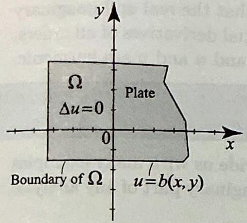
> Figure 1 The steady-state temperature distribution satisfies Laplace's equation.


The Laplacian is named after the great French mathematician and physicist PierreSimon de Laplace (17491827). The Laplacian appeared for the first time in a memoir of Laplace in 1784, in which he completely determined the attraction of a spheroid on the points outside it. The Laplacian of a function measures the difference between the value of the function at a point and the average value of the function in a neighborhood of that point. Thus a function that does not vary abruptly has a very small Laplacian. Harmonic functions have a zero Laplacian; they vary in a very regular way. Examples of such functions include the temperature distribution in a plate, the potential of the attractive force due to a sphere, the function that gives the brightness of colors in an image.
distribution, known as the steady-state distribution. For ( $x, y$ ) in $\Omega$, let $u(x, y)$ denote this steady-state temperature distribution. It is also a fact from thermodynamics that $u(x, y)$ satisfies the (two-dimensional) Laplace's equation

$$
\Delta u=\frac{\partial^{2} u}{\partial x^{2}}+\frac{\partial^{2} u}{\partial y^{2}}=0
$$

Here $\Delta u$ is the Laplacian of $u$, which by definition is $\frac{\partial^{2} u}{\partial x^{2}}+\frac{\partial^{2} u}{\partial y^{2}}$. Since Laplace's equation involves partial derivatives, it is called a partial differential equation. Any real-valued function that satisfies Laplace's equation on a region $\Omega$ and has continuous first and second partial derivatives is called harmonic on $\Omega$. Constant functions are clearly harmonic on the entire plane, and so are the functions $u(x, y)=x, u(x, y)=y, u(x, y)=x y$. Less obvious examples of harmonic functions will be derived from Theorem 1 later in this section.

To determine the steady-state temperature inside the plate, we must solve Laplace's equation inside of $\Omega$ subject to the condition $u(x, y)= b(x, y)$ on the boundary of $\Omega$, known as a boundary condition. A problem consisting of a partial differential equation along with specified boundary conditions is known as a boundary value problem. The special case involving Laplace's equation with specified boundary values is known as a Dirichlet problem. Solving Dirichlet problems is of paramount importance in applied mathematics, engineering, and physics. Many methods have been developed. The ones that we will present in this section provide a beautiful application of complex analysis.


# 2.5.2 Connection with Analytic Functions


> [!review]
> How can analytic functions be used to produce harmonic functions? Prove your answer.


##### solution

Analytic functions provide a systematic way to produce harmonic functions: if $f=u+i v$ is analytic on an open set $S$, then both its real part $u(x,y)$ and its imaginary part $v(x,y)$ are harmonic on $S$.

The reason is that analyticity gives the Cauchy-Riemann equations

$$
u_x=v_y
\qquad\text{and}\qquad
u_y=-v_x.
$$

To show that $u$ is harmonic, we compute its Laplacian. Differentiate the first Cauchy-Riemann equation with respect to $x$:

$$
u_{xx}=v_{yx}.
$$

Differentiate the second Cauchy-Riemann equation with respect to $y$:

$$
u_{yy}=-v_{xy}.
$$

Now add these two equations:

$$
\begin{aligned}
u_{xx}+u_{yy}
&=v_{yx}+(-v_{xy})\\
&=v_{yx}-v_{xy}.
\end{aligned}
$$

If the relevant second partial derivatives are continuous, then mixed partial derivatives may be interchanged, so $v_{yx}=v_{xy}$. Therefore

$$
\begin{aligned}
u_{xx}+u_{yy}
&=v_{xy}-v_{xy}\\
&=0.
\end{aligned}
$$

Hence

$$
\Delta u=u_{xx}+u_{yy}=0,
$$

so $u$ is harmonic on $S$.

The same argument works for $v$. Differentiate $u_x=v_y$ with respect to $y$:

$$
u_{xy}=v_{yy}.
$$

Differentiate $u_y=-v_x$ with respect to $x$:

$$
u_{yx}=-v_{xx}.
$$

Since $u_{xy}=u_{yx}$ when the second partial derivatives are continuous, we obtain

$$
\begin{aligned}
v_{yy}
&=u_{xy}\\
&=u_{yx}\\
&=-v_{xx}.
\end{aligned}
$$

Therefore

$$
\begin{aligned}
v_{xx}+v_{yy}
&=v_{xx}+(-v_{xx})\\
&=0.
\end{aligned}
$$

Thus

$$
\Delta v=v_{xx}+v_{yy}=0,
$$

so $v$ is also harmonic on $S$.

We conclude that every analytic function produces harmonic functions simply by taking its real part or its imaginary part. This is the content of the theorem stated in the section: if $f=u+i v$ is analytic on an open set $S$, then both $u$ and $v$ are harmonic on $S$.


+++++


Let $f=u+i v$ be an analytic function. We know that $u$ and $v$ satisfy the Cauchy-Riemann equations (Theorem 1, Section 2.4),

$$
\frac{\partial u}{\partial x}=\frac{\partial v}{\partial y} \quad \text { and } \quad \frac{\partial u}{\partial y}=-\frac{\partial v}{\partial x} .
$$

Let us suppose for a moment that we can differentiate $u$ and $v$ twice and interchange the order of partial derivatives. Then

$$
\frac{\partial^{2} u}{\partial x^{2}}=\frac{\partial}{\partial x}\left(\frac{\partial u}{\partial x}\right)=\frac{\partial}{\partial x}\left(\frac{\partial v}{\partial y}\right)=\frac{\partial}{\partial y}\left(\frac{\partial v}{\partial x}\right)=\frac{\partial}{\partial y}\left(-\frac{\partial u}{\partial y}\right)=-\frac{\partial^{2} u}{\partial y^{2}},
$$

and hence $\frac{\partial^{2} u}{\partial x^{2}}+\frac{\partial^{2} u}{\partial y^{2}}=0$. In other words, $u$ satisfies Laplace's equation. Reasoning in a similar way, we can show that $v$ also satisfies Laplace's equation.

Recall from calculus that in order to justify the interchange of partial derivatives as we needed to do above, it is enough to know that all first and


second partial derivatives are continuous. One of the major results that we will develop in the following chapter guarantees that the real and imaginary parts of an analytic function have continuous partial derivatives of all orders. Thus, the steps that we used above are justified and $u$ and $v$ are harmonic.


> [!theorem] Theorem 1: Analytic and Harmonic Functions
> Suppose that $f=u+i v$ is analytic on an open set $S$. Then its real and inaginary parts $u(x, y)$ and $v(x, y)$ are harmonic on $S$.


What this result effectively does for us is provide us with many examples of harmonic functions; simply take the real or imaginary part of any analytic function.


> [!exercise] Exercise 1: Harmonic functions
> Show that the following are harmonic functions in the stated region.
> (a) $u(x, y)=x^{2}-y^{2}$ on $\mathbb{C}$.
> (b) $u(x, y)=e^{x} \sin y$ on $\mathbb{C}$.
> (c) $u(x, y)=\operatorname{Arg} z(z=(x, y))$ on the region $\Omega=\mathbb{C} \backslash(-\infty, 0]$.
> (d) $u(x, y)=\ln |z|=\ln \sqrt{x^{2}+y^{2}}$ on the region $\mathbb{C} \backslash\{0\}$.


##### solution

We verify in each case that the function has continuous first and second partial derivatives on the stated region and that its Laplacian is zero there.

##### problem (a)

Let

$$
u(x,y)=x^2-y^2.
$$

Compute the first partial derivatives:

$$
u_x=2x,
\qquad
u_y=-2y.
$$

Now compute the second partial derivatives:

$$
u_{xx}=2,
\qquad
u_{yy}=-2.
$$

Therefore

$$
\Delta u=u_{xx}+u_{yy}=2+(-2)=0.
$$

Since these derivatives exist and are continuous everywhere on $\mathbb{C}$, the function $u(x,y)=x^2-y^2$ is harmonic on $\mathbb{C}$.

##### problem (b)

Let

$$
u(x,y)=e^x\sin y.
$$

Compute the first partial derivatives:

$$
u_x=e^x\sin y,
\qquad
u_y=e^x\cos y.
$$

Now compute the second partial derivatives:

$$
u_{xx}=e^x\sin y,
\qquad
u_{yy}=-e^x\sin y.
$$

Hence

$$
\Delta u=u_{xx}+u_{yy}=e^x\sin y+(-e^x\sin y)=0.
$$

These derivatives are continuous everywhere on $\mathbb{C}$, so $u(x,y)=e^x\sin y$ is harmonic on $\mathbb{C}$.

##### problem (c)

Let

$$
u(x,y)=\operatorname{Arg} z.
$$

On the region

$$
\Omega=\mathbb{C}\setminus(-\infty,0],
$$

the principal argument is single-valued. Its derivatives are the same as those obtained by differentiating the local expression

$$
u(x,y)=\arctan\!\left(\frac{y}{x}\right),
$$

which is valid locally away from the branch cut. We now compute its derivatives for $(x,y)\neq(0,0)$.

Set

$$
t=\frac{y}{x}.
$$

Then

$$
u(x,y)=\arctan(t).
$$

Differentiate with respect to $x$:

$$
\begin{aligned}
u_x
&=\frac{1}{1+t^2}\,t_x\\
&=\frac{1}{1+\left(\frac{y}{x}\right)^2}\left(-\frac{y}{x^2}\right)\\
&=\frac{1}{\frac{x^2+y^2}{x^2}}\left(-\frac{y}{x^2}\right)\\
&=\frac{x^2}{x^2+y^2}\left(-\frac{y}{x^2}\right)\\
&=-\frac{y}{x^2+y^2}.
\end{aligned}
$$

Differentiate with respect to $y$:

$$
\begin{aligned}
u_y
&=\frac{1}{1+t^2}\,t_y\\
&=\frac{1}{1+\left(\frac{y}{x}\right)^2}\left(\frac{1}{x}\right)\\
&=\frac{1}{\frac{x^2+y^2}{x^2}}\cdot\frac{1}{x}\\
&=\frac{x^2}{x^2+y^2}\cdot\frac{1}{x}\\
&=\frac{x}{x^2+y^2}.
\end{aligned}
$$

Now compute the second partial derivatives. Since

$$
u_x=-y(x^2+y^2)^{-1},
$$

we have

$$
\begin{aligned}
u_{xx}
&=-y\frac{\partial}{\partial x}(x^2+y^2)^{-1}\\
&=-y\left(-(x^2+y^2)^{-2}(2x)\right)\\
&=\frac{2xy}{(x^2+y^2)^2}.
\end{aligned}
$$

Since

$$
u_y=x(x^2+y^2)^{-1},
$$

we get

$$
\begin{aligned}
u_{yy}
&=x\frac{\partial}{\partial y}(x^2+y^2)^{-1}\\
&=x\left(-(x^2+y^2)^{-2}(2y)\right)\\
&=-\frac{2xy}{(x^2+y^2)^2}.
\end{aligned}
$$

Therefore

$$
\Delta u=u_{xx}+u_{yy}
=\frac{2xy}{(x^2+y^2)^2}-\frac{2xy}{(x^2+y^2)^2}
=0.
$$

The function and its derivatives are well defined and continuous on $\Omega=\mathbb{C}\setminus(-\infty,0]$, so $\operatorname{Arg} z$ is harmonic on that region.

##### problem (d)

Let

$$
u(x,y)=\ln|z|=\ln\sqrt{x^2+y^2}.
$$

Since

$$
\ln\sqrt{x^2+y^2}
=\ln\bigl((x^2+y^2)^{1/2}\bigr)
=\frac12\ln(x^2+y^2),
$$

we may write

$$
u(x,y)=\frac12\ln(x^2+y^2)
$$

for $(x,y)\neq(0,0)$.

Now compute the first partial derivatives:

$$
\begin{aligned}
u_x
&=\frac12\cdot\frac{1}{x^2+y^2}\cdot 2x\\
&=\frac{x}{x^2+y^2},
\end{aligned}
$$

and

$$
\begin{aligned}
u_y
&=\frac12\cdot\frac{1}{x^2+y^2}\cdot 2y\\
&=\frac{y}{x^2+y^2}.
\end{aligned}
$$

Now compute the second partial derivatives:

$$
\begin{aligned}
u_{xx}
&=\frac{\partial}{\partial x}\left(x(x^2+y^2)^{-1}\right)\\
&=(x^2+y^2)^{-1}+x\left(-(x^2+y^2)^{-2}(2x)\right)\\
&=\frac{1}{x^2+y^2}-\frac{2x^2}{(x^2+y^2)^2}\\
&=\frac{x^2+y^2}{(x^2+y^2)^2}-\frac{2x^2}{(x^2+y^2)^2}\\
&=\frac{y^2-x^2}{(x^2+y^2)^2},
\end{aligned}
$$

and similarly

$$
\begin{aligned}
u_{yy}
&=\frac{\partial}{\partial y}\left(y(x^2+y^2)^{-1}\right)\\
&=(x^2+y^2)^{-1}+y\left(-(x^2+y^2)^{-2}(2y)\right)\\
&=\frac{1}{x^2+y^2}-\frac{2y^2}{(x^2+y^2)^2}\\
&=\frac{x^2+y^2}{(x^2+y^2)^2}-\frac{2y^2}{(x^2+y^2)^2}\\
&=\frac{x^2-y^2}{(x^2+y^2)^2}.
\end{aligned}
$$

Therefore

$$
\begin{aligned}
\Delta u
&=u_{xx}+u_{yy}\\
&=\frac{y^2-x^2}{(x^2+y^2)^2}+\frac{x^2-y^2}{(x^2+y^2)^2}\\
&=0.
\end{aligned}
$$

Thus $\ln|z|$ is harmonic on $\mathbb{C}\setminus\{0\}$.


++++


> [!review]
> 1. Under what conditions is a linear combination $a u+b v$ of two functions $u, v$ harmonic on an open set $S$ ? Prove your answer.
> 2. What can be said about the pointwise product $u v$ of two harmonic functions $u, v$ on an open set $S$ ? Justify your answer.


##### problem 1

If $u$ and $v$ are harmonic on an open set $S$, and if $a$ and $b$ are real constants, then the linear combination

$$
a u+b v
$$

is also harmonic on $S$.

The reason is straightforward. Since $u$ and $v$ are harmonic on $S$, they have continuous first and second partial derivatives on $S$, and they satisfy

$$
\Delta u=0
\qquad\text{and}\qquad
\Delta v=0
$$

throughout $S$.

Now let

$$
\phi(x,y)=a u(x,y)+b v(x,y).
$$

Because differentiation is linear, the second partial derivatives of $\phi$ are

$$
\phi_{xx}=a u_{xx}+b v_{xx},
\qquad
\phi_{yy}=a u_{yy}+b v_{yy}.
$$

Therefore its Laplacian is

$$
\begin{aligned}
\Delta \phi
&=\phi_{xx}+\phi_{yy}\\
&=(a u_{xx}+b v_{xx})+(a u_{yy}+b v_{yy})\\
&=a(u_{xx}+u_{yy})+b(v_{xx}+v_{yy})\\
&=a\,\Delta u+b\,\Delta v\\
&=a\cdot 0+b\cdot 0\\
&=0.
\end{aligned}
$$

Since $\phi$ also has continuous first and second partial derivatives on $S$, it follows that $\phi$ is harmonic on $S$.

So the condition is simply this: both $u$ and $v$ must already be harmonic on the same open set $S$, and $a,b$ must be real constants. Under those conditions, every linear combination $a u+b v$ is harmonic on $S$.

##### problem 2

In general, the pointwise product $u v$ of two harmonic functions need not be harmonic.

There is no product rule for harmonicity analogous to the linearity property above. In fact, even if both $u$ and $v$ satisfy Laplace's equation, their product may fail to do so.

To see this concretely, take

$$
u(x,y)=x
\qquad\text{and}\qquad
v(x,y)=x.
$$

Each of these functions is harmonic on $\mathbb{R}^2$, because

$$
u_{xx}=0,\qquad u_{yy}=0,
$$

so

$$
\Delta u=0,
$$

and the same calculation holds for $v$.

But their product is

$$
u(x,y)v(x,y)=x\cdot x=x^2.
$$

Now compute the Laplacian of $x^2$:

$$
\frac{\partial}{\partial x}(x^2)=2x,
\qquad
\frac{\partial}{\partial y}(x^2)=0,
$$

so

$$
\frac{\partial^2}{\partial x^2}(x^2)=2,
\qquad
\frac{\partial^2}{\partial y^2}(x^2)=0.
$$

Therefore

$$
\Delta(x^2)=2+0=2\neq 0.
$$

So $x^2$ is not harmonic on $\mathbb{R}^2$.

This example shows that the product of two harmonic functions is not, in general, harmonic. It may happen in special cases that a product is harmonic, but there is no general theorem guaranteeing that harmonicity is preserved under multiplication.


+++++


> [!exercise]
> 1. Show that $\phi(x, y)=2\left(x^2-y^2\right)+7$ is harmonic on $\mathbb{R}^2$.
> 2. Show that $\phi(x, y)=(a x+b)(c y+d)$ is harmonic on $\mathbb{R}^2$ for any real constants $a, b, c, d$ .
> 3. Show that $u(x, y)=x^2$ is not harmonic on $\mathbb{R}^2$.


##### solution

##### problem 1

Let

$$
\phi(x,y)=2(x^2-y^2)+7.
$$

First expand the expression:

$$
\phi(x,y)=2x^2-2y^2+7.
$$

Now compute the first partial derivatives:

$$
\phi_x=4x,
\qquad
\phi_y=-4y.
$$

Differentiate once more:

$$
\phi_{xx}=4,
\qquad
\phi_{yy}=-4.
$$

Therefore the Laplacian is

$$
\Delta \phi=\phi_{xx}+\phi_{yy}=4+(-4)=0.
$$

Since the relevant partial derivatives are continuous everywhere on $\mathbb{R}^2$, the function $\phi(x,y)=2(x^2-y^2)+7$ is harmonic on $\mathbb{R}^2$.

##### problem 2

Let

$$
\phi(x,y)=(ax+b)(cy+d),
$$

where $a,b,c,d$ are real constants.

First expand:

$$
\phi(x,y)=ac\,xy+ad\,x+bc\,y+bd.
$$

Now compute the first partial derivatives:

$$
\phi_x=ac\,y+ad,
\qquad
\phi_y=ac\,x+bc.
$$

Differentiate again:

$$
\phi_{xx}=0,
\qquad
\phi_{yy}=0.
$$

Hence

$$
\Delta \phi=\phi_{xx}+\phi_{yy}=0+0=0.
$$

Therefore $\phi(x,y)=(ax+b)(cy+d)$ is harmonic on $\mathbb{R}^2$ for all real constants $a,b,c,d$.

##### problem 3

Let

$$
u(x,y)=x^2.
$$

Compute the first partial derivatives:

$$
u_x=2x,
\qquad
u_y=0.
$$

Differentiate again:

$$
u_{xx}=2,
\qquad
u_{yy}=0.
$$

Therefore

$$
\Delta u=u_{xx}+u_{yy}=2+0=2.
$$

Since $\Delta u\neq 0$, the function $u(x,y)=x^2$ does not satisfy Laplace's equation. Hence it is not harmonic on $\mathbb{R}^2$.


++++


> [!proposition] Proposition 1: Linearity
> Suppose that $u$ and $v$ are harmonic on an open set $S$, and $a, b$ are resed constants. Then $a u(x, y)+b v(x, y)$ is harmonic on $S$.


For example, $\phi(x, y)=2\left(x^{2}-y^{2}\right)+7$ is harmonic, being of the form $\phi(x, y)=2 u(x, y)+7$ where $u$ is the harmonic function of Example 1(a). Also the function $\phi(x, y)=(a x+b)(c y+d)$, where $a, b, c, d$ are real constants, is harmonic, being a linear combination of the harmonic functions $x, y, x y$, and constants.

You should be cautioned that the product of two harmonic functions need not be harmonic. For example, $u(x, y)=x$ is harmonic, but $(u(x, y))^{2}=x^{2}$ is not.


# 2.5.3 Harmonic Conjugates


> [!review]
> Given a harmonic function $u$ on a region $\Omega$, what additional function must be supplied to produce an analytic function $f$ on $\Omega$ with $\operatorname{Re}(f)=u$, and what properties must it satisfy? Is the required function always guaranteed to exist on $\Omega$ ?


##### solution

To produce an analytic function $f$ on $\Omega$ with real part

$$
\operatorname{Re}(f)=u,
$$

one must supply another real-valued function $v$ on $\Omega$ such that

$$
f=u+i v
$$

is analytic in $\Omega$.

Such a function $v$ is called a harmonic conjugate of $u$. Its role is not merely to fill in the imaginary part formally; it must be chosen so that the resulting complex-valued function $f$ actually satisfies the conditions for analyticity. In particular, if $f=u+i v$ is analytic, then $u$ and $v$ must satisfy the Cauchy-Riemann equations on $\Omega$:

$$
u_x=v_y
\qquad\text{and}\qquad
u_y=-v_x.
$$

Thus the additional function must be a function $v$ whose partial derivatives are related to those of $u$ in exactly this way. When such a function exists, $v$ is called a harmonic conjugate of $u$, and the function $f=u+i v$ is analytic on $\Omega$.

Moreover, because the real and imaginary parts of an analytic function are harmonic, a harmonic conjugate is itself harmonic. So the desired function is not just any auxiliary function; it must be another harmonic function that pairs with $u$ through the Cauchy-Riemann equations.

However, such a function is not always guaranteed to exist on a given region $\Omega$. The existence of a harmonic conjugate depends on the nature of the region. The section explicitly warns that this is a geometric issue tied to the domain.

For example, the function

$$
u(z)=\ln|z|
$$

is harmonic on $\Omega=\mathbb{C}\setminus\{0\}$, but it does not have a harmonic conjugate on that entire region. On the other hand, if we restrict to the slit plane

$$
\mathbb{C}\setminus(-\infty,0],
$$

then $\ln|z|$ does have a harmonic conjugate there, namely $\operatorname{Arg} z$.

So the answer is this: to obtain an analytic function with real part $u$, one must find a harmonic conjugate $v$ such that $f=u+i v$ satisfies the Cauchy-Riemann equations and is analytic on $\Omega$. But the existence of such a $v$ is not automatic on every region; it depends on the domain under consideration.


+++++


Reading Theorem 1, it is natural to ask the following question: Given a harmonic function $u$ in a region $\Omega$, can we find another harmonic function $v$ in $\Omega$ such that $f=u+i v$ is analytic in $\Omega$ ? Such a function $v$ is called a harmonic conjugate of $u$. Conditions for the existence of a harmonic conjugate will be established in Chapter 3. For now, just keep in mind that the existence of a harmonic conjugate depends on the nature of the region under consideration. For example, the function $\ln |z|$ is harmonic in $\Omega= \mathbb{C} \backslash\{0\}$ (Example 1(d)); but $\ln |z|$ has no harmonic conjugate in that region (Exercise 33). It does, however, have a harmonic conjugate in $\mathbb{C} \backslash(-\infty, 0]$, namely $\operatorname{Arg} z$. As our next example shows, by integrating the CauchyRiemann equations, we can always find the harmonic conjugate in a region such as the entire complex plane, a disk, or a rectangle. (More generally, we will show in Chapter 3 that we can find a harmonic conjugate if the region is simply connected. This more restrictive concept of connectedness is extremely important and will be at the heart of Chapter 3.)


> [!exercise] Exercise 2: Finding harmonic conjugates
> Show that $u(x, y)=x^{2}-y^{2}+x$ is harmonic in the entire plane and find a harmonic conjugate.


##### solution

We must do two things: show that

$$
u(x,y)=x^2-y^2+x
$$

is harmonic on the entire plane, and then find a function $v(x,y)$ such that

$$
f(z)=u(x,y)+i v(x,y)
$$

is analytic.

First compute the partial derivatives of $u$:

$$
u_x=2x+1,
\qquad
u_y=-2y.
$$

Differentiate once more:

$$
u_{xx}=2,
\qquad
u_{yy}=-2.
$$

Therefore

$$
\Delta u=u_{xx}+u_{yy}=2+(-2)=0.
$$

Since these partial derivatives are continuous everywhere on $\mathbb{R}^2$, the function $u$ is harmonic on the entire plane.

Now we find a harmonic conjugate $v$. If

$$
f=u+i v
$$

is analytic, then the Cauchy-Riemann equations must hold:

$$
u_x=v_y,
\qquad
u_y=-v_x.
$$

Substitute the derivatives of $u$:

$$
v_y=2x+1,
\qquad
-v_x=-2y.
$$

So

$$
v_y=2x+1,
\qquad
v_x=2y.
$$

We now integrate $v_x=2y$ with respect to $x$:

$$
\begin{aligned}
v(x,y)
&=\int 2y\,dx\\
&=2xy+\phi(y),
\end{aligned}
$$

where $\phi(y)$ is an arbitrary function of $y$, because differentiation with respect to $x$ treats $y$ as a constant.

Next differentiate this expression with respect to $y$:

$$
v_y=2x+\phi'(y).
$$

But from the Cauchy-Riemann equations we also need

$$
v_y=2x+1.
$$

Therefore

$$
2x+\phi'(y)=2x+1,
$$

so

$$
\phi'(y)=1.
$$

Integrating with respect to $y$, we obtain

$$
\phi(y)=y+C,
$$

where $C$ is a real constant.

Substitute this back into the formula for $v$:

$$
v(x,y)=2xy+y+C.
$$

Thus a harmonic conjugate of $u$ is

$$
\boxed{v(x,y)=2xy+y}
$$

up to an additive real constant.

Accordingly, one analytic function having real part $u$ is

$$
f(z)=x^2-y^2+x+i(2xy+y).
$$

Since

$$
z^2=(x+iy)^2=x^2-y^2+2ixy
$$

and

$$
z=x+iy,
$$

we can also write this analytic function more compactly as

$$
f(z)=z^2+z+iC.
$$

So the answer is that $u(x,y)=x^2-y^2+x$ is harmonic on the whole plane, and one of its harmonic conjugates is $v(x,y)=2xy+y$.


++++


> [!review]
> Given that $v$ is a harmonic conjugate of a harmonic function $u$, how can a harmonic conjugate of $v$ be expressed in terms of $u$ ? Prove your answer.


##### solution

If $v$ is a harmonic conjugate of $u$, then a harmonic conjugate of $v$ is $-u$.

To prove this, start from the definition. Saying that $v$ is a harmonic conjugate of $u$ means that

$$
f=u+i v
$$

is analytic. Therefore the Cauchy-Riemann equations hold:

$$
u_x=v_y
\qquad\text{and}\qquad
u_y=-v_x.
$$

Now consider the function

$$
g=v+i(-u)=v-i u.
$$

If we can show that $g$ is analytic, then by definition $-u$ will be a harmonic conjugate of $v$.

For the real part $v$ and the imaginary part $-u$, the Cauchy-Riemann equations would be

$$
v_x=(-u)_y
\qquad\text{and}\qquad
v_y=-(-u)_x.
$$

Compute the right-hand sides:

$$
(-u)_y=-u_y,
\qquad
-(-u)_x=u_x.
$$

So the required equations become

$$
v_x=-u_y
\qquad\text{and}\qquad
v_y=u_x.
$$

But these are exactly the same as the original Cauchy-Riemann equations written in rearranged form, since

$$
u_y=-v_x
\qquad\Longrightarrow\qquad
v_x=-u_y,
$$

and

$$
u_x=v_y
\qquad\Longrightarrow\qquad
v_y=u_x.
$$

Therefore the Cauchy-Riemann equations hold for $g=v+i(-u)$, so $g$ is analytic.

Hence $-u$ is a harmonic conjugate of $v$.

So the answer is:

$$
\boxed{\text{a harmonic conjugate of }v\text{ is }-u.}
$$


+++++


So, from Example 2, a harmonic conjugate of $u(x, y)=x^{2}-y^{2}+x$ is $v(x, y)=2 x y+y$. What is a harmonic conjugate of $v(x, y)=2 x y+y$ ? Surely it is related to $u$. Indeed, you can check that a conjugate of $v$ is $-u(x, y)=-x^{2}+y^{2}-x$. More generally, we have the following useful result.

> [!proposition] Proposition 2
> Suppose that $u$ is harmonic and that $v$ is a harmonic conjugate of $u$. Then $-u$ is a harmonic conjugate of $v$.


**Proof** 


> [!review]
> 1. If $v_1$ and $v_2$ are both harmonic conjugates of the same harmonic function $u$ on a region $\Omega$, how must $v_1$ and $v_2$ be related? Prove your answer.
> 2. If $v$ is a harmonic conjugate of a harmonic function $u$ on a region $\Omega$, determine whether $v$ is also a harmonic conjugate of $u+c$ for every real constant $c$. Prove your answer.
> 3. What does it mean for two curves in the plane to be orthogonal at a point of intersection, and what does it mean for two families of curves to be orthogonal?
> 4. What is the geometric relationship between the level curves of a harmonic function $u$ and those of its harmonic conjugate $v$ on a region $\Omega$ ? Prove your answer.


##### problem 1

If $v_1$ and $v_2$ are both harmonic conjugates of the same harmonic function $u$ on a region $\Omega$, then $v_1$ and $v_2$ must differ by a real constant. In other words, there exists a real constant $c$ such that

$$
v_1=v_2+c
$$

throughout $\Omega$.

To prove this, note that since both $v_1$ and $v_2$ are harmonic conjugates of $u$, the functions

$$
f_1=u+i v_1
\qquad\text{and}\qquad
f_2=u+i v_2
$$

are analytic on $\Omega$. Hence both pairs $(u,v_1)$ and $(u,v_2)$ satisfy the Cauchy-Riemann equations:

$$
u_x=(v_1)_y,
\qquad
u_y=-(v_1)_x,
$$

and

$$
u_x=(v_2)_y,
\qquad
u_y=-(v_2)_x.
$$

Subtract the corresponding equations. From the first pair we get

$$
(v_1)_y-(v_2)_y=0,
$$

so

$$
\frac{\partial}{\partial y}(v_1-v_2)=0.
$$

From the second pair we get

$$
(v_1)_x-(v_2)_x=0,
$$

so

$$
\frac{\partial}{\partial x}(v_1-v_2)=0.
$$

Thus both partial derivatives of $v_1-v_2$ are zero on $\Omega$. Therefore $v_1-v_2$ is constant on the region $\Omega$, and hence

$$
v_1=v_2+c
$$

for some real constant $c$.

##### problem 2

Yes. If $v$ is a harmonic conjugate of $u$ on $\Omega$, then $v$ is also a harmonic conjugate of $u+c$ for every real constant $c$.

Indeed, if $v$ is a harmonic conjugate of $u$, then

$$
f=u+i v
$$

is analytic on $\Omega$, so the Cauchy-Riemann equations hold:

$$
u_x=v_y,
\qquad
u_y=-v_x.
$$

Now let

$$
\tilde u=u+c,
$$

where $c$ is real and constant. Then

$$
\tilde u_x=u_x,
\qquad
\tilde u_y=u_y,
$$

because the derivatives of a constant are zero.

Therefore

$$
\tilde u_x=u_x=v_y
\qquad\text{and}\qquad
\tilde u_y=u_y=-v_x.
$$

So the pair $(\tilde u,v)$ also satisfies the Cauchy-Riemann equations. Hence

$$
(u+c)+i v
$$

is analytic on $\Omega$, which means that $v$ is a harmonic conjugate of $u+c$.

##### problem 3

Two curves in the plane are said to be orthogonal at a point of intersection if their tangent lines at that point are perpendicular. Equivalently, they intersect at a right angle there.

If the tangent lines have slopes $m_1$ and $m_2$, and neither slope is zero or undefined in a problematic way, then orthogonality is expressed by the relation

$$
m_1m_2=-1.
$$

Two families of curves are said to be orthogonal if every curve from one family intersects every curve from the other family at right angles whenever they meet.

##### problem 4

The level curves of a harmonic function $u$ and those of its harmonic conjugate $v$ are orthogonal to each other at every point where

$$
f'(z)\neq 0,
$$

where

$$
f=u+i v.
$$

To prove this, consider first a level curve of $u$, given implicitly by

$$
u(x,y)=C_1,
$$

where $C_1$ is constant. Differentiate implicitly with respect to $x$:

$$
u_x\frac{dx}{dx}+u_y\frac{dy}{dx}=0.
$$

Since $dx/dx=1$, this becomes

$$
u_x+u_y\frac{dy}{dx}=0.
$$

Assuming $u_y\neq 0$, we solve for the slope:

$$
\frac{dy}{dx}=-\frac{u_x}{u_y}.
$$

So the slope of the tangent line to a level curve of $u$ is

$$
m_u=-\frac{u_x}{u_y}.
$$

Now consider a level curve of $v$, given by

$$
v(x,y)=C_2.
$$

Differentiate implicitly with respect to $x$:

$$
v_x\frac{dx}{dx}+v_y\frac{dy}{dx}=0,
$$

so

$$
v_x+v_y\frac{dy}{dx}=0.
$$

Assuming $v_y\neq 0$, the slope is

$$
\frac{dy}{dx}=-\frac{v_x}{v_y}.
$$

Thus the slope of the tangent line to a level curve of $v$ is

$$
m_v=-\frac{v_x}{v_y}.
$$

Now use the Cauchy-Riemann equations:

$$
v_x=-u_y,
\qquad
v_y=u_x.
$$

Substitute these into the formula for $m_v$:

$$
\begin{aligned}
m_v
&=-\frac{v_x}{v_y}\\
&=-\frac{-u_y}{u_x}\\
&=\frac{u_y}{u_x}.
\end{aligned}
$$

Therefore

$$
\begin{aligned}
m_u m_v
&=\left(-\frac{u_x}{u_y}\right)\left(\frac{u_y}{u_x}\right)\\
&=-1.
\end{aligned}
$$

So the tangent lines are perpendicular, and therefore the level curves of $u$ are orthogonal to the level curves of $v$.

This argument is valid at points where the relevant derivatives do not vanish in a way that destroys the tangent-line computation, which is summarized in the theorem by the condition

$$
f'(z)\neq 0.
$$

Hence the geometric relationship is that the two families of level curves,

$$
u(x,y)=C_1
\qquad\text{and}\qquad
v(x,y)=C_2,
$$

form an orthogonal family.


+++++


In Example 2, we found the harmonic conjugate of $u$ up to an arbitrary additive real constant. In fact, the following properties of the harmonic conjugate are not hard to prove (Exercise 18).


> [!proposition] Proposition 3
> Suppose that $u$ is a harmonic function in a region $\Omega$. Then
> (i) if $v_{1}$ and $v_{2}$ are harmonic conjugates of $u$ in $\Omega$, then $v_{1}$ and $v_{2}$ must differ by a real constant.
> (ii) If $v$ is a harmonic conjugate of $u$, then $v$ is also a harmonic conjugate of $u+c$ where $c$ is any real constant.


The function $u$ and its conjugate $v$ have a very interesting geometric relationship based on the notion of orthogonal curves.

Suppose that two curves $C_{1}$ and $C_{2}$ meet at a point $A$. The curves are said to be orthogonal if their respective tangent lines $L_{1}$ and $L_{2}$ (at $A$ ) are orthogonal (_Figure 2_). 


> [!figure] Figure 2
> 
> 
> 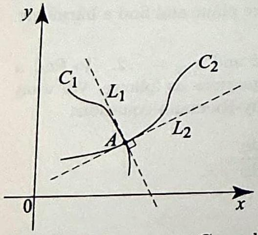
> Figure 2 The curves $C_{1}$ and $C_{2}$ are orthogonal at $A$ if the tangent lines $L_{1}$ and $L_{2}$ (at $A$ ) are orthogonal.


We also say that $C_{1}$ and $C_{2}$ intersect at a right angle at $A$. Recall that if $m_{1}$ and $m_{2}$ denote the respective slopes of the tangent lines, and if neither is zero, then $L_{1}$ and $L_{2}$ are orthogonal if and only if

$$
m_{1} m_{2}=-1
$$

Two families of curves are said to be orthogonal if each curve from one family intersects the curves from the other family at right angles.

Consider the level curves of a harmonic function $u(x, y)$ in a region $\Omega$. These are the curves determined by the implicit relation

$$
u(x, y)=C_{1}
$$

where $C_{1}$ is a constant (in the range of $u$ ). Since $u$ is harmonic, it has continuous partial derivatives, and hence we can use the chain rule, Theorem 4, Section 2.6, to differentiate both sides of (4) with respect to $x$ and get

$$
\frac{\partial u}{\partial x} \frac{d x}{d x}+\frac{\partial u}{\partial y} \frac{d y}{d x}=0
$$

But $d x / d x=1$, so if $\frac{\partial u}{\partial y} \neq 0$, we can solve for $d y / d x$ and get

$$
\frac{d y}{d x}=-\frac{\frac{\partial u}{\partial x}}{\frac{\partial u}{\partial y}}
$$

This gives the slope of the tangent line at a point on a level curve. Now suppose that we can find a harmonic conjugate $v(x, y)$ of $u(x, y)$ in $\Omega$ and let us consider the level curves

$$
v(x, y)=C_{2}
$$

where $C_{2}$ is a constant (in the range of $v$ ). Since $v$ is harmonic, arguing as we did with $u$, we find that the slope of the tangent line at a point on a level curve is

$$
\frac{d y}{d x}=-\frac{\frac{\partial v}{\partial x}}{\frac{\partial v}{\partial y}}=\frac{\frac{\partial u}{\partial y}}{\frac{\partial u}{\partial x}}
$$

since by the Cauchy-Riemann equations, $\partial v / \partial x=-\partial u / \partial y$ and $\partial v / \partial y= \partial u / \partial x$. Comparing (6) and (7), we see that the slopes of the tangent lines satisfy the orthogonality relation (3), and hence the level curves of $u$ are orthogonal to the level curves of $v$. This orthogonality relation also holds when the tangents are horizontal and vertical. We thus have the following result.

> [!theorem] Theorem 2: Orthogonality of Level Curves
> Suppose that $u$ is a harmonic function in a region $\Omega$ and let $v$ be a harmonic conjugate of $u$ in $\Omega$, so that $f=u+i v$ is analytic in $\Omega$. Then, the two families of level curves, $u(x, y)=C_{1}$ and $v(x, y)=C_{2}$, are orthogonal at every point where $f^{\prime}(z) \neq 0$.
> 


As an illustration, we show in _Figure 3(a) and (b)_ the level curves of the harmonic function $u=x^{2}-y^{2}+x$ and its conjugate $v(x, y)=2 x y+y$ (see Exercise 2). The graphs of the two families are superposed in Figure 3(c) to illustrate their orthogonality.


> [!figure] FIgure 3
> 
> ```horizontal
> 
> 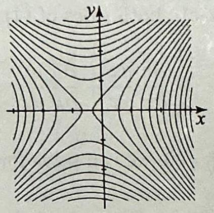
> (a)
> ---
> 
> 
> 
> 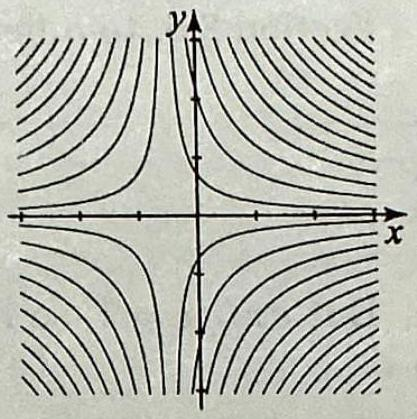
> (b)
> 
> ---
> 
> 
> 
> 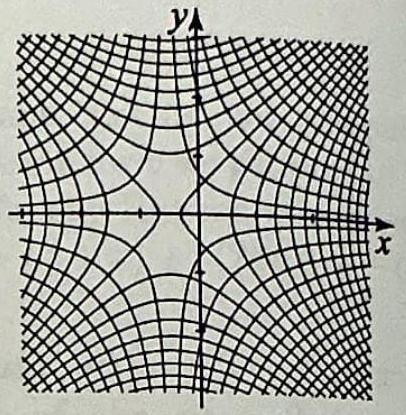
> (c)
> 
> ```
> 
> 
> Figure 3 (a) Level curves of $u(x, y)=x^{2}-y^{2}+x$.
> (b) Level curves of $v(x, y)=2 x y+y$.
> (c) The level curves of $u$ and $v$ are orthogonal.
> 
> 


# 2.5.4 Solving and Interpreting Dirichlet Problems


> [!review]
> 1. What characterizes the harmonic functions (on appropriate subdomains of $\mathbb{C}$ ) that are constant on rays from the origin? For what class of Dirichlet problems are such functions natural candidate solutions?
> 2. What characterizes the harmonic functions on $\mathbb{R}^2$ that are independent of $y$ ? Prove your answer. For what class of Dirichlet problems are such functions natural candidate solutions?


##### problem 1

On appropriate subdomains of $\mathbb{C}$, the harmonic functions that are constant on rays from the origin are precisely the functions of the form

$$
u(z)=a\,\operatorname{Arg} z+b,
$$

where $a$ and $b$ are real constants.

The reason is that a function that is constant on rays depends only on the angle $\theta=\operatorname{Arg} z$ and not on the radial variable $r=|z|$. The basic harmonic example of this type is $\operatorname{Arg} z$, which is harmonic on a slit plane such as

$$
\mathbb{C}\setminus(-\infty,0].
$$

By linearity of harmonic functions, every function of the form

$$
a\,\operatorname{Arg} z+b
$$

is also harmonic on such a domain. Because $\operatorname{Arg} z$ is constant along each ray from the origin, the same is true of $a\,\operatorname{Arg} z+b$.

These functions are natural candidate solutions for Dirichlet problems in regions where the prescribed boundary data is constant on rays, or equivalently depends only on the angular variable and not on the distance from the origin. In such problems one expects the solution to vary with direction but remain unchanged as one moves outward along a fixed ray.

##### problem 2

The harmonic functions on $\mathbb{R}^2$ that are independent of $y$ are precisely the functions of the form

$$
u(x,y)=ax+b,
$$

where $a$ and $b$ are real constants.

To prove this, suppose that $u$ is harmonic on $\mathbb{R}^2$ and is independent of $y$. Then $u$ depends only on $x$, so we may write

$$
u(x,y)=\phi(x)
$$

for some twice-differentiable real-valued function $\phi$.

Because $u$ is independent of $y$, we have

$$
u_y=0
\qquad\text{and}\qquad
u_{yy}=0.
$$

Since $u$ is harmonic, it satisfies Laplace's equation:

$$
u_{xx}+u_{yy}=0.
$$

Substitute $u_{yy}=0$:

$$
u_{xx}+0=0,
$$

so

$$
u_{xx}=0.
$$

But $u(x,y)=\phi(x)$, so this means

$$
\phi''(x)=0.
$$

Integrating once gives

$$
\phi'(x)=a,
$$

where $a$ is a real constant. Integrating again gives

$$
\phi(x)=ax+b,
$$

where $b$ is another real constant.

Therefore

$$
u(x,y)=ax+b.
$$

Conversely, any function of the form $ax+b$ is harmonic, since

$$
u_x=a,\qquad u_{xx}=0,\qquad u_y=0,\qquad u_{yy}=0,
$$

and hence

$$
\Delta u=u_{xx}+u_{yy}=0.
$$

So these are exactly the harmonic functions on $\mathbb{R}^2$ that are independent of $y$.

Such functions are natural candidate solutions for Dirichlet problems in vertical strips or other regions where the boundary data is constant along horizontal lines and depends only on the $x$-coordinate. In that situation one expects the steady-state temperature to vary only in the horizontal direction, not in the vertical one.


+++++


> [!exercise]
> Let $u=a \operatorname{Arg} z+b$. Show that $u(x, y)=a \operatorname{Arg} z+b$ (for real constants $a, b$ ) is harmonic on $\mathbb{C} \backslash(-\infty, 0]$ and is constant on rays from the origin.


##### solution

Let

$$
u(x,y)=a\,\operatorname{Arg} z+b,
$$

where $a$ and $b$ are real constants. We must show two things:

1. $u$ is harmonic on $\mathbb{C}\setminus(-\infty,0]$.
2. $u$ is constant on rays from the origin.

To prove harmonicity, recall from Example 1(c) that the function

$$
\operatorname{Arg} z
$$

is harmonic on the slit plane

$$
\mathbb{C}\setminus(-\infty,0].
$$

Also, constant functions are harmonic, and Proposition 1 says that any linear combination of harmonic functions with real constant coefficients is harmonic.

Now

$$
u(x,y)=a\,\operatorname{Arg} z+b
$$

is exactly a linear combination of the harmonic function $\operatorname{Arg} z$ and the constant harmonic function $1$. Therefore $u$ is harmonic on $\mathbb{C}\setminus(-\infty,0]$.

If we want to write this explicitly in the form used in Proposition 1, we may set

$$
u_1(x,y)=\operatorname{Arg} z
\qquad\text{and}\qquad
u_2(x,y)=1.
$$

Then

$$
u=a u_1+b u_2,
$$

and since both $u_1$ and $u_2$ are harmonic, so is $u$.

Now we show that $u$ is constant on rays from the origin. A ray from the origin is obtained by fixing the angle $\theta$ and allowing only the radial variable $r$ to vary. Along such a ray, the argument of $z$ does not change:

$$
\operatorname{Arg} z=\theta.
$$

Therefore, on that ray,

$$
\begin{aligned}
u(x,y)
&=a\,\operatorname{Arg} z+b\\
&=a\theta+b.
\end{aligned}
$$

The right-hand side depends only on the fixed angle $\theta$ and not on the distance $r$ from the origin. Hence its value is the same at every point of that ray.

So $u(x,y)=a\,\operatorname{Arg} z+b$ is constant on rays from the origin.

We conclude that for real constants $a$ and $b$, the function

$$
\boxed{u(x,y)=a\,\operatorname{Arg} z+b}
$$

is harmonic on $\mathbb{C}\setminus(-\infty,0]$ and is constant on rays from the origin.


++++


> [!exercise]
> Let $u=a \ln |z|+b$. Show that $u(z)=a \ln |z|+b$ (for real constants $a, b$ ) is harmonic on $\mathbb{C} \backslash\{0\}$ and depends only on $|z|$.


##### solution

Let

$$
u(z)=a\ln|z|+b,
$$

where $a$ and $b$ are real constants.

To show that $u$ is harmonic on $\mathbb{C}\setminus\{0\}$, recall from Example 1(d) that

$$
\ln|z|
$$

is harmonic on $\mathbb{C}\setminus\{0\}$. Also, constant functions are harmonic, and Proposition 1 says that any linear combination of harmonic functions with real constant coefficients is harmonic.

Now

$$
u(z)=a\ln|z|+b
$$

is a linear combination of the harmonic function $\ln|z|$ and a constant function. Therefore $u$ is harmonic on $\mathbb{C}\setminus\{0\}$.

To show that $u$ depends only on $|z|$, write

$$
r=|z|.
$$

Then

$$
u(z)=a\ln r+b.
$$

This expression involves only the radial variable $r$ and does not involve the argument of $z$. Hence the value of $u$ is determined entirely by the distance of $z$ from the origin.

So if two points $z_1$ and $z_2$ satisfy

$$
|z_1|=|z_2|,
$$

then

$$
\begin{aligned}
u(z_1)
&=a\ln|z_1|+b\\
&=a\ln|z_2|+b\\
&=u(z_2).
\end{aligned}
$$

Thus $u$ is constant on circles centered at the origin, which is exactly what it means to say that $u$ depends only on $|z|$.

Therefore, for real constants $a$ and $b$, the function

$$
\boxed{u(z)=a\ln|z|+b}
$$

is harmonic on $\mathbb{C}\setminus\{0\}$ and depends only on $|z|$.


++++


We now return to our main topic: that of solving Dirichlet problems. Let us first mention an interesting example of a harmonic function, $u(x, y)= a \operatorname{Arg} z+b$, which is harmonic by Example 1(c) and Proposition 1. Because $\operatorname{Arg} z$ is constant on rays (independent of $r$ ), it follows that $u=a \operatorname{Arg} z+b$ is also constant on rays. (In fact, this is the only harmonic function with such a property. See Exercise 49.) Thus $u$ is a good candidate for a solution of Dirichlet problems in which the boundary data is constant on rays or independent of $r$. We illustrate these ideas with an example.


> [!exercise] Exercise 3: A Dirichlet problem in a quadrant
> 
> Find the steady-state temperature $u(x, y)$ in a large sheet of metal occupying a quadrant of the plane, whose boundary is held at the constant temperatures $100^{\circ}$ on the bottom edge and $50^{\circ}$ on the left edge.
> 
> > [!figure]
> > 
> > 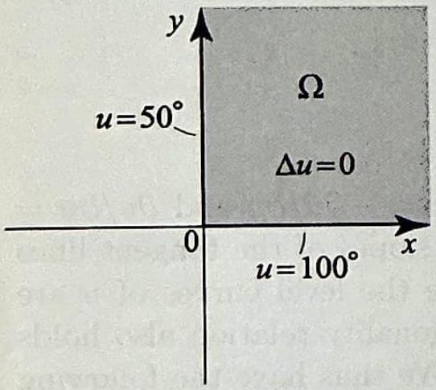
> > Dirichlet problem
> > 
> > 
> 
> 


##### solution

From the figure, the metal plate occupies the first quadrant

$$
\Omega=\{(x,y):x>0,\ y>0\},
$$

so points in the region have argument

$$
0<\theta=\operatorname{Arg} z<\frac{\pi}{2}.
$$

The boundary conditions shown in the figure are:

$$
u=100
\qquad\text{on the positive }x\text{-axis},
$$

and

$$
u=50
\qquad\text{on the positive }y\text{-axis}.
$$

Because these boundary values are constant on rays from the origin, it is natural to look for a harmonic solution of the form

$$
u(z)=a\,\operatorname{Arg} z+b.
$$

This function is harmonic on the first quadrant because the first quadrant lies inside the slit plane $\mathbb{C}\setminus(-\infty,0]$, where $\operatorname{Arg} z$ is harmonic.

Now determine the constants $a$ and $b$ from the boundary conditions.

On the positive $x$-axis we have

$$
\operatorname{Arg} z=0.
$$

Therefore

$$
\begin{aligned}
u
&=a\cdot 0+b\\
&=b.
\end{aligned}
$$

But the boundary condition there is $u=100$, so

$$
b=100.
$$

On the positive $y$-axis we have

$$
\operatorname{Arg} z=\frac{\pi}{2}.
$$

Therefore

$$
\begin{aligned}
u
&=a\frac{\pi}{2}+b\\
&=a\frac{\pi}{2}+100.
\end{aligned}
$$

But the boundary condition there is $u=50$, so

$$
a\frac{\pi}{2}+100=50.
$$

Subtract $100$ from both sides:

$$
a\frac{\pi}{2}=-50.
$$

Now solve for $a$:

$$
a=-\frac{100}{\pi}.
$$

Substitute these constants back into the formula for $u$:

$$
u(z)=100-\frac{100}{\pi}\operatorname{Arg} z.
$$

Thus the steady-state temperature distribution is

$$
\boxed{u(x,y)=100-\frac{100}{\pi}\operatorname{Arg} z.}
$$

Since we are in the first quadrant, we may also write

$$
\operatorname{Arg} z=\arctan\!\left(\frac{y}{x}\right),
$$

so equivalently

$$
\boxed{u(x,y)=100-\frac{100}{\pi}\arctan\!\left(\frac{y}{x}\right)}
$$

for $x>0$ and $y>0$.

We can check the boundary values directly:

On $y=0$ with $x>0$, we have $\operatorname{Arg} z=0$, so

$$
u=100-\frac{100}{\pi}\cdot 0=100.
$$

On $x=0$ with $y>0$, we have $\operatorname{Arg} z=\frac{\pi}{2}$, so

$$
u=100-\frac{100}{\pi}\cdot \frac{\pi}{2}=100-50=50.
$$

So this function satisfies both the Laplace equation and the boundary conditions in the figure.


++++


> [!figure] Figure 5: For Exercise 3
> 
> 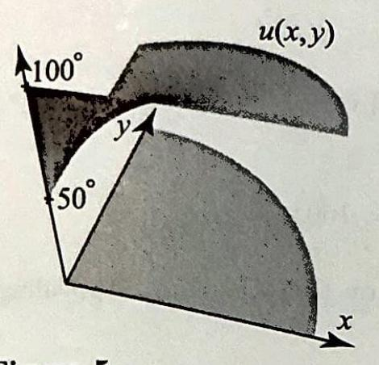
> Figure 5


In contrast to $\operatorname{Arg} z$ we can find harmonic functions which are independent of the argument and depend only on $r=|z|$. An example of such a function is $u(z)=a \ln |z|+b$, where $a$ and $b$ are real constants. By Example $1(\mathrm{~d})$, this function is harmonic in $\mathbb{C} \backslash\{0\}$. It is a good candidate for a solution of Dirichlet problems in which the boundary data is constant on circles. See Exercises 29-32 for illustrations.


> [!exercise] Exercise 4: Dirichlet problem in an infinite strip
> Solve the Dirichlet problem on the infinite strip $\{(x, y): 0<y<1\}$ with boundary conditions $u=0^{\circ}$ on $y=0$ and $u=100^{\circ}$ on $y=1$.
> 
> > [!figure] Figure 6: For Exercise 4
> > 
> > 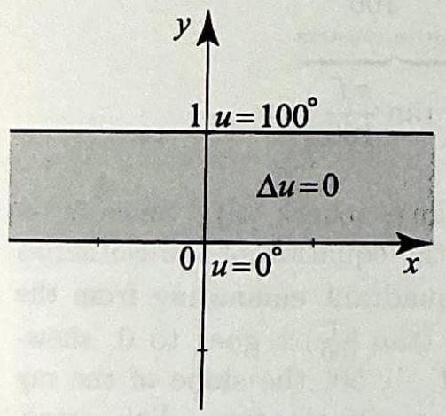
> > Figure 6 Dirichlet problem in Example 4.
> 
> 
> 


##### solution

We seek a harmonic function on the strip

$$
\{(x,y):0<y<1\}
$$

such that

$$
u(x,0)=0
\qquad\text{and}\qquad
u(x,1)=100
$$

for all $x$.

Because the boundary values are constant along each horizontal boundary line and do not depend on $x$, it is natural to look for a solution that is independent of $x$. So assume

$$
u(x,y)=\phi(y)
$$

for some function $\phi$ of one variable.

Since $u$ is independent of $x$, we have

$$
u_x=0
\qquad\text{and}\qquad
u_{xx}=0.
$$

For $u$ to be harmonic, it must satisfy Laplace's equation:

$$
u_{xx}+u_{yy}=0.
$$

Substituting $u_{xx}=0$, we obtain

$$
0+u_{yy}=0,
$$

so

$$
u_{yy}=0.
$$

But $u(x,y)=\phi(y)$, so this means

$$
\phi''(y)=0.
$$

Integrating once gives

$$
\phi'(y)=A,
$$

where $A$ is a constant. Integrating again gives

$$
\phi(y)=Ay+B,
$$

where $B$ is another constant.

Therefore the candidate solution has the form

$$
u(x,y)=Ay+B.
$$

Now impose the boundary conditions. On $y=0$ we require

$$
u(x,0)=A\cdot 0+B=B=0,
$$

so

$$
B=0.
$$

On $y=1$ we require

$$
u(x,1)=A\cdot 1+0=A=100,
$$

so

$$
A=100.
$$

Thus

$$
u(x,y)=100y.
$$

We now verify this directly:

$$
u_x=0,
\qquad
u_{xx}=0,
\qquad
u_y=100,
\qquad
u_{yy}=0.
$$

Hence

$$
\Delta u=u_{xx}+u_{yy}=0+0=0,
$$

so $u$ is harmonic on the strip. Also,

$$
u(x,0)=100\cdot 0=0
$$

and

$$
u(x,1)=100\cdot 1=100.
$$

Therefore the steady-state temperature distribution is

$$
\boxed{u(x,y)=100y.}
$$


++++


In Example 4 we used a harmonic function that was independent of $x$. Similarly, we can find harmonic functions that are independent of $y$ (hence $u_{y}=0$ and $u_{y y}=0$ ). You can show in this case that $u=a x+b$, where $a$ and $b$ are real constants. This function is a good candidate for solving Dirichlet problems in infinite vertical strips with constant boundary data. See problems 25 and 26 for illustrations.


# 2.5.5 Harmonic Conjugates, Isotherms, and Heat Flow


> [!review]
> 1.) What are isotherms in a steady-state heat distribution on a plate, and in terms of the temperature function $u(x, y)$, what curves do they correspond to?
> 2.) Why are the curves of heat flow in a steady-state temperature distribution orthogonal to the isotherms?
> 3.) How can a harmonic conjugate $v$ of a steady-state temperature distribution $u$ be used to determine the curves of heat flow on the plate, and why does this method work?
> 


##### problem 1

In a steady-state heat distribution on a plate, an isotherm is a curve along which the temperature is constant. If the temperature function is

$$
u(x,y),
$$

then the isotherms are exactly the level curves of $u$. In other words, for a fixed temperature value $T$, the corresponding isotherm is the curve determined by

$$
u(x,y)=T.
$$

So isotherms are the loci of points in the plate having the same temperature.

##### problem 2

The curves of heat flow are orthogonal to the isotherms because heat flows in the direction of greatest decrease of temperature, and that direction is perpendicular to level curves of the temperature function.

More precisely, from vector calculus we know that the gradient

$$
\nabla u=(u_x,u_y)
$$

is perpendicular to the level curves of $u(x,y)$. Since an isotherm is a level curve of $u$, the gradient is normal to each isotherm.

Fourier's law says that heat flows in the direction of

$$
-\nabla u,
$$

that is, from hotter regions toward colder ones. Because $-\nabla u$ is just the negative of $\nabla u$, it has the same line of action, so it is also perpendicular to the isotherms.

Therefore the curves of heat flow, whose tangent directions follow $-\nabla u$, are orthogonal to the isotherms.

##### problem 3

If $v$ is a harmonic conjugate of the steady-state temperature distribution $u$, then the curves of heat flow can be found by taking the level curves of $v$:

$$
v(x,y)=C.
$$

This works because if $v$ is a harmonic conjugate of $u$, then

$$
f=u+i v
$$

is analytic, and Theorem 2 tells us that the level curves of $u$ and the level curves of $v$ are orthogonal at every point where

$$
f'(z)\neq 0.
$$

But the level curves of $u$ are precisely the isotherms. Since curves of heat flow are orthogonal to the isotherms, and the level curves of $v$ are also orthogonal to the isotherms, the level curves of $v$ coincide with the curves of heat flow.

So the practical method is:

find a harmonic conjugate $v$ of the temperature function $u$, then solve

$$
v(x,y)=C
$$

to obtain the flow lines.

The reason this method works is the combination of two facts: heat flow follows a direction orthogonal to the level curves of $u$, and the harmonic conjugate $v$ has level curves orthogonal to those same curves.


+++++


In Example 3, the temperature of the boundary is kept at two constant values, $100^{\circ}$ and $50^{\circ}$. Our physical intuition tells us that, because the plate is insulated, the temperature of the points inside the plate will vary between these two values and will equal those values only at the boundary. It is natural to ask for those points inside the plate with the same temperature $u(x, y)=T$, where $50<T<100$. These points lie on curves inside the plate, called curves of constant temperature or isotherms. Isotherms have many practical applications. Computing them will lead us to interesting properties of harmonic functions.


You should recall from vector calculus that the gradient vector $\nabla u=\left(u_{x}, u_{y}\right)$ points in the direction of greatest change in a function. The gradient is perpendicular to level curves of $u(x, y)$. Fourier's law states that heat flows along $-\nabla u$, and thus curves of heat flow are orthogonal to level curves of $u$, and hence coincident with level curves of $v$.


> [!exercise] Exercise 5: Isotherms
> 
> Find the isotherms in Exercise 3.
> 
> 
> > [!figure] Figure 7: For Exercise 5
> > 
> > 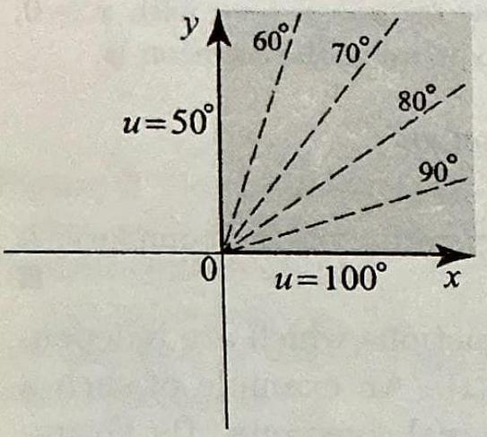
> > 
> > Figure 7 Isotherms in Example 5.
> 
> 
> 


##### solution

In Exercise 3, the steady-state temperature in the first quadrant was found to be

$$
u(x,y)=100-\frac{100}{\pi}\operatorname{Arg} z.
$$

The isotherms are the curves along which the temperature is constant. So let

$$
u(x,y)=T,
$$

where $50<T<100$.

Substitute the formula for $u$:

$$
100-\frac{100}{\pi}\operatorname{Arg} z=T.
$$

Now solve for $\operatorname{Arg} z$.

Subtract $100$ from both sides:

$$
-\frac{100}{\pi}\operatorname{Arg} z=T-100.
$$

Multiply both sides by $-\dfrac{\pi}{100}$:

$$
\operatorname{Arg} z=\frac{\pi}{100}(100-T).
$$

Thus each isotherm is given by a constant value of $\operatorname{Arg} z$. That means the isotherms are rays from the origin.

If we write

$$
\theta=\frac{\pi}{100}(100-T),
$$

then the isotherm corresponding to temperature $T$ is

$$
\operatorname{Arg} z=\theta.
$$

Since we are in the first quadrant, this is equivalently

$$
\arctan\!\left(\frac{y}{x}\right)=\theta,
$$

so

$$
\frac{y}{x}=\tan\theta,
$$

and therefore

$$
y=x\tan\theta.
$$

Substituting the expression for $\theta$, we may write the isotherms as

$$
\boxed{y=x\tan\!\left(\frac{\pi}{100}(100-T)\right)},
\qquad 50<T<100.
$$

So the isotherms in Exercise 3 are straight rays issuing from the origin. As $T$ decreases from $100$ to $50$, the angle increases from $0$ to $\dfrac{\pi}{2}$, so these rays sweep through the first quadrant from the positive $x$-axis toward the positive $y$-axis.


++++


Related to the topic of isotherms is the topic of curves of heat flow. These are the curves along which the heat is flowing inside the plate. To determine these curves, we use Fourier's law of heat conduction, which states that heat flows from hot to cold in the direction in which the temperature difference is the greatest. If along the isotherms the temperature difference is zero, then it should make sense that in the direction perpendicular to the isotherms the temperature difference is the greatest. Hence the curves of heat flow are orthogonal to the isotherms.

So to find the curves of heat flow in a plate, it is enough to find a harmonic conjugate $v(x, y)$ of the steady-state temperature distribution $u(x, y)$, since by Theorem 2 the level curves of $v$ are orthogonal to the level curves of $u$ We illustrate this process with an example.


> [!exercise] Exercise 6: Curves of Heat Flow
> 
> 
> Find the curves of heat flow in Example 3.
> 
> 
> > [!figure] Figure 8: For Exercise 6
> > 
> > 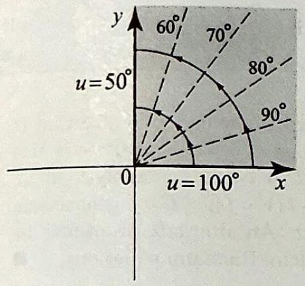
> > Figure 8 Curves of heat flow in Example 6, along with the isotherms.
> 
> 
> 


##### solution

In Exercise 3, the steady-state temperature distribution in the first quadrant was found to be

$$
u(x,y)=100-\frac{100}{\pi}\operatorname{Arg} z.
$$

To find the curves of heat flow, we look for a harmonic conjugate of $u$. Since

$$
\log z=\ln|z|+i\operatorname{Arg} z,
$$

the function $\operatorname{Arg} z$ is a harmonic conjugate of $\ln|z|$. Therefore, by the result that if $v$ is a harmonic conjugate of $u$, then $-u$ is a harmonic conjugate of $v$, a harmonic conjugate of $\operatorname{Arg} z$ is

$$
-\ln|z|.
$$

Now multiply by the constant coefficient appearing in $u$. Since

$$
u(x,y)=100-\frac{100}{\pi}\operatorname{Arg} z,
$$

a harmonic conjugate of $u$ is

$$
v(x,y)=-\frac{100}{\pi}\bigl(-\ln|z|\bigr)=\frac{100}{\pi}\ln|z|,
$$

up to an additive real constant.

Thus we may take

$$
v(x,y)=\frac{100}{\pi}\ln|z|.
$$

The curves of heat flow are the level curves of $v$, so set

$$
v(x,y)=C.
$$

Then

$$
\frac{100}{\pi}\ln|z|=C.
$$

Multiply both sides by $\dfrac{\pi}{100}$:

$$
\ln|z|=\frac{\pi C}{100}.
$$

Exponentiating gives

$$
|z|=e^{\pi C/100}.
$$

Since $e^{\pi C/100}$ is a positive constant, we may write it simply as

$$
|z|=R,
\qquad R>0.
$$

Therefore the curves of heat flow are circles centered at the origin. Because the plate occupies only the first quadrant, the relevant portions are the quarter-circles

$$
x^2+y^2=R^2,
\qquad x>0,\ y>0.
$$

So the answer is that the curves of heat flow in Example 3 are the quarter-circles centered at the origin in the first quadrant. They are orthogonal to the isotherms, which were the rays from the origin.


++++


# 2.5.6 Conformal Mappings


> [!review]
> 1.) What strategic idea underlies the method of conformal mappings for solving Dirichlet problems?
> 2.) What does it mean for a mapping $w=f(z)$ to be a conformal mapping of a region $\Omega$, and what geometric properties does such a mapping have that make it suitable for transforming a Dirichlet problem on $\Omega$ into one posed on the image region?
> 3.) If $U$ is a harmonic function on a region $\Omega^{\prime}$ and we pull it back to a region $\Omega$ via a mapping $w=f(z)$ (forming $u(z)=U(f(z))$ ), under what hypotheses on $f$ is $u$ guaranteed to be harmonic on $\Omega$ ? Prove your answer.


+++++


We conclude our panoramic overview of Dirichlet problems and their solutions by mentioning the method of conformal mappings, which is of wide use in complex analysis. In the past you have certainly used methods to transform a difficult problem to one with a known solution or whose solution is easier to find. For example, some integrals are simplified by using changes of variables, some differential equations are simplified by applying a Laplace transform, and so on. In solving Dirichlet problems, it is sometimes advantageous to map the region under consideration to a simpler region or one on which the transformed problem is easier to solve. This is the idea behind the method of conformal mappings, which we now explain.

Let a Dirichlet problem be given on a region $\Omega$ with boundary $\Gamma$. Suppose that we want to solve this problem by somehow transforming it first to the $w$ plane by means of a mapping $w=f(z)$, where $f$ is analytic in $\Omega$. If $f^{\prime}(z) \neq 0$ for all $z$ in $\Omega$, we call $f$ a conformal mapping of $\Omega$. Conformal mappings have important properties that will be studied in detail in Chapter 6. For example, if $f$ is conformal, then the image of $\Omega, \Omega^{\prime}=f[\Omega]$, is also a region (open, connected set); moreover, if $f$ is one-to-one, then $f$ will map $\Gamma$ onto $\Gamma^{\prime}$, the boundary of $\Omega^{\prime}$. In the examples of this section, these properties can be checked on a case-by-case basis.

In transforming the Dirichlet problem, we need to know what happens to Laplace's equation under our transformation $w=f(z)$ and what happens to the boundary conditions. Because $f$ maps boundary to boundary, the boundary conditions on $\Gamma$ will be transformed into boundary conditions on $\Gamma^{\prime}$ as we will explain shortly. However, the most important feature of this method is stated in the next theorem and tells us that Laplace's equation is invariant under a change of variables using a conformal mapping.


> [!NOTE]
> To understand the meaning of $U \circ f(z)$ where $f$ is complexvalued and $U$ is a function of two variables, write $U \circ f(z)=U(\operatorname{Re} f(z), \operatorname{Im} f(z))$. For example, if $f(z)= e^{z}=e^{x} \cos y+i e^{x} \sin y$ and $U(s, t)=s t$, then $U \circ f(z)= e^{2 x} \cos y \sin y$.


> [!Theorem] Theorem 3: Invariance of Laplace's Equation
> Suppose that $f$ is an analytic mapping of $\Omega$ into $\Omega^{\prime}$ and $U$ is a harmonic function on $\Omega^{\prime}$. Then $U \circ f$ is harmonic in $\Omega$. Thus, if $U$ satisfies $\Delta U=0$ on $\Omega^{\prime}$, then $u=U \circ f$ satisfies $\Delta u=0$ on $\Omega$.

**Proof** 


> [!review]
> Given a Dirichlet problem on a region $\Omega$ (Laplace's equation with prescribed boundary data $b$ on $\Gamma$ ), and an analytic mapping $w=f(z)$ that is one-to-one on $\Omega$ and its boundary, how can $f$ be used to transform the problem into a Dirichlet problem posed on the image region, and how does a solution of the transformed problem then yield a solution of the original? Prove your answer.


##### solution

Suppose we are given the Dirichlet problem

$$
\Delta u=0 \quad \text{in } \Omega,
\qquad
u(z)=b(z) \quad \text{for } z\in\Gamma,
$$

where $\Gamma$ is the boundary of $\Omega$. Assume that $w=f(z)$ is analytic on $\Omega$ and one-to-one on both $\Omega$ and its boundary $\Gamma$.

The strategy is to transfer the problem from the $z$-plane to the $w$-plane, solve the transformed problem there, and then pull the solution back to $\Omega$.

First, map the region and its boundary:

$$
\Omega' = f[\Omega],
\qquad
\Gamma' = f[\Gamma].
$$

Because $f$ is one-to-one, it has an inverse function

$$
f^{-1}
$$

defined on $\Omega'$ and on its boundary $\Gamma'$.

Now we transport the boundary data. If $w\in\Gamma'$, then $f^{-1}(w)\in\Gamma$, so the original boundary function $b$ induces a new boundary function on $\Gamma'$ given by

$$
B(w)=b\bigl(f^{-1}(w)\bigr).
$$

Thus the transformed Dirichlet problem on the image region is

$$
\Delta U=0 \quad \text{in } \Omega',
\qquad
U(w)=b\bigl(f^{-1}(w)\bigr) \quad \text{for } w\in\Gamma'.
$$

This is the problem one solves in the $w$-plane.

Once a solution $U$ of the transformed problem is found, we define a function on the original region by composing with $f$:

$$
u(z)=U(f(z))=U\circ f(z).
$$

We now show that this $u$ solves the original Dirichlet problem.

First, $U$ is harmonic on $\Omega'$ and $f$ is analytic on $\Omega$, so by the invariance theorem for Laplace's equation,

$$
u=U\circ f
$$

is harmonic on $\Omega$. Therefore

$$
\Delta u=0 \quad \text{in } \Omega.
$$

Next we check the boundary condition. Let $z\in\Gamma$. Then $f(z)\in\Gamma'$, so by the transformed boundary condition,

$$
U(f(z))=b\bigl(f^{-1}(f(z))\bigr).
$$

Since $f$ is one-to-one, we have

$$
f^{-1}(f(z))=z.
$$

Therefore

$$
\begin{aligned}
u(z)
&=U(f(z))\\
&=b\bigl(f^{-1}(f(z))\bigr)\\
&=b(z).
\end{aligned}
$$

So $u$ satisfies the prescribed boundary values on $\Gamma$.

Hence the method is:

1. map $\Omega$ and $\Gamma$ to $\Omega'$ and $\Gamma'$ using $w=f(z)$;
2. transfer the boundary data to $\Gamma'$ as $b\circ f^{-1}$;
3. solve the transformed Dirichlet problem for $U$ on $\Omega'$;
4. pull the solution back by setting $u=U\circ f$.

The proof that this works is exactly what we showed above: $u=U\circ f$ is harmonic in $\Omega$ by invariance of Laplace's equation, and on the boundary it satisfies

$$
u(z)=b(z).
$$

Therefore $u$ is a solution of the original Dirichlet problem on $\Omega$.


+++++


Now suppose that you want to use a conformal mapping $w=f(z)$ to solve the Dirichlet problem $\Delta u=0$ in $\Omega$ and $u(z)=b(z)$ on the boundary $\Gamma$ of $\Omega$. Suppose also that $f$ is one-to-one on $\Omega$ and its boundary $\Gamma$. Here is how the method works (see _Figure 9_ as you read through the steps).


> [!figure] Figure 9: For Proof to Theorem 3
> 
> 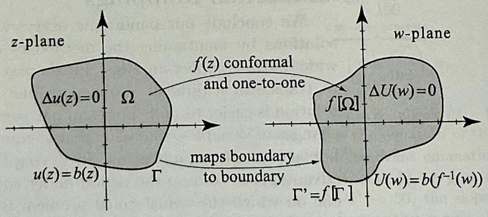
> 
> The conformal mapping method. If $f(z)$ is analytic and one-to-one on $\Omega$ and its boundary $\Gamma$, then $\Omega^{\prime}= f[\Omega]$ is a region with boundary $\Gamma^{\prime}=f[\Gamma]$. The boundary function $b(z)$ ( $z$ on $\Gamma$ ) is used to define a boundary function $b \circ f^{-1}(w)$ for all $w$ on $\Gamma$, where $f^{-1}$ is the inverse of $f$.


Step 1: Describe clearly the region $\Omega^{\prime}=f[\Omega]$ and its boundary $\Gamma^{\prime}=f[\Gamma]$ in the $w$-plane.
Step 2: Since $f$ is one-to-one, we have an inverse function $f^{-1}$ defined on $\Omega^{\prime}$ and $\Gamma^{\prime}$. For $w$ on $\Gamma^{\prime}, f^{-1}(w)$ is on $\Gamma$ and so we can define the function $b \circ f^{-1}(w)$ for all $w$ on $\Gamma^{\prime}$. This determines the boundary values on $\Gamma^{\prime}$.
Step 3: Set up and solve the Dirichlet problem on $\Omega^{\prime}$ consisting of Laplace's equation $\Delta U(w)=0$ for all $w$ in $\Omega^{\prime}$ and $U(w)=b \circ f^{-1}(w)$ for all $w$ on $\Gamma^{\prime}$. (This is our transformed Dirichlet problem.)
Step 4 Let $u(z)=U \circ f(z)$ for all $z$ in $\Omega$. Then $u(z)$ is a solution of out original Dirichlet problem on $\Omega$. Indeed, by Theorem 3, $u$ is harmonic in $\Omega$. For $z$ on the boundary $\Gamma$, we have $f(z)$ on the boundary $\Gamma^{\prime}$, and using the fact that $U(w)=b \circ f^{-1}(w)$ on $\Gamma^{\prime}$, we obtain for $z$ on $\Gamma, u(z)=U \circ f(z)= b \circ f^{-1}(f(z))=b(z)$. Hence $u$ satisfies the desired boundary condition.

In most examples, Steps 2 and 3 can be done without actually computives $f^{-1}$, as we illustrate in our next example.


> [!exercise] Exercise 7
> (a) Solve the Dirichlet problem in the semi-infinite strip $\Omega$ shown in _Figure 10_.
> (b) Discuss the isotherms and lines of heat flow of the solution.
> 
> 
> > [!figure] Figure 10
> > 
> > 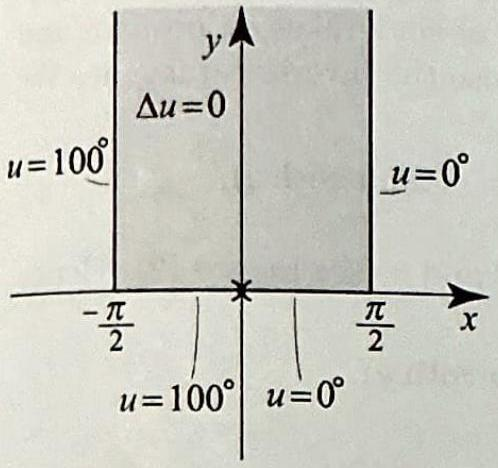
> > Dirichlet problem in Exercise 7.
> 
> 


##### solution

Let

$$
\Omega=\left\{x+i y:-\frac{\pi}{2}<x<\frac{\pi}{2},\ y>0\right\}.
$$

The boundary conditions in _Figure 10_ are

$$
u=100
\quad \text{on } x=-\frac{\pi}{2} \text{ and on } -\frac{\pi}{2}<x<0,\ y=0,
$$

and

$$
u=0
\quad \text{on } x=\frac{\pi}{2} \text{ and on } 0<x<\frac{\pi}{2},\ y=0.
$$

The value at the single point $z=0$ is irrelevant.

For part (a), use the conformal map

$$
w=f(z)=\sin z.
$$

If $z=x+i y$, then

$$
w=\sin z=\sin x \cosh y+i \cos x \sinh y.
$$

Since $-\dfrac{\pi}{2}<x<\dfrac{\pi}{2}$, we have $\cos x>0$, and therefore

$$
\operatorname{Im} w=\cos x \sinh y>0
$$

for every $z \in \Omega$. Hence $f[\Omega]$ is the upper half-plane.

Now check the boundary correspondence, as in _Figure 11_. On the left side $x=-\dfrac{\pi}{2}$,

$$
w=\sin \left(-\frac{\pi}{2}+i y\right)=-\cosh y \leq-1 .
$$

On the lower-left part of the bottom edge, where $-\dfrac{\pi}{2} \leq x \leq 0$ and $y=0$,

$$
w=\sin x \in[-1,0].
$$

So the part of the boundary where the temperature is $100^{\circ}$ maps to the negative real axis. Likewise, on the right side $x=\dfrac{\pi}{2}$,

$$
w=\sin \left(\frac{\pi}{2}+i y\right)=\cosh y \geq 1,
$$

and on the lower-right part, where $0 \leq x \leq \dfrac{\pi}{2}$ and $y=0$,

$$
w=\sin x \in[0,1].
$$

So the part of the boundary where the temperature is $0^{\circ}$ maps to the positive real axis.

The transformed Dirichlet problem in the $w$-plane is therefore

$$
\Delta U=0 \quad \text { in } \operatorname{Im} w>0,
$$

with boundary values

$$
U=100 \quad \text { on }(-\infty, 0),
\qquad
U=0 \quad \text { on }(0, \infty) .
$$

Using the principal argument on the upper half-plane, $0<\operatorname{Arg} w<\pi$, we obtain

$$
U(w)=\frac{100}{\pi} \operatorname{Arg} w .
$$

Indeed, $\operatorname{Arg} w=\pi$ on the negative real axis and $\operatorname{Arg} w=0$ on the positive real axis.

Therefore

$$
u(z)=U(\sin z)=\frac{100}{\pi} \operatorname{Arg}(\sin z)
$$

solves the original problem. If we write $w=s+i t=\sin z$, then

$$
s=\sin x \cosh y,
\qquad
t=\cos x \sinh y,
$$

so, using _Figure 12_,

$$
u(x, y)=\frac{100}{\pi} \cot ^{-1}\left(\frac{s}{t}\right)
=\frac{100}{\pi} \cot ^{-1}\left(\frac{\sin x \cosh y}{\cos x \sinh y}\right)
=\frac{100}{\pi} \cot ^{-1}(\tan x \operatorname{coth} y) .
$$

Thus

$$
\boxed{u(x, y)=\frac{100}{\pi} \operatorname{Arg}(\sin (x+i y))
=\frac{100}{\pi} \cot ^{-1}(\tan x \operatorname{coth} y)}
$$

for

$$
-\frac{\pi}{2}<x<\frac{\pi}{2},
\qquad
y>0.
$$

For part (b), the isotherms are the level curves $u(x, y)=T$, where $0<T<100$. Since

$$
\frac{100}{\pi} \operatorname{Arg}(\sin z)=T,
$$

we get

$$
\operatorname{Arg}(\sin z)=\frac{\pi T}{100} .
$$

In the $w$-plane these are the rays

$$
\operatorname{Arg} w=\frac{\pi T}{100} .
$$

Pulling them back by $w=\sin z$ gives

$$
\tan \left(\frac{\pi T}{100}\right)
=\frac{\operatorname{Im}(\sin z)}{\operatorname{Re}(\sin z)}
=\frac{\cos x \sinh y}{\sin x \cosh y}
=\cot x \tanh y .
$$

Hence the isotherms satisfy

$$
\boxed{\tan x=\cot \left(\frac{\pi T}{100}\right) \tanh y},
\qquad 0<T<100 .
$$

Equivalently,

$$
x=\tan ^{-1}\left(\cot \left(\frac{\pi T}{100}\right) \tanh y\right) .
$$

These are the curves shown in _Figure 13_. Each one starts at the origin, and as $y \to \infty$ it approaches the vertical line

$$
x=\frac{\pi}{2}-\frac{\pi T}{100} .
$$

To get the lines of heat flow, take a harmonic conjugate of $U$. Since

$$
-i \operatorname{Log} w=\operatorname{Arg} w-i \ln |w|,
$$

a harmonic conjugate of $\operatorname{Arg} w$ is $-\ln |w|$. Thus we may take

$$
V(w)=-\frac{100}{\pi} \ln |w| .
$$

The curves of heat flow are the level curves of $V$, so in the $w$-plane they are the semicircles

$$
|w|=R,
\qquad
R>0,
\qquad
\operatorname{Im} w \geq 0 .
$$

Pulling these back under $w=\sin z$ gives

$$
|\sin z|=R .
$$

Since

$$
|\sin (x+i y)|^{2}
=\sin ^{2} x \cosh ^{2} y+\cos ^{2} x \sinh ^{2} y
=\sin ^{2} x+\sinh ^{2} y,
$$

the lines of heat flow are

$$
\boxed{\sin ^{2} x+\sinh ^{2} y=R^{2}},
\qquad R>0 .
$$

For $0<R \leq 1$ these are arches meeting the bottom edge, and for $R>1$ they are larger arches joining the two vertical sides. They are orthogonal to the isotherms because they arise as level curves of a harmonic conjugate.


The following static plot shows a representative family of isotherms and curves of heat flow in the strip.


> [!figure] Python rendering for Exercise 7
> 
> 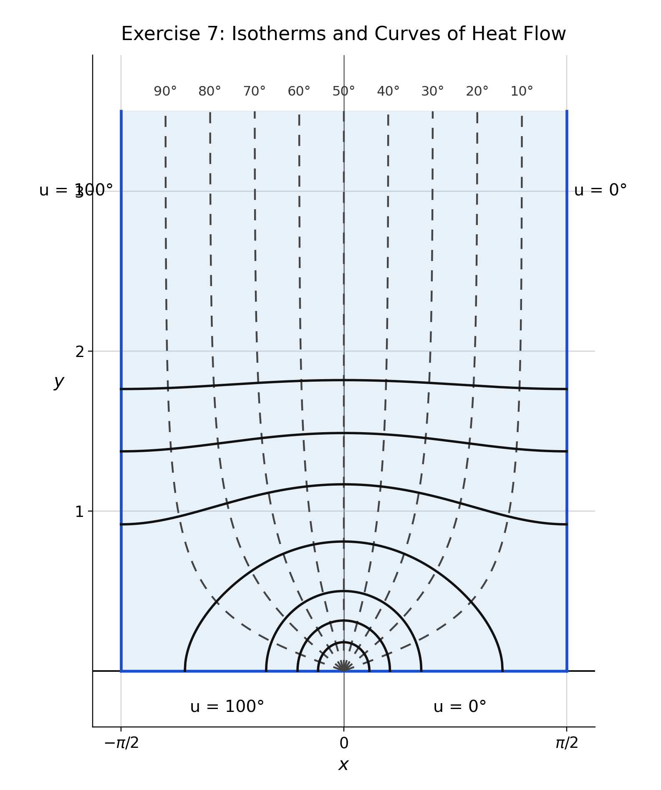
> 
> Static Python rendering of the isotherms $u(x, y)=T$ and heat-flow curves $\sin ^{2} x+\sinh ^{2} y=R^{2}$ for Exercise 7.


```Mathematica title:""
Manipulate[
 Module[
  {
   theta = Pi temp/100,
   blue = RGBColor[0.15, 0.42, 0.85],
   green = RGBColor[0.12, 0.62, 0.22],
   purple = RGBColor[0.50, 0.22, 0.72],
   gray = GrayLevel[0.35],
   xLeft, xRight, isoZ, flowZ, isoW, flowW,
   rayLength, wHeight, leftPlot, rightPlot
   },
  
  xLeft = If[rho <= 1, -ArcSin[rho], -Pi/2];
  xRight = If[rho <= 1, ArcSin[rho], Pi/2];
  
  isoZ =
   Table[
    {ArcTan[Cot[theta] Tanh[t]], t},
    {t, 0, displayHeight, displayHeight/260}
    ];
  
  flowZ =
   Table[
    {x, ArcSinh[Sqrt[Max[0, rho^2 - Sin[x]^2]]]},
    {x, xLeft, xRight, (xRight - xLeft)/320}
    ];
  
  rayLength = Max[3.2, rho + 0.8];
  wHeight = Max[3.2, rho + 0.8];
  
  isoW =
   Table[
    r {Cos[theta], Sin[theta]},
    {r, 0, rayLength, rayLength/260}
    ];
  
  flowW =
   Table[
    rho {Cos[t], Sin[t]},
    {t, 0, Pi, Pi/320}
    ];
  
  leftPlot =
   Graphics[
    {
     {LightBlue, Opacity[0.28], EdgeForm[{Thick, blue}],
      Rectangle[{-Pi/2, 0}, {Pi/2, displayHeight}]},
     {gray, Thick, Dashing[{0.02, 0.02}], Line[isoZ]},
     {green, Thick, Line[flowZ]},
     Text[Style["T = " <> ToString[NumberForm[temp, {4, 1}]] <> "\[Degree]", 14, gray, Bold],
      Last[isoZ] + {0.18, 0}],
     Text[Style["R = " <> ToString[NumberForm[rho, {4, 2}]], 14, green, Bold],
      flowZ[[Round[Length[flowZ]/2]]] + {0, 0.18}]
     },
    Axes -> True,
    GridLines -> Automatic,
    PlotRange -> {{-Pi/2 - 0.15, Pi/2 + 0.15}, {-0.08, displayHeight + 0.2}},
    ImageSize -> 430,
    PlotLabel -> Style["Exercise 7: z-plane strip", 18],
    AxesLabel -> {"x", "y"}
    ];
  
  rightPlot =
   Graphics[
    {
     {LightBlue, Opacity[0.28], EdgeForm[{Thick, blue}],
      Rectangle[{-rayLength, 0}, {rayLength, wHeight}]},
     {gray, Thick, Dashing[{0.02, 0.02}], Line[isoW]},
     {green, Thick, Line[flowW]},
     Text[Style["Arg w = \[Pi] T/100", 14, gray, Bold],
      0.72 rayLength {Cos[theta], Sin[theta]} + {0.18, 0.12}],
     Text[Style["|w| = R", 14, green, Bold], {0, rho + 0.18}]
     },
    Axes -> True,
    GridLines -> Automatic,
    PlotRange -> {{-rayLength, rayLength}, {-0.08, wHeight}},
    ImageSize -> 500,
    PlotLabel -> Style["w-plane: upper half-plane", 18],
    AxesLabel -> {"s", "t"}
    ];
  
  Column[
   {
    Style["Exercise 7: isotherms and heat-flow curves under w = sin z", 21, Bold],
    GraphicsRow[{leftPlot, rightPlot}, Spacings -> 28],
    Style[
     Row[{
       "Selected isotherm:  T = ", NumberForm[temp, {4, 1}], "\[Degree]",
       "  corresponds to  Arg(w) = \[Pi]T/100."
       }],
     14
     ],
    Style[
     Row[{
       "Selected heat-flow curve:  |w| = ", NumberForm[rho, {4, 2}],
       "  pulls back to  sin^2(x) + sinh^2(y) = ",
       NumberForm[rho^2, {5, 2}], "."
       }],
     13, green
     ]
    }
   ]
  ],
 {{temp, 60, "temperature T"}, 5, 95, Appearance -> "Labeled"},
 {{rho, 1.10, "flow radius R"}, 0.20, 3.20, Appearance -> "Labeled"},
 {{displayHeight, 3.5, "display height"}, 1.5, 5.0, Appearance -> "Labeled"},
 TrackedSymbols :> {temp, rho, displayHeight}
]
```


```python title:"exercise7_isotherms_heatflow_plot.py"
from pathlib import Path

import matplotlib.pyplot as plt
import numpy as np


def isotherm_x(y, temperature):
    theta = np.pi * temperature / 100.0
    return np.arctan((1.0 / np.tan(theta)) * np.tanh(y))


def heat_flow_y(x, radius):
    return np.arcsinh(np.sqrt(np.maximum(0.0, radius**2 - np.sin(x) ** 2)))


def main():
    chapter_dir = Path(__file__).resolve().parent
    output_path = chapter_dir / "images" / "exercise7_isotherms_heatflow_python_static.png"

    x_min = -np.pi / 2
    x_max = np.pi / 2
    y_max = 3.5

    fig, ax = plt.subplots(figsize=(7.2, 8.6), dpi=220)

    ax.fill(
        [x_min, x_min, x_max, x_max],
        [0.0, y_max, y_max, 0.0],
        color="#d8e8f7",
        alpha=0.6,
        zorder=0,
    )
    ax.plot([x_min, x_min], [0.0, y_max], color="#1b4fd1", linewidth=2.2, zorder=2)
    ax.plot([x_max, x_max], [0.0, y_max], color="#1b4fd1", linewidth=2.2, zorder=2)
    ax.plot([x_min, x_max], [0.0, 0.0], color="#1b4fd1", linewidth=2.2, zorder=2)

    ax.axhline(0.0, color="black", linewidth=1.2, zorder=1)
    ax.axvline(0.0, color="black", linewidth=1.0, alpha=0.7, zorder=1)

    y_vals = np.linspace(0.0, y_max, 700)
    temperatures = [10, 20, 30, 40, 50, 60, 70, 80, 90]
    for temperature in temperatures:
        x_vals = isotherm_x(y_vals, temperature)
        ax.plot(
            x_vals,
            y_vals,
            color="#444444",
            linewidth=1.45,
            linestyle=(0, (6, 5)),
            zorder=3,
        )

        x_limit = np.pi / 2 - np.pi * temperature / 100.0
        ax.text(
            x_limit,
            y_max + 0.08,
            f"{temperature}\N{DEGREE SIGN}",
            ha="center",
            va="bottom",
            fontsize=10.5,
            color="#333333",
        )

    radii = [0.18, 0.32, 0.52, 0.9, 1.45, 2.1, 3.0]
    for radius in radii:
        if radius <= 1.0:
            x_vals = np.linspace(-np.arcsin(radius), np.arcsin(radius), 700)
        else:
            x_vals = np.linspace(x_min, x_max, 900)
        y_vals_curve = heat_flow_y(x_vals, radius)
        ax.plot(x_vals, y_vals_curve, color="#111111", linewidth=1.85, zorder=4)

    ax.text(x_min - 0.05, 3.0, "u = 100°", ha="right", va="center", fontsize=13)
    ax.text(x_max + 0.05, 3.0, "u = 0°", ha="left", va="center", fontsize=13)
    ax.text(-0.82, -0.18, "u = 100°", ha="center", va="top", fontsize=13)
    ax.text(0.82, -0.18, "u = 0°", ha="center", va="top", fontsize=13)

    ax.set_title("Exercise 7: Isotherms and Curves of Heat Flow", fontsize=15, pad=12)
    ax.set_xlim(x_min - 0.2, x_max + 0.2)
    ax.set_ylim(-0.35, y_max + 0.35)
    ax.set_xticks([-np.pi / 2, 0.0, np.pi / 2])
    ax.set_xticklabels([r"$-\pi/2$", r"$0$", r"$\pi/2$"], fontsize=12)
    ax.set_yticks([1.0, 2.0, 3.0])
    ax.set_yticklabels([r"$1$", r"$2$", r"$3$"], fontsize=12)
    ax.set_xlabel(r"$x$", fontsize=14)
    ax.set_ylabel(r"$y$", fontsize=14, rotation=0, labelpad=12)
    ax.grid(True, color="#aeb6bf", linewidth=0.8, alpha=0.6)

    for spine in ("top", "right"):
        ax.spines[spine].set_visible(False)

    fig.subplots_adjust(top=0.93, left=0.14, right=0.90, bottom=0.08)
    fig.savefig(output_path)
    plt.close(fig)


if __name__ == "__main__":
    main()
```


++++


##### problem 7.a


> [!figure] Figure 11: For problem 7.a
> 
> 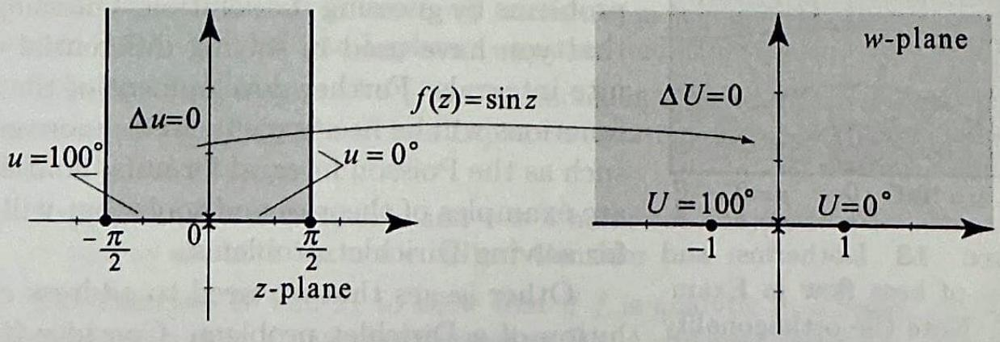
> 
> Mapping the semiinfinite vertical strip onto the upper half-plane. Note the boundary correspondence.


> [!figure] Figure 12: For Problem 7.a
> 
> 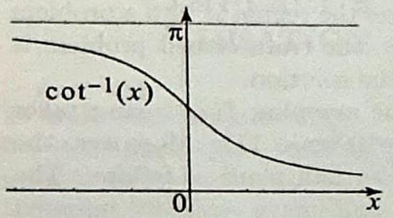
> Figure 12 The inverse cotangent takes its values in $(0, \pi)$.


##### problem 7.b


> [!figure] Figure 13: For Problem 7.b
> 
> 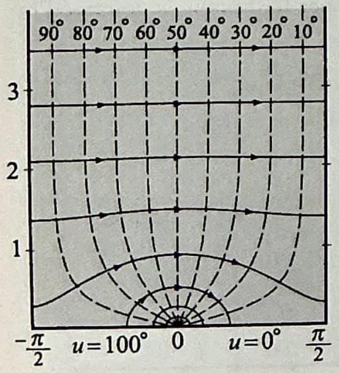
> 
> Isotherms and curves of heat flow in Example 7. Note the orthogonality of the curves.


++++


> [!review]
> Why might the boundary data of a Dirichlet problem fail to determine a unique solution, and what additional condition on the solution restores uniqueness?


##### solution

Boundary data alone can fail to determine a unique solution because one may be able to add a nonzero harmonic function that vanishes on the boundary and still preserve both Laplace's equation and the prescribed boundary values.

More precisely, if $u$ solves a Dirichlet problem and $\phi$ is harmonic in the region with

$$
\phi=0
\quad \text{on the boundary},
$$

then

$$
\psi=u+\phi
$$

is also harmonic and has the same boundary data as $u$. Thus the same boundary values may correspond to more than one harmonic function.

This is exactly what happens in Example 3: the function $x y$ is harmonic and vanishes on the boundary of the first quadrant, so if $u$ is one solution, then

$$
u(x,y)+x y
$$

is another solution with the same boundary values.

The additional condition that restores uniqueness is to require the solution to be bounded. This boundedness condition acts like a boundary condition at infinity and rules out extra functions such as $x y$, which become unbounded. With the boundary values together with boundedness, the Dirichlet problem has a unique solution.


+++++


> [!exercise]
> Show that if $u(x, y)$ is the solution to the Dirichlet problem of Example 3 (Laplace's equation on the first quadrant with $u=100$ on the positive $x$-axis and $u=50$ on the positive $y$-axis), then $\psi(x, y)=u(x, y)+x y$ is also a solution.


##### solution

We are told that $u(x, y)$ solves the Dirichlet problem of Example 3 on the first quadrant. Thus

$$
\Delta u=0
$$

in the first quadrant, with boundary values

$$
u(x,0)=100
\quad \text{for } x>0,
\qquad
u(0,y)=50
\quad \text{for } y>0.
$$

Define

$$
\psi(x,y)=u(x,y)+x y.
$$

We show that $\psi$ satisfies the same Dirichlet problem.

First, $\psi$ satisfies Laplace's equation. Since $u$ is harmonic,

$$
\Delta u=0.
$$

Also,

$$
\frac{\partial^{2}}{\partial x^{2}}(x y)=0,
\qquad
\frac{\partial^{2}}{\partial y^{2}}(x y)=0,
$$

so

$$
\Delta(x y)=0.
$$

Therefore

$$
\Delta \psi
=\Delta(u+x y)
=\Delta u+\Delta(x y)
=0+0
=0.
$$

Thus $\psi$ is harmonic in the first quadrant.

Now check the boundary values. On the positive $x$-axis, where $y=0$,

$$
\psi(x,0)=u(x,0)+x \cdot 0=u(x,0)=100.
$$

On the positive $y$-axis, where $x=0$,

$$
\psi(0,y)=u(0,y)+0 \cdot y=u(0,y)=50.
$$

So $\psi$ has exactly the same boundary values as $u$.

Hence $\psi(x,y)=u(x,y)+x y$ is also a solution of the Dirichlet problem in Example 3.


++++


So far we have used our knowledge of analytic functions to solve Dirichlet problems by guessing the solution. Guessing is certainly a legitimate method that you have used in solving differential equations and computing indefinite integrals. Further development of the theory of analytic and harmonic functions will be necessary to tackle more general Dirichlet problems. Topics such as the Poisson integral formula, Fourier series, and conformal mappings are examples of theories and tools that will provide us with systematic ways for solving Dirichlet problems.

Other issues that we need to address concern the uniqueness of the solution of a Dirichlet problem. Consider the problem in Example 3, whose solution is $u(x, y)=-\frac{100}{\pi} \tan ^{-1}\left(\frac{y}{x}\right)+100$. If we add to this solution the harmonic function $\phi(x, y)=x y$, we obtain the harmonic function $\psi(x, y)= u(x, y)+x y$, which solves Laplace's equation. Moreover, because $x y$ vanishes on the boundary of the first quadrant, $\psi(x, y)$ and $u(x, y)$ have the same boundary values. Thus, $\psi$ is another solution of the Dirichlet problem in Example 3. This is quite disturbing since we want to think of the solution ${ }^{25}$
representing a temperature distribution and as such it must be unique. As it turns out, if in addition to the boundary conditions in a Dirichlet problem we add the condition that the solution be bounded (which is effectively a boundary condition at infinity), then the solution will be unique. For example, with this additional boundedness assumption, we can no longer add the function $x y$ to the solution in Example 3 to obtain another solution.

Uniqueness results for the solution of Dirichlet problems will be derived from theoretical properties of analytic and harmonic functions, including results such as the maximum principle. All these topics will be addressed as part of the remainder of this book.


# Exercises 2.5

> [!exercise] Exercise 8
> In problemss 1-12, determine the set on which the given function is harmonic. You may verify Laplace's equation (1) directly or use Theorem 1.
> 
> 1. $x^{2}-y^{2}+2 x-y$.
> 2. $\frac{1}{x^{2}-y^{2}}$.
> 3. $e^{x} \cos y$.
> 4. $\frac{y}{x^{2}+y^{2}}$.
> 5. $\frac{1}{x+y}$.
> 6. $\sinh x \cos y$.
> 7. $\cos x \cosh y$.
> 8. $e^{2 x} \cos (2 y)$.
> 9. $e^{x^{2}-y^{2}} \cos (2 x y)$.
> 10. $\ln \left(x^{2}+y^{2}\right)$.
> 11. $\ln \left((x-1)^{2}+y^{2}\right)$.
> 12. $\arg _{\frac{\pi}{2}} z$.


##### solution

In these problems there are two standard ways to determine whether a function is harmonic.

The first method is to verify Laplace's equation directly. If a function is given explicitly in terms of $x$ and $y$ in a simple algebraic form, this is often the most efficient approach: compute

$$
\Delta u=u_{xx}+u_{yy}
$$

and check whether it is equal to $0$ on the domain of the function. This method is especially useful when the expression is a polynomial, a simple rational function, or a function that does not obviously come from a familiar analytic function. It is also the natural method when one suspects that the function may fail to be harmonic, because it can show directly that $\Delta u\ne 0$.

The second method is to use Theorem 1, which says that the real and imaginary parts of an analytic function are harmonic. This method is preferable when the given function is immediately recognizable as the real part or imaginary part of a standard analytic function such as

$$
e^z,\qquad \sin z,\qquad \cos z,\qquad \sinh z,\qquad \cosh z,\qquad \frac{1}{z},\qquad e^{z^2},
$$

or a branch of $\log z$. In that situation, it is usually much faster to identify the analytic parent function and then invoke Theorem 1 than to differentiate twice and simplify.

So the general principle is this: if the function has a clear analytic source, use Theorem 1; if it does not, or if you need to show it is not harmonic, compute the Laplacian directly.

##### problem 1

Consider

$$
u(x,y)=x^2-y^2+2x-y.
$$

Here the fastest method is to verify Laplace's equation directly, because the function is just a polynomial in $x$ and $y$, so the derivatives are immediate.

Compute the first partial derivatives:

$$
\begin{aligned}
u_x
&=\frac{\partial}{\partial x}(x^2-y^2+2x-y)\\
&=2x+2,
\end{aligned}
$$

and

$$
\begin{aligned}
u_y
&=\frac{\partial}{\partial y}(x^2-y^2+2x-y)\\
&=-2y-1.
\end{aligned}
$$

Now compute the second partial derivatives:

$$
\begin{aligned}
u_{xx}
&=\frac{\partial}{\partial x}(2x+2)\\
&=2,
\end{aligned}
$$

and

$$
\begin{aligned}
u_{yy}
&=\frac{\partial}{\partial y}(-2y-1)\\
&=-2.
\end{aligned}
$$

Therefore

$$
\begin{aligned}
\Delta u
&=u_{xx}+u_{yy}\\
&=2+(-2)\\
&=0.
\end{aligned}
$$

Since $u$ has continuous first and second partial derivatives everywhere, $u$ is harmonic on

$$
\mathbb C.
$$

##### problem 2

Now consider

$$
u(x,y)=\frac{1}{x^2-y^2}.
$$

Here it is better to verify Laplace's equation directly, because the function is not the obvious real or imaginary part of a standard analytic function, and we also need to decide whether it is harmonic anywhere.

First determine where the function is defined:

$$
x^2-y^2\ne 0.
$$

That means

$$
x\ne y
\qquad\text{and}\qquad
x\ne -y.
$$

So the natural domain is

$$
\mathbb C\setminus\{x+iy:x=y\text{ or }x=-y\}.
$$

Now compute derivatives. Write

$$
u(x,y)=(x^2-y^2)^{-1}.
$$

Then

$$
\begin{aligned}
u_x
&=\frac{\partial}{\partial x}(x^2-y^2)^{-1}\\
&=-1\cdot (x^2-y^2)^{-2}\cdot \frac{\partial}{\partial x}(x^2-y^2)\\
&=-(x^2-y^2)^{-2}(2x)\\
&=-\frac{2x}{(x^2-y^2)^2},
\end{aligned}
$$

and

$$
\begin{aligned}
u_y
&=\frac{\partial}{\partial y}(x^2-y^2)^{-1}\\
&=-1\cdot (x^2-y^2)^{-2}\cdot \frac{\partial}{\partial y}(x^2-y^2)\\
&=-(x^2-y^2)^{-2}(-2y)\\
&=\frac{2y}{(x^2-y^2)^2}.
\end{aligned}
$$

Differentiate again:

$$
\begin{aligned}
u_{xx}
&=\frac{\partial}{\partial x}\left[-2x(x^2-y^2)^{-2}\right]\\
&=-2(x^2-y^2)^{-2}+(-2x)\left[-2(x^2-y^2)^{-3}(2x)\right]\\
&=-\frac{2}{(x^2-y^2)^2}+\frac{8x^2}{(x^2-y^2)^3}\\
&=\frac{-2(x^2-y^2)+8x^2}{(x^2-y^2)^3}\\
&=\frac{-2x^2+2y^2+8x^2}{(x^2-y^2)^3}\\
&=\frac{6x^2+2y^2}{(x^2-y^2)^3},
\end{aligned}
$$

and

$$
\begin{aligned}
u_{yy}
&=\frac{\partial}{\partial y}\left[2y(x^2-y^2)^{-2}\right]\\
&=2(x^2-y^2)^{-2}+2y\left[-2(x^2-y^2)^{-3}(-2y)\right]\\
&=\frac{2}{(x^2-y^2)^2}+\frac{8y^2}{(x^2-y^2)^3}\\
&=\frac{2(x^2-y^2)+8y^2}{(x^2-y^2)^3}\\
&=\frac{2x^2-2y^2+8y^2}{(x^2-y^2)^3}\\
&=\frac{2x^2+6y^2}{(x^2-y^2)^3}.
\end{aligned}
$$

Now add:

$$
\begin{aligned}
\Delta u
&=u_{xx}+u_{yy}\\
&=\frac{6x^2+2y^2}{(x^2-y^2)^3}+\frac{2x^2+6y^2}{(x^2-y^2)^3}\\
&=\frac{8x^2+8y^2}{(x^2-y^2)^3}\\
&=\frac{8(x^2+y^2)}{(x^2-y^2)^3}.
\end{aligned}
$$

This is not equal to $0$ at points of the domain. For example, at $(x,y)=(1,0)$,

$$
\Delta u(1,0)=\frac{8(1^2+0^2)}{(1^2-0^2)^3}=8\ne 0.
$$

So $u$ is not harmonic on its domain, and therefore it is harmonic on no open set at all.

##### problem 3

Consider

$$
u(x,y)=e^x\cos y.
$$

Here Theorem 1 is the natural method, because the expression is immediately recognizable as the real part of $e^z$.

Indeed,

$$
\begin{aligned}
e^z
&=e^{x+iy}\\
&=e^x e^{iy}\\
&=e^x(\cos y+i\sin y).
\end{aligned}
$$

Therefore

$$
\operatorname{Re}(e^z)=e^x\cos y=u(x,y).
$$

Since $e^z$ is analytic on all of $\mathbb C$, Theorem 1 implies that its real part is harmonic on all of $\mathbb C$. Hence $u$ is harmonic on

$$
\mathbb C.
$$

##### problem 4

Now take

$$
u(x,y)=\frac{y}{x^2+y^2}.
$$

Here Theorem 1 is more efficient than direct differentiation, because the expression is naturally related to $1/z$.

For $z=x+iy\ne 0$,

$$
\begin{aligned}
\frac{1}{z}
&=\frac{1}{x+iy}\\
&=\frac{x-iy}{(x+iy)(x-iy)}\\
&=\frac{x-iy}{x^2+y^2}\\
&=\frac{x}{x^2+y^2}-i\frac{y}{x^2+y^2}.
\end{aligned}
$$

Thus

$$
\operatorname{Im}\!\left(\frac{1}{z}\right)=-\frac{y}{x^2+y^2},
$$

so

$$
u(x,y)=-\operatorname{Im}\!\left(\frac{1}{z}\right).
$$

The function $1/z$ is analytic on

$$
\mathbb C\setminus\{0\}.
$$

By Theorem 1, its imaginary part is harmonic there, and multiplying by $-1$ preserves harmonicity. Therefore $u$ is harmonic on

$$
\mathbb C\setminus\{0\}.
$$

##### problem 5

Consider

$$
u(x,y)=\frac{1}{x+y}.
$$

Here a direct Laplacian check is the right method, because the expression depends on both $x$ and $y$ in a simple rational way, and it is not the obvious real or imaginary part of a standard analytic function.

First, the function is defined when

$$
x+y\ne 0.
$$

Now compute:

$$
\begin{aligned}
u_x
&=\frac{\partial}{\partial x}(x+y)^{-1}\\
&=-1\cdot (x+y)^{-2}\cdot \frac{\partial}{\partial x}(x+y)\\
&=-(x+y)^{-2}\\
&=-\frac{1}{(x+y)^2},
\end{aligned}
$$

and similarly

$$
\begin{aligned}
u_y
&=\frac{\partial}{\partial y}(x+y)^{-1}\\
&=-1\cdot (x+y)^{-2}\cdot \frac{\partial}{\partial y}(x+y)\\
&=-(x+y)^{-2}\\
&=-\frac{1}{(x+y)^2}.
\end{aligned}
$$

Differentiate again:

$$
\begin{aligned}
u_{xx}
&=\frac{\partial}{\partial x}\left[-(x+y)^{-2}\right]\\
&=-\left[-2(x+y)^{-3}\cdot 1\right]\\
&=2(x+y)^{-3}\\
&=\frac{2}{(x+y)^3},
\end{aligned}
$$

and

$$
\begin{aligned}
u_{yy}
&=\frac{\partial}{\partial y}\left[-(x+y)^{-2}\right]\\
&=-\left[-2(x+y)^{-3}\cdot 1\right]\\
&=2(x+y)^{-3}\\
&=\frac{2}{(x+y)^3}.
\end{aligned}
$$

So

$$
\begin{aligned}
\Delta u
&=u_{xx}+u_{yy}\\
&=\frac{2}{(x+y)^3}+\frac{2}{(x+y)^3}\\
&=\frac{4}{(x+y)^3}.
\end{aligned}
$$

This is not zero at points of the domain. For instance, at $(0,1)$,

$$
\Delta u(0,1)=\frac{4}{(0+1)^3}=4\ne 0.
$$

Therefore $u$ is not harmonic on any open subset of its domain.

##### problem 6

Next consider

$$
u(x,y)=\sinh x\cos y.
$$

Here Theorem 1 is the natural choice, because the expression appears directly in the standard formula for $\sinh z$.

Compute:

$$
\begin{aligned}
\sinh z
&=\sinh(x+iy)\\
&=\frac{e^{x+iy}-e^{-(x+iy)}}{2}\\
&=\frac{e^x(\cos y+i\sin y)-e^{-x}(\cos y-i\sin y)}{2}\\
&=\frac{(e^x-e^{-x})\cos y+i(e^x+e^{-x})\sin y}{2}\\
&=\sinh x\cos y+i\cosh x\sin y.
\end{aligned}
$$

Thus

$$
\operatorname{Re}(\sinh z)=\sinh x\cos y=u(x,y).
$$

Since $\sinh z$ is entire, Theorem 1 gives that $u$ is harmonic on

$$
\mathbb C.
$$

##### problem 7

Now let

$$
u(x,y)=\cos x\cosh y.
$$

Again, Theorem 1 is the clean method, because the expression is the real part of $\cos z$.

Indeed,

$$
\begin{aligned}
\cos z
&=\cos(x+iy)\\
&=\frac{e^{i(x+iy)}+e^{-i(x+iy)}}{2}\\
&=\frac{e^{-y+ix}+e^{y-ix}}{2}\\
&=\frac{e^{-y}(\cos x+i\sin x)+e^y(\cos x-i\sin x)}{2}\\
&=\frac{(e^{-y}+e^y)\cos x+i(e^{-y}-e^y)\sin x}{2}\\
&=\cos x\cosh y-i\sin x\sinh y.
\end{aligned}
$$

Therefore

$$
\operatorname{Re}(\cos z)=\cos x\cosh y=u(x,y).
$$

Since $\cos z$ is entire, $u$ is harmonic on

$$
\mathbb C.
$$

##### problem 8

Consider

$$
u(x,y)=e^{2x}\cos(2y).
$$

Here Theorem 1 is preferable because the function is immediately the real part of $e^{2z}$.

We compute

$$
\begin{aligned}
e^{2z}
&=e^{2(x+iy)}\\
&=e^{2x+2iy}\\
&=e^{2x}(\cos 2y+i\sin 2y).
\end{aligned}
$$

Hence

$$
\operatorname{Re}(e^{2z})=e^{2x}\cos(2y)=u(x,y).
$$

Since $e^{2z}$ is entire, Theorem 1 gives that $u$ is harmonic on

$$
\mathbb C.
$$

##### problem 9

Now consider

$$
u(x,y)=e^{x^2-y^2}\cos(2xy).
$$

Here Theorem 1 is again the most efficient method, because the expression is exactly the real part of $e^{z^2}$.

First compute

$$
\begin{aligned}
z^2
&=(x+iy)^2\\
&=x^2+2ixy+i^2y^2\\
&=x^2+2ixy-y^2\\
&=x^2-y^2+2ixy.
\end{aligned}
$$

Then

$$
\begin{aligned}
e^{z^2}
&=e^{x^2-y^2+2ixy}\\
&=e^{x^2-y^2}e^{2ixy}\\
&=e^{x^2-y^2}(\cos(2xy)+i\sin(2xy)).
\end{aligned}
$$

Therefore

$$
\operatorname{Re}(e^{z^2})=e^{x^2-y^2}\cos(2xy)=u(x,y).
$$

Since $z^2$ is entire and the exponential function is entire, $e^{z^2}$ is entire. By Theorem 1, $u$ is harmonic on

$$
\mathbb C.
$$

##### problem 10

Now take

$$
u(x,y)=\ln(x^2+y^2).
$$

Here Theorem 1 is the better method because the function is closely related to $\ln|z|$, whose harmonicity was already established in the section.

For $z=x+iy\ne 0$,

$$
|z|=\sqrt{x^2+y^2}.
$$

Therefore

$$
\begin{aligned}
\ln(x^2+y^2)
&=\ln\bigl(|z|^2\bigr)\\
&=2\ln|z|.
\end{aligned}
$$

The function $\ln|z|$ is harmonic on

$$
\mathbb C\setminus\{0\}.
$$

Multiplying a harmonic function by the constant $2$ preserves harmonicity. Hence $u$ is harmonic on

$$
\mathbb C\setminus\{0\}.
$$

It is not even defined at $z=0$, so this is the largest region on which it is harmonic.

##### problem 11

Consider

$$
u(x,y)=\ln\!\bigl((x-1)^2+y^2\bigr).
$$

Here the same method as in problem 10 is the cleanest one, because the expression is just a translated version of $\ln(x^2+y^2)$.

Observe that

$$
z-1=(x-1)+iy,
$$

so

$$
\begin{aligned}
|z-1|^2
&=((x-1)+iy)((x-1)-iy)\\
&=(x-1)^2+y^2.
\end{aligned}
$$

Thus

$$
\begin{aligned}
u(x,y)
&=\ln\!\bigl((x-1)^2+y^2\bigr)\\
&=\ln|z-1|^2\\
&=2\ln|z-1|.
\end{aligned}
$$

Since $\ln|w|$ is harmonic for $w\ne 0$, the translated function $\ln|z-1|$ is harmonic for

$$
z-1\ne 0,
$$

that is, for

$$
z\ne 1.
$$

Therefore $u$ is harmonic on

$$
\mathbb C\setminus\{1\}.
$$

##### problem 12

Finally consider

$$
\arg_{\pi/2} z.
$$

Here Theorem 1, together with the discussion of branches of the logarithm and argument, is the correct method. A direct Laplacian computation would be much less natural because this is a branch-defined function, and the main issue is the domain.

The notation

$$
\arg_{\pi/2} z
$$

means the branch of the argument whose branch cut is the ray of angle

$$
\frac{\pi}{2}.
$$

That ray is

$$
\{re^{i\pi/2}:r\ge 0\}.
$$

Since

$$
e^{i\pi/2}=i,
$$

this ray is

$$
\{ir:r\ge 0\}=\{iy:y\ge 0\},
$$

which is the nonnegative imaginary axis.

On the plane with that ray removed, the branch $\arg_{\pi/2} z$ is harmonic. Therefore the function is harmonic on

$$
\mathbb C\setminus\{iy:y\ge 0\}.
$$


> [!exercise] Exercise 9
> In Problems 13-16, find a harmonic conjugate $v(x, y)$ of the given harmonic function $u(x, y)$ by using the method of Example 2 . Check your answer by verifying the Cauchy-Riemann equations.
> 13. $x+2 y$.
> 14. $x^{2}-y^{2}-x y$.
> 15. $e^{y} \cos x$.
> 16. $\cos x \sinh y$.


##### solution

To find a harmonic conjugate $v(x,y)$ of a given harmonic function $u(x,y)$, we use the Cauchy-Riemann equations

$$
u_x=v_y,
\qquad
u_y=-v_x.
$$

We integrate one of these equations to obtain a candidate for $v$, including an unknown function of the other variable, and then use the second equation to determine that unknown function. Finally, we verify the Cauchy-Riemann equations.

##### problem 13

Let

$$
u(x,y)=x+2y.
$$

First compute the partial derivatives of $u$:

$$
\begin{aligned}
u_x
&=\frac{\partial}{\partial x}(x+2y)\\
&=1,
\end{aligned}
$$

and

$$
\begin{aligned}
u_y
&=\frac{\partial}{\partial y}(x+2y)\\
&=2.
\end{aligned}
$$

Now use the first Cauchy-Riemann equation:

$$
v_y=u_x=1.
$$

Integrate with respect to $y$:

$$
\begin{aligned}
v(x,y)
&=
\int 1\,dy\\
&=
y+\phi(x),
\end{aligned}
$$

where $\phi(x)$ is an arbitrary function of $x$.

Next use the second Cauchy-Riemann equation:

$$
u_y=-v_x.
$$

Since $u_y=2$, this gives

$$
2=-v_x.
$$

Differentiate the expression

$$
v(x,y)=y+\phi(x)
$$

with respect to $x$:

$$
\begin{aligned}
v_x
&=\frac{\partial}{\partial x}(y+\phi(x))\\
&=\phi'(x).
\end{aligned}
$$

Therefore

$$
2=-\phi'(x),
$$

so

$$
\phi'(x)=-2.
$$

Integrating with respect to $x$,

$$
\begin{aligned}
\phi(x)
&=
\int (-2)\,dx\\
&=
-2x+C.
\end{aligned}
$$

Substitute back:

$$
\begin{aligned}
v(x,y)
&=
y+\phi(x)\\
&=
y+(-2x+C)\\
&=
y-2x+C.
\end{aligned}
$$

Now verify the Cauchy-Riemann equations:

$$
\begin{aligned}
v_x
&=
\frac{\partial}{\partial x}(y-2x+C)\\
&=
0-2+0\\
&=
-2,
\end{aligned}
$$

$$
\begin{aligned}
v_y
&=
\frac{\partial}{\partial y}(y-2x+C)\\
&=
1-0+0\\
&=
1.
\end{aligned}
$$

Thus

$$
\begin{aligned}
v_y
&=
1\\
&=
u_x,
\end{aligned}
$$

and

$$
\begin{aligned}
-v_x
&=
-(-2)\\
&=
2\\
&=
u_y.
\end{aligned}
$$

So one harmonic conjugate is

$$
\boxed{v(x,y)=y-2x+C.}
$$

##### problem 14

Let

$$
u(x,y)=x^2-y^2-xy.
$$

Compute the partial derivatives:

$$
\begin{aligned}
u_x
&=\frac{\partial}{\partial x}(x^2-y^2-xy)\\
&=2x-y,
\end{aligned}
$$

and

$$
\begin{aligned}
u_y
&=\frac{\partial}{\partial y}(x^2-y^2-xy)\\
&=-2y-x.
\end{aligned}
$$

Now use

$$
v_y=u_x=2x-y.
$$

Integrate with respect to $y$:

$$
\begin{aligned}
v(x,y)
&=
\int (2x-y)\,dy\\
&=
\int 2x\,dy-\int y\,dy+\phi(x)\\
&=
2xy-\frac{y^2}{2}+\phi(x),
\end{aligned}
$$

where $\phi(x)$ is an arbitrary function of $x$.

Now use the second Cauchy-Riemann equation:

$$
u_y=-v_x.
$$

Since

$$
u_y=-2y-x,
$$

we obtain

$$
-2y-x=-v_x.
$$

Differentiate $v$ with respect to $x$:

$$
\begin{aligned}
v_x
&=\frac{\partial}{\partial x}\left(2xy-\frac{y^2}{2}+\phi(x)\right)\\
&=2y+\phi'(x).
\end{aligned}
$$

Substitute into the equation:

$$
-2y-x=-(2y+\phi'(x)).
$$

Distribute the minus sign:

$$
-2y-x=-2y-\phi'(x).
$$

Add $2y$ to both sides:

$$
\begin{aligned}
(-2y-x)+2y
&=
(-2y-\phi'(x))+2y\\
-x
&=
-\phi'(x).
\end{aligned}
$$

Multiply by $-1$:

$$
\begin{aligned}
-1(-x)
&=
-1\bigl(-\phi'(x)\bigr)\\
x
&=
\phi'(x).
\end{aligned}
$$

Integrate:

$$
\begin{aligned}
\phi(x)
&=
\int x\,dx\\
&=
\frac{x^2}{2}+C.
\end{aligned}
$$

Therefore

$$
\begin{aligned}
v(x,y)
&=
2xy-\frac{y^2}{2}+\phi(x)\\
&=
2xy-\frac{y^2}{2}+\frac{x^2}{2}+C\\
&=
\frac{x^2}{2}+2xy-\frac{y^2}{2}+C.
\end{aligned}
$$

Now verify. Differentiate:

$$
\begin{aligned}
v_x
&=
\frac{\partial}{\partial x}\left(\frac{x^2}{2}+2xy-\frac{y^2}{2}+C\right)\\
&=
x+2y-0+0\\
&=
x+2y,
\end{aligned}
$$

and

$$
\begin{aligned}
v_y
&=
\frac{\partial}{\partial y}\left(\frac{x^2}{2}+2xy-\frac{y^2}{2}+C\right)\\
&=
0+2x-y+0\\
&=
2x-y.
\end{aligned}
$$

Then

$$
\begin{aligned}
v_y
&=
2x-y\\
&=
u_x,
\end{aligned}
$$

and

$$
\begin{aligned}
-v_x
&=
-(x+2y)\\
&=
-x-2y\\
&=
u_y.
\end{aligned}
$$

So one harmonic conjugate is

$$
\boxed{v(x,y)=\frac{x^2}{2}+2xy-\frac{y^2}{2}+C.}
$$

##### problem 15

Let

$$
u(x,y)=e^y\cos x.
$$

Compute the partial derivatives:

$$
\begin{aligned}
u_x
&=\frac{\partial}{\partial x}(e^y\cos x)\\
&=e^y(-\sin x)\\
&=-e^y\sin x,
\end{aligned}
$$

and

$$
\begin{aligned}
u_y
&=\frac{\partial}{\partial y}(e^y\cos x)\\
&=e^y\cos x.
\end{aligned}
$$

Now use

$$
v_y=u_x=-e^y\sin x.
$$

Integrate with respect to $y$:

$$
\begin{aligned}
v(x,y)
&=
\int (-e^y\sin x)\,dy\\
&=
-\sin x\int e^y\,dy+\phi(x)\\
&=
-\sin x\,e^y+\phi(x)\\
&=
-e^y\sin x+\phi(x),
\end{aligned}
$$

where $\phi(x)$ is an arbitrary function of $x$.

Now use

$$
u_y=-v_x.
$$

Since $u_y=e^y\cos x$, we obtain

$$
e^y\cos x=-v_x.
$$

Differentiate $v$ with respect to $x$:

$$
\begin{aligned}
v_x
&=\frac{\partial}{\partial x}\left(-e^y\sin x+\phi(x)\right)\\
&=-e^y\cos x+\phi'(x).
\end{aligned}
$$

Therefore

$$
e^y\cos x=-\bigl(-e^y\cos x+\phi'(x)\bigr).
$$

Distribute the minus sign:

$$
e^y\cos x=e^y\cos x-\phi'(x).
$$

Subtract $e^y\cos x$ from both sides:

$$
\begin{aligned}
e^y\cos x-e^y\cos x
&=
\bigl(e^y\cos x-\phi'(x)\bigr)-e^y\cos x\\
0
&=
-\phi'(x).
\end{aligned}
$$

Hence

$$
\phi'(x)=0,
$$

so

$$
\begin{aligned}
\phi(x)
&=
\int 0\,dx\\
&=
C.
\end{aligned}
$$

Thus

$$
\begin{aligned}
v(x,y)
&=
-e^y\sin x+\phi(x)\\
&=
-e^y\sin x+C.
\end{aligned}
$$

Now verify:

$$
\begin{aligned}
v_x
&=
\frac{\partial}{\partial x}(-e^y\sin x+C)\\
&=
-e^y\cos x+0\\
&=
-e^y\cos x,
\end{aligned}
$$

and

$$
\begin{aligned}
v_y
&=
\frac{\partial}{\partial y}(-e^y\sin x+C)\\
&=
-e^y\sin x+0\\
&=
-e^y\sin x.
\end{aligned}
$$

Therefore

$$
\begin{aligned}
v_y
&=
-e^y\sin x\\
&=
u_x,
\end{aligned}
$$

and

$$
\begin{aligned}
-v_x
&=
-(-e^y\cos x)\\
&=
e^y\cos x\\
&=
u_y.
\end{aligned}
$$

So one harmonic conjugate is

$$
\boxed{v(x,y)=-e^y\sin x+C.}
$$

##### problem 16

Let

$$
u(x,y)=\cos x\,\sinh y.
$$

Compute the partial derivatives:

$$
\begin{aligned}
u_x
&=\frac{\partial}{\partial x}(\cos x\,\sinh y)\\
&=-\sin x\,\sinh y,
\end{aligned}
$$

and

$$
\begin{aligned}
u_y
&=\frac{\partial}{\partial y}(\cos x\,\sinh y)\\
&=\cos x\,\cosh y.
\end{aligned}
$$

Now use

$$
v_y=u_x=-\sin x\,\sinh y.
$$

Integrate with respect to $y$:

$$
\begin{aligned}
v(x,y)
&=
\int (-\sin x\,\sinh y)\,dy\\
&=
-\sin x\int \sinh y\,dy+\phi(x)\\
&=
-\sin x\,\cosh y+\phi(x),
\end{aligned}
$$

where $\phi(x)$ is an arbitrary function of $x$.

Now impose the second Cauchy-Riemann equation:

$$
u_y=-v_x.
$$

Since

$$
u_y=\cos x\,\cosh y,
$$

we obtain

$$
\cos x\,\cosh y=-v_x.
$$

Differentiate $v$ with respect to $x$:

$$
\begin{aligned}
v_x
&=\frac{\partial}{\partial x}\left(-\sin x\,\cosh y+\phi(x)\right)\\
&=-\cos x\,\cosh y+\phi'(x).
\end{aligned}
$$

Hence

$$
\cos x\,\cosh y=-\bigl(-\cos x\,\cosh y+\phi'(x)\bigr).
$$

Distribute the minus sign:

$$
\cos x\,\cosh y=\cos x\,\cosh y-\phi'(x).
$$

Subtract $\cos x\,\cosh y$ from both sides:

$$
\begin{aligned}
\cos x\,\cosh y-\cos x\,\cosh y
&=
\bigl(\cos x\,\cosh y-\phi'(x)\bigr)-\cos x\,\cosh y\\
0
&=
-\phi'(x).
\end{aligned}
$$

Thus

$$
\phi'(x)=0,
$$

so

$$
\begin{aligned}
\phi(x)
&=
\int 0\,dx\\
&=
C.
\end{aligned}
$$

Therefore

$$
\begin{aligned}
v(x,y)
&=
-\sin x\,\cosh y+\phi(x)\\
&=
-\sin x\,\cosh y+C.
\end{aligned}
$$

Now verify:

$$
\begin{aligned}
v_x
&=
\frac{\partial}{\partial x}(-\sin x\,\cosh y+C)\\
&=
-\cos x\,\cosh y+0\\
&=
-\cos x\,\cosh y,
\end{aligned}
$$

and

$$
\begin{aligned}
v_y
&=
\frac{\partial}{\partial y}(-\sin x\,\cosh y+C)\\
&=
-\sin x\,\sinh y+0\\
&=
-\sin x\,\sinh y.
\end{aligned}
$$

Therefore

$$
\begin{aligned}
v_y
&=
-\sin x\,\sinh y\\
&=
u_x,
\end{aligned}
$$

and

$$
\begin{aligned}
-v_x
&=
-(-\cos x\,\cosh y)\\
&=
\cos x\,\cosh y\\
&=
u_y.
\end{aligned}
$$

So one harmonic conjugate is

$$
\boxed{v(x,y)=-\sin x\,\cosh y+C.}
$$


++++


> [!exercise] Exercise 10
> 17. Let $n$ be any integer. (a) Show that $u(r, \theta)=r^{n} \cos (n \theta)$ and $v(r, \theta)= r^{n} \sin (n \theta)$ are harmonic on $\mathbb{C}$ if $n \geq 0$ and on $\mathbb{C} \backslash\{0\}$ if $n<0$. (b) Find their respective harmonic conjugates. **(Hint: Consider $f(z)=z^{n}$ in polar coordinates.)**


##### solution

##### problem 17(a)

Let

$$
f(z)=z^n.
$$

Write

$$
z=re^{i\theta}.
$$

Then

$$
\begin{aligned}
f(z)
&=
z^n\\
&=
\left(re^{i\theta}\right)^n\\
&=
r^n\left(e^{i\theta}\right)^n\\
&=
r^n e^{in\theta}\\
&=
r^n\bigl(\cos(n\theta)+i\sin(n\theta)\bigr)\\
&=
r^n\cos(n\theta)+ir^n\sin(n\theta).
\end{aligned}
$$

Therefore

$$
\begin{aligned}
\operatorname{Re}(z^n)
&=
r^n\cos(n\theta),
\end{aligned}
$$

and

$$
\begin{aligned}
\operatorname{Im}(z^n)
&=
r^n\sin(n\theta).
\end{aligned}
$$

So

$$
u(r,\theta)=r^n\cos(n\theta)
\qquad\text{and}\qquad
v(r,\theta)=r^n\sin(n\theta)
$$

are the real and imaginary parts of

$$
z^n.
$$

We now determine where

$$
z^n
$$

is analytic.

First suppose that

$$
n\ge 0.
$$

If

$$
n=0,
$$

then

$$
z^n=z^0=1,
$$

which is constant and therefore analytic on all of

$$
\mathbb C.
$$

If

$$
n\ge 1,
$$

then

$$
\begin{aligned}
z^n
&=
\underbrace{z\cdot z\cdots z}_{n\text{ factors}},
\end{aligned}
$$

so

$$
z^n
$$

is a polynomial in

$$
z.
$$

Every polynomial is analytic on all of

$$
\mathbb C.
$$

Therefore, in either case

$$
n\ge 0
\quad\Longrightarrow\quad
z^n\text{ is analytic on }\mathbb C.
$$

By Theorem 1, the real and imaginary parts of an analytic function are harmonic on the region where the function is analytic. Hence

$$
n\ge 0
\quad\Longrightarrow\quad
u(r,\theta)=r^n\cos(n\theta)
\text{ and }
v(r,\theta)=r^n\sin(n\theta)
\text{ are harmonic on }\mathbb C.
$$

Now suppose that

$$
n<0.
$$

Then there exists a positive integer

$$
m
$$

such that

$$
n=-m.
$$

Substitute this into

$$
z^n
$$

$$
\begin{aligned}
z^n
&=
z^{-m}\\
&=
\frac{1}{z^m}.
\end{aligned}
$$

Now

$$
z^m
$$

is a polynomial, so it is analytic on

$$
\mathbb C.
$$

Also,

$$
z^m=0
\quad\Longleftrightarrow\quad
z=0.
$$

Therefore

$$
\frac{1}{z^m}
$$

is analytic precisely where

$$
z^m\neq 0,
$$

that is, on

$$
\mathbb C\setminus\{0\}.
$$

Hence

$$
n<0
\quad\Longrightarrow\quad
z^n\text{ is analytic on }\mathbb C\setminus\{0\}.
$$

Again by Theorem 1, its real and imaginary parts are harmonic on that region. Therefore

$$
n<0
\quad\Longrightarrow\quad
u(r,\theta)=r^n\cos(n\theta)
\text{ and }
v(r,\theta)=r^n\sin(n\theta)
\text{ are harmonic on }\mathbb C\setminus\{0\}.
$$

Thus

$$
\boxed{
u(r,\theta)=r^n\cos(n\theta)
\quad\text{and}\quad
v(r,\theta)=r^n\sin(n\theta)
}
$$

are harmonic on

$$
\mathbb C
\quad\text{if }n\ge 0,
$$

and on

$$
\mathbb C\setminus\{0\}
\quad\text{if }n<0.
$$

##### problem 17(b)

From part (a),

$$
\begin{aligned}
z^n
&=
r^n\cos(n\theta)+ir^n\sin(n\theta).
\end{aligned}
$$

Therefore, if we write

$$
z^n=u+iv,
$$

then

$$
u(r,\theta)=r^n\cos(n\theta)
$$

and

$$
v(r,\theta)=r^n\sin(n\theta).
$$

Now

$$
z^n=u+iv
$$

is analytic on the relevant domain from part (a). By definition, when

$$
f=u+iv
$$

is analytic, the function

$$
v
$$

is a harmonic conjugate of

$$
u.
$$

Hence a harmonic conjugate of

$$
u(r,\theta)=r^n\cos(n\theta)
$$

is

$$
\boxed{v(r,\theta)=r^n\sin(n\theta).}
$$

To find a harmonic conjugate of

$$
v(r,\theta)=r^n\sin(n\theta),
$$

use Proposition 2 from the section: if

$$
v
$$

is a harmonic conjugate of

$$
u,
$$

then

$$
-u
$$

is a harmonic conjugate of

$$
v.
$$

Since we have already shown that

$$
v(r,\theta)=r^n\sin(n\theta)
$$

is a harmonic conjugate of

$$
u(r,\theta)=r^n\cos(n\theta),
$$

it follows that

$$
-u(r,\theta)
=
-r^n\cos(n\theta)
$$

is a harmonic conjugate of

$$
v(r,\theta)=r^n\sin(n\theta).
$$

Therefore the respective harmonic conjugates are

$$
\boxed{
\text{a harmonic conjugate of }r^n\cos(n\theta)\text{ is }r^n\sin(n\theta)
}
$$

and

$$
\boxed{
\text{a harmonic conjugate of }r^n\sin(n\theta)\text{ is }-r^n\cos(n\theta).
}
$$


++++


> [!exercise] Exercise 11
> 18. (a) Prove Proposition 1.
> (b) Prove Proposition 3.


##### solution

##### problem 18(a)

We prove Proposition 1.

The proposition states: if $u$ and $v$ are harmonic on an open set $S$, and $a$ and $b$ are real constants, then

$$
\phi(x,y)=a\,u(x,y)+b\,v(x,y)
$$

is harmonic on $S$.

To show that $\phi$ is harmonic, we must verify two things:

1. $\phi$ has continuous first and second partial derivatives on $S$.
2. $\Delta \phi=0$ on $S$.

Since $u$ and $v$ are harmonic on $S$, they each have continuous first and second partial derivatives on $S$. Because $\phi$ is a linear combination of $u$ and $v$ with constant coefficients, its first and second partial derivatives also exist and are continuous on $S$.

Now compute the first partial derivatives:

$$
\begin{aligned}
\phi_x
&=\frac{\partial}{\partial x}(a\,u+b\,v)\\
&=a\,u_x+b\,v_x,
\end{aligned}
$$

and

$$
\begin{aligned}
\phi_y
&=\frac{\partial}{\partial y}(a\,u+b\,v)\\
&=a\,u_y+b\,v_y.
\end{aligned}
$$

Differentiate again:

$$
\begin{aligned}
\phi_{xx}
&=\frac{\partial}{\partial x}(a\,u_x+b\,v_x)\\
&=a\,u_{xx}+b\,v_{xx},
\end{aligned}
$$

and

$$
\begin{aligned}
\phi_{yy}
&=\frac{\partial}{\partial y}(a\,u_y+b\,v_y)\\
&=a\,u_{yy}+b\,v_{yy}.
\end{aligned}
$$

Therefore

$$
\begin{aligned}
\Delta\phi
&=\phi_{xx}+\phi_{yy}\\
&=(a\,u_{xx}+b\,v_{xx})+(a\,u_{yy}+b\,v_{yy})\\
&=a(u_{xx}+u_{yy})+b(v_{xx}+v_{yy})\\
&=a\,\Delta u+b\,\Delta v.
\end{aligned}
$$

But $u$ and $v$ are harmonic, so

$$
\Delta u=0
\qquad\text{and}\qquad
\Delta v=0.
$$

Substituting these into the previous expression gives

$$
\begin{aligned}
\Delta\phi
&=a\cdot 0+b\cdot 0\\
&=0.
\end{aligned}
$$

Thus $\phi$ satisfies Laplace's equation on $S$. Since $\phi$ also has continuous first and second partial derivatives on $S$, it follows that $\phi$ is harmonic on $S$.

Hence Proposition 1 is proved.

##### problem 18(b)

We prove Proposition 3.

The proposition states:

1. if $v_1$ and $v_2$ are harmonic conjugates of $u$ in $\Omega$, then $v_1$ and $v_2$ differ by a real constant;
2. if $v$ is a harmonic conjugate of $u$, then $v$ is also a harmonic conjugate of $u+c$ for every real constant $c$.

We prove each part separately.

##### problem 18(b)(i)

Assume that $v_1$ and $v_2$ are both harmonic conjugates of the same harmonic function $u$ in the region $\Omega$.

Then

$$
f_1=u+i v_1
\qquad\text{and}\qquad
f_2=u+i v_2
$$

are analytic in $\Omega$.

Since each is analytic, the Cauchy-Riemann equations hold. For $f_1=u+i v_1$, they give

$$
u_x=(v_1)_y,
\qquad
u_y=-(v_1)_x.
$$

For $f_2=u+i v_2$, they give

$$
u_x=(v_2)_y,
\qquad
u_y=-(v_2)_x.
$$

Compare the two systems. From the first equations we obtain

$$
(v_1)_y=(v_2)_y,
$$

and from the second equations we obtain

$$
(v_1)_x=(v_2)_x.
$$

Now define

$$
w=v_1-v_2.
$$

Then

$$
\begin{aligned}
w_x
&=(v_1-v_2)_x\\
&=(v_1)_x-(v_2)_x\\
&=0,
\end{aligned}
$$

and

$$
\begin{aligned}
w_y
&=(v_1-v_2)_y\\
&=(v_1)_y-(v_2)_y\\
&=0.
\end{aligned}
$$

So both partial derivatives of $w$ are zero throughout $\Omega$.

This means that $w$ is constant on the region $\Omega$. Hence there exists a real constant $C$ such that

$$
w=C.
$$

Since $w=v_1-v_2$, we conclude that

$$
v_1-v_2=C,
$$

or equivalently,

$$
\boxed{v_1=v_2+C.}
$$

Thus any two harmonic conjugates of the same harmonic function differ by a real constant.

##### problem 18(b)(ii)

Now assume that $v$ is a harmonic conjugate of $u$ in $\Omega$, and let $c$ be any real constant.

Because $v$ is a harmonic conjugate of $u$, the function

$$
f=u+i v
$$

is analytic in $\Omega$. Equivalently, the Cauchy-Riemann equations hold:

$$
u_x=v_y,
\qquad
u_y=-v_x.
$$

Now consider the function

$$
\tilde u=u+c.
$$

We claim that $v$ is a harmonic conjugate of $\tilde u$.

Compute the partial derivatives of $\tilde u$:

$$
\begin{aligned}
\tilde u_x
&=\frac{\partial}{\partial x}(u+c)\\
&=u_x+0\\
&=u_x,
\end{aligned}
$$

and

$$
\begin{aligned}
\tilde u_y
&=\frac{\partial}{\partial y}(u+c)\\
&=u_y+0\\
&=u_y.
\end{aligned}
$$

Since $u_x=v_y$ and $u_y=-v_x$, we obtain

$$
\tilde u_x=v_y
\qquad\text{and}\qquad
\tilde u_y=-v_x.
$$

Thus the Cauchy-Riemann equations also hold for

$$
\tilde u+i v=(u+c)+iv.
$$

Therefore $(u+c)+iv$ is analytic in $\Omega$, which means that $v$ is a harmonic conjugate of $u+c$.

Hence

$$
\boxed{\text{if }v\text{ is a harmonic conjugate of }u,\text{ then }v\text{ is also a harmonic conjugate of }u+c.}
$$

This completes the proof of Proposition 3.


++++


> [!exercise] Exercise 12
> 19. Show that if $u$ and $u^{2}$ are both harmonic in a region $\Omega$, then $u$ must be constant. **(Hint: Plug $u^{2}$ into Laplace's equation and show that $u_{x}=u_{y}=0$.)**
> 20. Show that if $u, v$, and $u^{2}+v^{2}$ are harmonic in a region $\Omega$, then $u$ and $v$ must be constant. **(Hint: Plug $u^{2}+v^{2}$ into Laplace's equation and show that $u_{x}=u_{y}=0$ and $v_{x}=v_{y}=0$.)**
> 21. Suppose that $u$ is harmonic and $v$ is a harmonic conjugate of $u$. Show that $u^{2}-v^{2}$ and $u v$ are both harmonic. **(Hint: Consider $(u+i v)^{2}$.)**


##### solution

##### problem 19

Assume that $u$ and $u^2$ are both harmonic in a region $\Omega$.

Because $u$ is harmonic, we have

$$
\Delta u=u_{xx}+u_{yy}=0
$$

throughout $\Omega$.

Because $u^2$ is also harmonic, we likewise have

$$
\Delta(u^2)=0
$$

throughout $\Omega$.

We now compute $\Delta(u^2)$ explicitly.

First differentiate with respect to $x$:

$$
\begin{aligned}
(u^2)_x
&=\frac{\partial}{\partial x}(u^2)\\
&=2u\,u_x.
\end{aligned}
$$

Differentiate once more with respect to $x$:

$$
\begin{aligned}
(u^2)_{xx}
&=\frac{\partial}{\partial x}(2u\,u_x)\\
&=2u_xu_x+2u\,u_{xx}\\
&=2u_x^2+2u\,u_{xx}.
\end{aligned}
$$

Now differentiate with respect to $y$:

$$
\begin{aligned}
(u^2)_y
&=\frac{\partial}{\partial y}(u^2)\\
&=2u\,u_y.
\end{aligned}
$$

Differentiate once more with respect to $y$:

$$
\begin{aligned}
(u^2)_{yy}
&=\frac{\partial}{\partial y}(2u\,u_y)\\
&=2u_yu_y+2u\,u_{yy}\\
&=2u_y^2+2u\,u_{yy}.
\end{aligned}
$$

Add the two expressions:

$$
\begin{aligned}
\Delta(u^2)
&=(u^2)_{xx}+(u^2)_{yy}\\
&=(2u_x^2+2u\,u_{xx})+(2u_y^2+2u\,u_{yy})\\
&=2u_x^2+2u_y^2+2u(u_{xx}+u_{yy})\\
&=2u_x^2+2u_y^2+2u\,\Delta u.
\end{aligned}
$$

Since $u$ is harmonic, $\Delta u=0$, so this becomes

$$
\begin{aligned}
\Delta(u^2)
&=2u_x^2+2u_y^2+2u\cdot 0\\
&=2u_x^2+2u_y^2.
\end{aligned}
$$

But $u^2$ is harmonic, so $\Delta(u^2)=0$. Therefore

$$
2u_x^2+2u_y^2=0.
$$

Divide by $2$:

$$
u_x^2+u_y^2=0.
$$

Now $u_x^2\ge 0$ and $u_y^2\ge 0$ at every point, since they are squares of real numbers. A sum of two nonnegative numbers can be zero only if both numbers are zero. Hence

$$
u_x=0
\qquad\text{and}\qquad
u_y=0
$$

throughout $\Omega$.

Thus all first partial derivatives of $u$ vanish on $\Omega$, so $u$ is constant on the region $\Omega$.

Therefore

$$
\boxed{u\text{ must be constant on }\Omega.}
$$

##### problem 20

Assume that $u$, $v$, and $u^2+v^2$ are all harmonic in a region $\Omega$.

Since $u$ and $v$ are harmonic, we have

$$
\Delta u=0
\qquad\text{and}\qquad
\Delta v=0.
$$

Since $u^2+v^2$ is harmonic, we also have

$$
\Delta(u^2+v^2)=0.
$$

We compute this Laplacian term by term:

$$
\begin{aligned}
\Delta(u^2+v^2)
&=\Delta(u^2)+\Delta(v^2).
\end{aligned}
$$

From the computation in problem 19, applied first to $u$ and then to $v$, we obtain

$$
\Delta(u^2)=2u_x^2+2u_y^2+2u\,\Delta u
$$

and

$$
\Delta(v^2)=2v_x^2+2v_y^2+2v\,\Delta v.
$$

Substitute these into the expression for $\Delta(u^2+v^2)$:

$$
\begin{aligned}
\Delta(u^2+v^2)
&=\bigl(2u_x^2+2u_y^2+2u\,\Delta u\bigr)+\bigl(2v_x^2+2v_y^2+2v\,\Delta v\bigr).
\end{aligned}
$$

Now use the fact that $\Delta u=0$ and $\Delta v=0$:

$$
\begin{aligned}
\Delta(u^2+v^2)
&=2u_x^2+2u_y^2+2u\cdot 0+2v_x^2+2v_y^2+2v\cdot 0\\
&=2u_x^2+2u_y^2+2v_x^2+2v_y^2.
\end{aligned}
$$

But $u^2+v^2$ is harmonic, so $\Delta(u^2+v^2)=0$. Hence

$$
2u_x^2+2u_y^2+2v_x^2+2v_y^2=0.
$$

Divide by $2$:

$$
u_x^2+u_y^2+v_x^2+v_y^2=0.
$$

Each term is a square of a real number, so each term is nonnegative. A sum of four nonnegative numbers can be zero only if each one is zero. Therefore

$$
u_x=0,\qquad u_y=0,\qquad v_x=0,\qquad v_y=0
$$

throughout $\Omega$.

Hence both $u$ and $v$ are constant on $\Omega$.

Therefore

$$
\boxed{u\text{ and }v\text{ must both be constant on }\Omega.}
$$

##### problem 21

Suppose that $u$ is harmonic and $v$ is a harmonic conjugate of $u$.

Then

$$
f=u+iv
$$

is analytic in the region under consideration.

The hint suggests that we consider

$$
(u+iv)^2.
$$

This is the correct method here, because if $f$ is analytic, then $f^2$ is also analytic, and Theorem 1 tells us that the real and imaginary parts of an analytic function are harmonic.

Now compute:

$$
\begin{aligned}
(u+iv)^2
&=(u+iv)(u+iv)\\
&=u^2+iuv+iuv+i^2v^2\\
&=u^2+2iuv-v^2\\
&=(u^2-v^2)+i(2uv).
\end{aligned}
$$

Since $f=u+iv$ is analytic, the function

$$
f^2=(u+iv)^2
$$

is also analytic.

Therefore, by Theorem 1, its real part and imaginary part are harmonic. The real part is

$$
u^2-v^2,
$$

and the imaginary part is

$$
2uv.
$$

Hence

$$
u^2-v^2
$$

is harmonic, and

$$
2uv
$$

is harmonic.

Finally, a constant multiple of a harmonic function is harmonic by Proposition 1. Since

$$
uv=\frac{1}{2}(2uv),
$$

it follows that $uv$ is harmonic as well.

Therefore

$$
\boxed{u^2-v^2\text{ and }uv\text{ are both harmonic.}}
$$


++++


> [!exercise] Exercise 13
> 22. Use Exercises 20 and 21 to show that if $f$ is analytic in a region $\Omega$ and $|f|$ is constant in $\Omega$, then $f$ must be constant in $\Omega$. (A different proof was outlined in Exercise 38, Section 2.4.)


##### solution

Let

$$
f(z)=u(x,y)+iv(x,y),
$$

where $u$ and $v$ are the real and imaginary parts of $f$.

Since $f$ is analytic in the region $\Omega$, Theorem 1 tells us that both $u$ and $v$ are harmonic in $\Omega$.

Now use the hypothesis that

$$
|f|
$$

is constant in $\Omega$. This means that there exists a real constant $c\ge 0$ such that

$$
|f(z)|=c
$$

for every $z\in\Omega$.

Square both sides:

$$
|f(z)|^2=c^2.
$$

But

$$
\begin{aligned}
|f(z)|^2
&=|u+iv|^2\\
&=u^2+v^2.
\end{aligned}
$$

Therefore

$$
u^2+v^2=c^2
$$

throughout $\Omega$.

Since $c^2$ is a constant function, it is harmonic. Thus $u^2+v^2$ is harmonic in $\Omega$.

So we now know three things:

$$
u \text{ is harmonic},\qquad v \text{ is harmonic},\qquad u^2+v^2 \text{ is harmonic}.
$$

By Exercise 20, it follows that $u$ and $v$ must both be constant on $\Omega$.

Hence

$$
f(z)=u+iv
$$

is constant on $\Omega$ as well.

Therefore

$$
\boxed{\text{if }f\text{ is analytic in }\Omega\text{ and }|f|\text{ is constant in }\Omega,\text{ then }f\text{ is constant in }\Omega.}
$$


++++


> [!exercise] Exercise 14
> 23. **Translating and dilating a harmonic function.** Suppose that $u$ is harmonic. Show that the following functions are also harmonic:
> (a) $\quad u(x-\alpha, y-\beta)$, where $\alpha$ and $\beta$ are real numbers;
> (b) $u(\alpha x, \alpha y)$, where $\alpha \neq 0$ is a real number.


##### solution

##### problem 23(a)

Assume that $u(x,y)$ is harmonic. We must show that

$$
U(x,y)=u(x-\alpha,y-\beta)
$$

is also harmonic, where $\alpha$ and $\beta$ are real constants.

Since $u$ is harmonic, it has continuous first and second partial derivatives and satisfies

$$
u_{xx}+u_{yy}=0.
$$

To simplify notation, let

$$
\xi=x-\alpha,
\qquad
\eta=y-\beta.
$$

Then

$$
U(x,y)=u(\xi,\eta).
$$

Now compute the partial derivatives of $U$ by the chain rule.

First,

$$
\begin{aligned}
U_x
&=\frac{\partial}{\partial x}u(\xi,\eta)\\
&=u_\xi\frac{\partial \xi}{\partial x}+u_\eta\frac{\partial \eta}{\partial x}\\
&=u_\xi(1)+u_\eta(0)\\
&=u_\xi.
\end{aligned}
$$

Differentiate once more with respect to $x$:

$$
\begin{aligned}
U_{xx}
&=\frac{\partial}{\partial x}(u_\xi)\\
&=u_{\xi\xi}\frac{\partial \xi}{\partial x}+u_{\xi\eta}\frac{\partial \eta}{\partial x}\\
&=u_{\xi\xi}(1)+u_{\xi\eta}(0)\\
&=u_{\xi\xi}.
\end{aligned}
$$

Similarly,

$$
\begin{aligned}
U_y
&=\frac{\partial}{\partial y}u(\xi,\eta)\\
&=u_\xi\frac{\partial \xi}{\partial y}+u_\eta\frac{\partial \eta}{\partial y}\\
&=u_\xi(0)+u_\eta(1)\\
&=u_\eta,
\end{aligned}
$$

and therefore

$$
\begin{aligned}
U_{yy}
&=\frac{\partial}{\partial y}(u_\eta)\\
&=u_{\eta\xi}\frac{\partial \xi}{\partial y}+u_{\eta\eta}\frac{\partial \eta}{\partial y}\\
&=u_{\eta\xi}(0)+u_{\eta\eta}(1)\\
&=u_{\eta\eta}.
\end{aligned}
$$

Now add:

$$
\begin{aligned}
\Delta U
&=U_{xx}+U_{yy}\\
&=u_{\xi\xi}+u_{\eta\eta}.
\end{aligned}
$$

But $u$ is harmonic, so at the point $(\xi,\eta)$ we have

$$
u_{\xi\xi}+u_{\eta\eta}=0.
$$

Hence

$$
\Delta U=0.
$$

Therefore $U(x,y)=u(x-\alpha,y-\beta)$ is harmonic.

##### problem 23(b)

Now assume that $u(x,y)$ is harmonic, and define

$$
V(x,y)=u(\alpha x,\alpha y),
$$

where $\alpha\ne 0$ is a real constant.

We must show that $V$ is harmonic.

Again, since $u$ is harmonic,

$$
u_{xx}+u_{yy}=0.
$$

Let

$$
\xi=\alpha x,
\qquad
\eta=\alpha y.
$$

Then

$$
V(x,y)=u(\xi,\eta).
$$

Compute the first partial derivatives using the chain rule:

$$
\begin{aligned}
V_x
&=\frac{\partial}{\partial x}u(\xi,\eta)\\
&=u_\xi\frac{\partial \xi}{\partial x}+u_\eta\frac{\partial \eta}{\partial x}\\
&=u_\xi(\alpha)+u_\eta(0)\\
&=\alpha u_\xi,
\end{aligned}
$$

and

$$
\begin{aligned}
V_y
&=\frac{\partial}{\partial y}u(\xi,\eta)\\
&=u_\xi\frac{\partial \xi}{\partial y}+u_\eta\frac{\partial \eta}{\partial y}\\
&=u_\xi(0)+u_\eta(\alpha)\\
&=\alpha u_\eta.
\end{aligned}
$$

Differentiate again:

$$
\begin{aligned}
V_{xx}
&=\frac{\partial}{\partial x}(\alpha u_\xi)\\
&=\alpha\frac{\partial}{\partial x}(u_\xi)\\
&=\alpha\left(u_{\xi\xi}\frac{\partial \xi}{\partial x}+u_{\xi\eta}\frac{\partial \eta}{\partial x}\right)\\
&=\alpha\left(u_{\xi\xi}(\alpha)+u_{\xi\eta}(0)\right)\\
&=\alpha^2u_{\xi\xi},
\end{aligned}
$$

and similarly

$$
\begin{aligned}
V_{yy}
&=\frac{\partial}{\partial y}(\alpha u_\eta)\\
&=\alpha\frac{\partial}{\partial y}(u_\eta)\\
&=\alpha\left(u_{\eta\xi}\frac{\partial \xi}{\partial y}+u_{\eta\eta}\frac{\partial \eta}{\partial y}\right)\\
&=\alpha\left(u_{\eta\xi}(0)+u_{\eta\eta}(\alpha)\right)\\
&=\alpha^2u_{\eta\eta}.
\end{aligned}
$$

Now add:

$$
\begin{aligned}
\Delta V
&=V_{xx}+V_{yy}\\
&=\alpha^2u_{\xi\xi}+\alpha^2u_{\eta\eta}\\
&=\alpha^2(u_{\xi\xi}+u_{\eta\eta}).
\end{aligned}
$$

Because $u$ is harmonic,

$$
u_{\xi\xi}+u_{\eta\eta}=0,
$$

so

$$
\Delta V=\alpha^2\cdot 0=0.
$$

Therefore $V(x,y)=u(\alpha x,\alpha y)$ is harmonic.

Hence both translated and uniformly dilated versions of a harmonic function are again harmonic.


++++


> [!exercise] Exercise 15
> 24. (a) Suppose that $u(x, y)$ is harmonic. Show that $u(x,-y)$ is also harmonic.
> 
> (b) Suppose that $u(x, y)$ is harmonic. Show that $u\left(\frac{x}{x^{2}+y^{2}}, \frac{y}{x^{2}+y^{2}}\right)$ is harmonic.
> **(Hint: Compose $u$ with the analytic function $\frac{1}{z}$; use Theorem 3 and part (a).)**
> 
> 


##### solution

##### problem 24(a)

Assume that $u(x,y)$ is harmonic. We must show that

$$
U(x,y)=u(x,-y)
$$

is also harmonic.

Since $u$ is harmonic, it has continuous first and second partial derivatives and satisfies

$$
u_{xx}+u_{yy}=0.
$$

To simplify notation, let

$$
\xi=x,
\qquad
\eta=-y.
$$

Then

$$
U(x,y)=u(\xi,\eta).
$$

Now compute the partial derivatives of $U$ by the chain rule.

First,

$$
\begin{aligned}
U_x
&=\frac{\partial}{\partial x}u(\xi,\eta)\\
&=u_\xi\frac{\partial \xi}{\partial x}+u_\eta\frac{\partial \eta}{\partial x}\\
&=u_\xi(1)+u_\eta(0)\\
&=u_\xi.
\end{aligned}
$$

Differentiate once more with respect to $x$:

$$
\begin{aligned}
U_{xx}
&=\frac{\partial}{\partial x}(u_\xi)\\
&=u_{\xi\xi}\frac{\partial \xi}{\partial x}+u_{\xi\eta}\frac{\partial \eta}{\partial x}\\
&=u_{\xi\xi}(1)+u_{\xi\eta}(0)\\
&=u_{\xi\xi}.
\end{aligned}
$$

Now compute the $y$-derivatives:

$$
\begin{aligned}
U_y
&=\frac{\partial}{\partial y}u(\xi,\eta)\\
&=u_\xi\frac{\partial \xi}{\partial y}+u_\eta\frac{\partial \eta}{\partial y}\\
&=u_\xi(0)+u_\eta(-1)\\
&=-u_\eta.
\end{aligned}
$$

Differentiate once more with respect to $y$:

$$
\begin{aligned}
U_{yy}
&=\frac{\partial}{\partial y}(-u_\eta)\\
&=-\left(u_{\eta\xi}\frac{\partial \xi}{\partial y}+u_{\eta\eta}\frac{\partial \eta}{\partial y}\right)\\
&=-\left(u_{\eta\xi}(0)+u_{\eta\eta}(-1)\right)\\
&=u_{\eta\eta}.
\end{aligned}
$$

Now add:

$$
\begin{aligned}
\Delta U
&=U_{xx}+U_{yy}\\
&=u_{\xi\xi}+u_{\eta\eta}.
\end{aligned}
$$

But $u$ is harmonic, so

$$
u_{\xi\xi}+u_{\eta\eta}=0.
$$

Therefore

$$
\Delta U=0.
$$

Hence

$$
\boxed{u(x,-y)\text{ is harmonic}.}
$$

##### problem 24(b)

We now show that

$$
u\left(\frac{x}{x^2+y^2},\frac{y}{x^2+y^2}\right)
$$

is harmonic.

The hint tells us to compose $u$ with the analytic function

$$
\frac{1}{z},
$$

and then use Theorem 3 together with part (a).

First write

$$
z=x+iy.
$$

Then for $z\ne 0$,

$$
\begin{aligned}
\frac{1}{z}
&=\frac{1}{x+iy}\\
&=\frac{x-iy}{(x+iy)(x-iy)}\\
&=\frac{x-iy}{x^2+y^2}\\
&=\frac{x}{x^2+y^2}-i\frac{y}{x^2+y^2}.
\end{aligned}
$$

So if we define

$$
f(z)=\frac{1}{z},
$$

then

$$
\operatorname{Re} f(z)=\frac{x}{x^2+y^2},
\qquad
\operatorname{Im} f(z)=-\frac{y}{x^2+y^2}.
$$

Since $f(z)=1/z$ is analytic on

$$
\mathbb C\setminus\{0\},
$$

Theorem 3 implies that the composition

$$
U(z)=u\circ f(z)
$$

is harmonic wherever it is defined. Writing this in terms of $x$ and $y$, we get

$$
\begin{aligned}
U(x,y)
&=u\!\left(\operatorname{Re}\frac{1}{z},\operatorname{Im}\frac{1}{z}\right)\\
&=u\!\left(\frac{x}{x^2+y^2},-\frac{y}{x^2+y^2}\right).
\end{aligned}
$$

Thus

$$
u\!\left(\frac{x}{x^2+y^2},-\frac{y}{x^2+y^2}\right)
$$

is harmonic for $(x,y)\ne (0,0)$.

Now apply part (a). Part (a) says that if a function $H(x,y)$ is harmonic, then

$$
H(x,-y)
$$

is also harmonic.

Take

$$
H(x,y)=u\!\left(\frac{x}{x^2+y^2},-\frac{y}{x^2+y^2}\right).
$$

Since $H$ is harmonic, part (a) implies that

$$
H(x,-y)
$$

is harmonic.

Now compute $H(x,-y)$:

$$
\begin{aligned}
H(x,-y)
&=u\!\left(\frac{x}{x^2+(-y)^2},-\frac{-y}{x^2+(-y)^2}\right)\\
&=u\!\left(\frac{x}{x^2+y^2},\frac{y}{x^2+y^2}\right).
\end{aligned}
$$

Therefore

$$
\boxed{u\!\left(\frac{x}{x^2+y^2},\frac{y}{x^2+y^2}\right)\text{ is harmonic}}
$$

for all $(x,y)\ne(0,0)$ where the composition is defined.


++++


> [!exercise] Exercise 16
> 
> 
> 25. **Harmonic functions independent of $y$.** 
> (a) Suppose that $u(x, y)$ is a harmonic function whose values depend only on $x$ and not on $y$. Using Laplace's equation, show that $u(x, y)=a x+b$, where $a$ and $b$ are real constants.
> (b) Consider the Dirichlet problem in the infinite vertical strip in _Figure 14_. Because the boundary values do not depend on $y$, it is plausible to try for a solution a harmonic function whose values do not depend on $y$. Solve the problem, using (a).
> 
> 
> > [!figure] Figure 14
> > 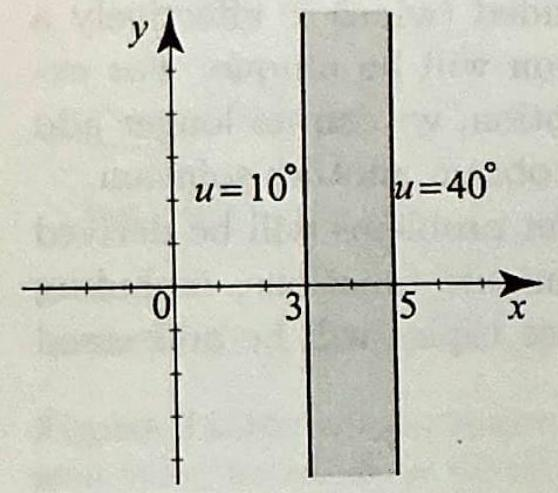
> > Dirichlet problem in problem 25.
> 
> 
> (c) Determine and plot the isotherms and curves of heat flow.
> 
> 


##### solution

##### problem 25(a)

Suppose that $u(x,y)$ is harmonic and depends only on $x$ and not on $y$. Then there is a one-variable function, which we still denote by $u$, such that

$$
u(x,y)=u(x).
$$

Because $u$ is independent of $y$, we have

$$
u_y=0.
$$

Differentiate once more with respect to $y$:

$$
u_{yy}=0.
$$

Since $u$ is harmonic, it satisfies Laplace's equation

$$
u_{xx}+u_{yy}=0.
$$

Substitute $u_{yy}=0$:

$$
\begin{aligned}
u_{xx}+u_{yy}
&=
0\\
u_{xx}+0
&=
0.
\end{aligned}
$$

So

$$
u_{xx}=0.
$$

Now integrate with respect to $x$:

$$
\begin{aligned}
u_x
&=
\int 0\,dx\\
&=
a,
\end{aligned}
$$

where $a$ is a real constant. Integrating again,

$$
\begin{aligned}
u(x)
&=
\int (a)\,dx\\
&=
ax+b,
\end{aligned}
$$

where $b$ is another real constant.

Therefore

$$
\boxed{u(x,y)=ax+b}
$$

for some real constants $a$ and $b$.

##### problem 25(b)

We now solve the Dirichlet problem in Figure 14. The region is the infinite vertical strip

$$
3<x<5,
\qquad -\infty<y<\infty,
$$

with boundary conditions

$$
u(3,y)=10
\qquad\text{and}\qquad
u(5,y)=40.
$$

Because the boundary values do not depend on $y$, part (a) suggests trying a solution of the form

$$
u(x,y)=ax+b.
$$

Now impose the boundary conditions.

At

$$
x=3,
$$

we must have

$$
u(3,y)=3a+b=10.
$$

At

$$
x=5,
$$

we must have

$$
u(5,y)=5a+b=40.
$$

We now solve the system

$$
3a+b=10,
\qquad
5a+b=40.
$$

Subtract the first equation from the second:

$$
(5a+b)-(3a+b)=40-10.
$$

Simplify:

$$
2a=30.
$$

Hence

$$
a=15.
$$

Substitute into

$$
3a+b=10
$$

$$
\begin{aligned}
3a+b
&=
10\\
3(15)+b
&=
10\\
45+b
&=
10.
\end{aligned}
$$

Therefore

$$
\begin{aligned}
b
&=
10-45\\
&=
-35.
\end{aligned}
$$

Thus the solution is

$$
\boxed{u(x,y)=15x-35.}
$$

We can check the boundary values directly:

$$
u(3,y)=15(3)-35=45-35=10,
$$

and

$$
u(5,y)=15(5)-35=75-35=40.
$$

So this function satisfies the boundary conditions, and since it is linear in $x$, it is harmonic by part (a).

##### problem 25(c)

The isotherms are the level curves of the temperature function

$$
u(x,y)=15x-35.
$$

Set

$$
u(x,y)=T,
$$

where

$$
10<T<40.
$$

Then

$$
15x-35=T.
$$

Add $35$ to both sides:

$$
15x=T+35.
$$

Divide by $15$:

$$
x=\frac{T+35}{15}.
$$

So each isotherm is a vertical line

$$
\boxed{x=\frac{T+35}{15}},
\qquad 10<T<40.
$$

As $T$ increases from $10$ to $40$, these vertical lines sweep from the left boundary

$$
x=3
$$

to the right boundary

$$
x=5.
$$

Now find the curves of heat flow.

First compute a harmonic conjugate $v(x,y)$ of $u(x,y)=15x-35$. The constant $-35$ does not affect the derivatives, so we use the Cauchy-Riemann equations:

$$
u_x=v_y,
\qquad
u_y=-v_x.
$$

Since

$$
u_x=15
\qquad\text{and}\qquad
u_y=0,
$$

we get

$$
v_y=15
\qquad\text{and}\qquad
v_x=0.
$$

Integrating

$$
v_y=15
$$

with respect to $y$, we obtain

$$
\begin{aligned}
v(x,y)
&=
\int 15\,dy\\
&=
15y+C,
\end{aligned}
$$

where $C$ is a real constant. This already satisfies

$$
v_x=0,
$$

so it is a harmonic conjugate.

The curves of heat flow are the level curves of $v$:

$$
v(x,y)=K.
$$

Thus

$$
15y+C=K.
$$

Subtract $C$ from both sides:

$$
\begin{aligned}
15y+C
&=
K\\
15y
&=
K-C.
\end{aligned}
$$

Divide by $15$:

$$
\begin{aligned}
y
&=
\frac{K-C}{15}.
\end{aligned}
$$

So the curves of heat flow are the horizontal lines

$$
\boxed{y=c},
\qquad c\in\mathbb R.
$$

Since the left boundary is at temperature $10^\circ$ and the right boundary is at temperature $40^\circ$, heat flows from right to left, that is, in the direction of decreasing temperature. This agrees with

$$
\nabla u=(15,0),
$$

so

$$
-\nabla u=(-15,0),
$$

which points to the left.

Therefore the geometric picture is:

1. isotherms: vertical lines;
2. curves of heat flow: horizontal lines;
3. heat flows leftward from the hotter side $u=40^\circ$ to the cooler side $u=10^\circ$.


```Mathematica title:""
Graphics[
 {
  {LightBlue, Opacity[0.28], EdgeForm[{Thick, RGBColor[0.15, 0.42, 0.85]}],
   Rectangle[{3, -3}, {5, 3}]},
  
  {GrayLevel[0.35], Dashed, Thick,
   Table[Line[{{x, -3}, {x, 3}}], {x, 3.5, 4.5, 0.5}]},
  
  {Black, Thick,
   Table[Line[{{3, y}, {5, y}}], {y, -2.5, 2.5, 1}]},
  
  {Black,
   Table[
    Arrow[{{4.6, y}, {3.4, y}}],
    {y, -2.5, 2.5, 1}
    ]},
  
  Text[Style["u = 10°", 15, Bold], {2.35, 1.9}],
  Text[Style["u = 40°", 15, Bold], {5.65, 1.9}],
  
  Text[Style["15°", 13, GrayLevel[0.25]], {3.33, 3.2}],
  Text[Style["20°", 13, GrayLevel[0.25]], {3.67, 3.2}],
  Text[Style["25°", 13, GrayLevel[0.25]], {4.00, 3.2}],
  Text[Style["30°", 13, GrayLevel[0.25]], {4.33, 3.2}],
  Text[Style["35°", 13, GrayLevel[0.25]], {4.67, 3.2}]
  },
 Axes -> True,
 GridLines -> Automatic,
 PlotRange -> {{1.8, 6.2}, {-3.4, 3.5}},
 ImageSize -> 430,
 AxesLabel -> {"x", "y"},
 PlotLabel -> Style["Exercise 25: Isotherms and Curves of Heat Flow", 18]
]
```


++++


> [!exercise] Exercise 17
> 
> 26. **A Dirichlet problem in an infinite vertical strip.** 
> (a) Solve the Dirichlet problem in _Figure 15_.
> 
> > [!figure] Figure 15
> > 
> > ![[Pasted image 20260401005538.png|300]]
> > Dirichlet problem in Problem 26.
> 
> 
> (b) Determine and plot the isotherms and curves of heat flow.
> 
> 


##### solution

##### problem 26(a)

We solve the Dirichlet problem in the infinite vertical strip shown in Figure 15. The region is

$$
-3<x<3,
\qquad
-\infty<y<\infty,
$$

with boundary conditions

$$
u(-3,y)=70
\qquad\text{and}\qquad
u(3,y)=-20.
$$

Because the boundary values do not depend on $y$, it is natural to try a harmonic function that depends only on $x$. By Exercise 25(a), every harmonic function independent of $y$ has the form

$$
u(x,y)=ax+b,
$$

where $a$ and $b$ are real constants.

Now impose the boundary conditions.

At

$$
x=-3,
$$

we must have

$$
u(-3,y)=-3a+b=70.
$$

At

$$
x=3,
$$

we must have

$$
u(3,y)=3a+b=-20.
$$

So we must solve the system

$$
-3a+b=70,
\qquad
3a+b=-20.
$$

Subtract the first equation from the second:

$$
(3a+b)-(-3a+b)=-20-70.
$$

Simplify:

$$
6a=-90.
$$

Hence

$$
a=-15.
$$

Substitute this into

$$
3a+b=-20:
$$

$$
3(-15)+b=-20.
$$

Thus

$$
-45+b=-20.
$$

Add $45$ to both sides:

$$
b=25.
$$

Therefore the solution is

$$
\boxed{u(x,y)=-15x+25.}
$$

We check the boundary values:

$$
u(-3,y)=-15(-3)+25=45+25=70,
$$

and

$$
u(3,y)=-15(3)+25=-45+25=-20.
$$

So this function satisfies the required boundary conditions.

##### problem 26(b)

The isotherms are the level curves of

$$
u(x,y)=-15x+25.
$$

Set

$$
u(x,y)=T.
$$

Then

$$
-15x+25=T.
$$

Subtract $25$ from both sides:

$$
-15x=T-25.
$$

Multiply both sides by $-1$:

$$
15x=25-T.
$$

Divide by $15$:

$$
x=\frac{25-T}{15}.
$$

Thus each isotherm is a vertical line

$$
\boxed{x=\frac{25-T}{15}}.
$$

As $T$ decreases from $70$ to $-20$, these lines move from the left boundary

$$
x=-3
$$

to the right boundary

$$
x=3.
$$

Now find the curves of heat flow.

We compute a harmonic conjugate $v(x,y)$ of

$$
u(x,y)=-15x+25.
$$

The constant $25$ does not affect the derivatives, so the Cauchy-Riemann equations give

$$
u_x=v_y,
\qquad
u_y=-v_x.
$$

Since

$$
u_x=-15
\qquad\text{and}\qquad
u_y=0,
$$

we obtain

$$
v_y=-15
\qquad\text{and}\qquad
v_x=0.
$$

Integrating

$$
v_y=-15
$$

with respect to $y$, we get

$$
v(x,y)=-15y+C,
$$

where $C$ is a real constant. This already satisfies

$$
v_x=0,
$$

so it is a harmonic conjugate.

The curves of heat flow are the level curves of $v$:

$$
v(x,y)=K.
$$

Thus

$$
-15y+C=K.
$$

Absorbing constants into a new constant gives

$$
y=\text{constant}.
$$

Therefore the curves of heat flow are the horizontal lines

$$
\boxed{y=c},
\qquad c\in\mathbb R.
$$

To determine the direction of heat flow, compute the gradient:

$$
\nabla u=(u_x,u_y)=(-15,0).
$$

Heat flows in the direction of

$$
-\nabla u=(15,0),
$$

which points to the right. This is physically correct: heat flows from the hotter left boundary $u=70^\circ$ toward the colder right boundary $u=-20^\circ$.

So the geometric picture is:

1. isotherms: vertical lines;
2. curves of heat flow: horizontal lines;
3. heat flows rightward.


```Mathematica title:""
Graphics[
 {
  {LightBlue, Opacity[0.28], EdgeForm[{Thick, RGBColor[0.15, 0.42, 0.85]}],
   Rectangle[{-3, -3}, {3, 3}]},
  
  {GrayLevel[0.35], Dashed, Thick,
   Table[Line[{{x, -3}, {x, 3}}], {x, -2, 2, 1}]},
  
  {Black, Thick,
   Table[Line[{{-3, y}, {3, y}}], {y, -2.5, 2.5, 1}]},
  
  {Black,
   Table[
    Arrow[{{-2.6, y}, {2.6, y}}],
    {y, -2.5, 2.5, 1}
    ]},
  
  Text[Style["u = 70°", 15, Bold], {-4.05, 1.9}],
  Text[Style["u = -20°", 15, Bold], {4.25, 1.9}],
  
  Text[Style["55°", 13, GrayLevel[0.25]], {-2, 3.2}],
  Text[Style["40°", 13, GrayLevel[0.25]], {-1, 3.2}],
  Text[Style["25°", 13, GrayLevel[0.25]], {0, 3.2}],
  Text[Style["10°", 13, GrayLevel[0.25]], {1, 3.2}],
  Text[Style["-5°", 13, GrayLevel[0.25]], {2, 3.2}]
  },
 Axes -> True,
 GridLines -> Automatic,
 PlotRange -> {{-4.8, 4.8}, {-3.4, 3.5}},
 ImageSize -> 460,
 AxesLabel -> {"x", "y"},
 PlotLabel -> Style["Exercise 26: Isotherms and Curves of Heat Flow", 18]
]
```


++++


> [!exercise] Exercise 18
> 
> 27. Harmonic functions independent of $r$. 
> (a) Solve the Dirichlet problem in _Figure 16_. Because the boundary values do not depend on $r$, you should try for a solution a harmonic function whose values do not depend on $r$.
> 
> 
> > [!figure] Figure 16
> > 
> > 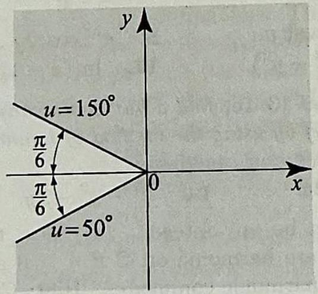
> > Dirichlet problem in Exercise 27.
> 
> 
> (b) Determine and plot the isotherms and curves of heat flow.
> 
> 


##### solution

##### problem 27(a)

The region in Figure 16 is the wedge between the two rays

$$
\theta=\frac{5\pi}{6}
\qquad\text{and}\qquad
\theta=\frac{7\pi}{6},
$$

with boundary values

$$
u=150
\quad\text{on}\quad
\theta=\frac{5\pi}{6},
$$

and

$$
u=50
\quad\text{on}\quad
\theta=\frac{7\pi}{6}.
$$

Because the boundary values are independent of $r$, we try a harmonic function that depends only on the angle. On this wedge we use the branch

$$
\theta=\arg_{5\pi/6} z,
$$

so that throughout the wedge

$$
\frac{5\pi}{6}<\theta<\frac{7\pi}{6}.
$$

As in the discussion earlier in the section, a harmonic function independent of $r$ must have the form

$$
u=a\theta+b.
$$

So we write

$$
u(r,\theta)=a\theta+b.
$$

Now impose the boundary conditions.

On the upper ray,

$$
\theta=\frac{5\pi}{6},
$$

so

$$
a\frac{5\pi}{6}+b=150.
$$

On the lower ray,

$$
\theta=\frac{7\pi}{6},
$$

so

$$
a\frac{7\pi}{6}+b=50.
$$

We now solve the system

$$
a\frac{5\pi}{6}+b=150,
\qquad
a\frac{7\pi}{6}+b=50.
$$

Subtract the first equation from the second:

$$
a\frac{7\pi}{6}-a\frac{5\pi}{6}=50-150.
$$

Simplify:

$$
a\left(\frac{2\pi}{6}\right)=-100.
$$

Since

$$
\frac{2\pi}{6}=\frac{\pi}{3},
$$

we get

$$
a\frac{\pi}{3}=-100.
$$

Therefore

$$
a=-\frac{300}{\pi}.
$$

Substitute this into

$$
a\frac{5\pi}{6}+b=150
$$

to get

$$
\left(-\frac{300}{\pi}\right)\frac{5\pi}{6}+b=150.
$$

Simplify:

$$
-300\cdot\frac{5}{6}+b=150,
$$

so

$$
-250+b=150.
$$

Hence

$$
b=400.
$$

Thus the solution is

$$
\boxed{u(r,\theta)=400-\frac{300}{\pi}\theta},
\qquad
\frac{5\pi}{6}<\theta<\frac{7\pi}{6},
$$

where

$$
\theta=\arg_{5\pi/6} z.
$$

Equivalently,

$$
\boxed{u(z)=400-\frac{300}{\pi}\arg_{5\pi/6} z.}
$$

We check the boundary values:

$$
u\left(r,\frac{5\pi}{6}\right)=400-\frac{300}{\pi}\cdot\frac{5\pi}{6}=400-250=150,
$$

and

$$
u\left(r,\frac{7\pi}{6}\right)=400-\frac{300}{\pi}\cdot\frac{7\pi}{6}=400-350=50.
$$

So the function satisfies the required boundary conditions.

##### problem 27(b)

The isotherms are the level curves of

$$
u(r,\theta)=400-\frac{300}{\pi}\theta.
$$

Set

$$
u(r,\theta)=T,
$$

where

$$
50<T<150.
$$

Then

$$
400-\frac{300}{\pi}\theta=T.
$$

Subtract $400$ from both sides:

$$
-\frac{300}{\pi}\theta=T-400.
$$

Multiply both sides by

$$
-\frac{\pi}{300}
$$

to get

$$
\theta=\frac{\pi}{300}(400-T).
$$

So each isotherm is a ray from the origin:

$$
\boxed{\theta=\frac{\pi}{300}(400-T)},
\qquad 50<T<150.
$$

As $T$ decreases from $150$ to $50$, the angle increases from

$$
\frac{5\pi}{6}
$$

to

$$
\frac{7\pi}{6}.
$$

Thus the isotherms sweep through the wedge from the upper boundary ray to the lower boundary ray.

Now find the curves of heat flow.

Since

$$
u(z)=400-\frac{300}{\pi}\arg_{5\pi/6} z,
$$

and $\arg z$ is a harmonic conjugate of $-\ln|z|$, a harmonic conjugate of $u$ is

$$
v(z)=\frac{300}{\pi}\ln|z|,
$$

up to an additive real constant.

The curves of heat flow are the level curves of $v$, so set

$$
v(z)=C.
$$

Then

$$
\frac{300}{\pi}\ln|z|=C.
$$

Multiply both sides by

$$
\frac{\pi}{300}
$$

to get

$$
\ln|z|=\frac{\pi C}{300}.
$$

Exponentiate:

$$
|z|=e^{\pi C/300}.
$$

Since the right-hand side is a positive constant, we may write

$$
|z|=R,
\qquad R>0.
$$

Therefore the curves of heat flow are circles centered at the origin. Because the region is only the wedge, the relevant portions are the circular arcs

$$
\boxed{r=R},
\qquad R>0,
\qquad
\frac{5\pi}{6}<\theta<\frac{7\pi}{6}.
$$

To determine the direction of heat flow, note that the temperature decreases from $150^\circ$ on the upper ray to $50^\circ$ on the lower ray. Hence heat flows from the upper boundary ray toward the lower boundary ray. Along the circular arcs this means the flow is clockwise.

So the geometric picture is:

1. isotherms: rays from the origin;
2. curves of heat flow: circular arcs centered at the origin;
3. heat flows clockwise from the $150^\circ$ boundary toward the $50^\circ$ boundary.


```Mathematica title:""
Graphics[
 {
  {LightBlue, Opacity[0.28], EdgeForm[{Thick, RGBColor[0.15, 0.42, 0.85]}],
   Disk[{0, 0}, 4.3, {5 Pi/6, 7 Pi/6}]},
  
  {GrayLevel[0.35], Dashed, Thick,
   Table[
    Line[{{0, 0}, 4.3 {Cos[th], Sin[th]}}],
    {th, 5 Pi/6 + Pi/18, 7 Pi/6 - Pi/18, Pi/18}
    ]},
  
  {Black, Thick,
   Table[
    Circle[{0, 0}, r, {5 Pi/6, 7 Pi/6}],
    {r, 0.8, 3.8, 0.75}
    ]},
  
  {Black,
   Table[
    Arrow[
     Table[
      r {Cos[t], Sin[t]},
      {t, 1.01 Pi, 0.99 Pi, -0.01 Pi}
      ]
     ],
    {r, 0.8, 3.8, 0.75}
    ]},
  
  Text[Style["u = 150°", 15, Bold], {-2.85, 1.55}],
  Text[Style["u = 50°", 15, Bold], {-2.75, -1.75}],
  
  Text[Style["125°", 13, GrayLevel[0.25]], {-1.75, 3.15}],
  Text[Style["100°", 13, GrayLevel[0.25]], {-2.35, 2.25}],
  Text[Style["75°", 13, GrayLevel[0.25]], {-2.55, 0.05}]
  },
 Axes -> True,
 GridLines -> Automatic,
 PlotRange -> {{-4.6, 1.2}, {-3.8, 3.8}},
 ImageSize -> 430,
 AxesLabel -> {"x", "y"},
 PlotLabel -> Style["Exercise 27: Isotherms and Curves of Heat Flow", 18]
]
```


++++


> [!exercise] Exercise 19
> 
> 
> 28. A Dirichlet problem in a wedge. 
> (a) Solve the Dirichlet problem in _Figure 17_.
> > [!figure] Figure 17
> > 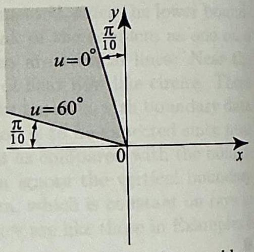
> > Dirichlet problem in Exercise 28.
> 
> (b) Determine and plot the isotherms and curves of heat flow.


##### solution

##### problem 28(a)

The region in Figure 17 is the wedge between the two rays

$$
\theta=\frac{3\pi}{5}
\qquad\text{and}\qquad
\theta=\frac{9\pi}{10}.
$$

Indeed, the upper ray is obtained by moving an angle

$$
\frac{\pi}{10}
$$

to the left of the positive $y$-axis, so its angle is

$$
\frac{\pi}{2}+\frac{\pi}{10}
=\frac{5\pi}{10}+\frac{\pi}{10}
=\frac{6\pi}{10}
=\frac{3\pi}{5},
$$

and the lower ray is obtained by moving an angle

$$
\frac{\pi}{10}
$$

above the negative $x$-axis, so its angle is

$$
\pi-\frac{\pi}{10}
=\frac{10\pi}{10}-\frac{\pi}{10}
=\frac{9\pi}{10}.
$$

The boundary values are

$$
u=0
\quad\text{on}\quad
\theta=\frac{3\pi}{5},
$$

and

$$
u=60
\quad\text{on}\quad
\theta=\frac{9\pi}{10}.
$$

Because the boundary values do not depend on $r$, we try a harmonic function that depends only on the angle. On this wedge we use the branch

$$
\theta=\arg_{3\pi/5} z,
$$

so that throughout the region

$$
\frac{3\pi}{5}<\theta<\frac{9\pi}{10}.
$$

As in the preceding exercise, a harmonic function independent of $r$ must have the form

$$
u=a\theta+b.
$$

So we write

$$
u(r,\theta)=a\theta+b.
$$

Now impose the boundary conditions.

On the ray

$$
\theta=\frac{3\pi}{5},
$$

we must have

$$
a\frac{3\pi}{5}+b=0.
$$

On the ray

$$
\theta=\frac{9\pi}{10},
$$

we must have

$$
a\frac{9\pi}{10}+b=60.
$$

Therefore $a$ and $b$ satisfy the system

$$
a\frac{3\pi}{5}+b=0,
\qquad
a\frac{9\pi}{10}+b=60.
$$

Subtract the first equation from the second:

$$
a\frac{9\pi}{10}-a\frac{3\pi}{5}=60-0.
$$

Factor out $a$:

$$
a\left(\frac{9\pi}{10}-\frac{3\pi}{5}\right)=60.
$$

Rewrite

$$
\frac{3\pi}{5}
=\frac{6\pi}{10},
$$

so

$$
a\left(\frac{9\pi}{10}-\frac{6\pi}{10}\right)=60.
$$

Subtract inside the parentheses:

$$
a\left(\frac{3\pi}{10}\right)=60.
$$

Solve for $a$:

$$
a
=60\cdot\frac{10}{3\pi}
=\frac{600}{3\pi}
=\frac{200}{\pi}.
$$

Now substitute this into

$$
a\frac{3\pi}{5}+b=0
$$

to get

$$
\left(\frac{200}{\pi}\right)\frac{3\pi}{5}+b=0.
$$

Simplify:

$$
200\cdot\frac{3}{5}+b=0,
$$

so

$$
120+b=0.
$$

Hence

$$
b=-120.
$$

Therefore the solution is

$$
\boxed{u(r,\theta)=\frac{200}{\pi}\theta-120},
\qquad
\frac{3\pi}{5}<\theta<\frac{9\pi}{10}.
$$

Equivalently,

$$
\boxed{u(z)=\frac{200}{\pi}\arg_{3\pi/5} z-120.}
$$

We check the boundary values explicitly:

$$
u\left(r,\frac{3\pi}{5}\right)
=\frac{200}{\pi}\cdot\frac{3\pi}{5}-120
=200\cdot\frac{3}{5}-120
=120-120
=0,
$$

and

$$
u\left(r,\frac{9\pi}{10}\right)
=\frac{200}{\pi}\cdot\frac{9\pi}{10}-120
=200\cdot\frac{9}{10}-120
=180-120
=60.
$$

So the function satisfies the required boundary conditions.

##### problem 28(b)

The isotherms are the level curves of

$$
u(r,\theta)=\frac{200}{\pi}\theta-120.
$$

Set

$$
u(r,\theta)=T,
$$

where

$$
0<T<60.
$$

Then

$$
\frac{200}{\pi}\theta-120=T.
$$

Add $120$ to both sides:

$$
\frac{200}{\pi}\theta=T+120.
$$

Multiply both sides by

$$
\frac{\pi}{200}
$$

to get

$$
\theta=\frac{\pi}{200}(T+120).
$$

Therefore each isotherm is a ray from the origin:

$$
\boxed{\theta=\frac{\pi}{200}(T+120)},
\qquad 0<T<60.
$$

As $T$ increases from $0$ to $60$, the angle increases from

$$
\frac{\pi}{200}(0+120)
=\frac{120\pi}{200}
=\frac{3\pi}{5}
$$

to

$$
\frac{\pi}{200}(60+120)
=\frac{180\pi}{200}
=\frac{9\pi}{10}.
$$

So the isotherms sweep through the wedge from the $0^\circ$ boundary ray to the $60^\circ$ boundary ray.

Now determine the curves of heat flow.

Since

$$
\operatorname{Log} z=\ln|z|+i\arg z,
$$

we have

$$
-i\operatorname{Log} z
=-i\ln|z|-i(i\arg z)
=-i\ln|z|+\arg z.
$$

Therefore

$$
\Re(-i\operatorname{Log} z)=\arg z.
$$

It follows that

$$
\Re\left(\frac{200}{\pi}(-i\operatorname{Log} z)-120\right)
=\frac{200}{\pi}\arg z-120
=u(z).
$$

So a harmonic conjugate of $u$ is

$$
v(z)=-\frac{200}{\pi}\ln|z|,
$$

up to an additive real constant.

The curves of heat flow are the level curves of $v$, so set

$$
v(z)=C.
$$

Then

$$
-\frac{200}{\pi}\ln|z|=C.
$$

Multiply both sides by

$$
-\frac{\pi}{200}
$$

to get

$$
\ln|z|=-\frac{\pi C}{200}.
$$

Exponentiate:

$$
|z|=e^{-\pi C/200}.
$$

Since the right-hand side is a positive constant, we may write

$$
|z|=R,
\qquad R>0.
$$

Therefore the curves of heat flow are circles centered at the origin. Since the region is only the wedge, the relevant parts are the circular arcs

$$
\boxed{r=R},
\qquad R>0,
\qquad
\frac{3\pi}{5}<\theta<\frac{9\pi}{10}.
$$

To determine the direction of heat flow, note that the temperature is $60^\circ$ on the lower ray and $0^\circ$ on the upper ray. Hence heat flows from the lower boundary ray toward the upper boundary ray. Along the circular arcs this means the flow is counterclockwise.

Thus the picture is the following: the isotherms are rays from the origin, the heat-flow curves are circular arcs centered at the origin, and the arrows on the heat-flow curves point counterclockwise from the $60^\circ$ side toward the $0^\circ$ side.


```Mathematica title:""
Graphics[
 {
  {LightBlue, Opacity[0.28], EdgeForm[{Thick, RGBColor[0.15, 0.42, 0.85]}],
   Disk[{0, 0}, 4.3, {3 Pi/5, 9 Pi/10}]},
  
  {GrayLevel[0.35], Dashed, Thick,
   Table[
    Line[{{0, 0}, 4.3 {Cos[th], Sin[th]}}],
    {th, 3 Pi/5 + Pi/20, 9 Pi/10 - Pi/20, Pi/20}
    ]},
  
  {Black, Thick,
   Table[
    Circle[{0, 0}, r, {3 Pi/5, 9 Pi/10}],
    {r, 0.8, 3.8, 0.75}
    ]},
  
  {Black,
   Table[
    Arrow[
     Table[
      r {Cos[t], Sin[t]},
      {t, 3 Pi/4, 4 Pi/5, 0.01 Pi}
      ]
     ],
    {r, 0.8, 3.8, 0.75}
    ]},
  
  Text[Style["u = 0°", 15, Bold], {-1.35, 3.1}],
  Text[Style["u = 60°", 15, Bold], {-3.1, 1.25}],
  
  Text[Style["15°", 13, GrayLevel[0.25]], {-1.85, 2.65}],
  Text[Style["30°", 13, GrayLevel[0.25]], {-2.25, 2.1}],
  Text[Style["45°", 13, GrayLevel[0.25]], {-2.7, 1.45}]
  },
 Axes -> True,
 GridLines -> Automatic,
 PlotRange -> {{-4.4, 1.0}, {-0.5, 4.4}},
 ImageSize -> 430,
 AxesLabel -> {"x", "y"},
 PlotLabel -> Style["Exercise 28: Isotherms and Curves of Heat Flow", 18]
]
```


++++


> [!exercise] Exercise 20
> 29. Harmonic functions independent of $\theta$. Suppose that $u(r, \theta)$ is a harmonic function, in polar coordinates.
> (a) Suppose that $u$ depends only on $r$ and not $\theta$; hence $u(r, \theta)=u(r)$. Using the polar form of the Laplacian (12) in Exercise 47, show that $u(r)$ satisfies the (ordinary) differential equation in $r$
> 
> $$
> u_{r r}+\frac{1}{r} u_{r}=0,
> $$
> 
> known as an Euler equation. This is perhaps the simplest second order linear differential equation with nonconstant coefficients. To find its general solution, we
> (b) Multiply the Euler equation by the integrating factor $r$ and notice that the need two linearly independent solutions. left side is now exact. Integrate to conclude $r u_{r}=c_{1}$, where $c_{1}$ is the constant of
> 
> 
> > [!figure] Figure 21
> > 
> > 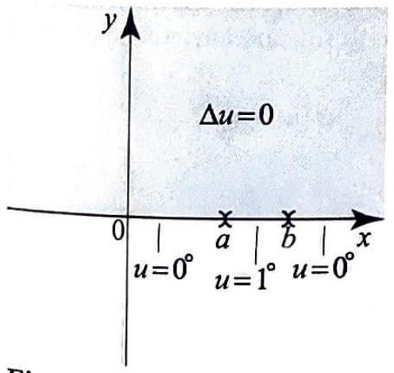
> > Figure 21 Dirichlet problem for problem 35.
> 
> integration. Integrate again and find the general solution
> 
> 
> 
> $$
> u(r)=c_{1} \ln r+c_{2} .
> $$
> 


##### solution

##### problem 29(a)

We are told that $u(r,\theta)$ is harmonic and that $u$ depends only on $r$. Thus

$$
u(r,\theta)=u(r).
$$

The polar form of Laplace's equation is

$$
u_{rr}+\frac{1}{r}u_r+\frac{1}{r^2}u_{\theta\theta}=0.
$$

Because $u$ does not depend on $\theta$, its derivative with respect to $\theta$ is zero:

$$
u_\theta=0.
$$

Differentiate once more with respect to $\theta$:

$$
u_{\theta\theta}=0.
$$

Substitute this into the polar Laplace equation:

$$
u_{rr}+\frac{1}{r}u_r+\frac{1}{r^2}(0)=0.
$$

Simplify:

$$
u_{rr}+\frac{1}{r}u_r=0.
$$

This is the required ordinary differential equation.

##### problem 29(b)

We now solve

$$
u_{rr}+\frac{1}{r}u_r=0.
$$

Multiply both sides by the integrating factor $r$:

$$
r\left(u_{rr}+\frac{1}{r}u_r\right)=r\cdot 0.
$$

Distribute $r$ on the left-hand side:

$$
ru_{rr}+r\cdot\frac{1}{r}u_r=0.
$$

Simplify $r\cdot \dfrac{1}{r}=1$:

$$
ru_{rr}+u_r=0.
$$

Now observe that

$$
\frac{d}{dr}(ru_r)=1\cdot u_r+r\cdot u_{rr}=u_r+ru_{rr}.
$$

Since addition is commutative,

$$
u_r+ru_{rr}=ru_{rr}+u_r.
$$

Therefore

$$
\frac{d}{dr}(ru_r)=ru_{rr}+u_r.
$$

So the differential equation becomes

$$
\frac{d}{dr}(ru_r)=0.
$$

Integrate with respect to $r$:

$$
ru_r=c_1,
$$

where $c_1$ is a constant of integration.

Now solve for $u_r$:

$$
u_r=\frac{c_1}{r}.
$$

Integrate again with respect to $r$:

$$
u(r)=\int \frac{c_1}{r}\,dr.
$$

Factor out the constant $c_1$:

$$
u(r)=c_1\int \frac{1}{r}\,dr.
$$

Use

$$
\int \frac{1}{r}\,dr=\ln r+c,
$$

for $r>0$, to obtain

$$
u(r)=c_1\ln r+c_2,
$$

where $c_2$ is another constant of integration.

Therefore the general solution is

$$
\boxed{u(r)=c_1\ln r+c_2.}
$$


++++


> [!exercise] Exercise 21
> 
> 30. Dirichlet problems in annular regions. The annular region $A_{R_{1}, R_{2}}$ in _Figure 18_ is centered at the origin with inner radius $R_{1}$ and outer radius $R_{2}$. Consider the Dirichlet problem in $A_{R_{1}, R_{2}}$ with constant boundary conditions $u\left(R_{1}, \theta\right)= T_{1}$ and $u\left(R_{2}, \theta\right)=T_{2}$ for all $\theta$. Show that the solution of the problem is
> 
> 
> > [!figure] Figure 18
> > 
> > 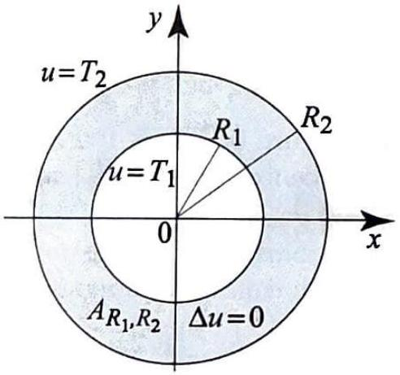
> > Figure 18 Dirichlet problem in problem 30.
> 
> 
> $$
> u(r, \theta)=u(r)=T_{1}+\left(T_{2}-T_{1}\right) \frac{\ln \left(r / R_{1}\right)}{\ln \left(R_{2} / R_{1}\right)}
> $$
> 
> **(Hint: Since the boundary conditions are independent of $\theta$, you should try a harmonic function independent of $\theta$. According to Problem 29, try $u(r)=c_{1} \ln r+c_{2}$.)** 


##### solution

Since the boundary conditions are independent of $\theta$, it is natural to look for a harmonic function that also does not depend on $\theta$. By Problem 29, every harmonic function of this type has the form

$$
u(r,\theta)=u(r)=c_1\ln r+c_2.
$$

We now determine the constants $c_1$ and $c_2$ from the boundary conditions.

On the inner circle

$$
r=R_1,
$$

we are given

$$
u(R_1,\theta)=T_1.
$$

Substitute $r=R_1$ into

$$
u(r)=c_1\ln r+c_2
$$

to get

$$
c_1\ln R_1+c_2=T_1.
$$

On the outer circle

$$
r=R_2,
$$

we are given

$$
u(R_2,\theta)=T_2.
$$

Substitute $r=R_2$ into

$$
u(r)=c_1\ln r+c_2
$$

to get

$$
c_1\ln R_2+c_2=T_2.
$$

Thus $c_1$ and $c_2$ satisfy the system

$$
c_1\ln R_1+c_2=T_1,
\qquad
c_1\ln R_2+c_2=T_2.
$$

Subtract the first equation from the second:

$$
c_1\ln R_2-c_1\ln R_1=T_2-T_1.
$$

Factor out $c_1$:

$$
c_1(\ln R_2-\ln R_1)=T_2-T_1.
$$

Use the logarithm identity

$$
\ln R_2-\ln R_1=\ln\left(\frac{R_2}{R_1}\right)
$$

to obtain

$$
c_1\ln\left(\frac{R_2}{R_1}\right)=T_2-T_1.
$$

Therefore

$$
c_1=\frac{T_2-T_1}{\ln\left(\frac{R_2}{R_1}\right)}.
$$

Now solve for $c_2$. From

$$
c_1\ln R_1+c_2=T_1
$$

we get

$$
c_2=T_1-c_1\ln R_1.
$$

Substitute the value of $c_1$:

$$
c_2=T_1-\frac{T_2-T_1}{\ln\left(\frac{R_2}{R_1}\right)}\ln R_1.
$$

Now substitute $c_1$ and $c_2$ back into

$$
u(r)=c_1\ln r+c_2.
$$

This gives

$$
u(r)=\frac{T_2-T_1}{\ln\left(\frac{R_2}{R_1}\right)}\ln r
+T_1-\frac{T_2-T_1}{\ln\left(\frac{R_2}{R_1}\right)}\ln R_1.
$$

Group the terms involving the common factor

$$
\frac{T_2-T_1}{\ln\left(\frac{R_2}{R_1}\right)}
$$

$$
u(r)=T_1+\frac{T_2-T_1}{\ln\left(\frac{R_2}{R_1}\right)}(\ln r-\ln R_1).
$$

Use the logarithm identity

$$
\ln r-\ln R_1=\ln\left(\frac{r}{R_1}\right)
$$

to obtain

$$
u(r)=T_1+\frac{T_2-T_1}{\ln\left(\frac{R_2}{R_1}\right)}\ln\left(\frac{r}{R_1}\right).
$$

Therefore the solution is

$$
\boxed{
u(r,\theta)=u(r)=T_1+\left(T_2-T_1\right)\frac{\ln\left(r/R_1\right)}{\ln\left(R_2/R_1\right)}
}.
$$

We can check the boundary values directly. If $r=R_1$, then

$$
u(R_1,\theta)
=T_1+\left(T_2-T_1\right)\frac{\ln\left(R_1/R_1\right)}{\ln\left(R_2/R_1\right)}
=T_1+\left(T_2-T_1\right)\frac{\ln 1}{\ln\left(R_2/R_1\right)}
=T_1+\left(T_2-T_1\right)\frac{0}{\ln\left(R_2/R_1\right)}
=T_1.
$$

If $r=R_2$, then

$$
u(R_2,\theta)
=T_1+\left(T_2-T_1\right)\frac{\ln\left(R_2/R_1\right)}{\ln\left(R_2/R_1\right)}
=T_1+\left(T_2-T_1\right)
=T_2.
$$

So the formula satisfies both boundary conditions.


++++


> [!exercise] Exercise 22
> 
> 
> Problems 31-32 are Dirichlet problems described by the corresponding figures. In each case, (a) solve the Dirichlet problem.
> (b) Determine the isotherms.
> (c) Determine the curves of heat flow. (d) Plot the isotherms and curves of heat flow.
> 
> 
> > [!figure] Figure 19
> > 
> > 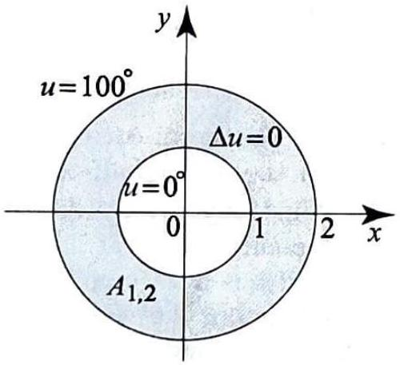
> > 
> > Dirichlet problem in problem 31.
> 
> 
> 
> 
> > [!figure] Figure 20
> > 
> > 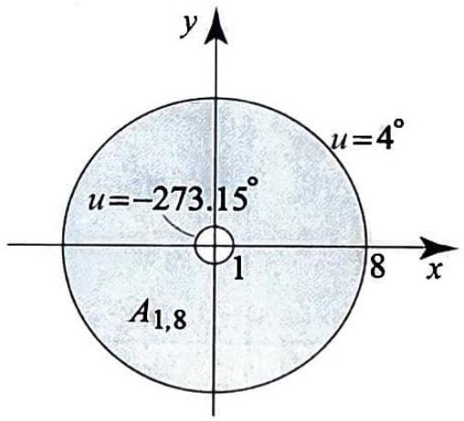
> > 
> > Dirichlet problem in problem 32.
> 
> 
> 
> 


##### solution

For both problems, the boundary conditions are constant on circles centered at the origin, so they do not depend on $\theta$. For that reason, the correct method is to use the radial solution from Exercise 30:

$$
u(r,\theta)=u(r)=T_1+\left(T_2-T_1\right)\frac{\ln(r/R_1)}{\ln(R_2/R_1)}.
$$

Once $u(r)$ is known, the isotherms are the level curves of $u$, so they are circles

$$
r=\text{constant},
$$

and a harmonic conjugate is a constant multiple of $\theta$, so the curves of heat flow are rays

$$
\theta=\text{constant}.
$$

##### problem 31(a)

In Figure 19 the annulus is

$$
A_{1,2},
$$

so

$$
R_1=1,
\qquad
R_2=2.
$$

The boundary values are

$$
u(1,\theta)=0,
\qquad
u(2,\theta)=100.
$$

Thus

$$
T_1=0,
\qquad
T_2=100.
$$

Substitute these values into the formula from Exercise 30:

$$
u(r)=T_1+\left(T_2-T_1\right)\frac{\ln(r/R_1)}{\ln(R_2/R_1)}.
$$

This gives

$$
u(r)=0+\left(100-0\right)\frac{\ln(r/1)}{\ln(2/1)}.
$$

Simplify:

$$
u(r)=100\frac{\ln r}{\ln 2}.
$$

Therefore the solution is

$$
\boxed{u(r,\theta)=u(r)=100\frac{\ln r}{\ln 2}},
\qquad 1<r<2.
$$

We can check the boundary values directly. If $r=1$, then

$$
u(1,\theta)=100\frac{\ln 1}{\ln 2}=100\frac{0}{\ln 2}=0.
$$

If $r=2$, then

$$
u(2,\theta)=100\frac{\ln 2}{\ln 2}=100.
$$

So the formula satisfies the required boundary conditions.

##### problem 31(b)

The isotherms are the level curves of

$$
u(r)=100\frac{\ln r}{\ln 2}.
$$

Set

$$
u(r)=T,
$$

where

$$
0<T<100.
$$

Then

$$
100\frac{\ln r}{\ln 2}=T.
$$

Multiply both sides by

$$
\frac{\ln 2}{100}
$$

to get

$$
\ln r=\frac{T\ln 2}{100}.
$$

Exponentiate:

$$
r=e^{(T\ln 2)/100}.
$$

Use

$$
e^{a\ln 2}=2^a
$$

to obtain

$$
\boxed{r=2^{T/100}},
\qquad 0<T<100.
$$

Therefore the isotherms are concentric circles centered at the origin.

##### problem 31(c)

The isotherms found in part (b) are the circles

$$
r=\text{constant}.
$$

The curves of heat flow must be orthogonal to the isotherms. A ray

$$
\theta=\theta_0
$$

meets every circle

$$
r=\text{constant}
$$

at a right angle, so the orthogonal trajectories of the isotherms are precisely the rays from the origin.

If we want to see this analytically, we may remove one ray from the annulus and choose a branch of $\operatorname{Log} z$ on the resulting slit annulus. On that slit annulus,

$$
f(z)=100\frac{\operatorname{Log} z}{\ln 2}
$$

has real part

$$
\Re f(z)=100\frac{\ln|z|}{\ln 2}=100\frac{\ln r}{\ln 2}=u(r),
$$

so a local harmonic conjugate is

$$
v(r,\theta)=100\frac{\theta}{\ln 2},
$$

up to an additive constant. Its level curves satisfy

$$
100\frac{\theta}{\ln 2}=C,
$$

hence

$$
\boxed{\theta=\theta_0},
\qquad 0\le \theta_0<2\pi.
$$

Therefore the curves of heat flow are rays from the origin.

To determine the direction of heat flow, note that the outer boundary has temperature

$$
100^\circ
$$

and the inner boundary has temperature

$$
0^\circ.
$$

So heat flows from the outer circle toward the inner circle. Therefore the arrows on the heat-flow curves point radially inward.

##### problem 31(d)


```Mathematica title:""
Graphics[
 {
  {LightBlue, Opacity[0.28], EdgeForm[{Thick, RGBColor[0.15, 0.42, 0.85]}],
   Annulus[{0, 0}, {1, 2}]},
  
  {GrayLevel[0.35], Dashed, Thick,
   Table[Circle[{0, 0}, r], {r, 1.2, 1.8, 0.2}]},
  
  {Black, Thick,
   Table[Line[{1.95 {Cos[t], Sin[t]}, 1.05 {Cos[t], Sin[t]}}], {t, 0, 11 Pi/6, Pi/6}]},
  
  {Black,
   Table[
    Arrow[{1.75 {Cos[t], Sin[t]}, 1.3 {Cos[t], Sin[t]}}],
    {t, 0, 11 Pi/6, Pi/6}
    ]},
  
  Text[Style["u = 0°", 15, Bold], {0, 0.45}],
  Text[Style["u = 100°", 15, Bold], {-1.45, 1.55}],
  
  Text[Style["25°", 13, GrayLevel[0.25]], {0.9, 0.95}],
  Text[Style["50°", 13, GrayLevel[0.25]], {0, 1.45}],
  Text[Style["75°", 13, GrayLevel[0.25]], {-1.1, 1.1}]
  },
 Axes -> True,
 GridLines -> Automatic,
 PlotRange -> {{-2.3, 2.3}, {-2.3, 2.3}},
 ImageSize -> 430,
 AxesLabel -> {"x", "y"},
 PlotLabel -> Style["Problem 31: Isotherms and Curves of Heat Flow", 18]
]
```

##### problem 32(a)

In Figure 20 the annulus is

$$
A_{1,8},
$$

so

$$
R_1=1,
\qquad
R_2=8.
$$

The boundary values are

$$
u(1,\theta)=-273.15,
\qquad
u(8,\theta)=4.
$$

Thus

$$
T_1=-273.15,
\qquad
T_2=4.
$$

Substitute these values into the formula from Exercise 30:

$$
u(r)=T_1+\left(T_2-T_1\right)\frac{\ln(r/R_1)}{\ln(R_2/R_1)}.
$$

This gives

$$
u(r)=-273.15+\left(4-(-273.15)\right)\frac{\ln(r/1)}{\ln(8/1)}.
$$

Simplify

$$
4-(-273.15)=277.15
$$

and

$$
\ln(r/1)=\ln r,
\qquad
\ln(8/1)=\ln 8,
$$

to obtain

$$
u(r)=-273.15+277.15\frac{\ln r}{\ln 8}.
$$

Therefore the solution is

$$
\boxed{u(r,\theta)=u(r)=-273.15+277.15\frac{\ln r}{\ln 8}},
\qquad 1<r<8.
$$

We check the boundary values directly. If $r=1$, then

$$
u(1,\theta)=-273.15+277.15\frac{\ln 1}{\ln 8}=-273.15+277.15\cdot 0=-273.15.
$$

If $r=8$, then

$$
u(8,\theta)=-273.15+277.15\frac{\ln 8}{\ln 8}=-273.15+277.15=4.
$$

So the formula satisfies the required boundary conditions.

##### problem 32(b)

The isotherms are the level curves of

$$
u(r)=-273.15+277.15\frac{\ln r}{\ln 8}.
$$

Set

$$
u(r)=T,
$$

where

$$
-273.15<T<4.
$$

Then

$$
-273.15+277.15\frac{\ln r}{\ln 8}=T.
$$

Add

$$
273.15
$$

to both sides:

$$
277.15\frac{\ln r}{\ln 8}=T+273.15.
$$

Multiply both sides by

$$
\frac{\ln 8}{277.15}
$$

to get

$$
\ln r=\frac{(T+273.15)\ln 8}{277.15}.
$$

Exponentiate:

$$
r=e^{((T+273.15)\ln 8)/277.15}.
$$

Use

$$
e^{a\ln 8}=8^a
$$

to obtain

$$
\boxed{r=8^{(T+273.15)/277.15}},
\qquad -273.15<T<4.
$$

Therefore the isotherms are concentric circles centered at the origin.

##### problem 32(c)

The isotherms found in part (b) are again the circles

$$
r=\text{constant}.
$$

The curves of heat flow are orthogonal to the isotherms. Since rays

$$
\theta=\theta_0
$$

meet circles centered at the origin at right angles, the heat-flow curves are rays from the origin.

Analytically, if we remove one ray from the annulus and choose a branch of $\operatorname{Log} z$ on the resulting slit annulus, then

$$
f(z)=-273.15+277.15\frac{\operatorname{Log} z}{\ln 8}
$$

has real part

$$
\Re f(z)
=-273.15+277.15\frac{\ln|z|}{\ln 8}
=-273.15+277.15\frac{\ln r}{\ln 8}
=u(r),
$$

so a local harmonic conjugate is

$$
v(r,\theta)=277.15\frac{\theta}{\ln 8},
$$

up to an additive constant. Its level curves satisfy

$$
277.15\frac{\theta}{\ln 8}=C,
$$

hence

$$
\boxed{\theta=\theta_0},
\qquad 0\le \theta_0<2\pi.
$$

Therefore the curves of heat flow are rays from the origin.

To determine the direction of heat flow, note that the outer boundary has temperature

$$
4^\circ
$$

and the inner boundary has temperature

$$
-273.15^\circ.
$$

So heat flows from the outer circle toward the inner circle. Therefore the arrows on the heat-flow curves point radially inward.

##### problem 32(d)


```Mathematica title:""
Graphics[
 {
  {LightBlue, Opacity[0.28], EdgeForm[{Thick, RGBColor[0.15, 0.42, 0.85]}],
   Annulus[{0, 0}, {1, 8}]},
  
  {GrayLevel[0.35], Dashed, Thick,
   Table[Circle[{0, 0}, r], {r, 2, 7, 1.25}]},
  
  {Black, Thick,
   Table[Line[{7.8 {Cos[t], Sin[t]}, 1.1 {Cos[t], Sin[t]}}], {t, 0, 11 Pi/6, Pi/6}]},
  
  {Black,
   Table[
    Arrow[{6.6 {Cos[t], Sin[t]}, 3.2 {Cos[t], Sin[t]}}],
    {t, 0, 11 Pi/6, Pi/6}
    ]},
  
  Text[Style["u = -273.15°", 15, Bold], {-3.8, 1.0}],
  Text[Style["u = 4°", 15, Bold], {4.8, 5.2}],
  
  Text[Style["-200°", 13, GrayLevel[0.25]], {0, 2.0}],
  Text[Style["-100°", 13, GrayLevel[0.25]], {0, 4.2}],
  Text[Style["0°", 13, GrayLevel[0.25]], {0, 6.7}]
  },
 Axes -> True,
 GridLines -> Automatic,
 PlotRange -> {{-8.6, 8.6}, {-8.6, 8.6}},
 ImageSize -> 430,
 AxesLabel -> {"x", "y"},
 PlotLabel -> Style["Problem 32: Isotherms and Curves of Heat Flow", 18]
]
```


++++


> [!exercise] Exercise 23
> 33. Nonexistence of a harmonic conjugate. In Example 1(d), we showed that $\ln |z|$ is harmonic in $\mathbb{C} \backslash\{0\}$. We also know that $\ln |z|$ has a harmonic conjugate in $\mathbb{C} \backslash(-\infty, 0]$. In fact, since $\ln |z|$ is the real part of the analytic function $\log _{\alpha} z$, it has a harmonic conjugate in the complex plane minus the ray emanating from the origin at angle $\alpha$. In this exercise, we will show that $\ln |z|$ does not have a harmonic conjugate in $\mathbb{C} \backslash\{0\}$.
> (a) Suppose that $\phi(z)$ is a harmonic conjugate of $\ln |z|$ in $\mathbb{C} \backslash\{0\}$. Show that $\phi(z)=\operatorname{Arg}(z)+c$ for all $z$ in $\mathbb{C} \backslash(-\infty, 0]$. **(Hint: The functions $\ln |z|+i \phi(z)$ and $\log z$ are analytic in the region $\mathbb{C} \backslash(-\infty, 0]$ and have the same real parts. Use Corollary 1, Section 2.4.])**
> (b) Argue that, since $\phi(z)$ is harmonic in $\mathbb{C} \backslash\{0\}, \phi(z)$ is continuous on $(-\infty, 0)$. Obtain a contradiction using (a) and the fact that the discontinuities of $\operatorname{Arg} z$ are not removable on the negative $x$-axis (Example 7, Section 2.2).


##### solution

##### problem 33(a)

Assume that $\phi(z)$ is a harmonic conjugate of $\ln|z|$ in

$$
\mathbb{C}\setminus\{0\}.
$$

Then

$$
F(z)=\ln|z|+i\phi(z)
$$

is analytic in

$$
\mathbb{C}\setminus\{0\}.
$$

In particular, $F$ is analytic in the smaller region

$$
\mathbb{C}\setminus(-\infty,0].
$$

On this slit plane, the principal logarithm

$$
\log z=\ln|z|+i\operatorname{Arg}(z)
$$

is also analytic.

Now compare the real parts of $F$ and $\log z$. We have

$$
\Re F(z)=\ln|z|
$$

and

$$
\Re(\log z)=\ln|z|.
$$

So $F$ and $\log z$ are analytic in

$$
\mathbb{C}\setminus(-\infty,0]
$$

and have the same real part there.

By Corollary 1 of Section 2.4, two analytic functions on a region with the same real part differ by a purely imaginary constant. Therefore there exists a real constant $c$ such that

$$
F(z)=\log z+ic
$$

for all

$$
z\in \mathbb{C}\setminus(-\infty,0].
$$

Substitute the definitions of $F$ and $\log z$:

$$
\ln|z|+i\phi(z)=\ln|z|+i\operatorname{Arg}(z)+ic.
$$

Subtract $\ln|z|$ from both sides:

$$
i\phi(z)=i\operatorname{Arg}(z)+ic.
$$

Factor out $i$ on the right-hand side:

$$
i\phi(z)=i\bigl(\operatorname{Arg}(z)+c\bigr).
$$

Divide by $i$:

$$
\phi(z)=\operatorname{Arg}(z)+c.
$$

Thus, for all

$$
z\in \mathbb{C}\setminus(-\infty,0],
$$

we have

$$
\boxed{\phi(z)=\operatorname{Arg}(z)+c.}
$$

##### problem 33(b)

Because $\phi$ is harmonic in

$$
\mathbb{C}\setminus\{0\},
$$

it is continuous there. In particular, every point of the negative real axis except the origin belongs to

$$
\mathbb{C}\setminus\{0\},
$$

so $\phi$ must be continuous on

$$
(-\infty,0).
$$

Now let

$$
x<0.
$$

Then the point $x$ lies on the negative real axis. Since $\phi$ is continuous at $x$, the limit of $\phi(z)$ as $z\to x$ from the upper half-plane must agree with the limit of $\phi(z)$ as $z\to x$ from the lower half-plane, and both limits must equal $\phi(x)$.

However, part (a) shows that on the slit plane

$$
\phi(z)=\operatorname{Arg}(z)+c.
$$

Approach the point $x<0$ from above. Then

$$
\operatorname{Arg}(z)\to \pi,
$$

so

$$
\phi(z)\to \pi+c.
$$

Now approach the same point $x<0$ from below. The argument of $z$ tends to

$$
-\pi,
$$

so

$$
\phi(z)\to -\pi+c.
$$

These two limiting values are different, because

$$
\pi+c\neq -\pi+c.
$$

Indeed,

$$
(\pi+c)-(-\pi+c)=2\pi\neq 0.
$$

So $\phi$ cannot be continuous at any point of

$$
(-\infty,0).
$$

This contradicts the fact that $\phi$ is harmonic, hence continuous, on

$$
\mathbb{C}\setminus\{0\}.
$$

Therefore our original assumption was false. Hence

$$
\boxed{\ln|z|\text{ does not have a harmonic conjugate in }\mathbb{C}\setminus\{0\}.}
$$


++++

> [!exercise] Exercise 24
> 34. (a) Suppose that $f$ is analytic on $\Omega, U$ is harmonic on $f[\Omega]$, and $u=U \circ f$. Then $u$ is harmonic in $\Omega$ by Theorem 3. Suppose that $V$ is a harmonic conjugate of $U$. Show that $V \circ f$ is a harmonic conjugate of $u$.
> (b) Derive the isotherms and curves of heat flow in Exercise 7.


##### solution

##### problem 34(a)

We are given that $f$ is analytic on $\Omega$, that $U$ is harmonic on $f[\Omega]$, and that

$$
u=U\circ f.
$$

We are also given that $V$ is a harmonic conjugate of $U$.

Since $V$ is a harmonic conjugate of $U$, the function

$$
F(w)=U(w)+iV(w)
$$

is analytic on

$$
f[\Omega].
$$

Now compose with $f$. Since $F$ is analytic on $f[\Omega]$ and $f$ is analytic on $\Omega$, the composition

$$
F\circ f
$$

is analytic on $\Omega$.

Write this composition explicitly:

$$
(F\circ f)(z)=F(f(z)).
$$

Substitute the definition of $F$:

$$
(F\circ f)(z)=U(f(z))+iV(f(z)).
$$

Since

$$
u(z)=U(f(z)),
$$

we get

$$
(F\circ f)(z)=u(z)+i(V\circ f)(z).
$$

Thus

$$
u+i(V\circ f)
$$

is analytic on $\Omega$.

By definition, this means that

$$
V\circ f
$$

is a harmonic conjugate of $u$.

Therefore

$$
\boxed{V\circ f\text{ is a harmonic conjugate of }u.}
$$

##### problem 34(b)

In Exercise 7 we used the conformal map

$$
w=f(z)=\sin z
$$

from the strip

$$
-\frac{\pi}{2}<x<\frac{\pi}{2},
\qquad
y>0,
$$

onto the upper half-plane.

In the $w$-plane we solved the transformed Dirichlet problem by taking

$$
U(w)=\frac{100}{\pi}\operatorname{Arg}w,
$$

where

$$
0<\operatorname{Arg}w<\pi.
$$

A harmonic conjugate of $U$ is

$$
V(w)=-\frac{100}{\pi}\ln|w|,
$$

because

$$
-i\operatorname{Log}w=\operatorname{Arg}w-i\ln|w|
$$

shows that $\operatorname{Arg}w$ and $-\ln|w|$ are harmonic conjugates in the upper half-plane.

By part (a), since

$$
u(z)=U(\sin z),
$$

a harmonic conjugate of $u$ is

$$
v(z)=V(\sin z).
$$

Substitute the formula for $V$:

$$
v(z)=-\frac{100}{\pi}\ln|\sin z|.
$$

Now derive the isotherms and the curves of heat flow from these two functions.

The isotherms are the level curves of $u$, so set

$$
u(z)=T,
\qquad 0<T<100.
$$

Since

$$
u(z)=U(\sin z)=\frac{100}{\pi}\operatorname{Arg}(\sin z),
$$

we get

$$
\frac{100}{\pi}\operatorname{Arg}(\sin z)=T.
$$

Multiply both sides by

$$
\frac{\pi}{100}
$$

to obtain

$$
\operatorname{Arg}(\sin z)=\frac{\pi T}{100}.
$$

Write

$$
\sin z=\sin(x+iy)=\sin x\cosh y+i\cos x\sinh y.
$$

Then

$$
\tan\left(\frac{\pi T}{100}\right)
=\frac{\operatorname{Im}(\sin z)}{\operatorname{Re}(\sin z)}
=\frac{\cos x\sinh y}{\sin x\cosh y}
=\cot x\tanh y.
$$

Multiply both sides by $\tan x$:

$$
\tan x\tan\left(\frac{\pi T}{100}\right)=\tanh y.
$$

Now divide by

$$
\tan\left(\frac{\pi T}{100}\right)
$$

to get

$$
\tan x=\frac{\tanh y}{\tan\left(\frac{\pi T}{100}\right)}.
$$

Since

$$
\frac{1}{\tan\alpha}=\cot\alpha,
$$

this becomes

$$
\boxed{\tan x=\cot\left(\frac{\pi T}{100}\right)\tanh y},
\qquad 0<T<100.
$$

These are the isotherms.

Now find the curves of heat flow. They are the level curves of $v$, so set

$$
v(z)=C.
$$

Since

$$
v(z)=-\frac{100}{\pi}\ln|\sin z|,
$$

we get

$$
-\frac{100}{\pi}\ln|\sin z|=C.
$$

Multiply both sides by

$$
-\frac{\pi}{100}
$$

to obtain

$$
\ln|\sin z|=-\frac{\pi C}{100}.
$$

Exponentiate:

$$
|\sin z|=e^{-\pi C/100}.
$$

Since the right-hand side is a positive constant, we may write

$$
|\sin z|=R,
\qquad R>0.
$$

Square both sides:

$$
|\sin z|^2=R^2.
$$

Now compute $|\sin(x+iy)|^2$:

$$
|\sin(x+iy)|^2
=|\sin x\cosh y+i\cos x\sinh y|^2
=\sin^2x\cosh^2y+\cos^2x\sinh^2y.
$$

Use

$$
\cosh^2y=1+\sinh^2y
$$

to get

$$
\sin^2x\cosh^2y+\cos^2x\sinh^2y
=\sin^2x(1+\sinh^2y)+\cos^2x\sinh^2y.
$$

Distribute:

$$
=\sin^2x+\sin^2x\sinh^2y+\cos^2x\sinh^2y.
$$

Factor out $\sinh^2y$ from the last two terms:

$$
=\sin^2x+(\sin^2x+\cos^2x)\sinh^2y.
$$

Use

$$
\sin^2x+\cos^2x=1
$$

to obtain

$$
|\sin(x+iy)|^2=\sin^2x+\sinh^2y.
$$

Therefore the curves of heat flow satisfy

$$
\boxed{\sin^2x+\sinh^2y=R^2},
\qquad R>0.
$$

So Exercise 7 may be summarized as follows: the isotherms are the curves

$$
\tan x=\cot\left(\frac{\pi T}{100}\right)\tanh y,
\qquad 0<T<100,
$$

and the curves of heat flow are the curves

$$
\sin^2x+\sinh^2y=R^2,
\qquad R>0.
$$


++++


> [!exercise] Exercise 25
> 
> 35. Harmonic measure of an interval. A very important Dirichlet problem is described in the upper half-plane with boundary data on the $x$-axis given by
> 
> $$
> u(x, 0)= \begin{cases}1 & \text { if } a<x<b \\ 0 & \text { otherwise }\end{cases}
> $$
> 
> where $a<b$ are fixed real numbers (see Figure 21). We will outline a solution of this problem using basic geometry and properties of harmonic functions.
> (a) For $z$ in the upper half-plane, let $\alpha(z)$ denote the angle at $z$ subtended by the interval $[a, b]$ (_Figure 22_). Show that $\alpha(z)=\operatorname{Arg}(z-b)-\operatorname{Arg}(z-a)$. The function $\alpha(z)$ is called the harmonic measure of the interval $(a, b)$. **(Hint: We have $\alpha_{1}=\operatorname{Arg}(z-b), \alpha_{2}=\operatorname{Arg}(z-a)$, and $\alpha(z)=\alpha_{1}-\alpha_{2}$ _(Figure 22)_.)**
> 
> > [!figure] Figure 22
> > 
> > 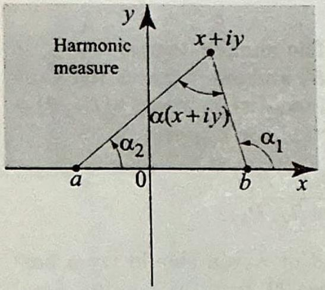
> > 
> > Figure 22 The harmonic measure of an interval is the difference of two translated arguments:
> > 
> > $$
> > \begin{aligned}
> > \alpha(z)=\operatorname{Arg} & (z-b) -\operatorname{Arg}(z-a)
> > \end{aligned}
> > $$
> > 
> 
> 
> (b) Show that $\alpha(z)$ is harmonic. **(Hint: problem 23(a).)**
> (c) Show geometrically that
> 
> $$
> \lim _{y \downarrow 0} \alpha(x+i y)= \begin{cases}0 & \text { if } x>b, \\ \pi & \text { if } a<x<b, \\ 0 & \text { if } x<a .\end{cases}
> $$
> 
> (d) Conclude that $u(x, y)=\frac{1}{\pi} \alpha(x+i y)$ is a solution of the Dirichlet problem in Figure 21.
> 
> 


##### solution

##### problem 35(a)

Let

$$
z=x+iy,
\qquad y>0,
$$

so that $z$ lies in the upper half-plane.

Draw the two line segments from $z$ to the endpoints $a$ and $b$ of the interval $[a,b]$. Let

$$
\alpha_1=\operatorname{Arg}(z-b),
\qquad
\alpha_2=\operatorname{Arg}(z-a),
$$

where we use the branch of $\operatorname{Arg}$ taking values in

$$
(0,\pi)
$$

on the upper half-plane.

Geometrically, the vector

$$
z-b
$$

points from the endpoint $b$ to the point $z$, so its argument is exactly the angle that the segment from $b$ to $z$ makes with the positive real axis. Likewise,

$$
z-a
$$

points from the endpoint $a$ to the point $z$, so its argument is the angle that the segment from $a$ to $z$ makes with the positive real axis.

The angle at $z$ subtended by the interval $[a,b]$ is the angle between these two segments. From the picture in Figure 22, that angle is

$$
\alpha(z)=\alpha_1-\alpha_2.
$$

Substitute the definitions of $\alpha_1$ and $\alpha_2$:

$$
\alpha(z)=\operatorname{Arg}(z-b)-\operatorname{Arg}(z-a).
$$

Therefore

$$
\boxed{\alpha(z)=\operatorname{Arg}(z-b)-\operatorname{Arg}(z-a).}
$$

##### problem 35(b)

We now show that $\alpha(z)$ is harmonic in the upper half-plane.

We know that

$$
\operatorname{Arg} z
$$

is harmonic in the upper half-plane

$$
\{z:\operatorname{Im} z>0\},
$$

because it is the imaginary part of the analytic function

$$
\operatorname{Log} z
$$

there.

Now consider the translated functions

$$
\operatorname{Arg}(z-a)
\qquad\text{and}\qquad
\operatorname{Arg}(z-b).
$$

The map

$$
z\mapsto z-a
$$

is analytic, and it carries the upper half-plane onto itself, because subtracting a real number does not change the imaginary part. Therefore, by Theorem 3, the composition

$$
\operatorname{Arg}(z-a)
$$

is harmonic in the upper half-plane.

By the same reasoning,

$$
\operatorname{Arg}(z-b)
$$

is harmonic in the upper half-plane.

From part (a),

$$
\alpha(z)=\operatorname{Arg}(z-b)-\operatorname{Arg}(z-a).
$$

Since a difference of harmonic functions is harmonic, it follows that $\alpha(z)$ is harmonic in the upper half-plane.

Thus

$$
\boxed{\alpha(z)\text{ is harmonic for }\operatorname{Im} z>0.}
$$

##### problem 35(c)

We now determine the boundary values of $\alpha(x+iy)$ as

$$
y\downarrow 0.
$$

There are three cases.

First suppose that

$$
x>b.
$$

Then the point $x+iy$ lies above and to the right of both endpoints $a$ and $b$. The two segments from $x+iy$ down to $a$ and $b$ point almost straight downward, and as

$$
y\downarrow 0,
$$

the angle between them shrinks to $0$. Hence

$$
\lim_{y\downarrow 0}\alpha(x+iy)=0
\qquad\text{if }x>b.
$$

Next suppose that

$$
a<x<b.
$$

Then the point $x+iy$ lies directly above the interval. As

$$
y\downarrow 0,
$$

the segment from $x+iy$ to $a$ points almost horizontally to the left, while the segment from $x+iy$ to $b$ points almost horizontally to the right. The subtended angle therefore approaches a straight angle, namely

$$
\pi.
$$

So

$$
\lim_{y\downarrow 0}\alpha(x+iy)=\pi
\qquad\text{if }a<x<b.
$$

Finally suppose that

$$
x<a.
$$

Then the point $x+iy$ lies above and to the left of both endpoints $a$ and $b$. As

$$
y\downarrow 0,
$$

the two segments from $x+iy$ to $a$ and $b$ again become nearly parallel, so the angle between them tends to $0$. Hence

$$
\lim_{y\downarrow 0}\alpha(x+iy)=0
\qquad\text{if }x<a.
$$

Therefore

$$
\boxed{
\lim_{y\downarrow 0}\alpha(x+iy)=
\begin{cases}
0 & \text{if }x>b,\\
\pi & \text{if }a<x<b,\\
0 & \text{if }x<a.
\end{cases}}
$$

##### problem 35(d)

Define

$$
u(x,y)=\frac{1}{\pi}\alpha(x+iy).
$$

Since $\alpha$ is harmonic in the upper half-plane by part (b), multiplying by the constant

$$
\frac{1}{\pi}
$$

shows that $u$ is also harmonic in the upper half-plane.

Now examine the boundary values on the real axis. Using part (c),

$$
\lim_{y\downarrow 0}u(x,y)
=\frac{1}{\pi}\lim_{y\downarrow 0}\alpha(x+iy).
$$

If

$$
x>b,
$$

then

$$
\lim_{y\downarrow 0}u(x,y)=\frac{1}{\pi}\cdot 0=0.
$$

If

$$
a<x<b,
$$

then

$$
\lim_{y\downarrow 0}u(x,y)=\frac{1}{\pi}\cdot \pi=1.
$$

If

$$
x<a,
$$

then

$$
\lim_{y\downarrow 0}u(x,y)=\frac{1}{\pi}\cdot 0=0.
$$

Therefore the boundary values are exactly

$$
u(x,0)=
\begin{cases}
1 & \text{if }a<x<b,\\
0 & \text{otherwise}.
\end{cases}
$$

Thus $u$ satisfies Laplace's equation in the upper half-plane and has the required boundary data on the real axis. Hence

$$
\boxed{u(x,y)=\frac{1}{\pi}\alpha(x+iy)}
$$

is a solution of the Dirichlet problem in Figure 21.


++++


> [!exercise] Exercise 26
> 
> 
> 36. (a) Solve the Dirichlet problem in _Figure 23_.
> 
> 
> > [!figure] Figure 23
> > 
> > 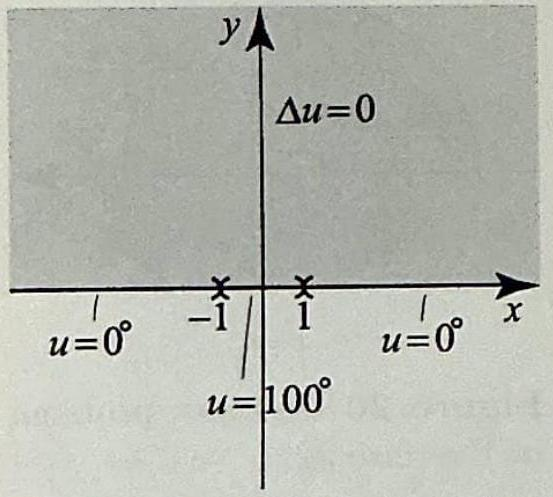
> > Figure 23 Dirichlet problem for problem 36.
> 
> 
> 
> (b) Show that the isotherm corresponding to the temperature $0<T<100$ consists of the arc in the upper half-plane of the circle with center $\left(0, \cot \frac{\pi T}{100}\right)$ and radius $\left|\csc \frac{\pi T}{100}\right|$. Justify your answer using facts from plane geometry.
> (c) What are the curves of heat flow? **(Hint: You know a harmonic conjugate of $\operatorname{Arg} z$. Show that if $v$ is a harmonic conjugate of $u$, then a harmonic conjugate of $u(z-a) \pm u(z-b)$ is $v(z-a) \pm v(z-b)$.)**
> (d) Plot the isotherms and curves of heat flow.
> 


##### solution

##### problem 36(a)

In Figure 23, the boundary data on the real axis are

$$
u(x,0)=
\begin{cases}
100 & \text{if }-1<x<1,\\
0 & \text{otherwise}.
\end{cases}
$$

This is exactly the interval problem from Exercise 35 with

$$
a=-1,
\qquad
b=1,
$$

except that the temperature on the interval is $100$ instead of $1$.

By Exercise 35, the harmonic measure of the interval $[-1,1]$ is

$$
\alpha(z)=\operatorname{Arg}(z-1)-\operatorname{Arg}(z+1),
$$

and

$$
\frac{1}{\pi}\alpha(z)
$$

solves the corresponding problem with boundary values $1$ on $(-1,1)$ and $0$ elsewhere.

Therefore, multiplying by $100$, we obtain the required solution:

$$
\boxed{
u(x,y)=\frac{100}{\pi}\alpha(x+iy)
=\frac{100}{\pi}\Bigl(\operatorname{Arg}(z-1)-\operatorname{Arg}(z+1)\Bigr),
\qquad z=x+iy,\ y>0.
}
$$

This function is harmonic in the upper half-plane and has the boundary values

$$
u(x,0)=
\begin{cases}
100 & \text{if }-1<x<1,\\
0 & \text{otherwise}.
\end{cases}
$$

##### problem 36(b)

Let

$$
0<T<100.
$$

The isotherm corresponding to the temperature $T$ is the level curve

$$
u(x,y)=T.
$$

Using the formula from part (a), this becomes

$$
\frac{100}{\pi}\alpha(x+iy)=T.
$$

Multiply both sides by

$$
\frac{\pi}{100}
$$

to get

$$
\alpha(x+iy)=\frac{\pi T}{100}.
$$

Thus the isotherm consists of all points in the upper half-plane from which the interval $[-1,1]$ is seen under the fixed angle

$$
\theta=\frac{\pi T}{100}.
$$

By the inscribed-angle theorem, the locus of points from which the chord joining

$$
(-1,0)
\qquad\text{and}\qquad
(1,0)
$$

is seen under a fixed angle is an arc of a circle through those two endpoints. Because the endpoints are symmetric with respect to the $y$-axis, the center of this circle must lie on the $y$-axis. So write the center as

$$
(0,c).
$$

Since the circle passes through

$$
(\pm 1,0),
$$

its radius is

$$
R=\sqrt{1+c^2}.
$$

We now determine $c$ in terms of $\theta$.

An equivalent analytic derivation starts from

$$
\alpha(z)=\operatorname{Arg}(z-1)-\operatorname{Arg}(z+1)=\theta.
$$

This means

$$
\operatorname{Arg}\left(\frac{z-1}{z+1}\right)=\theta.
$$

Hence

$$
\tan\theta=\frac{\operatorname{Im}\left(\frac{z-1}{z+1}\right)}{\operatorname{Re}\left(\frac{z-1}{z+1}\right)}.
$$

Let

$$
z=x+iy.
$$

Then

$$
\frac{z-1}{z+1}
=\frac{x-1+iy}{x+1+iy}
=\frac{(x-1+iy)(x+1-iy)}{(x+1)^2+y^2}.
$$

Expand the numerator:

$$
(x-1+iy)(x+1-iy)
=(x^2-1+y^2)+2iy.
$$

Therefore

$$
\operatorname{Re}\left(\frac{z-1}{z+1}\right)=\frac{x^2+y^2-1}{(x+1)^2+y^2},
\qquad
\operatorname{Im}\left(\frac{z-1}{z+1}\right)=\frac{2y}{(x+1)^2+y^2}.
$$

So

$$
\tan\theta
=\frac{2y}{x^2+y^2-1}.
$$

Multiply both sides by

$$
x^2+y^2-1
$$

$$
\bigl(x^2+y^2-1\bigr)\tan\theta=2y.
$$

Divide by $\tan\theta$:

$$
x^2+y^2-1=2y\cot\theta.
$$

Bring all terms to one side:

$$
x^2+y^2-2y\cot\theta-1=0.
$$

Complete the square in $y$:

$$
x^2+\bigl(y-\cot\theta\bigr)^2-\cot^2\theta-1=0.
$$

Therefore

$$
x^2+\bigl(y-\cot\theta\bigr)^2=1+\cot^2\theta.
$$

Use

$$
1+\cot^2\theta=\csc^2\theta
$$

to obtain

$$
x^2+\left(y-\cot\theta\right)^2=\csc^2\theta.
$$

Substitute

$$
\theta=\frac{\pi T}{100}
$$

to get

$$
\boxed{
x^2+\left(y-\cot\frac{\pi T}{100}\right)^2=\csc^2\frac{\pi T}{100}.
}
$$

So the isotherm is the arc in the upper half-plane of the circle with center

$$
\boxed{\left(0,\cot\frac{\pi T}{100}\right)}
$$

and radius

$$
\boxed{\left|\csc\frac{\pi T}{100}\right|.}
$$

Because

$$
0<T<100,
$$

we have

$$
0<\frac{\pi T}{100}<\pi,
$$

so the circle passes through

$$
(-1,0)
\qquad\text{and}\qquad
(1,0),
$$

and the required isotherm is its upper arc.

##### problem 36(c)

To find the curves of heat flow, we compute a harmonic conjugate of $u$.

A harmonic conjugate of

$$
\operatorname{Arg} z
$$

is

$$
-\ln|z|.
$$

Therefore a harmonic conjugate of

$$
\operatorname{Arg}(z-1)
$$

is

$$
-\ln|z-1|,
$$

and a harmonic conjugate of

$$
\operatorname{Arg}(z+1)
$$

is

$$
-\ln|z+1|.
$$

Since

$$
u(z)=\frac{100}{\pi}\Bigl(\operatorname{Arg}(z-1)-\operatorname{Arg}(z+1)\Bigr),
$$

a harmonic conjugate of $u$ is

$$
v(z)=\frac{100}{\pi}\Bigl(-\ln|z-1|+\ln|z+1|\Bigr).
$$

Rewrite this as

$$
v(z)=\frac{100}{\pi}\ln\left|\frac{z+1}{z-1}\right|.
$$

The curves of heat flow are the level curves of $v$, so set

$$
v(z)=C.
$$

Then

$$
\frac{100}{\pi}\ln\left|\frac{z+1}{z-1}\right|=C.
$$

Multiply both sides by

$$
\frac{\pi}{100}
$$

to obtain

$$
\ln\left|\frac{z+1}{z-1}\right|=\frac{\pi C}{100}.
$$

Exponentiate:

$$
\left|\frac{z+1}{z-1}\right|=e^{\pi C/100}.
$$

Since the right-hand side is a positive constant, we may write

$$
\left|\frac{z+1}{z-1}\right|=R,
\qquad R>0.
$$

Equivalently,

$$
|z+1|=R|z-1|.
$$

These are the points whose distances from

$$
(-1,0)
\qquad\text{and}\qquad
(1,0)
$$

have a constant ratio. Hence the heat-flow curves are Apollonius circles.

To write them explicitly, let

$$
z=x+iy.
$$

Then

$$
\sqrt{(x+1)^2+y^2}=R\sqrt{(x-1)^2+y^2}.
$$

Square both sides:

$$
(x+1)^2+y^2=R^2\bigl((x-1)^2+y^2\bigr).
$$

Expand:

$$
x^2+2x+1+y^2=R^2x^2-2R^2x+R^2+R^2y^2.
$$

Bring everything to one side:

$$
(1-R^2)x^2+2(1+R^2)x+(1-R^2)y^2+(1-R^2)=0.
$$

If

$$
R\neq 1,
$$

divide by

$$
1-R^2
$$

to get

$$
x^2+y^2+2\frac{1+R^2}{1-R^2}x+1=0.
$$

Complete the square in $x$:

$$
\left(x+\frac{1+R^2}{1-R^2}\right)^2+y^2
=\left(\frac{1+R^2}{1-R^2}\right)^2-1.
$$

Simplify the right-hand side:

$$
\left(\frac{1+R^2}{1-R^2}\right)^2-1
=\frac{(1+R^2)^2-(1-R^2)^2}{(1-R^2)^2}
=\frac{4R^2}{(1-R^2)^2}.
$$

Therefore, for

$$
R\neq 1,
$$

the curves of heat flow are

$$
\boxed{
\left(x+\frac{1+R^2}{1-R^2}\right)^2+y^2
=\frac{4R^2}{(1-R^2)^2}
}.
$$

If

$$
R=1,
$$

then

$$
|z+1|=|z-1|,
$$

so the point is equidistant from

$$
(-1,0)
\qquad\text{and}\qquad
(1,0),
$$

which means

$$
\boxed{x=0.}
$$

Thus the curves of heat flow are circles centered on the $x$-axis, together with the limiting case

$$
x=0,
$$

and they are orthogonal to the isotherm circles.


##### problem 36(d)


```Mathematica title:""
Module[
 {
  isothermTemps = {10, 20, 30, 40, 50, 60, 70, 80, 90},
  flowRhos = {0.35, 0.55, 0.75, 1, 1.35, 1.8, 2.6},
  blue = RGBColor[0.15, 0.42, 0.85],
  green = RGBColor[0.10, 0.62, 0.22],
  xMin = -4.8,
  xMax = 4.8,
  yMin = 0,
  yMax = 4.9
  },
 Show[
  ContourPlot[
   Evaluate@Join[
     Table[
      x^2 + (y - Cot[Pi t/100])^2 == Csc[Pi t/100]^2,
      {t, isothermTemps}
      ],
     Table[
      If[
       rho == 1,
       x == 0,
       (x + (1 + rho^2)/(1 - rho^2))^2 + y^2 == 4 rho^2/(1 - rho^2)^2
       ],
      {rho, flowRhos}
      ]
     ],
   {x, xMin, xMax}, {y, yMin, yMax},
   ContourStyle -> Join[
     Table[Directive[blue, Thick], {Length[isothermTemps]}],
     Table[Directive[green, Thick], {Length[flowRhos]}]
     ],
   ContourShading -> False,
   Frame -> False,
   Axes -> True,
   AspectRatio -> (yMax - yMin)/(xMax - xMin),
   AxesLabel -> {"x", "y"},
   PlotPoints -> 90,
   MaxRecursion -> 2,
   ImageSize -> 560,
   PlotRange -> {{xMin, xMax}, {yMin, yMax}},
   PlotRangePadding -> Scaled[0.02]
   ],
  Graphics[
   {
    {Thick, Red, Line[{{-1, 0}, {1, 0}}]},
    {Thick, GrayLevel[0.35], Line[{{xMin, 0}, {-1, 0}}], Line[{{1, 0}, {xMax, 0}}]},
    
    {green,
     Arrow[Table[{0, t}, {t, 0.25, 2.0, 0.08}]],
     
     With[
      {
       h = -(1 + 0.55^2)/(1 - 0.55^2),
       r = 2*0.55/(1 - 0.55^2)
       },
      Arrow[Table[{h + r Cos[t], r Sin[t]}, {t, 0.65, 1.55, 0.04}]]
      ],
     
     With[
      {
       h = -(1 + 1.8^2)/(1 - 1.8^2),
       r = 2*1.8/Abs[1 - 1.8^2]
       },
      Arrow[Table[{h + r Cos[t], r Sin[t]}, {t, 2.45, 1.55, -0.04}]]
      ]
     },
    
    Text[Style["u = 100°", 15, Bold, Red], {0, -0.24}],
    Text[Style["u = 0°", 15, Bold], {-2.9, -0.24}],
    Text[Style["u = 0°", 15, Bold], {2.9, -0.24}],
    
    Text[Style["T = 25°", 13, blue], {0.18, 3.55}],
    Text[Style["T = 50°", 13, blue], {0.18, 0.98}],
    Text[Style["T = 75°", 13, blue], {0.18, 0.42}]
    }
   ],
  PlotLabel -> Style["Problem 36: Isotherms and Curves of Heat Flow", 18]
  ]
]
```


++++


> [!exercise] Exercise 27
> 37. Solve the Dirichlet problem in the upper half-plane with boundary data on the $x$-axis given by
> 
> $$
> u(x, 0)= \begin{cases}T_{1} & \text { if } a<x<b \\ T_{2} & \text { otherwise }\end{cases}
> $$
> 
> where $a<b$ are fixed real numbers. **(Hint: Use Exercise 35 and the fact that constant functions are harmonic.)**


##### solution

Let

$$
\alpha(z)
$$

denote the harmonic measure of the interval $(a,b)$ in the upper half-plane, as in Exercise 35. Then

$$
\frac{1}{\pi}\alpha(z)
$$

is harmonic in the upper half-plane and has boundary values

$$
\frac{1}{\pi}\alpha(x+iy)\to
\begin{cases}
1 & \text{if }a<x<b,\\
0 & \text{otherwise},
\end{cases}
\qquad y\downarrow 0.
$$

We want boundary data

$$
u(x,0)=
\begin{cases}
T_1 & \text{if }a<x<b,\\
T_2 & \text{otherwise}.
\end{cases}
$$

The idea is to start with the constant harmonic function

$$
T_2
$$

and then add a correction which is

$$
T_1-T_2
$$

on the interval $(a,b)$ and

$$
0
$$

elsewhere.

Since

$$
\frac{1}{\pi}\alpha(z)
$$

has exactly the boundary values

$$
\begin{cases}
1 & \text{if }a<x<b,\\
0 & \text{otherwise},
\end{cases}
$$

the needed correction is

$$
\frac{T_1-T_2}{\pi}\alpha(z).
$$

Therefore we define

$$
u(z)=T_2+\frac{T_1-T_2}{\pi}\alpha(z).
$$

Using the formula from Exercise 35,

$$
\alpha(z)=\operatorname{Arg}(z-b)-\operatorname{Arg}(z-a),
$$

we obtain

$$
\boxed{
u(z)=T_2+\frac{T_1-T_2}{\pi}\Bigl(\operatorname{Arg}(z-b)-\operatorname{Arg}(z-a)\Bigr),
\qquad \operatorname{Im} z>0.
}
$$

Now check the boundary values.

If

$$
a<x<b,
$$

then by Exercise 35,

$$
\alpha(x+iy)\to\pi
\qquad\text{as }y\downarrow 0.
$$

Hence

$$
u(x,y)\to T_2+\frac{T_1-T_2}{\pi}\cdot\pi
=T_2+(T_1-T_2)
=T_1.
$$

If

$$
x<a
\qquad\text{or}\qquad
x>b,
$$

then

$$
\alpha(x+iy)\to 0
\qquad\text{as }y\downarrow 0.
$$

Hence

$$
u(x,y)\to T_2+\frac{T_1-T_2}{\pi}\cdot 0
=T_2.
$$

So the function has exactly the required boundary data.

Since constants are harmonic and $\alpha(z)$ is harmonic in the upper half-plane, the function

$$
u(z)=T_2+\frac{T_1-T_2}{\pi}\alpha(z)
$$

is harmonic in the upper half-plane.

Therefore the solution of the Dirichlet problem is

$$
\boxed{
u(z)=T_2+\frac{T_1-T_2}{\pi}\Bigl(\operatorname{Arg}(z-b)-\operatorname{Arg}(z-a)\Bigr).
}
$$


++++


> [!exercise] Exercise 28
> 
> 
> 38. **Project Problem:** Harmonic measures of two disjoint intervals. In this exercise, we generalize the result of Exercise 35 by solving the Dirichlet problem in the upper half-plane with boundary data
> 
> $$
> u(x, 0)= \begin{cases}T_{1} & \text { if } a<x<b \\ T_{2} & \text { if } c<x<d \\ 0 & \text { otherwise }\end{cases}
> $$
> 
> where $a<b \leq c<d$ (_Figure 24_).
> 
> 
> > [!figure] Figure 24
> > 
> > 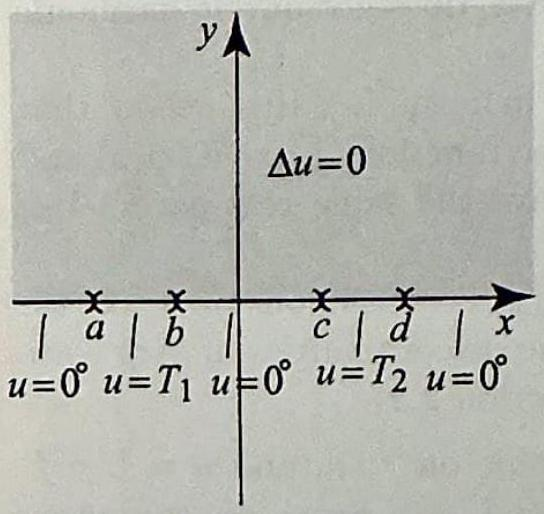
> > Figure 24 Dirichlet problem for problem 38.
> 
> 
> 
> (a) Show that if $u_{1}$ is a solution of the Dirichlet problem in the upper half-plane with boundary conditions
> 
> $$
> u_{1}(x, 0)= \begin{cases}T_{1} & \text { if } a<x<b \\ 0 & \text { otherwise }\end{cases}
> $$
> 
> and $u_{2}$ is a solution of the Dirichlet problem in the upper half-plane with boundary conditions
> 
> $$
> u_{2}(x, 0)= \begin{cases}T_{2} & \text { if } c<x<d \\ 0 & \text { otherwise }\end{cases}
> $$
> 
> then the solution of the Dirichlet problem in the upper half-plane with boundary data $u(x, 0)$ is $u(x, y)=u_{1}(x, y)+u_{2}(x, y)$.
> (b) Show that $u(x, y)=\frac{T_{1}}{\pi} \alpha_{1}(z)+\frac{T_{2}}{\pi} \alpha_{2}(z)$ where $\alpha_{1}(z)$, respectively, $\alpha_{2}(z)$, is the angle at $z$ subtended by the interval $(a, b)$, respectively, $(c, d)$.


##### solution

##### problem 38(a)

Let

$$
u(x,y)=u_1(x,y)+u_2(x,y).
$$

We must show that this function solves the Dirichlet problem with boundary data

$$
u(x,0)=
\begin{cases}
T_1 & \text{if }a<x<b,\\
T_2 & \text{if }c<x<d,\\
0 & \text{otherwise}.
\end{cases}
$$

First, $u$ is harmonic in the upper half-plane. Indeed, $u_1$ and $u_2$ are each solutions of Dirichlet problems in the upper half-plane, so each is harmonic there:

$$
\Delta u_1=0,
\qquad
\Delta u_2=0.
$$

Therefore

$$
\Delta u
=\Delta(u_1+u_2)
=\Delta u_1+\Delta u_2
=0+0
=0.
$$

So $u$ is harmonic in the upper half-plane.

Now check the boundary values on the real axis.

If

$$
a<x<b,
$$

then by the definition of $u_1$ and $u_2$,

$$
u_1(x,0)=T_1,
\qquad
u_2(x,0)=0,
$$

because the interval

$$
(a,b)
$$

and the interval

$$
(c,d)
$$

are disjoint. Hence

$$
u(x,0)=u_1(x,0)+u_2(x,0)=T_1+0=T_1.
$$

If

$$
c<x<d,
$$

then similarly

$$
u_1(x,0)=0,
\qquad
u_2(x,0)=T_2,
$$

so

$$
u(x,0)=u_1(x,0)+u_2(x,0)=0+T_2=T_2.
$$

If $x$ lies outside both intervals, then

$$
u_1(x,0)=0,
\qquad
u_2(x,0)=0,
$$

and therefore

$$
u(x,0)=0+0=0.
$$

Thus $u$ has exactly the required boundary data. Hence

$$
\boxed{u(x,y)=u_1(x,y)+u_2(x,y)}
$$

is the solution of the Dirichlet problem.

##### problem 38(b)

By Exercise 27, the solution of the upper-half-plane Dirichlet problem with boundary data

$$
\begin{cases}
T_1 & \text{if }a<x<b,\\
0 & \text{otherwise}
\end{cases}
$$

is

$$
u_1(x,y)=\frac{T_1}{\pi}\alpha_1(z),
$$

where $\alpha_1(z)$ is the angle at $z$ subtended by the interval $(a,b)$.

Likewise, the solution of the upper-half-plane Dirichlet problem with boundary data

$$
\begin{cases}
T_2 & \text{if }c<x<d,\\
0 & \text{otherwise}
\end{cases}
$$

is

$$
u_2(x,y)=\frac{T_2}{\pi}\alpha_2(z),
$$

where $\alpha_2(z)$ is the angle at $z$ subtended by the interval $(c,d)$.

Now apply part (a). The solution of the two-interval problem is

$$
u(x,y)=u_1(x,y)+u_2(x,y).
$$

Substitute the formulas for $u_1$ and $u_2$:

$$
u(x,y)=\frac{T_1}{\pi}\alpha_1(z)+\frac{T_2}{\pi}\alpha_2(z).
$$

Therefore

$$
\boxed{u(x,y)=\frac{T_1}{\pi}\alpha_1(z)+\frac{T_2}{\pi}\alpha_2(z).}
$$

If one wants the formula written entirely in terms of arguments, then

$$
\alpha_1(z)=\operatorname{Arg}(z-b)-\operatorname{Arg}(z-a),
$$

and

$$
\alpha_2(z)=\operatorname{Arg}(z-d)-\operatorname{Arg}(z-c),
$$

so the solution may also be written as

$$
\boxed{
u(x,y)=\frac{T_1}{\pi}\Bigl(\operatorname{Arg}(z-b)-\operatorname{Arg}(z-a)\Bigr)
+\frac{T_2}{\pi}\Bigl(\operatorname{Arg}(z-d)-\operatorname{Arg}(z-c)\Bigr).
}
$$


++++


> [!exercise] Exercise 29
> 
> 
> 39. (a) Solve the Dirichlet problem in _Figure 25_.
> 
> 
> > [!figure] Figure 25
> > 
> > 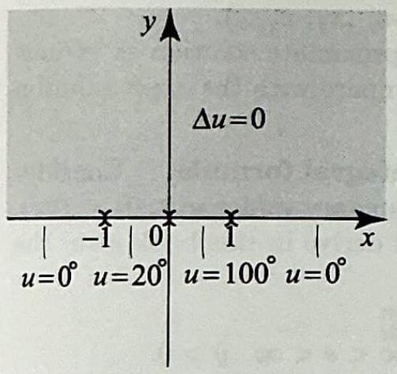
> > Figure 25 Dirichlet problem for problem 39.
> 
> 
> (b) Plot the isotherms.


##### solution

##### problem 39(a)

The boundary data in Figure 25 are

$$
u(x,0)=
\begin{cases}
20 & \text{if }-1<x<0,\\
100 & \text{if }0<x<1,\\
0 & \text{otherwise}.
\end{cases}
$$

This is exactly a two-interval Dirichlet problem of the type considered in Exercise 38.

Let

$$
\alpha_1(z)
$$

be the angle at $z$ subtended by the interval

$$
(-1,0),
$$

and let

$$
\alpha_2(z)
$$

be the angle at $z$ subtended by the interval

$$
(0,1).
$$

By Exercise 38, the solution is

$$
u(x,y)=\frac{20}{\pi}\alpha_1(z)+\frac{100}{\pi}\alpha_2(z),
\qquad z=x+iy,\ y>0.
$$

Now write $\alpha_1$ and $\alpha_2$ in terms of arguments.

For the interval

$$
(-1,0),
$$

we have

$$
a=-1,
\qquad
b=0,
$$

so by Exercise 35,

$$
\alpha_1(z)=\operatorname{Arg}(z-0)-\operatorname{Arg}(z-(-1))
=\operatorname{Arg} z-\operatorname{Arg}(z+1).
$$

For the interval

$$
(0,1),
$$

we have

$$
a=0,
\qquad
b=1,
$$

so

$$
\alpha_2(z)=\operatorname{Arg}(z-1)-\operatorname{Arg}(z).
$$

Substitute these into the formula for $u$:

$$
u(x,y)=\frac{20}{\pi}\Bigl(\operatorname{Arg} z-\operatorname{Arg}(z+1)\Bigr)
+\frac{100}{\pi}\Bigl(\operatorname{Arg}(z-1)-\operatorname{Arg} z\Bigr).
$$

Combine like terms:

$$
u(x,y)=\frac{100}{\pi}\operatorname{Arg}(z-1)
-\frac{80}{\pi}\operatorname{Arg} z
-\frac{20}{\pi}\operatorname{Arg}(z+1).
$$

Therefore the solution is

$$
\boxed{
u(x,y)=\frac{20}{\pi}\Bigl(\operatorname{Arg} z-\operatorname{Arg}(z+1)\Bigr)
+\frac{100}{\pi}\Bigl(\operatorname{Arg}(z-1)-\operatorname{Arg} z\Bigr),
\qquad y>0.
}
$$

If we want the formula in terms of $x$ and $y$, then for points in the upper half-plane

$$
\operatorname{Arg}(x+iy-a)=\cot^{-1}\left(\frac{x-a}{y}\right).
$$

Hence

$$
\operatorname{Arg} z=\cot^{-1}\left(\frac{x}{y}\right),
$$

$$
\operatorname{Arg}(z+1)=\cot^{-1}\left(\frac{x+1}{y}\right),
$$

and

$$
\operatorname{Arg}(z-1)=\cot^{-1}\left(\frac{x-1}{y}\right).
$$

So we may also write

$$
\boxed{
u(x,y)=\frac{20}{\pi}\left[\cot^{-1}\left(\frac{x}{y}\right)-\cot^{-1}\left(\frac{x+1}{y}\right)\right]
+\frac{100}{\pi}\left[\cot^{-1}\left(\frac{x-1}{y}\right)-\cot^{-1}\left(\frac{x}{y}\right)\right].
}
$$

##### problem 39(b)

The isotherms are the level curves of $u$, so for a temperature $T$ we set

$$
u(x,y)=T.
$$

Using the formula above, this gives

$$
\frac{20}{\pi}\alpha_1(z)+\frac{100}{\pi}\alpha_2(z)=T.
$$

Multiply both sides by

$$
\frac{\pi}{20}
$$

to obtain

$$
\alpha_1(z)+5\alpha_2(z)=\frac{\pi T}{20}.
$$

Now substitute the argument formulas:

$$
\operatorname{Arg} z-\operatorname{Arg}(z+1)+5\bigl(\operatorname{Arg}(z-1)-\operatorname{Arg} z\bigr)=\frac{\pi T}{20}.
$$

Distribute the factor $5$:

$$
\operatorname{Arg} z-\operatorname{Arg}(z+1)+5\operatorname{Arg}(z-1)-5\operatorname{Arg} z=\frac{\pi T}{20}.
$$

Combine like terms:

$$
5\operatorname{Arg}(z-1)-4\operatorname{Arg} z-\operatorname{Arg}(z+1)=\frac{\pi T}{20}.
$$

Thus the isotherms are the curves

$$
\boxed{
5\operatorname{Arg}(z-1)-4\operatorname{Arg} z-\operatorname{Arg}(z+1)=\frac{\pi T}{20}.
}
$$

Equivalently, if we define

$$
F(z)=\frac{(z-1)^5}{z^4(z+1)},
$$

then

$$
\operatorname{Arg}F(z)=5\operatorname{Arg}(z-1)-4\operatorname{Arg} z-\operatorname{Arg}(z+1),
$$

so the isotherms are the preimages of rays in the $F$-plane:

$$
\boxed{\operatorname{Arg}F(z)=\frac{\pi T}{20}.}
$$

The following Mathematica plot shows a representative family of isotherms in the upper half-plane.

```Mathematica title:""
Module[
 {
  u, temps, blue, xMin, xMax, yMin, yMax
  },
 
 u[x_, y_] := (20/Pi) (Arg[x + I y] - Arg[x + 1 + I y]) +
   (100/Pi) (Arg[x - 1 + I y] - Arg[x + I y]);
 
 temps = {5, 10, 15, 20, 30, 40, 50, 60, 70, 80, 90, 95};
 blue = RGBColor[0.15, 0.42, 0.85];
 xMin = -4.5; xMax = 4.5; yMin = 0; yMax = 4.2;
 
 Show[
  ContourPlot[
   Evaluate@Table[u[x, y] == t, {t, temps}],
   {x, xMin, xMax}, {y, yMin, yMax},
   ContourStyle -> Table[Directive[blue, Thick], {Length[temps]}],
   ContourShading -> False,
   Frame -> False,
   Axes -> True,
   AspectRatio -> (yMax - yMin)/(xMax - xMin),
   AxesLabel -> {"x", "y"},
   PlotPoints -> 90,
   MaxRecursion -> 2,
   ImageSize -> 560,
   PlotRange -> {{xMin, xMax}, {yMin, yMax}},
   PlotRangePadding -> Scaled[0.02]
   ],
  Graphics[
   {
    {Thick, RGBColor[0.80, 0.15, 0.15], Line[{{-1, 0}, {0, 0}}]},
    {Thick, RGBColor[0.85, 0.45, 0.10], Line[{{0, 0}, {1, 0}}]},
    {Thick, GrayLevel[0.35], Line[{{xMin, 0}, {-1, 0}}], Line[{{1, 0}, {xMax, 0}}]},
    Text[Style["u = 20°", 15, Bold, RGBColor[0.80, 0.15, 0.15]], {-0.52, -0.22}],
    Text[Style["u = 100°", 15, Bold, RGBColor[0.85, 0.45, 0.10]], {0.58, -0.22}],
    Text[Style["u = 0°", 15, Bold], {-2.7, -0.22}],
    Text[Style["u = 0°", 15, Bold], {2.7, -0.22}],
    Text[Style["T = 40°", 13, blue], {-0.7, 1.55}],
    Text[Style["T = 60°", 13, blue], {0.15, 1.2}],
    Text[Style["T = 80°", 13, blue], {0.85, 0.75}]
    }
   ],
  PlotLabel -> Style["Problem 39: Isotherms", 18]
  ]
]
```


++++


> [!exercise] Exercise 30
> 
> 40. **Project Problem:** Harmonic measures of several disjoint intervals. Generalize the result of Exercise 38 as follows. Suppose that $I_{1}, I_{2}, \ldots, I_{n}$ are disjoint open intervals on the $x$-axis, and $T_{1}, T_{2}, \ldots, T_{n}$ are real numbers. Consider the Dirichlet problem in the upper half-plane with boundary condition
> 
> $$
> u(x, 0)= \begin{cases}T_{j} & \text { if } x \in I_{j} \\ 0 & \text { otherwise }\end{cases}
> $$
> 
> Show that the solution is
> 
> $$
> u(x, y)=\frac{1}{\pi} \sum_{j=1}^{n} T_{j} \alpha_{j}(z)
> $$
> 
> where $\alpha_{j}(z)$ is the angle at $z$ subtended by the interval $I_{j}$.


##### solution

For each interval

$$
I_j,
$$

let

$$
\alpha_j(z)
$$

denote the angle at $z$ subtended by the interval $I_j$.

We claim that the solution of the Dirichlet problem is

$$
u(x,y)=\frac{1}{\pi}\sum_{j=1}^n T_j\alpha_j(z),
\qquad z=x+iy,
\qquad y>0.
$$

We now prove this carefully.

For each fixed index

$$
j\in\{1,2,\dots,n\},
$$

consider the auxiliary Dirichlet problem in the upper half-plane with boundary values

$$
u_j(x,0)=
\begin{cases}
T_j & \text{if }x\in I_j,\\
0 & \text{otherwise}.
\end{cases}
$$

By Exercise 27, the solution of this one-interval problem is

$$
u_j(x,y)=\frac{T_j}{\pi}\alpha_j(z).
$$

For the first interval, the contribution is

$$
u_1(x,y)=\frac{T_1}{\pi}\alpha_1(z).
$$

For the first two intervals, the contribution is

$$
u_1(x,y)+u_2(x,y)
=
\frac{T_1}{\pi}\alpha_1(z)+\frac{T_2}{\pi}\alpha_2(z).
$$

For the first three intervals, the contribution is

$$
u_1(x,y)+u_2(x,y)+u_3(x,y)
=
\frac{T_1}{\pi}\alpha_1(z)+\frac{T_2}{\pi}\alpha_2(z)+\frac{T_3}{\pi}\alpha_3(z).
$$

Continuing in this way, we define

$$
u(x,y)=u_1(x,y)+u_2(x,y)+\cdots+u_n(x,y).
$$

Using the formula for each $u_j$, this becomes

$$
\begin{aligned}
u(x,y)
&=
u_1(x,y)+u_2(x,y)+\cdots+u_n(x,y)\\
&=
\frac{T_1}{\pi}\alpha_1(z)+\frac{T_2}{\pi}\alpha_2(z)+\cdots+\frac{T_n}{\pi}\alpha_n(z)\\
&=
\frac{1}{\pi}\Bigl(T_1\alpha_1(z)+T_2\alpha_2(z)+\cdots+T_n\alpha_n(z)\Bigr).
\end{aligned}
$$

In summation notation,

$$
\boxed{
u(x,y)=\frac{1}{\pi}\sum_{j=1}^n T_j\alpha_j(z).
}
$$

It remains to show that this function really solves the given Dirichlet problem.

First, $u$ is harmonic in the upper half-plane. Since each $u_j$ solves a Dirichlet problem there, each $u_j$ is harmonic:

$$
\Delta u_j=0
\qquad\text{for }j=1,2,\dots,n.
$$

Therefore

$$
\Delta u
=\Delta\left(\sum_{j=1}^n u_j\right)
=\sum_{j=1}^n \Delta u_j
=0+0+\cdots+0
=0.
$$

So $u$ is harmonic in the upper half-plane.

Now we verify the boundary values on the real axis.

Take a real number $x$.

Because the intervals

$$
I_1,I_2,\dots,I_n
$$

are disjoint, there are only two possibilities.

First case: $x$ belongs to one of the intervals. Suppose

$$
x\in I_k
$$

for some fixed index $k$.

Then, by the definition of the functions $u_j$,

$$
u_k(x,0)=T_k.
$$

Since the intervals are disjoint, $x$ does not belong to any other interval $I_j$ with

$$
j\neq k.
$$

Hence

$$
u_j(x,0)=0
\qquad\text{for every }j\neq k.
$$

Therefore

$$
u(x,0)
=\sum_{j=1}^n u_j(x,0)
=u_1(x,0)+\cdots+u_k(x,0)+\cdots+u_n(x,0)
=0+\cdots+T_k+\cdots+0
=T_k.
$$

But the prescribed boundary condition in the problem is precisely

$$
u(x,0)=T_k
\qquad\text{when }x\in I_k.
$$

So the boundary condition is satisfied in this case.

Second case: $x$ does not belong to any of the intervals. Then

$$
x\notin I_j
\qquad\text{for every }j=1,2,\dots,n.
$$

Therefore

$$
u_j(x,0)=0
\qquad\text{for every }j=1,2,\dots,n.
$$

Hence

$$
u(x,0)
=\sum_{j=1}^n u_j(x,0)
=0+0+\cdots+0
=0.
$$

This agrees with the required boundary condition outside the intervals.

We have now shown two things:

$$
\Delta u=0
\qquad\text{in the upper half-plane},
$$

and

$$
u(x,0)=
\begin{cases}
T_j & \text{if }x\in I_j,\\
0 & \text{otherwise}.
\end{cases}
$$

Therefore

$$
\boxed{
u(x,y)=\frac{1}{\pi}\sum_{j=1}^n T_j\alpha_j(z)
}
$$

is the solution of the Dirichlet problem.


++++


> [!exercise] Exercise 31
> 
> 41. **Project Problem:** Approximation of steady-state solutions. Consider the Dirichlet problem in the upper half-plane with boundary values $u(x, 0)= f(x)(-\infty<x<\infty)$, where $f(x)$ is an arbitrary function that represents the temperature of the points on the $x$-axis. Such a temperature distribution will be bounded and piecewise continuous. There is an analytical solution of the Dirichlet problem, given by an integral involving $f(x)$, known as the Poisson integral of $f$ (see Exercise 42). In this exercise, we will show how we can use the result of Exercise 40 to approximate the solution for a given $f(x)$. The approach that we take has some merit, since it can be used to obtain approximate numerical values for the steady-state temperature. Moreover, we will use it in Exercise 42 to justify the Poisson integral formula. The rigorous derivation of this formula will be given in a later chapter.
> 
> To be able to compare our numerical approximation with the exact solution, let us take $f(x)=\frac{1}{1+x^{2}},-\infty<x<\infty$. In this case, using properties of the Poisson integral, we will show in a later chapter that the solution is
> 
> $$
> u(x, y)=\frac{1+y}{x^{2}+(1+y)^{2}}
> $$
> 
> (a) Verify that $u$ is indeed harmonic in the upper half-plane and that it equals $f(x)=\frac{1}{1+x^{2}}$ on the $x$-axis.
> (b) We now pretend that we do not know the exact solution and proceed to find an approximate solution. The idea is to approximate $f(x)$ by a function that takes on constant values on disjoint intervals. Take the interval ( $-5,5$ ) and subdivide it
> into 40 smaller intervals of equal length, $\left(x_{j}, x_{j+1}\right), j=1,2, \ldots, 40$. Approximate $f$ on ( $x_{j}, x_{j+1}$ ) by $f\left(x_{j}\right)$, and by 0 outside the interval ( $-5,5$ ). Thus the boundary values are now replaced by
> 
> $$
> u(x, 0)= \begin{cases}\frac{1}{1+x_{j}^{2}} & \text { if } x_{j}<x<x_{j+1} \\ 0 & \text { otherwise }\end{cases}
> $$
> 
> Show that the solution is
> 
> $$
> u(x, y)=\frac{1}{\pi} \sum_{j=1}^{40} \frac{1}{1+x_{j}^{2}} \alpha_{j}(z)
> $$
> 
> where $\alpha_{j}(z)$ is the angle at $z$ subtended by the interval $\left(x_{j}, x_{j+1}\right)$.
> (c) With the help of a computer, evaluate your approximate solution at various points, $z_{0}=x_{0}+i y_{0}$, in the upper half-plane and compare with the exact solution (10).
> 
> 


##### solution

##### problem 41(a)

We are given

$$
u(x,y)=\frac{1+y}{x^2+(1+y)^2}.
$$

We must show two things:

$$
\Delta u=0
\qquad\text{for }y>0,
$$

and

$$
u(x,0)=\frac{1}{1+x^2}.
$$

To simplify the differentiation, write

$$
D=x^2+(1+y)^2.
$$

Then

$$
u(x,y)=\frac{1+y}{D}.
$$

We first compute the partial derivatives with respect to $x$.

Since $1+y$ is constant with respect to $x$,

$$
u_x
=\frac{\partial}{\partial x}\left((1+y)D^{-1}\right)
=(1+y)\frac{\partial}{\partial x}\left(D^{-1}\right).
$$

Now

$$
\frac{\partial D}{\partial x}=2x,
$$

so

$$
\frac{\partial}{\partial x}\left(D^{-1}\right)
=-D^{-2}\frac{\partial D}{\partial x}
=-D^{-2}(2x).
$$

Therefore

$$
u_x
=(1+y)\bigl(-2xD^{-2}\bigr)
=-\frac{2x(1+y)}{D^2}.
$$

Differentiate again with respect to $x$:

$$
u_{xx}
=\frac{\partial}{\partial x}\left(-2(1+y)xD^{-2}\right)
=-2(1+y)\frac{\partial}{\partial x}\left(xD^{-2}\right).
$$

Use the product rule:

$$
\frac{\partial}{\partial x}\left(xD^{-2}\right)
=1\cdot D^{-2}+x\frac{\partial}{\partial x}\left(D^{-2}\right).
$$

Now

$$
\frac{\partial}{\partial x}\left(D^{-2}\right)
=-2D^{-3}\frac{\partial D}{\partial x}
=-2D^{-3}(2x)
=-4xD^{-3}.
$$

So

$$
\frac{\partial}{\partial x}\left(xD^{-2}\right)
=D^{-2}+x(-4xD^{-3})
=D^{-2}-4x^2D^{-3}.
$$

Hence

$$
u_{xx}
=-2(1+y)\left(D^{-2}-4x^2D^{-3}\right).
$$

Put the terms over the common denominator $D^3$:

$$
u_{xx}
=-2(1+y)\left(\frac{D}{D^3}-\frac{4x^2}{D^3}\right)
=-2(1+y)\frac{D-4x^2}{D^3}.
$$

Substitute

$$
D=x^2+(1+y)^2
$$

$$
u_{xx}
=-2(1+y)\frac{x^2+(1+y)^2-4x^2}{D^3}
=-2(1+y)\frac{(1+y)^2-3x^2}{D^3}.
$$

Now compute the $y$-derivatives.

Starting from

$$
u(x,y)=\frac{1+y}{D},
$$

use the quotient rule:

$$
u_y
=\frac{(1)\cdot D-(1+y)\cdot D_y}{D^2}.
$$

Since

$$
D_y=\frac{\partial}{\partial y}\left(x^2+(1+y)^2\right)=2(1+y),
$$

we get

$$
u_y
=\frac{D-(1+y)\cdot 2(1+y)}{D^2}
=\frac{D-2(1+y)^2}{D^2}.
$$

Substitute $D=x^2+(1+y)^2$:

$$
u_y
=\frac{x^2+(1+y)^2-2(1+y)^2}{D^2}
=\frac{x^2-(1+y)^2}{D^2}.
$$

Differentiate once more with respect to $y$.

Let

$$
N=x^2-(1+y)^2.
$$

Then

$$
u_y=ND^{-2}.
$$

Differentiate:

$$
u_{yy}
=N_yD^{-2}+N\frac{\partial}{\partial y}(D^{-2}).
$$

Now

$$
N_y=-2(1+y),
$$

and

$$
\frac{\partial}{\partial y}(D^{-2})
=-2D^{-3}D_y
=-2D^{-3}\cdot 2(1+y)
=-4(1+y)D^{-3}.
$$

Therefore

$$
u_{yy}
=-2(1+y)D^{-2}+N\bigl(-4(1+y)D^{-3}\bigr).
$$

Factor out

$$
-2(1+y)
$$

$$
u_{yy}
=-2(1+y)\left(D^{-2}+2ND^{-3}\right).
$$

Put the terms over the common denominator $D^3$:

$$
u_{yy}
=-2(1+y)\left(\frac{D}{D^3}+\frac{2N}{D^3}\right)
=-2(1+y)\frac{D+2N}{D^3}.
$$

Now substitute

$$
D=x^2+(1+y)^2,
\qquad
N=x^2-(1+y)^2:
$$

$$
D+2N
=x^2+(1+y)^2+2x^2-2(1+y)^2
=3x^2-(1+y)^2.
$$

So

$$
u_{yy}
=-2(1+y)\frac{3x^2-(1+y)^2}{D^3}
=2(1+y)\frac{(1+y)^2-3x^2}{D^3}.
$$

Now add $u_{xx}$ and $u_{yy}$:

$$
u_{xx}+u_{yy}
=-2(1+y)\frac{(1+y)^2-3x^2}{D^3}
+2(1+y)\frac{(1+y)^2-3x^2}{D^3}
=0.
$$

Therefore

$$
\Delta u=0
\qquad\text{for }y>0.
$$

So $u$ is harmonic in the upper half-plane.

Now check the boundary values on the $x$-axis. Set

$$
y=0.
$$

Then

$$
u(x,0)
=\frac{1+0}{x^2+(1+0)^2}
=\frac{1}{x^2+1}
=\frac{1}{1+x^2}.
$$

Thus

$$
\boxed{u(x,0)=\frac{1}{1+x^2}.}
$$

So the given function is indeed harmonic in the upper half-plane and agrees with the boundary data.

##### problem 41(b)

We now construct the approximate solution described in the exercise.

We begin with the interval

$$
(-5,5).
$$

Its length is

$$
5-(-5)=10.
$$

We divide this interval into $40$ equal subintervals, so each subinterval has width

$$
\Delta x=\frac{10}{40}=\frac14.
$$

Let the partition points be

$$
x_j=-5+(j-1)\Delta x=-5+\frac{j-1}{4},
\qquad j=1,2,\dots,41.
$$

Then

$$
x_1=-5,
\qquad
x_{41}=5,
$$

and the subintervals are

$$
(x_j,x_{j+1}),
\qquad j=1,2,\dots,40.
$$

On each subinterval

$$
(x_j,x_{j+1}),
$$

we approximate

$$
f(x)=\frac{1}{1+x^2}
$$

by the constant value

$$
f(x_j)=\frac{1}{1+x_j^2}.
$$

Outside

$$
(-5,5),
$$

we approximate the boundary data by $0$.

Thus the approximate boundary condition is

$$
u(x,0)=
\begin{cases}
\dfrac{1}{1+x_j^2} & \text{if }x_j<x<x_{j+1}\text{ for some }j=1,2,\dots,40,\\[1ex]
0 & \text{otherwise}.
\end{cases}
$$

Now apply Exercise 40. For each interval

$$
(x_j,x_{j+1}),
$$

let

$$
\alpha_j(z)
$$

denote the angle at $z$ subtended by that interval.

Exercise 40 tells us that the solution of the upper-half-plane Dirichlet problem with piecewise-constant boundary data equal to

$$
\frac{1}{1+x_j^2}
$$

on the interval

$$
(x_j,x_{j+1})
$$

and equal to $0$ elsewhere is

$$
\frac{1}{\pi}\frac{1}{1+x_j^2}\alpha_j(z).
$$

For the first interval, the contribution is

$$
\frac{1}{\pi}\frac{1}{1+x_1^2}\alpha_1(z).
$$

For the first two intervals, the contribution is

$$
\frac{1}{\pi}\frac{1}{1+x_1^2}\alpha_1(z)
+
\frac{1}{\pi}\frac{1}{1+x_2^2}\alpha_2(z).
$$

For the first three intervals, the contribution is

$$
\frac{1}{\pi}\frac{1}{1+x_1^2}\alpha_1(z)
+
\frac{1}{\pi}\frac{1}{1+x_2^2}\alpha_2(z)
+
\frac{1}{\pi}\frac{1}{1+x_3^2}\alpha_3(z).
$$

Continuing in this way through all $40$ subintervals, we obtain

$$
\begin{aligned}
u(x,y)
&=
\frac{1}{\pi}\frac{1}{1+x_1^2}\alpha_1(z)
+
\frac{1}{\pi}\frac{1}{1+x_2^2}\alpha_2(z)
+
\cdots
+
\frac{1}{\pi}\frac{1}{1+x_{40}^2}\alpha_{40}(z)\\
&=
\frac{1}{\pi}\left(
\frac{1}{1+x_1^2}\alpha_1(z)
+
\frac{1}{1+x_2^2}\alpha_2(z)
+
\cdots
+
\frac{1}{1+x_{40}^2}\alpha_{40}(z)
\right)\\
&=
\frac{1}{\pi}\sum_{j=1}^{40}\frac{1}{1+x_j^2}\alpha_j(z).
\end{aligned}
$$

Therefore

$$
\boxed{
u(x,y)=\frac{1}{\pi}\sum_{j=1}^{40}\frac{1}{1+x_j^2}\alpha_j(z).
}
$$

This is exactly the formula we were asked to show.

##### problem 41(c)

We now evaluate the approximate solution numerically at several points in the upper half-plane and compare it with the exact solution

$$
u_{\text{exact}}(x,y)=\frac{1+y}{x^2+(1+y)^2}.
$$

To compute the approximation, we use the formula from part (b):

$$
u_{\text{app}}(x,y)=\frac{1}{\pi}\sum_{j=1}^{40}\frac{1}{1+x_j^2}\alpha_j(z),
\qquad z=x+iy,
$$

with

$$
x_j=-5+\frac{j-1}{4},
\qquad j=1,2,\dots,41.
$$

For each interval

$$
(x_j,x_{j+1}),
$$

Exercise 35(a) gives

$$
\alpha_j(z)=\operatorname{Arg}(z-x_{j+1})-\operatorname{Arg}(z-x_j).
$$

Substitute this into the summation formula from part (b):

$$
\begin{aligned}
u_{\text{app}}(x,y)
&=
\frac{1}{\pi}\sum_{j=1}^{40}\frac{1}{1+x_j^2}\alpha_j(z)\\
&=
\frac{1}{\pi}\sum_{j=1}^{40}\frac{1}{1+x_j^2}
\Bigl(\operatorname{Arg}(z-x_{j+1})-\operatorname{Arg}(z-x_j)\Bigr).
\end{aligned}
$$

This is the quantity that we evaluate numerically at the sample points.

Using a computer evaluation of this sum, we obtain the following sample values.

At

$$
z_0=0+\frac12 i,
$$

the approximate value is

$$
u_{\text{app}}\left(0,\frac12\right)\approx 0.659770,
$$

while the exact value is

$$
u_{\text{exact}}\left(0,\frac12\right)
=\frac{1+\frac12}{0^2+\left(1+\frac12\right)^2}
=\frac{\frac32}{\left(\frac32\right)^2}
=\frac{\frac32}{\frac94}
=\frac23
\approx 0.666667.
$$

So the error is

$$
u_{\text{app}}-u_{\text{exact}}\approx -0.006897.
$$

At

$$
z_0=i,
$$

the approximate value is

$$
u_{\text{app}}(0,1)\approx 0.495800,
$$

while the exact value is

$$
u_{\text{exact}}(0,1)
=\frac{1+1}{0^2+(1+1)^2}
=\frac{2}{4}
=\frac12
=0.500000.
$$

So the error is

$$
u_{\text{app}}-u_{\text{exact}}\approx -0.004200.
$$

At

$$
z_0=1+i,
$$

the approximate value is

$$
u_{\text{app}}(1,1)\approx 0.417756,
$$

while the exact value is

$$
u_{\text{exact}}(1,1)
=\frac{2}{1^2+2^2}
=\frac{2}{5}
=0.400000.
$$

So the error is

$$
u_{\text{app}}-u_{\text{exact}}\approx 0.017756.
$$

At

$$
z_0=-1+i,
$$

the approximate value is

$$
u_{\text{app}}(-1,1)\approx 0.378093,
$$

while the exact value is

$$
u_{\text{exact}}(-1,1)
=\frac{2}{(-1)^2+2^2}
=\frac{2}{5}
=0.400000.
$$

So the error is

$$
u_{\text{app}}-u_{\text{exact}}\approx -0.021907.
$$

At

$$
z_0=2+i,
$$

the approximate value is

$$
u_{\text{app}}(2,1)\approx 0.264090,
$$

while the exact value is

$$
u_{\text{exact}}(2,1)
=\frac{2}{2^2+2^2}
=\frac{2}{8}
=\frac14
=0.250000.
$$

So the error is

$$
u_{\text{app}}-u_{\text{exact}}\approx 0.014090.
$$

At

$$
z_0=2i,
$$

the approximate value is

$$
u_{\text{app}}(0,2)\approx 0.329533,
$$

while the exact value is

$$
u_{\text{exact}}(0,2)
=\frac{1+2}{0^2+(1+2)^2}
=\frac{3}{9}
=\frac13
\approx 0.333333.
$$

So the error is

$$
u_{\text{app}}-u_{\text{exact}}\approx -0.003801.
$$

These computations show that the approximation is already fairly good with only $40$ subintervals. The errors are small at all of these sample points.

One noticeable feature is that the errors at the symmetric points

$$
1+i
\qquad\text{and}\qquad
-1+i
$$

are not exactly the same. This happens because the approximation in part (b) uses the left-endpoint values

$$
f(x_j)
$$

on each subinterval, so the discretized boundary data are not perfectly symmetric about the origin even though the original function

$$
f(x)=\frac{1}{1+x^2}
$$

is symmetric.

So the numerical experiment supports the conclusion that the piecewise-constant construction from Exercise 40 gives a reasonable approximation to the true harmonic solution.

The following Python code was used to evaluate the approximate solution and compare it with the exact solution at the sample points above.

```python title:""
import cmath
import math


def exact_solution(x: float, y: float) -> float:
    return (1 + y) / (x * x + (1 + y) ** 2)


def approximate_solution(x: float, y: float) -> float:
    delta_x = 10 / 40
    partition = [-5 + j * delta_x for j in range(41)]
    z = complex(x, y)
    total = 0.0

    for j in range(40):
        x_j = partition[j]
        x_j1 = partition[j + 1]
        f_j = 1 / (1 + x_j**2)
        alpha_j = cmath.phase(z - x_j1) - cmath.phase(z - x_j)
        total += f_j * alpha_j

    return total / math.pi


sample_points = [
    (0.0, 0.5),
    (0.0, 1.0),
    (1.0, 1.0),
    (-1.0, 1.0),
    (2.0, 1.0),
    (0.0, 2.0),
]

for x_0, y_0 in sample_points:
    u_app = approximate_solution(x_0, y_0)
    u_exact = exact_solution(x_0, y_0)
    error = u_app - u_exact
    print(
        f"z0 = {x_0} + {y_0}i: "
        f"approx = {u_app:.6f}, "
        f"exact = {u_exact:.6f}, "
        f"error = {error:+.6f}"
    )
```


++++


> [!exercise] Exercise 32
> 
> 
> 42. **Project Problem:** Justifying the Poisson integral formula. Consider the Dirichlet problem in the upper half-plane with boundary values $u(x, 0)=f(x)$, $-\infty<x<\infty$. One of the major results that we will derive in this book gives the solution as
> 
> $$
> u(s, y)=\frac{y}{\pi} \int_{-\infty}^{\infty} \frac{f(x)}{(s-x)^{2}+y^{2}} d x, \quad-\infty<s<\infty, y>0
> $$
> 
> This is known as the Poisson integral formula or the Poisson integral of $f$. Our goal in this exercise is to motivate this formula by sketching a proof using the numerical scheme of Exercise 41.
> (a) Based on the approach in Exercise 41, explain how you would derive the approximate solution
> 
> $$
> u_{\mathrm{app}}(s, y)=\frac{1}{\pi} \sum_{j=1}^{n} f\left(x_{j}\right) \alpha_{j}(s, y)
> $$
> 
> where $x_{j}$ are equally spaced points on the $x$-axis and $\alpha_{j}(s, y)$ is the angle at $z= s+i y$ subtended by the interval ( $x_{j}, x_{j+1}$ ).
> (b) Use the result of Exercise 35(a) to write
> 
> $$
> u_{\mathrm{app}}(s, y)=\frac{1}{\pi} \sum_{j=1}^{n} f\left(x_{j}\right)\left(\operatorname{Arg}\left(z-x_{j+1}\right)-\operatorname{Arg}\left(z-x_{j}\right)\right)
> $$
> 
> where $z=s+i y$.
> (c) Use the mean value theorem to show that there exists a $\xi_{j}$ in the interval $\left(x_{j}, x_{j+1}\right)$ such that $\operatorname{Arg}\left(z-x_{j+1}\right)-\operatorname{Arg}\left(z-x_{j}\right)=\frac{y}{\left(s-\xi_{j}\right)^{2}+y^{2}} \Delta x$, where $\Delta x= x_{j+1}-x_{j}$.
> (d) Thus the approximate solution
> 
> $$
> u_{\mathrm{app}}(s, y)=\frac{y}{\pi} \sum_{j=1}^{n} \frac{f\left(x_{j}\right)}{\left(s-\xi_{j}\right)^{2}+y^{2}} \Delta x
> $$
> 
> 
> 
> 
> **(Hints: In problem 43, use the conformal mapping $f(z)= \sin z$.**
> **In Exercise 44, use the conformal mapping $f(z)=z^{2}$. Solve the transformed problem by using problem 36.)**
> 
> **(Hints: In problem 45, use the conformal mapping $f(z)= \sin z$, then the result of problem 36. In problem 46, use the conformal mapping $f(z)=z^{4}$, then the result of problem 36.)**
> 
> Let $\Delta x \rightarrow 0$ and explain why $u_{\mathrm{app}}(s, y)$ should approach the Poisson integral (11). **(Hint: Interpret $u_{\mathrm{app}}(s, y)$ as a Riemann sum that approximates the Poisson integral (11).)**
> 
> 
> > [!NOTE]
> > What we have done in problem 42 is not exactly a proof of the Poisson integral formula, since Riemann sums are defined for functions on finite intervals and we have used them on the interval $(-\infty, \infty)$. However, if we know that $f(x)$ is continuous and equal to zero outside an interval $[a, b]$ (no matter how large the interval is), then the preceding proof works, giving you a simple proof of an important result in applied mathematics for the class of continuous functions vanishing outside a bounded interval. Often in analysis, knowing that a result is true for this class of continuous functions is a good indication that the result is also true for a larger class of functions. In particular, to extend the Poisson integral formula to a larger class of functions $f(x)$ satisfying some general integrability conditions, we use standard techniques from analysis to approximate $f(x)$ by continuous functions that vanish outside a bounded interval, and then use this approximation to establish the Poisson integral formula for $f$.
> 
> 
> 


##### solution

##### problem 42(a)

The idea is exactly the same as in Exercise 41.

We begin with the boundary function

$$
u(x,0)=f(x),
\qquad -\infty<x<\infty.
$$

To approximate this boundary data, choose equally spaced points on the $x$-axis,

$$
x_1,x_2,\dots,x_{n+1},
$$

with common spacing

$$
\Delta x=x_{j+1}-x_j.
$$

Then we replace the original boundary function $f(x)$ by a step function which is constant on each interval

$$
(x_j,x_{j+1}).
$$

More precisely, on the interval

$$
(x_j,x_{j+1})
$$

we replace $f(x)$ by the constant value

$$
f(x_j).
$$

Thus the approximate boundary condition is

$$
u(x,0)\approx
\begin{cases}
f(x_1) & \text{if }x_1<x<x_2,\\
f(x_2) & \text{if }x_2<x<x_3,\\
\vdots & \\
f(x_n) & \text{if }x_n<x<x_{n+1},
\end{cases}
$$

with the understanding that the boundary is being approximated interval by interval.

For each interval

$$
(x_j,x_{j+1}),
$$

let

$$
\alpha_j(s,y)
$$

denote the angle at the point

$$
z=s+iy
$$

subtended by that interval.

By Exercise 40, the solution of the upper-half-plane Dirichlet problem whose boundary value is

$$
f(x_j)
$$

on the interval

$$
(x_j,x_{j+1})
$$

and $0$ elsewhere is

$$
\frac{1}{\pi}f(x_j)\alpha_j(s,y).
$$

Now add these contributions one interval at a time. First interval:

$$
\frac{1}{\pi}f(x_1)\alpha_1(s,y).
$$

First two intervals:

$$
\frac{1}{\pi}f(x_1)\alpha_1(s,y)+\frac{1}{\pi}f(x_2)\alpha_2(s,y).
$$

First three intervals:

$$
\frac{1}{\pi}f(x_1)\alpha_1(s,y)+\frac{1}{\pi}f(x_2)\alpha_2(s,y)+\frac{1}{\pi}f(x_3)\alpha_3(s,y).
$$

Continuing in this way, the approximate solution is

$$
\begin{aligned}
u_{\mathrm{app}}(s,y)
&=
\frac{1}{\pi}f(x_1)\alpha_1(s,y)
+\frac{1}{\pi}f(x_2)\alpha_2(s,y)
+\cdots
+\frac{1}{\pi}f(x_n)\alpha_n(s,y)\\
&=
\frac{1}{\pi}\Bigl(f(x_1)\alpha_1(s,y)+f(x_2)\alpha_2(s,y)+\cdots+f(x_n)\alpha_n(s,y)\Bigr)\\
&=
\frac{1}{\pi}\sum_{j=1}^n f(x_j)\alpha_j(s,y).
\end{aligned}
$$

Hence

$$
\boxed{
u_{\mathrm{app}}(s,y)=\frac{1}{\pi}\sum_{j=1}^n f(x_j)\alpha_j(s,y).
}
$$

##### problem 42(b)

We now use Exercise 35(a) to rewrite the angles $\alpha_j(s,y)$.

Let

$$
z=s+iy.
$$

For the interval

$$
(x_j,x_{j+1}),
$$

Exercise 35(a) gives

$$
\alpha_j(s,y)=\operatorname{Arg}(z-x_{j+1})-\operatorname{Arg}(z-x_j).
$$

Substitute this into the formula from part (a):

$$
\begin{aligned}
u_{\mathrm{app}}(s,y)
&=
\frac{1}{\pi}\sum_{j=1}^n f(x_j)\alpha_j(s,y)\\
&=
\frac{1}{\pi}\sum_{j=1}^n f(x_j)\Bigl(\operatorname{Arg}(z-x_{j+1})-\operatorname{Arg}(z-x_j)\Bigr).
\end{aligned}
$$

Therefore

$$
\boxed{
u_{\mathrm{app}}(s,y)=\frac{1}{\pi}\sum_{j=1}^n f(x_j)\left(\operatorname{Arg}(z-x_{j+1})-\operatorname{Arg}(z-x_j)\right).
}
$$

##### problem 42(c)

We now apply the mean value theorem.

Define the function

$$
g(x)=\operatorname{Arg}(z-x),
\qquad z=s+iy,
\qquad y>0.
$$

Since $y>0$, the point

$$
z-x=(s-x)+iy
$$

always lies in the upper half-plane, so $g$ is differentiable as a function of the real variable $x$.

We first compute $g'(x)$.

Because

$$
g(x)=\operatorname{Arg}\bigl((s-x)+iy\bigr),
$$

and the argument in the upper half-plane can be written as

$$
g(x)=\cot^{-1}\left(\frac{s-x}{y}\right),
$$

we differentiate with respect to $x$.

Let

$$
h(x)=\frac{s-x}{y}.
$$

Then

$$
g(x)=\cot^{-1}(h(x)).
$$

Differentiate:

$$
g'(x)=-\frac{1}{1+h(x)^2}\,h'(x).
$$

Now compute $h'(x)$:

$$
h(x)=\frac{s-x}{y},
$$

so

$$
h'(x)
=\frac{1}{y}\frac{d}{dx}(s-x)
=\frac{1}{y}(-1)
=-\frac{1}{y}.
$$

Also,

$$
1+h(x)^2
=1+\frac{(s-x)^2}{y^2}
=\frac{(s-x)^2+y^2}{y^2}.
$$

Therefore

$$
g'(x)
=-\frac{1}{\frac{(s-x)^2+y^2}{y^2}}\cdot\left(-\frac{1}{y}\right)
=\frac{y^2}{(s-x)^2+y^2}\cdot\frac{1}{y}
=\frac{y}{(s-x)^2+y^2}.
$$

Now apply the mean value theorem to $g$ on the interval

$$
[x_j,x_{j+1}].
$$

There exists a point

$$
\xi_j\in(x_j,x_{j+1})
$$

such that

$$
g(x_{j+1})-g(x_j)=g'(\xi_j)(x_{j+1}-x_j).
$$

Substitute the definition of $g$:

$$
\operatorname{Arg}(z-x_{j+1})-\operatorname{Arg}(z-x_j)=g'(\xi_j)(x_{j+1}-x_j).
$$

Now substitute the formula for $g'(\xi_j)$:

$$
\operatorname{Arg}(z-x_{j+1})-\operatorname{Arg}(z-x_j)
=\frac{y}{(s-\xi_j)^2+y^2}(x_{j+1}-x_j).
$$

Since

$$
\Delta x=x_{j+1}-x_j,
$$

we obtain

$$
\boxed{
\operatorname{Arg}(z-x_{j+1})-\operatorname{Arg}(z-x_j)
=\frac{y}{(s-\xi_j)^2+y^2}\Delta x.
}
$$

##### problem 42(d)

Now substitute the result of part (c) into the formula obtained in part (b).

From part (b),

$$
u_{\mathrm{app}}(s,y)
=\frac{1}{\pi}\sum_{j=1}^n f(x_j)\left(\operatorname{Arg}(z-x_{j+1})-\operatorname{Arg}(z-x_j)\right).
$$

From part (c),

$$
\operatorname{Arg}(z-x_{j+1})-\operatorname{Arg}(z-x_j)
=\frac{y}{(s-\xi_j)^2+y^2}\Delta x.
$$

Substitute this into the sum:

$$
u_{\mathrm{app}}(s,y)
=\frac{1}{\pi}\sum_{j=1}^n f(x_j)\left(\frac{y}{(s-\xi_j)^2+y^2}\Delta x\right).
$$

Factor the constant $y$ out of each term:

$$
u_{\mathrm{app}}(s,y)
=\frac{y}{\pi}\sum_{j=1}^n \frac{f(x_j)}{(s-\xi_j)^2+y^2}\Delta x.
$$

Therefore

$$
\boxed{
u_{\mathrm{app}}(s,y)=\frac{y}{\pi}\sum_{j=1}^n \frac{f(x_j)}{(s-\xi_j)^2+y^2}\Delta x.
}
$$

##### problem 42(e)

We now explain why, as

$$
\Delta x\to 0,
$$

the approximate solution should approach the Poisson integral

$$
\frac{y}{\pi}\int_{-\infty}^{\infty}\frac{f(x)}{(s-x)^2+y^2}\,dx.
$$

The expression from part (d) is

$$
u_{\mathrm{app}}(s,y)
=\frac{y}{\pi}\sum_{j=1}^n \frac{f(x_j)}{(s-\xi_j)^2+y^2}\Delta x.
$$

Look at the sum without the factor

$$
\frac{y}{\pi}.
$$

It has the form

$$
\sum_{j=1}^n \Phi_j\,\Delta x,
$$

where

$$
\Phi_j=\frac{f(x_j)}{(s-\xi_j)^2+y^2}.
$$

This is exactly the form of a Riemann sum.

As the mesh size

$$
\Delta x
$$

tends to $0$, the points

$$
x_j
\qquad\text{and}\qquad
\xi_j
$$

both lie in the same very small interval

$$
(x_j,x_{j+1}),
$$

so they become arbitrarily close. Thus, for small $\Delta x$, the factor

$$
\frac{f(x_j)}{(s-\xi_j)^2+y^2}
$$

is approximately the value of the function

$$
\frac{f(x)}{(s-x)^2+y^2}
$$

at a point of the $j$th subinterval.

Write

$$
F(x)=\frac{f(x)}{(s-x)^2+y^2}.
$$

Then the sum from part (d) becomes

$$
\frac{y}{\pi}\sum_{j=1}^n F(\xi_j^*)\,\Delta x,
$$

where for each subinterval

$$
\xi_j^*\in(x_j,x_{j+1})
$$

is a point at which the integrand is being sampled. Since

$$
\xi_j\in(x_j,x_{j+1})
\qquad\text{and}\qquad
x_j\in[x_j,x_{j+1}],
$$

the numbers

$$
\xi_j
\qquad\text{and}\qquad
x_j
$$

lie in the same subinterval, so when

$$
\Delta x\to 0,
$$

they approach one another. Consequently,

$$
\frac{f(x_j)}{(s-\xi_j)^2+y^2}
\approx
\frac{f(\xi_j)}{(s-\xi_j)^2+y^2}
=
F(\xi_j).
$$

So the sum has the Riemann-sum form

$$
\frac{y}{\pi}\sum_{j=1}^n F(\xi_j)\,\Delta x.
$$

Therefore

$$
\begin{aligned}
u_{\mathrm{app}}(s,y)
&=
\frac{y}{\pi}\sum_{j=1}^n \frac{f(x_j)}{(s-\xi_j)^2+y^2}\Delta x\\
&\approx
\frac{y}{\pi}\sum_{j=1}^n F(\xi_j)\,\Delta x\\
&=
\frac{y}{\pi}\sum_{j=1}^n \frac{f(\xi_j)}{(s-\xi_j)^2+y^2}\Delta x.
\end{aligned}
$$

As

$$
\Delta x\to 0,
$$

this Riemann sum approaches

$$
\frac{y}{\pi}\int_{-\infty}^{\infty}F(x)\,dx.
$$

Substitute back the definition of $F$:

$$
\frac{y}{\pi}\int_{-\infty}^{\infty}F(x)\,dx
=
\frac{y}{\pi}\int_{-\infty}^{\infty}\frac{f(x)}{(s-x)^2+y^2}\,dx.
$$

Hence

$$
u_{\mathrm{app}}(s,y)
\to
\frac{y}{\pi}\int_{-\infty}^{\infty}\frac{f(x)}{(s-x)^2+y^2}\,dx
$$

as

$$
\Delta x\to 0.
$$

So the Poisson integral formula appears naturally as the limit of the piecewise-constant approximation scheme from Exercise 41.


++++


> [!exercise] Exercise 33
> 
> Project Problems: Conformal mapping method. Exercises 43-46 are Dirichlet problems described by the corresponding figures. In each case, 
> (a) solve the problem by following the four steps, as we did in Exercise 7.
> (b) Determine and plot the isotherms.
> 
> 
> 
> > [!figure] Figure 26
> > 
> > 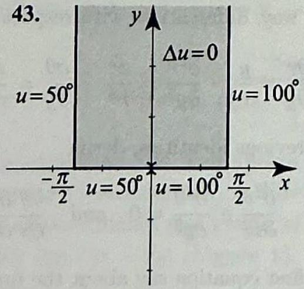
> > Dirichlet problem in problem 43.
> 
> 
> 
> > [!figure] Figure 27
> > 
> > 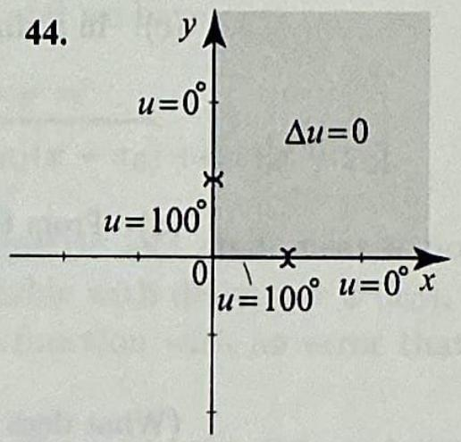
> > Dirichlet problem in problem 44.
> 
> 
> 
> > [!figure] Figure 28
> > 
> > 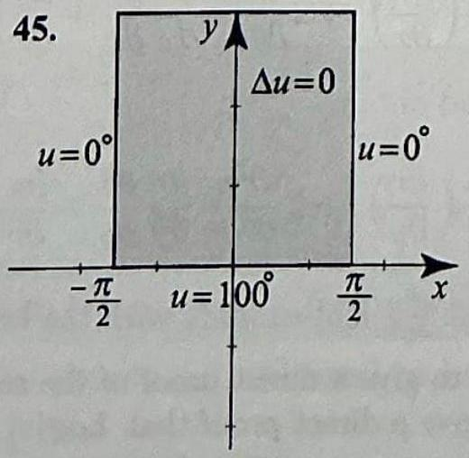
> > Dirichlet problem in problem 45.
> 
> 
> 
> > [!figure] Figure 29
> > 
> > 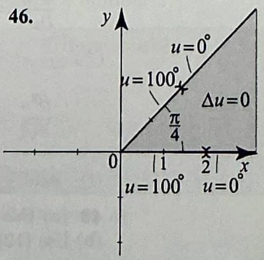
> > Dirichlet problem in problem 46.
> 
> 


##### solution

##### problem 43(a)

The region in Figure 26 is the semi-infinite strip

$$
-\frac{\pi}{2}<x<\frac{\pi}{2},
\qquad
y>0.
$$

The boundary values are

$$
u=50
$$

on the left side

$$
x=-\frac{\pi}{2},
\qquad y>0,
$$

and on the left half of the bottom edge

$$
-\frac{\pi}{2}<x<0,
\qquad y=0,
$$

while

$$
u=100
$$

on the right side

$$
x=\frac{\pi}{2},
\qquad y>0,
$$

and on the right half of the bottom edge

$$
0<x<\frac{\pi}{2},
\qquad y=0.
$$

Following the same four-step method as Exercise 7, we map the strip by

$$
w=\sin z.
$$

Write

$$
z=x+iy.
$$

Then

$$
w=\sin(x+iy)=\sin x\cosh y+i\cos x\sinh y.
$$

So

$$
\operatorname{Im} w=\cos x\sinh y.
$$

Because

$$
-\frac{\pi}{2}<x<\frac{\pi}{2},
$$

we have

$$
\cos x>0,
$$

and since

$$
y>0,
$$

we also have

$$
\sinh y>0.
$$

Therefore

$$
\operatorname{Im} w>0,
$$

so the strip maps into the upper half-plane.

Now determine the boundary correspondence.

On the left vertical side

$$
x=-\frac{\pi}{2},
$$

we have

$$
w=\sin\left(-\frac{\pi}{2}+iy\right)
=-\cosh y,
$$

which lies on the negative real axis.

On the left half of the bottom edge

$$
y=0,
\qquad -\frac{\pi}{2}<x<0,
$$

we have

$$
w=\sin x,
$$

and since

$$
\sin x<0,
$$

this also lies on the negative real axis.

So the part of the boundary where

$$
u=50
$$

maps to

$$
(-\infty,0).
$$

On the right vertical side

$$
x=\frac{\pi}{2},
$$

we have

$$
w=\sin\left(\frac{\pi}{2}+iy\right)
=\cosh y,
$$

which lies on the positive real axis.

On the right half of the bottom edge

$$
y=0,
\qquad 0<x<\frac{\pi}{2},
$$

we have

$$
w=\sin x>0.
$$

So the part of the boundary where

$$
u=100
$$

maps to

$$
(0,\infty).
$$

Thus the transformed Dirichlet problem in the $w$-plane is

$$
\Delta U=0
\qquad\text{for }\operatorname{Im} w>0,
$$

with boundary values

$$
U=50
\quad\text{on }(-\infty,0),
\qquad
U=100
\quad\text{on }(0,\infty).
$$

We solve this transformed problem by looking for a function of the argument:

$$
U(w)=A+B\operatorname{Arg} w,
\qquad 0<\operatorname{Arg} w<\pi.
$$

On the positive real axis,

$$
\operatorname{Arg} w=0,
$$

so

$$
U= A =100.
$$

Hence

$$
A=100.
$$

On the negative real axis,

$$
\operatorname{Arg} w=\pi,
$$

so

$$
U=100+B\pi=50.
$$

Subtract $100$ from both sides:

$$
B\pi=-50.
$$

Therefore

$$
B=-\frac{50}{\pi}.
$$

So the transformed solution is

$$
U(w)=100-\frac{50}{\pi}\operatorname{Arg} w.
$$

Now pull this solution back to the $z$-plane:

$$
u(z)=U(\sin z)=100-\frac{50}{\pi}\operatorname{Arg}(\sin z).
$$

Therefore

$$
\boxed{
u(x,y)=100-\frac{50}{\pi}\operatorname{Arg}(\sin(x+iy))
}
$$

for

$$
-\frac{\pi}{2}<x<\frac{\pi}{2},
\qquad y>0.
$$

We can also write this in elementary form. Since

$$
\sin(x+iy)=\sin x\cosh y+i\cos x\sinh y,
$$

we have

$$
\tan\bigl(\operatorname{Arg}(\sin z)\bigr)
=\frac{\cos x\sinh y}{\sin x\cosh y}
=\cot x\tanh y.
$$

Thus

$$
\boxed{
u(x,y)=100-\frac{50}{\pi}\cot^{-1}(\tan x\,\operatorname{coth} y).
}
$$

##### problem 43(b)

The isotherms are the level curves

$$
u(x,y)=T,
\qquad 50<T<100.
$$

Substitute the formula for $u$:

$$
100-\frac{50}{\pi}\operatorname{Arg}(\sin z)=T.
$$

Subtract $100$ from both sides:

$$
-\frac{50}{\pi}\operatorname{Arg}(\sin z)=T-100.
$$

Multiply both sides by

$$
-\frac{\pi}{50}
$$

to obtain

$$
\operatorname{Arg}(\sin z)=\frac{\pi(100-T)}{50}.
$$

Set

$$
\phi=\frac{\pi(100-T)}{50}.
$$

Then

$$
0<\phi<\pi.
$$

As in Exercise 7,

$$
\tan\phi
=\frac{\operatorname{Im}(\sin z)}{\operatorname{Re}(\sin z)}
=\frac{\cos x\sinh y}{\sin x\cosh y}
=\cot x\tanh y.
$$

Multiply both sides by $\tan x$:

$$
\tan x\tan\phi=\tanh y.
$$

Solve for $\tan x$:

$$
\tan x=\frac{\tanh y}{\tan\phi}=\cot\phi\,\tanh y.
$$

Therefore the isotherms are

$$
\boxed{
\tan x=\cot\left(\frac{\pi(100-T)}{50}\right)\tanh y,
\qquad 50<T<100.
}
$$

The following Mathematica plot shows a representative family of isotherms.

```Mathematica title:""
Module[
 {
  u, temps, blue, xMin, xMax, yMin, yMax
  },
 
 u[x_, y_] := 100 - (50/Pi) Arg[Sin[x + I y]];
 temps = {55, 60, 65, 70, 75, 80, 85, 90, 95};
 blue = RGBColor[0.15, 0.42, 0.85];
 xMin = -Pi/2; xMax = Pi/2; yMin = 0; yMax = 3.8;
 
 Show[
  ContourPlot[
   Evaluate@Table[u[x, y] == t, {t, temps}],
   {x, xMin, xMax}, {y, yMin, yMax},
   ContourStyle -> Table[Directive[blue, Thick], {Length[temps]}],
   ContourShading -> False,
   Frame -> False,
   Axes -> True,
   AxesLabel -> {"x", "y"},
   PlotPoints -> 90,
   MaxRecursion -> 2,
   ImageSize -> 520,
   PlotRange -> {{xMin, xMax}, {yMin, yMax}}
   ],
  Graphics[
   {
    {Thick, GrayLevel[0.25], Line[{{-Pi/2, 0}, {-Pi/2, yMax}}], Line[{{Pi/2, 0}, {Pi/2, yMax}}]},
    Text[Style["u = 50°", 15, Bold], {-1.9, 2.8}],
    Text[Style["u = 100°", 15, Bold], {1.95, 2.8}],
    Text[Style["u = 50°", 15, Bold], {-0.8, -0.2}],
    Text[Style["u = 100°", 15, Bold], {0.8, -0.2}]
    }
   ],
  PlotLabel -> Style["Problem 43: Isotherms", 18]
  ]
]
```

##### problem 44(a)

The region in Figure 27 is the first quadrant

$$
x>0,
\qquad
y>0,
$$

with boundary values

$$
u=100
$$

on the two segments

$$
0<x<1,\ y=0,
\qquad
x=0,\ 0<y<1,
$$

and

$$
u=0
$$

on the rays

$$
x>1,\ y=0,
\qquad
x=0,\ y>1.
$$

We use the conformal map

$$
w=z^2.
$$

Write

$$
z=x+iy.
$$

Then

$$
w=(x+iy)^2=x^2-y^2+i(2xy).
$$

Since

$$
x>0
\qquad\text{and}\qquad
y>0,
$$

we have

$$
2xy>0,
$$

so

$$
\operatorname{Im} w>0.
$$

Thus the first quadrant maps onto the upper half-plane.

Now determine the boundary correspondence.

On the positive $x$-axis,

$$
z=x,
\qquad x>0,
$$

so

$$
w=x^2>0.
$$

The hot segment

$$
0<x<1
$$

maps to

$$
0<w<1,
$$

while the cold ray

$$
x>1
$$

maps to

$$
w>1.
$$

On the positive $y$-axis,

$$
z=iy,
\qquad y>0,
$$

so

$$
w=(iy)^2=-y^2<0.
$$

The hot segment

$$
0<y<1
$$

maps to

$$
-1<w<0,
$$

while the cold ray

$$
y>1
$$

maps to

$$
w<-1.
$$

Therefore the transformed problem in the $w$-plane is

$$
\Delta U=0
\qquad\text{for }\operatorname{Im} w>0,
$$

with boundary values

$$
U=100
\quad\text{on }(-1,1),
\qquad
U=0
\quad\text{otherwise on }\mathbb{R}.
$$

This is exactly Problem 36. Therefore

$$
U(w)=\frac{100}{\pi}\Bigl(\operatorname{Arg}(w-1)-\operatorname{Arg}(w+1)\Bigr).
$$

Now pull this solution back by

$$
w=z^2.
$$

We obtain

$$
u(z)=U(z^2)=\frac{100}{\pi}\Bigl(\operatorname{Arg}(z^2-1)-\operatorname{Arg}(z^2+1)\Bigr).
$$

Therefore

$$
\boxed{
u(x,y)=\frac{100}{\pi}\Bigl(\operatorname{Arg}((x+iy)^2-1)-\operatorname{Arg}((x+iy)^2+1)\Bigr),
\qquad x>0,\ y>0.
}
$$

##### problem 44(b)

From Problem 36, the isotherm corresponding to the temperature

$$
0<T<100
$$

in the $w$-plane is the circle

$$
\xi^2+\left(\eta-\cot\frac{\pi T}{100}\right)^2=\csc^2\frac{\pi T}{100},
$$

where

$$
w=\xi+i\eta.
$$

Under the map

$$
w=z^2,
$$

we have

$$
\xi=x^2-y^2,
\qquad
\eta=2xy.
$$

Substitute these into the circle equation:

$$
(x^2-y^2)^2+\left(2xy-\cot\frac{\pi T}{100}\right)^2=\csc^2\frac{\pi T}{100}.
$$

Now expand every term:

$$
\begin{aligned}
(x^2-y^2)^2+\left(2xy-\cot\frac{\pi T}{100}\right)^2
&=
\left(x^4-2x^2y^2+y^4\right)
+\left(4x^2y^2-4xy\cot\frac{\pi T}{100}+\cot^2\frac{\pi T}{100}\right)\\
&=
x^4-2x^2y^2+y^4+4x^2y^2-4xy\cot\frac{\pi T}{100}+\cot^2\frac{\pi T}{100}\\
&=
x^4+2x^2y^2+y^4-4xy\cot\frac{\pi T}{100}+\cot^2\frac{\pi T}{100}\\
&=
\left(x^2+y^2\right)^2-4xy\cot\frac{\pi T}{100}+\cot^2\frac{\pi T}{100}.
\end{aligned}
$$

Therefore the circle equation becomes

$$
\left(x^2+y^2\right)^2-4xy\cot\frac{\pi T}{100}+\cot^2\frac{\pi T}{100}
=\csc^2\frac{\pi T}{100}.
$$

Subtract

$$
\cot^2\frac{\pi T}{100}
$$

from both sides:

$$
\left(x^2+y^2\right)^2-4xy\cot\frac{\pi T}{100}
=
\csc^2\frac{\pi T}{100}-\cot^2\frac{\pi T}{100}.
$$

Now use

$$
\csc^2\theta-\cot^2\theta=1
$$

to get

$$
\boxed{
(x^2+y^2)^2-4xy\cot\frac{\pi T}{100}=1,
\qquad 0<T<100.
}
$$

These are the isotherms in the first quadrant.

The following Mathematica plot shows a representative family of isotherms.

```Mathematica title:""
Module[
 {
  u, temps, blue, xMin, xMax, yMin, yMax
  },
 
 u[x_, y_] := (100/Pi) (Arg[(x + I y)^2 - 1] - Arg[(x + I y)^2 + 1]);
 temps = {10, 20, 30, 40, 50, 60, 70, 80, 90};
 blue = RGBColor[0.15, 0.42, 0.85];
 xMin = 0; xMax = 2.2; yMin = 0; yMax = 2.2;
 
 Show[
  ContourPlot[
   Evaluate@Table[u[x, y] == t, {t, temps}],
   {x, xMin, xMax}, {y, yMin, yMax},
   ContourStyle -> Table[Directive[blue, Thick], {Length[temps]}],
   ContourShading -> False,
   Frame -> False,
   Axes -> True,
   AspectRatio -> 1,
   AxesLabel -> {"x", "y"},
   PlotPoints -> 90,
   MaxRecursion -> 2,
   ImageSize -> 500,
   PlotRange -> {{xMin, xMax}, {yMin, yMax}}
   ],
  Graphics[
   {
    {Thick, RGBColor[0.80, 0.15, 0.15], Line[{{0, 0}, {1, 0}}], Line[{{0, 0}, {0, 1}}]},
    {Thick, GrayLevel[0.35], Line[{{1, 0}, {xMax, 0}}], Line[{{0, 1}, {0, yMax}}]},
    Text[Style["u = 100°", 14, Bold, RGBColor[0.80, 0.15, 0.15]], {0.55, -0.12}],
    Text[Style["u = 100°", 14, Bold, RGBColor[0.80, 0.15, 0.15]], {-0.2, 0.55}],
    Text[Style["u = 0°", 14, Bold], {1.55, -0.12}],
    Text[Style["u = 0°", 14, Bold], {-0.2, 1.45}]
    }
   ],
  PlotLabel -> Style["Problem 44: Isotherms", 18]
  ]
]
```

##### problem 45(a)

The region in Figure 28 is again the semi-infinite strip

$$
-\frac{\pi}{2}<x<\frac{\pi}{2},
\qquad
y>0.
$$

The boundary values are

$$
u=100
$$

on the bottom edge

$$
-\frac{\pi}{2}<x<\frac{\pi}{2},
\qquad y=0,
$$

and

$$
u=0
$$

on the two vertical sides

$$
x=-\frac{\pi}{2},\ y>0,
\qquad
x=\frac{\pi}{2},\ y>0.
$$

We again map the strip by

$$
w=\sin z.
$$

As in Problems 7 and 43, this maps the strip onto the upper half-plane.

On the bottom edge,

$$
y=0,
\qquad -\frac{\pi}{2}<x<\frac{\pi}{2},
$$

we have

$$
w=\sin x,
$$

so this boundary portion maps to the interval

$$
(-1,1).
$$

On the left vertical side,

$$
x=-\frac{\pi}{2},
$$

we have

$$
w=-\cosh y,
$$

which lies on

$$
(-\infty,-1].
$$

On the right vertical side,

$$
x=\frac{\pi}{2},
$$

we have

$$
w=\cosh y,
$$

which lies on

$$
[1,\infty).
$$

Therefore the transformed problem in the $w$-plane is

$$
\Delta U=0
\qquad\text{for }\operatorname{Im} w>0,
$$

with boundary values

$$
U=100
\quad\text{on }(-1,1),
\qquad
U=0
\quad\text{on }(-\infty,-1)\cup(1,\infty).
$$

Again this is exactly Problem 36, so

$$
U(w)=\frac{100}{\pi}\Bigl(\operatorname{Arg}(w-1)-\operatorname{Arg}(w+1)\Bigr).
$$

Pull back by

$$
w=\sin z
$$

$$
u(z)=\frac{100}{\pi}\Bigl(\operatorname{Arg}(\sin z-1)-\operatorname{Arg}(\sin z+1)\Bigr).
$$

Therefore

$$
\boxed{
u(x,y)=\frac{100}{\pi}\Bigl(\operatorname{Arg}(\sin(x+iy)-1)-\operatorname{Arg}(\sin(x+iy)+1)\Bigr).
}
$$

##### problem 45(b)

From Problem 36, the isotherm corresponding to the temperature

$$
0<T<100
$$

in the $w$-plane is the circle

$$
s^2+\left(t-\cot\frac{\pi T}{100}\right)^2=\csc^2\frac{\pi T}{100},
$$

where

$$
w=s+it.
$$

Now

$$
w=\sin(x+iy)=\sin x\cosh y+i\cos x\sinh y,
$$

so

$$
s=\sin x\cosh y,
\qquad
t=\cos x\sinh y.
$$

Substitute these into the circle equation:

$$
\sin^2x\cosh^2y+\left(\cos x\sinh y-\cot\frac{\pi T}{100}\right)^2=\csc^2\frac{\pi T}{100}.
$$

Expand the square and keep every algebraic step:

$$
\begin{aligned}
\sin^2x\cosh^2y+\left(\cos x\sinh y-\cot\frac{\pi T}{100}\right)^2
&=
\sin^2x\cosh^2y
+\left(\cos^2x\sinh^2y
-2\cot\frac{\pi T}{100}\cos x\sinh y
+\cot^2\frac{\pi T}{100}\right)\\
&=
\sin^2x\cosh^2y+\cos^2x\sinh^2y
-2\cot\frac{\pi T}{100}\cos x\sinh y
+\cot^2\frac{\pi T}{100}.
\end{aligned}
$$

Now expand the first two terms:

$$
\begin{aligned}
\sin^2x\cosh^2y+\cos^2x\sinh^2y
&=
\sin^2x(1+\sinh^2y)+\cos^2x\sinh^2y\\
&=
\sin^2x+\sin^2x\sinh^2y+\cos^2x\sinh^2y\\
&=
\sin^2x+(\sin^2x+\cos^2x)\sinh^2y\\
&=
\sin^2x+\sinh^2y.
\end{aligned}
$$

Therefore the circle equation becomes

$$
\sin^2x+\sinh^2y
-2\cot\frac{\pi T}{100}\cos x\sinh y
+\cot^2\frac{\pi T}{100}
=\csc^2\frac{\pi T}{100}.
$$

Subtract

$$
\cot^2\frac{\pi T}{100}
$$

from both sides:

$$
\sin^2x+\sinh^2y
-2\cot\frac{\pi T}{100}\cos x\sinh y
=
\csc^2\frac{\pi T}{100}-\cot^2\frac{\pi T}{100}.
$$

Use

$$
\csc^2\theta-\cot^2\theta=1
$$

to get

$$
\sin^2x+\sinh^2y
-2\cot\frac{\pi T}{100}\cos x\sinh y
=1.
$$

Now replace

$$
\sin^2x
=
1-\cos^2x
$$

to obtain

$$
1-\cos^2x+\sinh^2y
-2\cot\frac{\pi T}{100}\cos x\sinh y
=1.
$$

Subtract $1$ from both sides:

$$
-\cos^2x+\sinh^2y
-2\cot\frac{\pi T}{100}\cos x\sinh y
=0.
$$

Multiply both sides by

$$
-1
$$

to get

$$
\cos^2x-\sinh^2y
+2\cot\frac{\pi T}{100}\cos x\sinh y
=0.
$$

Reorder the terms:

$$
\cos^2x
+2\cot\frac{\pi T}{100}\sinh y\,\cos x
-\sinh^2y
=0.
$$

This is a quadratic equation in

$$
\cos x.
$$

Applying the quadratic formula gives

$$
\cos x
=
\frac{-2\cot\frac{\pi T}{100}\sinh y
\pm
\sqrt{\left(2\cot\frac{\pi T}{100}\sinh y\right)^2-4(1)(-\sinh^2y)}}{2}.
$$

Now simplify the discriminant step by step:

$$
\begin{aligned}
\cos x
&=
\frac{-2\cot\frac{\pi T}{100}\sinh y
\pm
\sqrt{4\cot^2\frac{\pi T}{100}\sinh^2y+4\sinh^2y}}{2}\\
&=
\frac{-2\cot\frac{\pi T}{100}\sinh y
\pm
\sqrt{4\sinh^2y\left(\cot^2\frac{\pi T}{100}+1\right)}}{2}\\
&=
\frac{-2\cot\frac{\pi T}{100}\sinh y
\pm
2\sinh y\sqrt{\cot^2\frac{\pi T}{100}+1}}{2}\\
&=
-\cot\frac{\pi T}{100}\sinh y
\pm
\sinh y\sqrt{\cot^2\frac{\pi T}{100}+1}.
\end{aligned}
$$

Now use

$$
\cot^2\theta+1=\csc^2\theta
$$

to get

$$
\cos x
=
-\cot\frac{\pi T}{100}\sinh y
\pm
\csc\frac{\pi T}{100}\sinh y.
$$

Let

$$
\alpha=\frac{\pi T}{100}.
$$

Then

$$
0<\alpha<\pi,
$$

so

$$
\sin\alpha>0.
$$

For the plus sign,

$$
\begin{aligned}
-\cot\alpha+\csc\alpha
&=
-\frac{\cos\alpha}{\sin\alpha}+\frac{1}{\sin\alpha}\\
&=
\frac{1-\cos\alpha}{\sin\alpha}\\
&=
\frac{2\sin^2(\alpha/2)}{2\sin(\alpha/2)\cos(\alpha/2)}\\
&=
\tan\frac{\alpha}{2}.
\end{aligned}
$$

Hence the plus sign gives

$$
\cos x=\tan\frac{\alpha}{2}\,\sinh y=\tan\frac{\pi T}{200}\,\sinh y.
$$

For the minus sign,

$$
\begin{aligned}
-\cot\alpha-\csc\alpha
&=
-\frac{\cos\alpha}{\sin\alpha}-\frac{1}{\sin\alpha}\\
&=
-\frac{\cos\alpha+1}{\sin\alpha}\\
&=
-\frac{2\cos^2(\alpha/2)}{2\sin(\alpha/2)\cos(\alpha/2)}\\
&=
-\cot\frac{\alpha}{2}.
\end{aligned}
$$

Hence the minus sign gives

$$
\cos x=-\cot\frac{\alpha}{2}\,\sinh y=-\cot\frac{\pi T}{200}\,\sinh y.
$$

But

$$
-\frac{\pi}{2}<x<\frac{\pi}{2}
\quad\Longrightarrow\quad
\cos x>0,
$$

while

$$
0<T<100
\quad\Longrightarrow\quad
0<\frac{\pi T}{200}<\frac{\pi}{2}
\quad\Longrightarrow\quad
\cot\frac{\pi T}{200}>0,
$$

and also

$$
y>0
\quad\Longrightarrow\quad
\sinh y>0.
$$

Therefore

$$
-\cot\frac{\pi T}{200}\,\sinh y<0,
$$

so the minus sign is impossible.

Therefore the isotherms are

$$
\boxed{
\cos x=\tan\frac{\pi T}{200}\,\sinh y,
\qquad 0<T<100.
}
$$

The following Mathematica plot shows a representative family of isotherms.


```Mathematica title:""
Module[
 {
  u, temps, blue, xMin, xMax, yMin, yMax
  },
 
 u[x_, y_] := (100/Pi) (Arg[Sin[x + I y] - 1] - Arg[Sin[x + I y] + 1]);
 temps = {10, 20, 30, 40, 50, 60, 70, 80, 90};
 blue = RGBColor[0.15, 0.42, 0.85];
 xMin = -Pi/2; xMax = Pi/2; yMin = 0; yMax = 3.8;
 
 Show[
  ContourPlot[
   Evaluate@Table[u[x, y] == t, {t, temps}],
   {x, xMin, xMax}, {y, yMin, yMax},
   ContourStyle -> Table[Directive[blue, Thick], {Length[temps]}],
   ContourShading -> False,
   Frame -> False,
   Axes -> True,
   AxesLabel -> {"x", "y"},
   PlotPoints -> 90,
   MaxRecursion -> 2,
   ImageSize -> 520,
   PlotRange -> {{xMin, xMax}, {yMin, yMax}}
   ],
  Graphics[
   {
    {Thick, RGBColor[0.80, 0.15, 0.15], Line[{{-Pi/2, 0}, {Pi/2, 0}}]},
    {Thick, GrayLevel[0.35], Line[{{-Pi/2, 0}, {-Pi/2, yMax}}], Line[{{Pi/2, 0}, {Pi/2, yMax}}]},
    Text[Style["u = 100°", 15, Bold, RGBColor[0.80, 0.15, 0.15]], {0, -0.2}],
    Text[Style["u = 0°", 15, Bold], {-1.95, 2.7}],
    Text[Style["u = 0°", 15, Bold], {1.95, 2.7}]
    }
   ],
  PlotLabel -> Style["Problem 45: Isotherms", 18]
  ]
]
```

##### problem 46(a)

The region in Figure 29 is the wedge

$$
0<\theta<\frac{\pi}{4},
$$

and the boundary values are

$$
u=100
$$

on the two ray segments

$$
0<r<2,\ \theta=0,
\qquad
0<r<2,\ \theta=\frac{\pi}{4},
$$

while

$$
u=0
$$

on the remaining boundary rays

$$
r>2,\ \theta=0,
\qquad
r>2,\ \theta=\frac{\pi}{4}.
$$

To map the wedge to the upper half-plane and at the same time send the heated boundary segments to the interval

$$
(-1,1),
$$

we use

$$
w=\frac{z^4}{16}.
$$

Write

$$
z=re^{i\theta}.
$$

Then

$$
w=\frac{r^4}{16}e^{i4\theta}.
$$

Since

$$
0<\theta<\frac{\pi}{4},
$$

we have

$$
0<4\theta<\pi,
$$

so

$$
\operatorname{Im} w>0.
$$

Thus the wedge maps to the upper half-plane.

Now check the boundary correspondence.

On the lower ray

$$
\theta=0,
$$

we have

$$
w=\frac{r^4}{16}>0.
$$

The hot segment

$$
0<r<2
$$

maps to

$$
0<w<1,
$$

and the cold ray

$$
r>2
$$

maps to

$$
w>1.
$$

On the upper ray

$$
\theta=\frac{\pi}{4},
$$

we have

$$
w=\frac{r^4}{16}e^{i\pi}=-\frac{r^4}{16}<0.
$$

The hot segment

$$
0<r<2
$$

maps to

$$
-1<w<0,
$$

and the cold ray

$$
r>2
$$

maps to

$$
w<-1.
$$

Therefore the transformed problem in the $w$-plane is again

$$
\Delta U=0
\qquad\text{for }\operatorname{Im} w>0,
$$

with boundary values

$$
U=100
\quad\text{on }(-1,1),
\qquad
U=0
\quad\text{otherwise on }\mathbb{R}.
$$

By Problem 36,

$$
U(w)=\frac{100}{\pi}\Bigl(\operatorname{Arg}(w-1)-\operatorname{Arg}(w+1)\Bigr).
$$

Now pull this solution back by

$$
w=\frac{z^4}{16}.
$$

Then

$$
w-1=\frac{z^4-16}{16},
\qquad
w+1=\frac{z^4+16}{16},
$$

and multiplying by the positive constant

$$
\frac1{16}
$$

does not change the argument. Hence

$$
u(z)=\frac{100}{\pi}\Bigl(\operatorname{Arg}(z^4-16)-\operatorname{Arg}(z^4+16)\Bigr).
$$

Therefore

$$
\boxed{
u(z)=\frac{100}{\pi}\Bigl(\operatorname{Arg}(z^4-16)-\operatorname{Arg}(z^4+16)\Bigr),
\qquad 0<\arg z<\frac{\pi}{4}.
}
$$

##### problem 46(b)

From Problem 36, the isotherm corresponding to the temperature

$$
0<T<100
$$

in the $w$-plane is

$$
\xi^2+\left(\eta-\cot\frac{\pi T}{100}\right)^2=\csc^2\frac{\pi T}{100},
$$

where

$$
w=\xi+i\eta.
$$

Now

$$
w=\frac{z^4}{16}=\frac{r^4}{16}\bigl(\cos 4\theta+i\sin 4\theta\bigr),
$$

so

$$
\xi=\frac{r^4}{16}\cos 4\theta,
\qquad
\eta=\frac{r^4}{16}\sin 4\theta.
$$

Substitute these into the circle equation:

$$
\left(\frac{r^4}{16}\cos 4\theta\right)^2
+\left(\frac{r^4}{16}\sin 4\theta-\cot\frac{\pi T}{100}\right)^2
=\csc^2\frac{\pi T}{100}.
$$

Now expand the square explicitly:

$$
\begin{aligned}
\left(\frac{r^4}{16}\cos 4\theta\right)^2
+\left(\frac{r^4}{16}\sin 4\theta-\cot\frac{\pi T}{100}\right)^2
&=
\frac{r^8}{256}\cos^2 4\theta
+\left(
\frac{r^8}{256}\sin^2 4\theta
-2\frac{r^4}{16}\sin 4\theta\cot\frac{\pi T}{100}
+\cot^2\frac{\pi T}{100}
\right)\\
&=
\frac{r^8}{256}\cos^2 4\theta
+\frac{r^8}{256}\sin^2 4\theta
-2\frac{r^4}{16}\sin 4\theta\cot\frac{\pi T}{100}
+\cot^2\frac{\pi T}{100}.
\end{aligned}
$$

Therefore the circle equation becomes

$$
\frac{r^8}{256}\cos^2 4\theta
+\frac{r^8}{256}\sin^2 4\theta
-2\frac{r^4}{16}\sin 4\theta\cot\frac{\pi T}{100}
+\cot^2\frac{\pi T}{100}
=\csc^2\frac{\pi T}{100}.
$$

Now combine the first two terms:

$$
\begin{aligned}
\frac{r^8}{256}\cos^2 4\theta+\frac{r^8}{256}\sin^2 4\theta
&=
\frac{r^8}{256}\left(\cos^2 4\theta+\sin^2 4\theta\right)\\
&=
\frac{r^8}{256}\cdot 1\\
&=
\frac{r^8}{256}.
\end{aligned}
$$

Also,

$$
2\frac{r^4}{16}=\frac{2r^4}{16}=\frac{r^4}{8}.
$$

So the equation becomes

$$
\frac{r^8}{256}
-\frac{r^4}{8}\sin 4\theta\cot\frac{\pi T}{100}
+\cot^2\frac{\pi T}{100}
=\csc^2\frac{\pi T}{100}.
$$

Subtract

$$
\cot^2\frac{\pi T}{100}
$$

from both sides:

$$
\frac{r^8}{256}
-\frac{r^4}{8}\sin 4\theta\cot\frac{\pi T}{100}
=
\csc^2\frac{\pi T}{100}-\cot^2\frac{\pi T}{100}.
$$

Use

$$
\csc^2\theta-\cot^2\theta=1
$$

to get

$$
\frac{r^8}{256}
-\frac{r^4}{8}\sin 4\theta\cot\frac{\pi T}{100}
=1.
$$

Multiply both sides by

$$
256
$$

to obtain

$$
256\left(\frac{r^8}{256}\right)
-256\left(\frac{r^4}{8}\sin 4\theta\cot\frac{\pi T}{100}\right)
=256(1),
$$

that is,

$$
r^8-32r^4\sin 4\theta\cot\frac{\pi T}{100}=256.
$$

Therefore the isotherms are

$$
\boxed{
r^8-32r^4\sin 4\theta\cot\frac{\pi T}{100}=256,
\qquad 0<T<100.
}
$$

The following Mathematica plot shows a representative family of isotherms in the wedge.


```Mathematica title:""
Module[
 {
  u, temps, blue, xMin, xMax, yMin, yMax
  },
 
 u[x_, y_] := (100/Pi) (Arg[(x + I y)^4 - 16] - Arg[(x + I y)^4 + 16]);
 temps = {10, 20, 30, 40, 50, 60, 70, 80, 90};
 blue = RGBColor[0.15, 0.42, 0.85];
 xMin = 0; xMax = 4.2; yMin = 0; yMax = 4.2;
 
 Show[
  ContourPlot[
   Evaluate@Table[u[x, y] == t, {t, temps}],
   {x, xMin, xMax}, {y, yMin, yMax},
   RegionFunction -> Function[{x, y, z}, y >= 0 && y <= x],
   ContourStyle -> Table[Directive[blue, Thick], {Length[temps]}],
   ContourShading -> False,
   Frame -> False,
   Axes -> True,
   AspectRatio -> 1,
   AxesLabel -> {"x", "y"},
   PlotPoints -> 100,
   MaxRecursion -> 2,
   ImageSize -> 520,
   PlotRange -> {{xMin, xMax}, {yMin, yMax}}
   ],
  Graphics[
   {
    {Thick, RGBColor[0.80, 0.15, 0.15], Line[{{0, 0}, {2, 0}}], Line[{{0, 0}, {2, 2}}]},
    {Thick, GrayLevel[0.35], Line[{{2, 0}, {xMax, 0}}], Line[{{2, 2}, {xMax, xMax}}]},
    Text[Style["u = 100°", 14, Bold, RGBColor[0.80, 0.15, 0.15]], {0.9, -0.16}],
    Text[Style["u = 100°", 14, Bold, RGBColor[0.80, 0.15, 0.15]], {1.55, 1.15}],
    Text[Style["u = 0°", 14, Bold], {2.9, -0.16}],
    Text[Style["u = 0°", 14, Bold], {3.25, 3.0}]
    }
   ],
  PlotLabel -> Style["Problem 46: Isotherms", 18]
  ]
]
```


++++


> [!exercise] Exercise 34
> 
> 43. **Project Problem:** Laplacian in polar coordinates. In this exercise, you are asked to derive the polar form of the Laplacian
> 
> $$
> \Delta u=\frac{\partial^{2} u}{\partial r^{2}}+\frac{1}{r} \frac{\partial u}{\partial r}+\frac{1}{r^{2}} \frac{\partial^{2} u}{\partial \theta^{2}}
> $$
> 
> The derivation is straightforward but a little tedious. To organize your approach, follow the outlined steps.
> (a) Recall the relationship between rectangular and polar coordinates
> 
> $$
> x=r \cos \theta, \quad y=r \sin \theta, \quad r^{2}=x^{2}+y^{2}, \quad \tan \theta=\frac{y}{x}
> $$
> 
> Differentiate $r^{2}=x^{2}+y^{2}$ with respect to $x$ once, then a second time, and obtain
> 
> $$
> \frac{\partial r}{\partial x}=\frac{x}{r}, \quad \frac{\partial^{2} r}{\partial x^{2}}=\frac{y^{2}}{r^{3}}
> $$
> 
> (b) Differentiate $\tan \theta=\frac{y}{x}$ with respect to $x$ once, then a second time, and get
> 
> $$
> \frac{\partial \theta}{\partial x}=-\frac{y}{r^{2}}, \quad \frac{\partial^{2} \theta}{\partial x^{2}}=\frac{2 x y}{r^{4}}
> $$
> 
> (c) In a similar way, differentiate with respect to $y$ and obtain
> 
> $$
> \frac{\partial r}{\partial y}=\frac{y}{r}, \quad \frac{\partial^{2} r}{\partial y^{2}}=\frac{x^{2}}{r^{3}}, \quad \frac{\partial \theta}{\partial y}=\frac{x}{r^{2}}, \quad \frac{\partial^{2} \theta}{\partial y^{2}}=-\frac{2 x y}{r^{4}}
> $$
> 
> (d) From the previous identities, derive
> 
> $$
> \frac{\partial^{2} \theta}{\partial x^{2}}+\frac{\partial^{2} \theta}{\partial y^{2}}=0 \quad \text { and } \quad \frac{\partial \theta}{\partial x} \frac{\partial r}{\partial x}+\frac{\partial \theta}{\partial y} \frac{\partial r}{\partial y}=0
> $$
> 
> (What does the first equation say about the function $\theta(x, y) ?$ )
> (e) Use the chain rule in two dimensions ((13), Section 2.6) to derive
> 
> $$
> \frac{\partial^{2} u}{\partial x^{2}}=\frac{\partial^{2} u}{\partial r^{2}}\left(\frac{\partial r}{\partial x}\right)^{2}+2 \frac{\partial^{2} u}{\partial \theta \partial r} \frac{\partial r}{\partial x} \frac{\partial \theta}{\partial x}+\frac{\partial u}{\partial r} \frac{\partial^{2} r}{\partial x^{2}}+\frac{\partial^{2} u}{\partial \theta^{2}}\left(\frac{\partial \theta}{\partial x}\right)^{2}+\frac{\partial u}{\partial \theta} \frac{\partial^{2} \theta}{\partial x^{2}}
> $$
> 
> Change $x$ to $y$ and obtain
> 
> $$
> \frac{\partial^{2} u}{\partial y^{2}}=\frac{\partial^{2} u}{\partial r^{2}}\left(\frac{\partial r}{\partial y}\right)^{2}+2 \frac{\partial^{2} u}{\partial \theta \partial r} \frac{\partial r}{\partial y} \frac{\partial \theta}{\partial y}+\frac{\partial u}{\partial r} \frac{\partial^{2} r}{\partial y^{2}}+\frac{\partial^{2} u}{\partial \theta^{2}}\left(\frac{\partial \theta}{\partial y}\right)^{2}+\frac{\partial u}{\partial \theta} \frac{\partial^{2} \theta}{\partial y^{2}}
> $$
> 
> (f) Add $\frac{\partial^{2} u}{\partial x^{2}}$ and $\frac{\partial^{2} u}{\partial y^{2}}$ and simplify with the help of (d) to derive (12).


##### solution

Throughout this exercise we work with

$$
r>0.
$$

For brevity, write

$$
r_x=\frac{\partial r}{\partial x},
\qquad
r_y=\frac{\partial r}{\partial y},
\qquad
\theta_x=\frac{\partial\theta}{\partial x},
\qquad
\theta_y=\frac{\partial\theta}{\partial y},
$$

and similarly for second derivatives.

##### problem 43(a)

$$
\begin{aligned}
r^2=x^2+y^2
&\implies
\frac{\partial}{\partial x}(r^2)
=
\frac{\partial}{\partial x}(x^2+y^2)\\
&\implies
2rr_x=2x\\
&\implies
r_x=\frac{x}{r}.
\end{aligned}
$$

$$
\begin{aligned}
r_{xx}
&=
\frac{\partial}{\partial x}\left(\frac{x}{r}\right)\\
&=
\frac{\partial}{\partial x}(xr^{-1})\\
&=
\frac{\partial x}{\partial x}\,r^{-1}
+
x\frac{\partial}{\partial x}(r^{-1})\\
&=
\frac{1}{r}
+
x(-r^{-2})r_x\\
&=
\frac{1}{r}-xr^{-2}\frac{x}{r}\\
&=
\frac{1}{r}-\frac{x^2}{r^3}\\
&=
\frac{r^2}{r^3}-\frac{x^2}{r^3}\\
&=
\frac{r^2-x^2}{r^3}\\
&=
\frac{x^2+y^2-x^2}{r^3}\\
&=
\frac{y^2}{r^3}.
\end{aligned}
$$

Therefore

$$
\boxed{
\frac{\partial r}{\partial x}=\frac{x}{r},
\qquad
\frac{\partial^2 r}{\partial x^2}=\frac{y^2}{r^3}.
}
$$

##### problem 43(b)

$$
\begin{aligned}
\tan\theta=\frac{y}{x}
&\implies
\frac{\partial}{\partial x}(\tan\theta)
=
\frac{\partial}{\partial x}\left(\frac{y}{x}\right)\\
&\implies
\sec^2\theta\,\theta_x
=
y\frac{\partial}{\partial x}(x^{-1})\\
&\implies
\sec^2\theta\,\theta_x
=
y(-x^{-2})\\
&\implies
\sec^2\theta\,\theta_x
=
-\frac{y}{x^2}.
\end{aligned}
$$

$$
\begin{aligned}
\sec^2\theta
&=
1+\tan^2\theta\\
&=
1+\left(\frac{y}{x}\right)^2\\
&=
1+\frac{y^2}{x^2}\\
&=
\frac{x^2+y^2}{x^2}\\
&=
\frac{r^2}{x^2}.
\end{aligned}
$$

$$
\begin{aligned}
\frac{r^2}{x^2}\theta_x
&=
-\frac{y}{x^2}\\
\theta_x
&=
-\frac{y}{x^2}\cdot\frac{x^2}{r^2}\\
&=
-\frac{y}{r^2}.
\end{aligned}
$$

$$
\begin{aligned}
\theta_{xx}
&=
\frac{\partial}{\partial x}\left(-\frac{y}{r^2}\right)\\
&=
-y\frac{\partial}{\partial x}(r^{-2})\\
&=
-y(-2r^{-3}r_x)\\
&=
2yr^{-3}\frac{x}{r}\\
&=
\frac{2xy}{r^4}.
\end{aligned}
$$

Therefore

$$
\boxed{
\frac{\partial\theta}{\partial x}=-\frac{y}{r^2},
\qquad
\frac{\partial^2\theta}{\partial x^2}=\frac{2xy}{r^4}.
}
$$

##### problem 43(c)

$$
\begin{aligned}
r^2=x^2+y^2
&\implies
\frac{\partial}{\partial y}(r^2)
=
\frac{\partial}{\partial y}(x^2+y^2)\\
&\implies
2rr_y=2y\\
&\implies
r_y=\frac{y}{r}.
\end{aligned}
$$

$$
\begin{aligned}
r_{yy}
&=
\frac{\partial}{\partial y}\left(\frac{y}{r}\right)\\
&=
\frac{\partial}{\partial y}(yr^{-1})\\
&=
\frac{\partial y}{\partial y}\,r^{-1}
+
y\frac{\partial}{\partial y}(r^{-1})\\
&=
\frac{1}{r}
+
y(-r^{-2})r_y\\
&=
\frac{1}{r}-yr^{-2}\frac{y}{r}\\
&=
\frac{1}{r}-\frac{y^2}{r^3}\\
&=
\frac{r^2}{r^3}-\frac{y^2}{r^3}\\
&=
\frac{r^2-y^2}{r^3}\\
&=
\frac{x^2+y^2-y^2}{r^3}\\
&=
\frac{x^2}{r^3}.
\end{aligned}
$$

$$
\begin{aligned}
\tan\theta=\frac{y}{x}
&\implies
\frac{\partial}{\partial y}(\tan\theta)
=
\frac{\partial}{\partial y}\left(\frac{y}{x}\right)\\
&\implies
\sec^2\theta\,\theta_y
=
\frac{1}{x}.
\end{aligned}
$$

$$
\begin{aligned}
\frac{r^2}{x^2}\theta_y
&=
\frac{1}{x}\\
\theta_y
&=
\frac{1}{x}\cdot\frac{x^2}{r^2}\\
&=
\frac{x}{r^2}.
\end{aligned}
$$

$$
\begin{aligned}
\theta_{yy}
&=
\frac{\partial}{\partial y}\left(\frac{x}{r^2}\right)\\
&=
x\frac{\partial}{\partial y}(r^{-2})\\
&=
x(-2r^{-3}r_y)\\
&=
x\left(-2r^{-3}\frac{y}{r}\right)\\
&=
-\frac{2xy}{r^4}.
\end{aligned}
$$

Therefore

$$
\boxed{
\frac{\partial r}{\partial y}=\frac{y}{r},
\qquad
\frac{\partial^2 r}{\partial y^2}=\frac{x^2}{r^3},
\qquad
\frac{\partial\theta}{\partial y}=\frac{x}{r^2},
\qquad
\frac{\partial^2\theta}{\partial y^2}=-\frac{2xy}{r^4}.
}
$$

##### problem 43(d)

$$
\theta_{xx}+\theta_{yy}
=
\frac{2xy}{r^4}+\left(-\frac{2xy}{r^4}\right)
=
0.
$$

$$
\begin{aligned}
\theta_x r_x+\theta_y r_y
&=
\left(-\frac{y}{r^2}\right)\left(\frac{x}{r}\right)
+
\left(\frac{x}{r^2}\right)\left(\frac{y}{r}\right)\\
&=
-\frac{xy}{r^3}+\frac{xy}{r^3}\\
&=
0.
\end{aligned}
$$

Therefore

$$
\boxed{
\frac{\partial^2\theta}{\partial x^2}+\frac{\partial^2\theta}{\partial y^2}=0,
\qquad
\frac{\partial\theta}{\partial x}\frac{\partial r}{\partial x}
+\frac{\partial\theta}{\partial y}\frac{\partial r}{\partial y}=0.
}
$$

The first identity says that

$$
\theta(x,y)
$$

is harmonic wherever it is single-valued and twice differentiable.

##### problem 43(e)

Write

$$
u_r=\frac{\partial u}{\partial r},
\qquad
u_\theta=\frac{\partial u}{\partial\theta},
\qquad
u_{rr}=\frac{\partial^2 u}{\partial r^2},
\qquad
u_{r\theta}=\frac{\partial^2 u}{\partial r\partial\theta},
\qquad
u_{\theta\theta}=\frac{\partial^2 u}{\partial \theta^2}.
$$

$$
\begin{aligned}
u_x
&=
u_r r_x+u_\theta\theta_x,\\
u_{xx}
&=
\frac{\partial}{\partial x}(u_r r_x+u_\theta\theta_x)\\
&=
\frac{\partial}{\partial x}(u_r r_x)
+
\frac{\partial}{\partial x}(u_\theta\theta_x)\\
&=
(u_r)_x r_x+u_r r_{xx}+(u_\theta)_x\theta_x+u_\theta\theta_{xx}\\
&=
(u_{rr}r_x+u_{r\theta}\theta_x)r_x+u_r r_{xx}
+
(u_{\theta r}r_x+u_{\theta\theta}\theta_x)\theta_x+u_\theta\theta_{xx}\\
&=
u_{rr}r_x^2+u_{r\theta}\theta_xr_x+u_r r_{xx}
+
u_{\theta r}r_x\theta_x+u_{\theta\theta}\theta_x^2+u_\theta\theta_{xx}\\
&=
u_{rr}r_x^2+2u_{r\theta}r_x\theta_x+u_r r_{xx}+u_{\theta\theta}\theta_x^2+u_\theta\theta_{xx}.
\end{aligned}
$$

Similarly,

$$
\begin{aligned}
u_y
&=
u_r r_y+u_\theta\theta_y,\\
u_{yy}
&=
\frac{\partial}{\partial y}(u_r r_y+u_\theta\theta_y)\\
&=
\frac{\partial}{\partial y}(u_r r_y)
+
\frac{\partial}{\partial y}(u_\theta\theta_y)\\
&=
(u_r)_y r_y+u_r r_{yy}+(u_\theta)_y\theta_y+u_\theta\theta_{yy}\\
&=
(u_{rr}r_y+u_{r\theta}\theta_y)r_y+u_r r_{yy}
+
(u_{\theta r}r_y+u_{\theta\theta}\theta_y)\theta_y+u_\theta\theta_{yy}\\
&=
u_{rr}r_y^2+u_{r\theta}\theta_yr_y+u_r r_{yy}
+
u_{\theta r}r_y\theta_y+u_{\theta\theta}\theta_y^2+u_\theta\theta_{yy}\\
&=
u_{rr}r_y^2+2u_{r\theta}r_y\theta_y+u_r r_{yy}+u_{\theta\theta}\theta_y^2+u_\theta\theta_{yy}.
\end{aligned}
$$

Therefore

$$
\boxed{
\frac{\partial^{2} u}{\partial x^{2}}
=
\frac{\partial^{2} u}{\partial r^{2}}\left(\frac{\partial r}{\partial x}\right)^{2}
+2 \frac{\partial^{2} u}{\partial \theta \partial r} \frac{\partial r}{\partial x} \frac{\partial \theta}{\partial x}
+\frac{\partial u}{\partial r} \frac{\partial^{2} r}{\partial x^{2}}
+\frac{\partial^{2} u}{\partial \theta^{2}}\left(\frac{\partial \theta}{\partial x}\right)^{2}
+\frac{\partial u}{\partial \theta} \frac{\partial^{2} \theta}{\partial x^{2}}.
}
$$

$$
\boxed{
\frac{\partial^{2} u}{\partial y^{2}}
=
\frac{\partial^{2} u}{\partial r^{2}}\left(\frac{\partial r}{\partial y}\right)^{2}
+2 \frac{\partial^{2} u}{\partial \theta \partial r} \frac{\partial r}{\partial y} \frac{\partial \theta}{\partial y}
+\frac{\partial u}{\partial r} \frac{\partial^{2} r}{\partial y^{2}}
+\frac{\partial^{2} u}{\partial \theta^{2}}\left(\frac{\partial \theta}{\partial y}\right)^{2}
+\frac{\partial u}{\partial \theta} \frac{\partial^{2} \theta}{\partial y^{2}}.
}
$$

##### problem 43(f)

$$
\begin{aligned}
\Delta u
&=
u_{xx}+u_{yy}\\
&=
u_{rr}(r_x^2+r_y^2)
+2u_{r\theta}(r_x\theta_x+r_y\theta_y)
+u_r(r_{xx}+r_{yy})
+u_{\theta\theta}(\theta_x^2+\theta_y^2)
+u_\theta(\theta_{xx}+\theta_{yy})\\
&=
u_{rr}\left[\left(\frac{x}{r}\right)^2+\left(\frac{y}{r}\right)^2\right]
+2u_{r\theta}\left[\left(\frac{x}{r}\right)\left(-\frac{y}{r^2}\right)+\left(\frac{y}{r}\right)\left(\frac{x}{r^2}\right)\right]\\
&\qquad
+u_r\left(\frac{y^2}{r^3}+\frac{x^2}{r^3}\right)
+u_{\theta\theta}\left[\left(-\frac{y}{r^2}\right)^2+\left(\frac{x}{r^2}\right)^2\right]
+u_\theta\left(\frac{2xy}{r^4}-\frac{2xy}{r^4}\right)\\
&=
u_{rr}\left(\frac{x^2+y^2}{r^2}\right)
+2u_{r\theta}\left(-\frac{xy}{r^3}+\frac{xy}{r^3}\right)
+u_r\left(\frac{x^2+y^2}{r^3}\right)
+u_{\theta\theta}\left(\frac{y^2+x^2}{r^4}\right)
+u_\theta(0)\\
&=
u_{rr}\left(\frac{r^2}{r^2}\right)
+2u_{r\theta}(0)
+u_r\left(\frac{r^2}{r^3}\right)
+u_{\theta\theta}\left(\frac{r^2}{r^4}\right)\\
&=
u_{rr}
+\frac{1}{r}u_r
+\frac{1}{r^2}u_{\theta\theta}.
\end{aligned}
$$

$$
\boxed{
\Delta u
=
\frac{\partial^{2} u}{\partial r^{2}}
+\frac{1}{r}\frac{\partial u}{\partial r}
+\frac{1}{r^{2}}\frac{\partial^{2} u}{\partial \theta^{2}}.
}
$$


++++


> [!exercise] Exercise 35
> 44. (a) Use (12) to give a direct proof of the result of problem 17(a).
> (b) Use (12) to give a direct proof that $\log |z|$ is harmonic for all $z \neq 0$.


##### solution

##### problem 44(a)

Let

$$
u(r,\theta)=r^n\cos(n\theta)
$$

and

$$
v(r,\theta)=r^n\sin(n\theta),
$$

where $n$ is any integer.

We use the polar form of the Laplacian:

$$
\Delta w
=
\frac{\partial^2 w}{\partial r^2}
+\frac{1}{r}\frac{\partial w}{\partial r}
+\frac{1}{r^2}\frac{\partial^2 w}{\partial \theta^2}.
$$

We first compute the Laplacian of

$$
u(r,\theta)=r^n\cos(n\theta).
$$

Its $r$-derivatives are

$$
\begin{aligned}
u_r
&=
\frac{\partial}{\partial r}\left(r^n\cos(n\theta)\right)\\
&=
\cos(n\theta)\frac{\partial}{\partial r}(r^n)\\
&=
\cos(n\theta)\,nr^{n-1}\\
&=
nr^{n-1}\cos(n\theta),
\end{aligned}
$$

$$
\begin{aligned}
u_{rr}
&=
\frac{\partial}{\partial r}\left(nr^{n-1}\cos(n\theta)\right)\\
&=
n\cos(n\theta)\frac{\partial}{\partial r}\left(r^{n-1}\right)\\
&=
n\cos(n\theta)(n-1)r^{n-2}\\
&=
n(n-1)r^{n-2}\cos(n\theta).
\end{aligned}
$$

Its $\theta$-derivatives are

$$
\begin{aligned}
u_\theta
&=
\frac{\partial}{\partial \theta}\left(r^n\cos(n\theta)\right)\\
&=
r^n\frac{\partial}{\partial \theta}\left(\cos(n\theta)\right)\\
&=
r^n\bigl(-\sin(n\theta)\bigr)n\\
&=
-nr^n\sin(n\theta),
\end{aligned}
$$

$$
\begin{aligned}
u_{\theta\theta}
&=
\frac{\partial}{\partial \theta}\left(-nr^n\sin(n\theta)\right)\\
&=
-nr^n\frac{\partial}{\partial \theta}\left(\sin(n\theta)\right)\\
&=
-nr^n\bigl(\cos(n\theta)\bigr)n\\
&=
-n^2r^n\cos(n\theta).
\end{aligned}
$$

Substitute these into the polar Laplacian:

$$
\begin{aligned}
\Delta u
&=
u_{rr}+\frac{1}{r}u_r+\frac{1}{r^2}u_{\theta\theta}\\
&=
n(n-1)r^{n-2}\cos(n\theta)
+\frac{1}{r}\left(nr^{n-1}\cos(n\theta)\right)
+\frac{1}{r^2}\left(-n^2r^n\cos(n\theta)\right)\\
&=
n(n-1)r^{n-2}\cos(n\theta)
+nr^{n-2}\cos(n\theta)
-n^2r^{n-2}\cos(n\theta)\\
&=
\bigl(n(n-1)+n-n^2\bigr)r^{n-2}\cos(n\theta)\\
&=
\bigl(n^2-n+n-n^2\bigr)r^{n-2}\cos(n\theta)\\
&=
0
\end{aligned}
$$

for

$$
r>0.
$$

So

$$
u(r,\theta)=r^n\cos(n\theta)
$$

is harmonic on

$$
\mathbb{C}\setminus\{0\}.
$$

Now do the same for

$$
v(r,\theta)=r^n\sin(n\theta).
$$

Its $r$-derivatives are

$$
\begin{aligned}
v_r
&=
\frac{\partial}{\partial r}\left(r^n\sin(n\theta)\right)\\
&=
\sin(n\theta)\frac{\partial}{\partial r}(r^n)\\
&=
\sin(n\theta)\,nr^{n-1}\\
&=
nr^{n-1}\sin(n\theta),
\end{aligned}
$$

$$
\begin{aligned}
v_{rr}
&=
\frac{\partial}{\partial r}\left(nr^{n-1}\sin(n\theta)\right)\\
&=
n\sin(n\theta)\frac{\partial}{\partial r}\left(r^{n-1}\right)\\
&=
n\sin(n\theta)(n-1)r^{n-2}\\
&=
n(n-1)r^{n-2}\sin(n\theta).
\end{aligned}
$$

Its $\theta$-derivatives are

$$
\begin{aligned}
v_\theta
&=
\frac{\partial}{\partial \theta}\left(r^n\sin(n\theta)\right)\\
&=
r^n\frac{\partial}{\partial \theta}\left(\sin(n\theta)\right)\\
&=
r^n\bigl(\cos(n\theta)\bigr)n\\
&=
nr^n\cos(n\theta),
\end{aligned}
$$

$$
\begin{aligned}
v_{\theta\theta}
&=
\frac{\partial}{\partial \theta}\left(nr^n\cos(n\theta)\right)\\
&=
nr^n\frac{\partial}{\partial \theta}\left(\cos(n\theta)\right)\\
&=
nr^n\bigl(-\sin(n\theta)\bigr)n\\
&=
-n^2r^n\sin(n\theta).
\end{aligned}
$$

Substitute into the polar Laplacian:

$$
\begin{aligned}
\Delta v
&=
v_{rr}+\frac{1}{r}v_r+\frac{1}{r^2}v_{\theta\theta}\\
&=
n(n-1)r^{n-2}\sin(n\theta)
+\frac{1}{r}\left(nr^{n-1}\sin(n\theta)\right)
+\frac{1}{r^2}\left(-n^2r^n\sin(n\theta)\right)\\
&=
n(n-1)r^{n-2}\sin(n\theta)
+nr^{n-2}\sin(n\theta)
-n^2r^{n-2}\sin(n\theta)\\
&=
\bigl(n(n-1)+n-n^2\bigr)r^{n-2}\sin(n\theta)\\
&=
\bigl(n^2-n+n-n^2\bigr)r^{n-2}\sin(n\theta)\\
&=
0
\end{aligned}
$$

for

$$
r>0.
$$

So

$$
v(r,\theta)=r^n\sin(n\theta)
$$

is also harmonic on

$$
\mathbb{C}\setminus\{0\}.
$$

This already proves the result for

$$
n<0,
$$

because when $n<0$ the factor

$$
r^n
$$

is not defined at

$$
r=0.
$$

Now suppose

$$
n\ge 0.
$$

If

$$
n=0,
$$

then

$$
u(r,\theta)=r^0\cos 0=1,
\qquad
v(r,\theta)=r^0\sin 0=0,
$$

and both functions are harmonic on all of

$$
\mathbb{C}.
$$

If

$$
n\ge 1,
$$

then

$$
z^n=(x+iy)^n
$$

is a polynomial in

$$
x
\qquad\text{and}\qquad
y.
$$

Its real and imaginary parts are therefore polynomials in

$$
x
\qquad\text{and}\qquad
y,
$$

and those real and imaginary parts are exactly

$$
r^n\cos(n\theta)
\qquad\text{and}\qquad
r^n\sin(n\theta).
$$

Hence these functions extend across

$$
r=0
$$

without any singularity, so together with the computation above they are harmonic on all of

$$
\mathbb{C}.
$$

Therefore

$$
\boxed{
u(r,\theta)=r^{n}\cos(n\theta)
\quad\text{and}\quad
v(r,\theta)=r^{n}\sin(n\theta)
}
$$

are harmonic on

$$
\mathbb{C}
\quad\text{if }n\ge 0,
$$

and on

$$
\mathbb{C}\setminus\{0\}
\quad\text{if }n<0.
$$

##### problem 44(b)

Let

$$
u(x,y)=\log|z|.
$$

In polar coordinates,

$$
|z|=r,
$$

so

$$
u(r,\theta)=\log r.
$$

Now compute its derivatives.

Because

$$
u(r,\theta)=\log r,
$$

we have

$$
\begin{aligned}
u_r
&=
\frac{\partial}{\partial r}(\log r)\\
&=
\frac{1}{r},
\end{aligned}
$$

$$
\begin{aligned}
u_{rr}
&=
\frac{\partial}{\partial r}\left(\frac{1}{r}\right)\\
&=
\frac{\partial}{\partial r}(r^{-1})\\
&=
-r^{-2}\\
&=
-\frac{1}{r^2}.
\end{aligned}
$$

Since

$$
\log r
$$

does not depend on

$$
\theta,
$$

we also have

$$
\begin{aligned}
u_\theta
&=
\frac{\partial}{\partial \theta}(\log r)\\
&=
0,
\end{aligned}
$$

$$
\begin{aligned}
u_{\theta\theta}
&=
\frac{\partial}{\partial \theta}(0)\\
&=
0.
\end{aligned}
$$

Now substitute into the polar form of the Laplacian:

$$
\begin{aligned}
\Delta u
&=
u_{rr}+\frac{1}{r}u_r+\frac{1}{r^2}u_{\theta\theta}\\
&=
\left(-\frac{1}{r^2}\right)
+\frac{1}{r}\left(\frac{1}{r}\right)
+\frac{1}{r^2}(0)\\
&=
-\frac{1}{r^2}+\frac{1}{r^2}+0\\
&=
0
\end{aligned}
$$

for

$$
r>0.
$$

Since

$$
r>0
\quad\Longleftrightarrow\quad
z\neq 0,
$$

we conclude that

$$
\boxed{
\log|z|
}
$$

is harmonic for all

$$
z\neq 0.
$$


++++


> [!exercise] Exercise 36
> 45. Show that if $u$ is harmonic and independent of $r$, then $u_{\theta \theta}=0$. Conclude that $u=a \theta+b$; equivalently, $u=a \arg _{\alpha} z+b$, where $\arg _{\alpha} z$ is a branch of the argument.


##### solution

Assume that

$$
u=u(r,\theta)
$$

is harmonic and independent of

$$
r.
$$

To say that $u$ is independent of $r$ means that there is a function of $\theta$ alone, say

$$
\phi(\theta),
$$

such that

$$
u(r,\theta)=\phi(\theta).
$$

Therefore

$$
\begin{aligned}
u_r
&=
\frac{\partial}{\partial r}\phi(\theta)\\
&=
0,
\end{aligned}
$$

and then

$$
\begin{aligned}
u_{rr}
&=
\frac{\partial}{\partial r}(u_r)\\
&=
\frac{\partial}{\partial r}(0)\\
&=
0.
\end{aligned}
$$

Now use the polar form of the Laplacian:

$$
\Delta u
=
u_{rr}
+\frac{1}{r}u_r
+\frac{1}{r^2}u_{\theta\theta}.
$$

Since $u$ is harmonic,

$$
\Delta u=0.
$$

Substitute the formulas

$$
u_{rr}=0
\qquad\text{and}\qquad
u_r=0:
$$

$$
\begin{aligned}
0
&=
u_{rr}
+\frac{1}{r}u_r
+\frac{1}{r^2}u_{\theta\theta}\\
&=
0
+\frac{1}{r}(0)
+\frac{1}{r^2}u_{\theta\theta}\\
&=
\frac{1}{r^2}u_{\theta\theta}.
\end{aligned}
$$

Multiply both sides by

$$
r^2
$$

$$
\begin{aligned}
r^2\cdot 0
&=
r^2\cdot \frac{1}{r^2}u_{\theta\theta}\\
0
&=
u_{\theta\theta}.
\end{aligned}
$$

Thus

$$
\boxed{
u_{\theta\theta}=0.
}
$$

We now solve this differential equation in $\theta$.

From

$$
u_{\theta\theta}=0,
$$

integrate once with respect to $\theta$:

$$
\begin{aligned}
u_{\theta}
&=
\int 0\,d\theta\\
&=
a,
\end{aligned}
$$

where $a$ is a real constant.

Integrate again with respect to $\theta$:

$$
\begin{aligned}
u
&=
\int a\,d\theta\\
&=
a\theta+b,
\end{aligned}
$$

where $b$ is another real constant.

Therefore

$$
\boxed{
u=a\theta+b.
}
$$

Finally, on any domain where a branch of the argument is defined, we have

$$
\theta=\arg_{\alpha} z.
$$

So the same formula may be written as

$$
\boxed{
u=a\arg_{\alpha} z+b.
}
$$


++++
