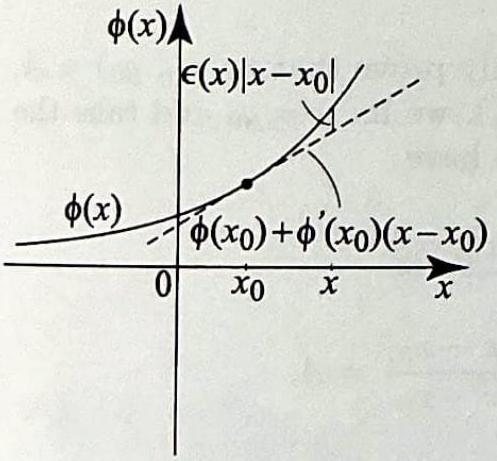
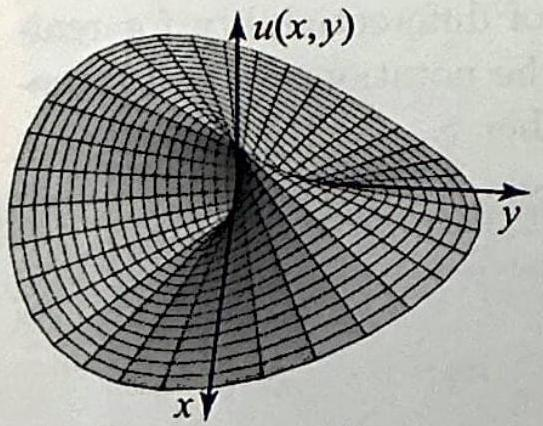
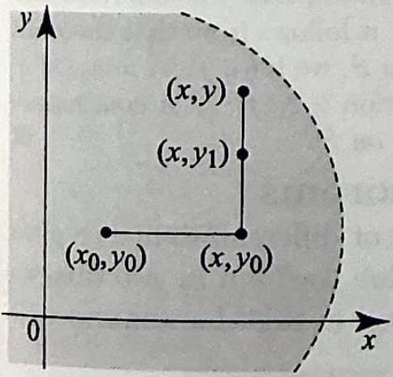
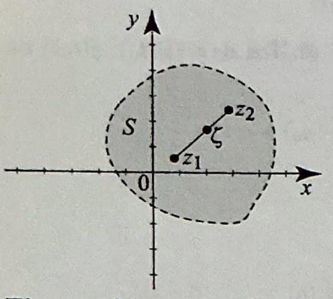

> [!review]
> 1.) How is differentiability defined for a real-valued function $u(x, y)$ at a point $z_0=\left(x_0, y_0\right)$, and how does this definition parallel the corresponding notion for a real-valued function of one variable?
> 2.) Suppose a real-valued function $u(x, y)$ is differentiable at a point $z_0$. What does this imply about the continuity of $u$ at $z_0$, and about the existence and values of the partial derivatives of $u$ at $z_0$ ? Prove your answer.


##### solution

##### problem 1

A real-valued function $u(x,y)$ is differentiable at a point $z_0=(x_0,y_0)$ if it can be written in the form

$$
u(z)
=
u(z_0)
+A(x-x_0)
+B(y-y_0)
+\epsilon(z)\lvert z-z_0\rvert,
$$

where $A$ and $B$ are real constants and $\epsilon(z)\to 0$ as $z\to z_0$.

The meaning of this definition is that near $z_0$ the function $u(x,y)$ is approximated by the linear function

$$
u(z_0)+A(x-x_0)+B(y-y_0),
$$

and the error is small compared with $\lvert z-z_0\rvert$.

This is exactly parallel to the one-variable notion. A real-valued function $\phi(x)$ is differentiable at $x_0$ precisely when it can be written as

$$
\phi(x)
=
\phi(x_0)
+\phi'(x_0)(x-x_0)
+\epsilon(x)\lvert x-x_0\rvert,
$$

with $\epsilon(x)\to 0$ as $x\to x_0$.

So in one variable the function is approximated by its tangent line, while in two variables it is approximated by a linear function in $x-x_0$ and $y-y_0$, that is, by the tangent plane.

##### problem 2

If $u(x,y)$ is differentiable at $z_0=(x_0,y_0)$, then by definition

$$
u(z)
=
u(z_0)
+A(x-x_0)
+B(y-y_0)
+\epsilon(z)\lvert z-z_0\rvert,
$$

with $\epsilon(z)\to 0$ as $z\to z_0$.

We first prove continuity at $z_0$. Subtract $u(z_0)$ from both sides:

$$
u(z)-u(z_0)
=
A(x-x_0)
+B(y-y_0)
+\epsilon(z)\lvert z-z_0\rvert.
$$

Take absolute values:

$$
\begin{aligned}
\lvert u(z)-u(z_0)\rvert
&=
\left|A(x-x_0)+B(y-y_0)+\epsilon(z)\lvert z-z_0\rvert\right|\\
&\le
\lvert A\rvert\lvert x-x_0\rvert
+\lvert B\rvert\lvert y-y_0\rvert
+\lvert\epsilon(z)\rvert\lvert z-z_0\rvert.
\end{aligned}
$$

Now $\lvert x-x_0\rvert\le \lvert z-z_0\rvert$ and $\lvert y-y_0\rvert\le \lvert z-z_0\rvert$, so

$$
\begin{aligned}
\lvert u(z)-u(z_0)\rvert
&\le
\lvert A\rvert\lvert z-z_0\rvert
+\lvert B\rvert\lvert z-z_0\rvert
+\lvert\epsilon(z)\rvert\lvert z-z_0\rvert\\
&=
\bigl(\lvert A\rvert+\lvert B\rvert+\lvert\epsilon(z)\rvert\bigr)\lvert z-z_0\rvert.
\end{aligned}
$$

As $z\to z_0$, we have $\epsilon(z)\to 0$, so

$$
\lvert\epsilon(z)\rvert\to 0.
$$

Therefore

$$
\lvert A\rvert+\lvert B\rvert+\lvert\epsilon(z)\rvert
\to
\lvert A\rvert+\lvert B\rvert.
$$

Since $\lvert A\rvert+\lvert B\rvert$ is a finite constant, it follows that the quantity $\lvert A\rvert+\lvert B\rvert+\lvert\epsilon(z)\rvert$ remains bounded as $z\to z_0$. Also,

$$
\lvert z-z_0\rvert\to 0.
$$

Hence

$$
\bigl(\lvert A\rvert+\lvert B\rvert+\lvert\epsilon(z)\rvert\bigr)\lvert z-z_0\rvert\to 0.
$$

Hence

$$
u(z)\to u(z_0)
\qquad\text{as}\qquad
z\to z_0,
$$

which proves that $u$ is continuous at $z_0$.

We next prove the existence of the partial derivative with respect to $x$. Set $y=y_0$.

Then

$$
\lvert z-z_0\rvert
=
\sqrt{(x-x_0)^2+(y_0-y_0)^2}
=
\sqrt{(x-x_0)^2}
=
\lvert x-x_0\rvert.
$$

Substitute $y=y_0$ into the differentiability formula:

$$
u(x,y_0)
=
u(z_0)
+A(x-x_0)
+B(y_0-y_0)
+\epsilon(z)\lvert x-x_0\rvert.
$$

Since $B(y_0-y_0)=0$, this becomes

$$
u(x,y_0)-u(z_0)
=
A(x-x_0)
+\epsilon(z)\lvert x-x_0\rvert.
$$

Divide by $x-x_0$ for $x\ne x_0$:

$$
\frac{u(x,y_0)-u(x_0,y_0)}{x-x_0}
=
A
+\epsilon(z)\frac{\lvert x-x_0\rvert}{x-x_0}.
$$

Now

$$
\left|\frac{\lvert x-x_0\rvert}{x-x_0}\right|=1.
$$

Hence

$$
\left|\epsilon(z)\frac{\lvert x-x_0\rvert}{x-x_0}\right|
=
\lvert\epsilon(z)\rvert\left|\frac{\lvert x-x_0\rvert}{x-x_0}\right|
=
\lvert\epsilon(z)\rvert\cdot 1
=
\lvert\epsilon(z)\rvert.
$$

Since $\epsilon(z)\to 0$ as $z\to z_0$, we have

$$
\lvert\epsilon(z)\rvert\to 0.
$$

Therefore, by the squeeze theorem, we get

$$
\epsilon(z)\frac{\lvert x-x_0\rvert}{x-x_0}\to 0.
$$

Therefore

$$
\lim_{x\to x_0}\frac{u(x,y_0)-u(x_0,y_0)}{x-x_0}
=
A.
$$

Hence $u_x(z_0)=A$.

Now prove the existence of the partial derivative with respect to $y$. Set $x=x_0$.

Then

$$
\lvert z-z_0\rvert
=
\sqrt{(x_0-x_0)^2+(y-y_0)^2}
=
\sqrt{(y-y_0)^2}
=
\lvert y-y_0\rvert.
$$

Substitute $x=x_0$ into the differentiability formula:

$$
u(x_0,y)
=
u(z_0)
+A(x_0-x_0)
+B(y-y_0)
+\epsilon(z)\lvert y-y_0\rvert.
$$

Since $A(x_0-x_0)=0$, this becomes

$$
u(x_0,y)-u(z_0)
=
B(y-y_0)
+\epsilon(z)\lvert y-y_0\rvert.
$$

Divide by $y-y_0$ for $y\ne y_0$:

$$
\frac{u(x_0,y)-u(x_0,y_0)}{y-y_0}
=
B
+\epsilon(z)\frac{\lvert y-y_0\rvert}{y-y_0}.
$$

Again

$$
\left|\frac{\lvert y-y_0\rvert}{y-y_0}\right|=1.
$$

Hence

$$
\left|\epsilon(z)\frac{\lvert y-y_0\rvert}{y-y_0}\right|
=
\lvert\epsilon(z)\rvert\left|\frac{\lvert y-y_0\rvert}{y-y_0}\right|
=
\lvert\epsilon(z)\rvert\cdot 1
=
\lvert\epsilon(z)\rvert.
$$

Since $\epsilon(z)\to 0$ as $z\to z_0$, we have

$$
\lvert\epsilon(z)\rvert\to 0.
$$

Therefore, by the squeeze theorem,

$$
\epsilon(z)\frac{\lvert y-y_0\rvert}{y-y_0}\to 0.
$$

Therefore

$$
\lim_{y\to y_0}\frac{u(x_0,y)-u(x_0,y_0)}{y-y_0}
=
B.
$$

Hence $u_y(z_0)=B$.

So differentiability at $z_0$ implies both of the following:

$$
\boxed{
u\text{ is continuous at }z_0
}
$$

and

$$
\boxed{
u_x(z_0)\text{ and }u_y(z_0)\text{ exist, with }u_x(z_0)=A,\ u_y(z_0)=B.
}
$$


+++++


Our goal in this section is to fulfill our promise of completing the proof of the Cauchy-Riemann theorem, which we stated in Section 2.4. The material that is required for the proof is interesting in its own right. It deals with the concept of differentiation for functions of several variables. We will also apply it to give simple proofs of the chain rule and the mean value theorem in two dimensions.

As a motivation, let us begin by reviewing a geometric interpretation of the derivative of a real-valued function of one variable, $\phi(x)$. When we say that $\phi^{\prime}\left(x_{0}\right)$ exists, we mean that the limit $\lim _{x \rightarrow x_{0}} \frac{\phi(x)-\phi\left(x_{0}\right)}{x-x_{0}}$ exists and equals a finite number $\phi^{\prime}\left(x_{0}\right)$. If we set

$$
r(x)=\phi^{\prime}\left(x_{0}\right)-\frac{\phi(x)-\phi\left(x_{0}\right)}{x-x_{0}}
$$

then $\lim _{x \rightarrow x_{0}} r(x)=0$. Solving for $\phi(x)$, we obtain

$$
\phi(x)=\phi\left(x_{0}\right)+\phi^{\prime}\left(x_{0}\right)\left(x-x_{0}\right)+r(x)\left(x-x_{0}\right) .
$$


Let $\epsilon(x)=r(x) \frac{x-x_{0}}{\left|x-x_{0}\right|}$, then, because $\frac{x-x_{0}}{\left|x-x_{0}\right|}= \pm 1$ and $r(x) \rightarrow 0$ as $x \rightarrow x_{0}$, it follows that $\epsilon(x) \rightarrow 0$ as $x \rightarrow x_{0}$, and we have

$$
\phi(x)=\overbrace{\phi\left(x_{0}\right)+\phi^{\prime}\left(x_{0}\right)\left(x-x_{0}\right)}^{\text {tangent line at } x_{0}}+\epsilon(x)\left|x-x_{0}\right| .
$$

This expresses the well-known geometric fact that, near a point $x=x_{0}$ where the function $\phi(x)$ is differentiable with derivative $\phi^{\prime}\left(x_{0}\right)$, the tangent line approximates the graph of the function with an error that tends to 0 faster than $\left|x-x_{0}\right|$ (_Figure 1_).


> [!figure] Figure 1
> 
> 
> Figure 1 Approximation of a differentiable function by the tangent line.


With (1) in mind, we introduce the notion of differentiability for realvalued functions of two variables. To simplify the notation, we will sometimes denote a point $(x, y)$ by the complex number $z$.

> [!definition] Differentiability of Real-Valued Functions of Two Variables
> We call a real-valued function $u(x, y)$ differentiable at $z_{0}=\left(x_{0}, y_{0}\right)$ if it can be written in the form
> 
> $$
> u(z)=u\left(z_{0}\right)+A\left(x-x_{0}\right)+B\left(y-y_{0}\right)+\epsilon(z)\left|z-z_{0}\right|
> $$
> 
> where $A$ and $B$ are (real) constants and $\epsilon(z) \rightarrow 0$ as $z \rightarrow z_{0}$.


In proofs, we will need to know limits such as
(3) $\lim _{z \rightarrow z_{0}} \epsilon(z) \frac{\left|z-z_{0}\right|}{z-z_{0}}=0, \quad \lim _{z \rightarrow z_{0}} \epsilon(z) \frac{\left|x-x_{0}\right|}{x-x_{0}}=0, \quad \lim _{z \rightarrow z_{0}} \epsilon(z) \frac{x-x_{0}}{\left|z-z_{0}\right|}=0$.


These are all of the form $\epsilon(z)$ times a bounded function, and hence by the squeeze theorem they tend to zero as $z \rightarrow z_{0}$, because $\epsilon(z)$ tends to zero. For example,

$$
\left|\epsilon(z) \frac{x-x_{0}}{\left|z-z_{0}\right|}\right|=|\epsilon(z)| \overbrace{\frac{\left|x-x_{0}\right|}{\left|z-z_{0}\right|}}^{\leq 1} \leq|\epsilon(z)|
$$

where the inequality $\frac{\left|x-x_{0}\right|}{\left|z-z_{0}\right|}=\frac{\left|\operatorname{Re}\left(z-z_{0}\right)\right|}{\left|z-z_{0}\right|} \leq 1$ follows from (14), Section 1.2.
Our first result states that a differentiable function is continuous and has partial derivatives.


> [!Theorem] Theorem 1
> Suppose $u(x, y)$ is differentiable at $z_{0}=x_{0}+i y_{0}$, so that (2) holds. Then 
> (i) $u(x, y)$ is continuous at $z_{0}$; and
> (ii) $u_{x}, u_{y}$ exist at $z_{0}$ and $u_{x}\left(z_{0}\right)=A, u_{y}\left(z_{0}\right)=B$.

**Proof** 


> [!review]
> 1.) Suppose a real-valued function $u(x, y)$ has partial derivatives $u_x\left(z_0\right)$ and $u_y\left(z_0\right)$ at a point $z_0$. What, if anything, does this imply about the continuity or differentiability of $u$ at $z_0$ ?
> 2.) What additional hypothesis on the partial derivatives of a real-valued function $u(x, y)$, beyond their mere existence at $z_0$, is sufficient to guarantee that $u$ is differentiable at $z_0$ ? Prove your answer.
> 3.) What conditions on the partial derivatives of the real and imaginary parts $u, v$ of a complex-valued function $f(z)=u(x, y)+i v(x, y)$ are sufficient to guarantee that $f$ is analytic on an open set? Prove your answer.


##### solution

##### problem 1

The existence of the partial derivatives $u_x(z_0)$ and $u_y(z_0)$ by itself implies neither continuity nor differentiability at $z_0$.

To see this, consider

$$
u(x,y)=
\begin{cases}
\dfrac{xy}{x^2+y^2}, & (x,y)\ne (0,0),\\[6pt]
0, & (x,y)=(0,0).
\end{cases}
$$

We show first that the partial derivatives exist at $(0,0)$.

For the partial derivative with respect to $x$,

$$
u_x(0,0)
=
\lim_{h\to 0}\frac{u(h,0)-u(0,0)}{h}
=
\lim_{h\to 0}\frac{0-0}{h}
=
\lim_{h\to 0} 0
=
0.
$$

For the partial derivative with respect to $y$,

$$
u_y(0,0)
=
\lim_{k\to 0}\frac{u(0,k)-u(0,0)}{k}
=
\lim_{k\to 0}\frac{0-0}{k}
=
\lim_{k\to 0} 0
=
0.
$$

So both partial derivatives exist at $(0,0)$.

Now check continuity at $(0,0)$. If we approach along the line $y=x$, then for $x\ne 0$,

$$
u(x,x)
=
\frac{x\cdot x}{x^2+x^2}
=
\frac{x^2}{2x^2}
=
\frac{1}{2}.
$$

Hence

$$
\lim_{x\to 0} u(x,x)
=
\frac{1}{2}.
$$

But

$$
u(0,0)=0.
$$

Therefore

$$
\lim_{(x,y)\to (0,0)}u(x,y)
$$

does not equal $u(0,0)$, so $u$ is not continuous at $(0,0)$.

Since differentiability implies continuity by Theorem 1, $u$ cannot be differentiable at $(0,0)$.

Thus the mere existence of $u_x(z_0)$ and $u_y(z_0)$ does not imply continuity, and therefore does not imply differentiability either.

##### problem 2

The additional hypothesis given in Theorem 2 is the following: besides the existence of $u_x(z_0)$ and $u_y(z_0)$, it is sufficient to assume that either $u_x$ or $u_y$ is continuous at $z_0$.

We prove this. Assume that $u_x(z_0)$ and $u_y(z_0)$ exist and that $u_y$ is continuous at $z_0$. The proof when $u_x$ is continuous is analogous.

Write $z_0=(x_0,y_0)$ and let $z=(x,y)$. Consider

$$
u(x,y)-u(x_0,y_0)-u_x(z_0)(x-x_0)-u_y(z_0)(y-y_0).
$$

Add and subtract $u(x,y_0)$:

$$
\begin{aligned}
&u(x,y)-u(x_0,y_0)-u_x(z_0)(x-x_0)-u_y(z_0)(y-y_0)\\
&=
\bigl(u(x,y)-u(x,y_0)-u_y(z_0)(y-y_0)\bigr)\\
&\qquad+
\bigl(u(x,y_0)-u(x_0,y_0)-u_x(z_0)(x-x_0)\bigr).
\end{aligned}
$$

We treat the two brackets separately.

For the second bracket, keep $y=y_0$ fixed. Since $u_x(z_0)$ exists,

$$
\lim_{x\to x_0}\frac{u(x,y_0)-u(x_0,y_0)}{x-x_0}
=
u_x(z_0).
$$

Therefore

$$
\frac{u(x,y_0)-u(x_0,y_0)}{x-x_0}-u_x(z_0)\to 0
\qquad\text{as}\qquad
x\to x_0.
$$

Define

$$
\epsilon_1(x)
=
\frac{u(x,y_0)-u(x_0,y_0)}{x-x_0}-u_x(z_0)
\qquad (x\ne x_0).
$$

Then $\epsilon_1(x)\to 0$ as $x\to x_0$, and hence

$$
u(x,y_0)-u(x_0,y_0)-u_x(z_0)(x-x_0)
=
\epsilon_1(x)(x-x_0).
$$

Now

$$
\left|\epsilon_1(x)(x-x_0)\right|
=
\left|\epsilon_1(x)\right|\left|x-x_0\right|
\le
\left|\epsilon_1(x)\right|\left|z-z_0\right|.
$$

Since $\epsilon_1(x)\to 0$, the factor $\epsilon_1(x)$ is bounded in a neighborhood of $x_0$. Also,

$$
\left|z-z_0\right|\to 0
\qquad\text{as}\qquad
z\to z_0.
$$

Therefore

$$
\epsilon_1(x)(x-x_0)=o\!\left(\left|z-z_0\right|\right).
$$

Next consider the first bracket. Keep $x$ fixed and apply the one-variable mean value theorem to the function of $y$

$$
\phi(t)=u(x,t)
$$

on the interval joining $y_0$ and $y$. Then there exists a number $\eta$ between $y_0$ and $y$ such that

$$
u(x,y)-u(x,y_0)
=
u_y(x,\eta)(y-y_0).
$$

Hence

$$
\begin{aligned}
u(x,y)-u(x,y_0)-u_y(z_0)(y-y_0)
&=
u_y(x,\eta)(y-y_0)-u_y(z_0)(y-y_0)\\
&=
\bigl(u_y(x,\eta)-u_y(z_0)\bigr)(y-y_0).
\end{aligned}
$$

Since $\eta$ lies between $y_0$ and $y$, we have $\eta\to y_0$ as $y\to y_0$. Therefore

$$
(x,\eta)\to (x_0,y_0)
\qquad\text{as}\qquad
(x,y)\to (x_0,y_0).
$$

Because $u_y$ is continuous at $z_0$,

$$
u_y(x,\eta)-u_y(z_0)\to 0.
$$

Also,

$$
|y-y_0|\le |z-z_0|.
$$

Therefore

$$
\begin{aligned}
\left|\bigl(u_y(x,\eta)-u_y(z_0)\bigr)(y-y_0)\right|
&=
\left|u_y(x,\eta)-u_y(z_0)\right|\left|y-y_0\right|\\
&\le
\left|u_y(x,\eta)-u_y(z_0)\right|\left|z-z_0\right|.
\end{aligned}
$$

Since $u_y(x,\eta)-u_y(z_0)\to 0$, this shows that

$$
\bigl(u_y(x,\eta)-u_y(z_0)\bigr)(y-y_0)
=
o\!\left(\left|z-z_0\right|\right).
$$

Substitute these two estimates back into the decomposition:

$$
\begin{aligned}
&u(x,y)-u(x_0,y_0)-u_x(z_0)(x-x_0)-u_y(z_0)(y-y_0)\\
&=
o\!\left(\left|z-z_0\right|\right)
+
o\!\left(\left|z-z_0\right|\right)\\
&=
o\!\left(\left|z-z_0\right|\right).
\end{aligned}
$$

Hence

$$
u(x,y)
=
u(x_0,y_0)
+
u_x(z_0)(x-x_0)
+
u_y(z_0)(y-y_0)
+
\epsilon(z)\left|z-z_0\right|,
$$

where $\epsilon(z)\to 0$ as $z\to z_0$.

This is exactly the definition of differentiability at $z_0$. Therefore $u$ is differentiable at $z_0$.

##### problem 3

A sufficient condition is the one stated in the theorem just below this review: if $f(z)=u(x,y)+iv(x,y)$ is defined on an open set $S$, and if the four partial derivatives $u_x,u_y,v_x,v_y$ are continuous in $S$ and satisfy the Cauchy-Riemann equations

$$
u_x=v_y,
\qquad
u_y=-v_x
$$

throughout $S$, then $f$ is analytic on $S$.

We prove this by combining Theorem 2 with the Cauchy-Riemann theorem from Section 2.4.

Let $z_0\in S$. Since $u_x$ and $u_y$ are continuous at $z_0$, Theorem 2 implies that $u$ is differentiable at $z_0$. Likewise, since $v_x$ and $v_y$ are continuous at $z_0$, Theorem 2 implies that $v$ is differentiable at $z_0$.

Thus at the point $z_0$, both real-valued functions $u$ and $v$ are differentiable, and the Cauchy-Riemann equations hold there:

$$
u_x(z_0)=v_y(z_0),
\qquad
u_y(z_0)=-v_x(z_0).
$$

The Cauchy-Riemann theorem from Section 2.4 says that if $u$ and $v$ are differentiable at a point and satisfy the Cauchy-Riemann equations there, then $f=u+iv$ is complex differentiable at that point.

Therefore $f$ is differentiable at $z_0$. Since $z_0$ was arbitrary in the open set $S$, it follows that $f$ is differentiable at every point of $S$.

Hence $f$ is analytic on $S$.


+++++


> [!exercise]
> For the function
> 
> $$
> u(x, y)= \begin{cases}\frac{x y}{x^2+y^2} & (x, y) \neq(0,0) \\ 0 & (x, y)=(0,0)\end{cases}
> $$
> 
> verify that $u_x(0,0)=0$ and $u_y(0,0)=0$, and show that $u$ is not continuous at $(0,0)$. Conclude from Theorem 1 that $u$ is not differentiable at $(0,0)$.


##### solution

We are given

$$
u(x,y)=
\begin{cases}
\dfrac{xy}{x^2+y^2}, & (x,y)\ne (0,0),\\[6pt]
0, & (x,y)=(0,0).
\end{cases}
$$

We first verify that $u_x(0,0)=0$.

By the definition of the partial derivative,

$$
u_x(0,0)
=
\lim_{h\to 0}\frac{u(h,0)-u(0,0)}{h}.
$$

Now, if $h\ne 0$, then

$$
u(h,0)
=
\frac{h\cdot 0}{h^2+0^2}
=
\frac{0}{h^2}
=
0.
$$

Also,

$$
u(0,0)=0.
$$

Therefore

$$
u_x(0,0)
=
\lim_{h\to 0}\frac{u(h,0)-u(0,0)}{h}
=
\lim_{h\to 0}\frac{0-0}{h}
=
\lim_{h\to 0} 0
=
0.
$$

Next we verify that $u_y(0,0)=0$.

Again by definition,

$$
u_y(0,0)
=
\lim_{k\to 0}\frac{u(0,k)-u(0,0)}{k}.
$$

Now, if $k\ne 0$, then

$$
u(0,k)
=
\frac{0\cdot k}{0^2+k^2}
=
\frac{0}{k^2}
=
0.
$$

Also,

$$
u(0,0)=0.
$$

Therefore

$$
u_y(0,0)
=
\lim_{k\to 0}\frac{u(0,k)-u(0,0)}{k}
=
\lim_{k\to 0}\frac{0-0}{k}
=
\lim_{k\to 0} 0
=
0.
$$

So both partial derivatives exist at $(0,0)$ and both are equal to $0$.

We now show that $u$ is not continuous at $(0,0)$.

To test continuity, approach $(0,0)$ along the line $y=x$. When $x\ne 0$, we have

$$
u(x,x)
=
\frac{x\cdot x}{x^2+x^2}
=
\frac{x^2}{2x^2}
=
\frac{1}{2}.
$$

Therefore

$$
\lim_{x\to 0}u(x,x)
=
\lim_{x\to 0}\frac{1}{2}
=
\frac{1}{2}.
$$

But

$$
u(0,0)=0.
$$

Hence

$$
\lim_{(x,y)\to (0,0)}u(x,y)
$$

cannot equal $u(0,0)$, because along the path $y=x$ the function tends to $\frac12$ rather than $0$.

Therefore $u$ is not continuous at $(0,0)$.

Now apply Theorem 1. Theorem 1 says that if a real-valued function is differentiable at a point, then it is continuous at that point.

We have just shown that $u$ is not continuous at $(0,0)$. Therefore $u$ cannot be differentiable at $(0,0)$.

Hence

$$
u_x(0,0)=0,
\qquad
u_y(0,0)=0,
$$

but $u$ is not continuous at $(0,0)$ and therefore is not differentiable at $(0,0)$.

A helpful plot is the following. The surface is drawn on the punctured plane, and the red point marks the separately defined value $u(0,0)=0$.

> [!figure] Plot of $u(x,y)=\dfrac{xy}{x^2+y^2}$
>
> 
>
> The punctured surface approaches different values along different paths, while the origin itself is defined to be $0$.

The following Mathematica code produces a corresponding plot.

```mathematica
u[x_, y_] := x y/(x^2 + y^2)

surface =
  Plot3D[
    u[x, y],
    {x, -2, 2},
    {y, -2, 2},
    RegionFunction -> Function[{x, y, z}, x^2 + y^2 >= 0.03],
    PlotRange -> {-0.6, 0.6},
    Mesh -> None,
    PlotPoints -> 80,
    MaxRecursion -> 2,
    ColorFunction -> "SolarColors",
    ColorFunctionScaling -> True,
    AxesLabel -> {"x", "y", "u(x,y)"},
    BoxRatios -> {1, 1, 0.6},
    ImageSize -> 520
  ];

originPoint =
  Graphics3D[{
    Red,
    PointSize[0.02],
    Point[{0, 0, 0}]
  }];

Show[
  surface,
  originPoint,
  PlotLabel ->
    Style["u(x,y) = xy/(x^2 + y^2), with u(0,0) = 0", 16, Bold]
]
```

The following Python code generates the embedded image.

```python
import numpy as np
from PIL import Image, ImageDraw

def u(x, y):
    r2 = x * x + y * y
    if r2 <= 0.03:
        return None
    return x * y / r2

def project(x, y, z):
    xp = 430 + 125 * (x - y)
    yp = 355 - 68 * (x + y) - 230 * z
    return xp, yp

grid = np.linspace(-2.0, 2.0, 90)
img = Image.new("RGB", (860, 680), "white")
draw = ImageDraw.Draw(img)

cells = []
for i in range(len(grid) - 1):
    for j in range(len(grid) - 1):
        x1, x2 = grid[i], grid[i + 1]
        y1, y2 = grid[j], grid[j + 1]
        corners = [(x1, y1), (x2, y1), (x2, y2), (x1, y2)]
        values = [u(x, y) for x, y in corners]
        if any(v is None for v in values):
            continue

        avg_z = sum(values) / 4.0
        t = (avg_z + 0.5) / 1.0
        color = (
            int(35 + 180 * t),
            int(80 + 110 * (1 - abs(2 * t - 1))),
            int(210 - 160 * t),
        )
        polygon = [project(x, y, z) for (x, y), z in zip(corners, values)]
        depth = sum(x + y for x, y in corners) / 4.0
        cells.append((depth, polygon, color))

for _, polygon, color in sorted(cells, key=lambda item: item[0]):
    draw.polygon(polygon, fill=color, outline=(120, 120, 120))

for axis in [
    (project(-2, -2, -0.6), project(2, -2, -0.6)),
    (project(-2, -2, -0.6), project(-2, 2, -0.6)),
    (project(-2, -2, -0.6), project(-2, -2, 0.6)),
]:
    draw.line(axis, fill=(40, 40, 40), width=3)

ox, oy = project(0, 0, 0)
draw.ellipse((ox - 7, oy - 7, ox + 7, oy + 7), fill="crimson", outline="crimson")

img.save("images/exercise_xy_over_x2_plus_y2_surface.png")
```


++++


The converse of part (ii) of Theorem 1 is not true. A function of two variables may have partial derivatives and yet fail to be differentiable at a point. In fact, the function may not even be continuous at that point. As an illustration, consider

$$
u(x, y)= \begin{cases}\frac{x y}{x^{2}+y^{2}} & (x, y) \neq(0,0) \\ 0 & (x, y)=(0,0)\end{cases}
$$

It is a good exercise to check that $u_{x}(0,0)=0$ and $u_{y}(0,0)=0$, but $u$ is not continuous at $(0,0)$. Hence by Theorem 1(i), $u$ is not differentiable at $(0,0)$. The graph of $u$ is shown in _Figure 2_.


> [!figure] Figure 2
> 
> 
> Figure 2 A discontinuous function with partial derivatives at $(0,0)$. The function is not differentiable at $(0,0)$.


$u(x, y)-u\left(x, y_{0}\right)$, think of $x$ as fixed, and apply the mean value theorem in the second variable.

To obtain differentiability at a point, more is needed than the existence of the partial derivatives. We have the following interesting result.

> [!Theorem] Theorem 2: Sufficient Conditions for Differentiability
> Let $u$ be a real-valued function defined on a neighborhood of $z_{0}$. If
> (i) $u_{x}\left(z_{0}\right)$ and $u_{y}\left(z_{0}\right)$ exist, and
> (ii) either $u_{x}(z)$ or $u_{y}(z)$ is continuous at $z_{0}$,
> then $u$ is differentiable at $z_{0}$, and (2) holds with $A=u_{x}\left(x_{0}, y_{0}\right), B= u_{y}\left(x_{0}, y_{0}\right)$.


**Proof** 


> [!figure] Figure 3: For Proof to Theorem 3
> 
> 
> Figure 3 In the expression


---


We are now in a position to complete the proof of the Cauchy-Riemann equations theorem.


> [!theorem] Theorem 4: The Chain Rule
> Let $f(z)=u(x, y)+i v(x, y)$ be a complex-valued function, defined in an open set $S$. If $u_{x}, u_{y}, v_{x}$, and $v_{y}$ are continuous and satisfy the CauchyRiemann equations in $S$, then $f(z)$ is analytic on $S$.


**Proof** 


# 2.6.1 Chain Rule and Mean Value Theorems


> [!review]
> 1.) If a differentiable real-valued function $u(x, y)$ is composed with a curve $(x(t), y(t))$ whose components are differentiable in $t$, how does the rate of change of the composite $U(t)= u(x(t), y(t))$ express in terms of the partial derivatives of $u$ and the derivatives of $x$ and $y$ ? Prove your answer.
> 2.) Suppose $x$ and $y$ are differentiable functions of two parameters $s$ and $t$. How do the partial derivatives of $U(s, t)=u(x(s, t), y(s, t))$ express in terms of the partial derivatives of $u, x$, and $y$ ? Prove your answer.
> 3.) Can the total finite change of a differentiable real-valued function of two variables along a line segment in its domain be computed using the function's partial derivatives at a single intermediate point on the segment? Prove your answer.


##### solution

##### problem 1

If $U(t)=u(x(t),y(t))$, where $u$ is differentiable and $x(t),y(t)$ are differentiable functions of $t$, then

$$
\frac{dU}{dt}
=
\frac{\partial u}{\partial x}\frac{dx}{dt}
+
\frac{\partial u}{\partial y}\frac{dy}{dt}.
$$

We prove this. Fix a value $t_0$, and write

$$
z=(x,y),
\qquad
z_0=(x_0,y_0)=\bigl(x(t_0),y(t_0)\bigr).
$$

Since $u$ is differentiable at $z_0$, Definition 1 gives

$$
u(z)-u(z_0)
=
u_x(z_0)(x-x_0)
+
u_y(z_0)(y-y_0)
+
\epsilon(z)\lvert z-z_0\rvert,
$$

where $\epsilon(z)\to 0$ as $z\to z_0$.

Now substitute $x=x(t)$ and $y=y(t)$:

$$
\begin{aligned}
u(x(t),y(t))-u(x(t_0),y(t_0))
&=
u_x(z_0)\bigl(x(t)-x(t_0)\bigr)\\
&\qquad+
u_y(z_0)\bigl(y(t)-y(t_0)\bigr)\\
&\qquad+
\epsilon(z)\lvert z-z_0\rvert.
\end{aligned}
$$

Divide by $t-t_0$ for $t\ne t_0$:

$$
\begin{aligned}
\frac{u(x(t),y(t))-u(x(t_0),y(t_0))}{t-t_0}
&=
u_x(z_0)\frac{x(t)-x(t_0)}{t-t_0}\\
&\qquad+
u_y(z_0)\frac{y(t)-y(t_0)}{t-t_0}\\
&\qquad+
\epsilon(z)\frac{\lvert z-z_0\rvert}{t-t_0}.
\end{aligned}
$$

As $t\to t_0$, we have

$$
\frac{x(t)-x(t_0)}{t-t_0}\to x'(t_0)
$$

and

$$
\frac{y(t)-y(t_0)}{t-t_0}\to y'(t_0).
$$

It remains to show that

$$
\epsilon(z)\frac{\lvert z-z_0\rvert}{t-t_0}\to 0.
$$

Since $t\to t_0$ implies $z\to z_0$, we have

$$
\epsilon(z)\to 0.
$$

Now

$$
\left|\frac{\lvert z-z_0\rvert}{t-t_0}\right|
=
\left|\frac{x-x_0}{t-t_0}+i\frac{y-y_0}{t-t_0}\right|.
$$

As $t\to t_0$,

$$
\frac{x-x_0}{t-t_0}\to x'(t_0)
$$

and

$$
\frac{y-y_0}{t-t_0}\to y'(t_0),
$$

so

$$
\left|\frac{x-x_0}{t-t_0}+i\frac{y-y_0}{t-t_0}\right|
\to
\left|x'(t_0)+iy'(t_0)\right|.
$$

Therefore the factor $\dfrac{\lvert z-z_0\rvert}{t-t_0}$ is bounded in a neighborhood of $t_0$. Since it is bounded and $\epsilon(z)\to 0$, we get

$$
\epsilon(z)\frac{\lvert z-z_0\rvert}{t-t_0}\to 0.
$$

Taking limits in the difference quotient gives

$$
\frac{dU}{dt}(t_0)
=
u_x(z_0)x'(t_0)+u_y(z_0)y'(t_0).
$$

Since $t_0$ was arbitrary,

$$
\frac{dU}{dt}
=
\frac{\partial u}{\partial x}\frac{dx}{dt}
+
\frac{\partial u}{\partial y}\frac{dy}{dt}.
$$

##### problem 2

If $U(s,t)=u(x(s,t),y(s,t))$, where $x$ and $y$ are differentiable functions of the two parameters $s$ and $t$, then

$$
\frac{\partial U}{\partial s}
=
\frac{\partial u}{\partial x}\frac{\partial x}{\partial s}
+
\frac{\partial u}{\partial y}\frac{\partial y}{\partial s}
$$

and

$$
\frac{\partial U}{\partial t}
=
\frac{\partial u}{\partial x}\frac{\partial x}{\partial t}
+
\frac{\partial u}{\partial y}\frac{\partial y}{\partial t}.
$$

We prove the first identity. Fix $t=t_0$ and consider the function

$$
V(s)=U(s,t_0)=u(x(s,t_0),y(s,t_0)).
$$

Now $x(s,t_0)$ and $y(s,t_0)$ are differentiable functions of the single variable $s$. Therefore problem 1 applies and gives

$$
\frac{dV}{ds}
=
u_x\frac{\partial x}{\partial s}
+
u_y\frac{\partial y}{\partial s}.
$$

But $V(s)=U(s,t_0)$, so

$$
\frac{dV}{ds}
=
\frac{\partial U}{\partial s}(s,t_0).
$$

Hence

$$
\frac{\partial U}{\partial s}(s,t_0)
=
\frac{\partial u}{\partial x}\frac{\partial x}{\partial s}
+
\frac{\partial u}{\partial y}\frac{\partial y}{\partial s}.
$$

Since $t_0$ was arbitrary, we obtain

$$
\frac{\partial U}{\partial s}
=
\frac{\partial u}{\partial x}\frac{\partial x}{\partial s}
+
\frac{\partial u}{\partial y}\frac{\partial y}{\partial s}.
$$

The proof of the second identity is the same, except that we keep $s$ fixed and vary $t$. Let

$$
W(t)=U(s_0,t)=u(x(s_0,t),y(s_0,t)).
$$

Applying problem 1 to this one-variable composite gives

$$
\frac{dW}{dt}
=
u_x\frac{\partial x}{\partial t}
+
u_y\frac{\partial y}{\partial t}.
$$

Since $W(t)=U(s_0,t)$, we have

$$
\frac{dW}{dt}
=
\frac{\partial U}{\partial t}(s_0,t).
$$

Therefore

$$
\frac{\partial U}{\partial t}(s_0,t)
=
\frac{\partial u}{\partial x}\frac{\partial x}{\partial t}
+
\frac{\partial u}{\partial y}\frac{\partial y}{\partial t}.
$$

Since $s_0$ was arbitrary, we conclude that

$$
\frac{\partial U}{\partial t}
=
\frac{\partial u}{\partial x}\frac{\partial x}{\partial t}
+
\frac{\partial u}{\partial y}\frac{\partial y}{\partial t}.
$$

##### problem 3

Yes. If the line segment joining $z_1=(x_1,y_1)$ to $z_2=(x_2,y_2)$ lies in the domain of differentiability of $u$, then there exists a point $\zeta$ on that segment such that

$$
u(z_2)-u(z_1)
=
u_x(\zeta)(x_2-x_1)+u_y(\zeta)(y_2-y_1).
$$

We prove this by reducing the problem to the one-variable mean value theorem.

Parameterize the line segment from $z_1$ to $z_2$ by

$$
x(t)=x_1+t(x_2-x_1),
\qquad
y(t)=y_1+t(y_2-y_1),
\qquad
0\le t\le 1.
$$

Define

$$
\phi(t)=u(x(t),y(t)).
$$

Since $u$ is differentiable and $x(t),y(t)$ are differentiable, problem 1 gives

$$
\phi'(t)
=
u_x(x(t),y(t))x'(t)+u_y(x(t),y(t))y'(t).
$$

Now compute

$$
x'(t)
=
\frac{d}{dt}\bigl(x_1+t(x_2-x_1)\bigr)
=
x_2-x_1
$$

and

$$
y'(t)
=
\frac{d}{dt}\bigl(y_1+t(y_2-y_1)\bigr)
=
y_2-y_1.
$$

Therefore

$$
\phi'(t)
=
u_x(x(t),y(t))(x_2-x_1)+u_y(x(t),y(t))(y_2-y_1).
$$

Apply the ordinary mean value theorem to $\phi$ on the interval $[0,1]$. There exists some $c$ with $0<c<1$ such that

$$
\phi(1)-\phi(0)
=
\phi'(c)(1-0)
=
\phi'(c).
$$

Now

$$
\phi(1)
=
u(x(1),y(1))
=
u(x_2,y_2)
=
u(z_2)
$$

and

$$
\phi(0)
=
u(x(0),y(0))
=
u(x_1,y_1)
=
u(z_1).
$$

Also,

$$
\phi'(c)
=
u_x(x(c),y(c))(x_2-x_1)+u_y(x(c),y(c))(y_2-y_1).
$$

Let

$$
\zeta=(x(c),y(c)).
$$

Since $0<c<1$, the point $\zeta$ lies on the line segment joining $z_1$ to $z_2$. Substituting into the mean value identity gives

$$
u(z_2)-u(z_1)
=
u_x(\zeta)(x_2-x_1)+u_y(\zeta)(y_2-y_1).
$$

Thus the total finite change of $u$ along the segment can indeed be computed from the partial derivatives at a single intermediate point on that segment.


+++++


We can use Definition 1 and basic properties of differentiability to give simple proofs of the chain rule and the mean value theorem in two dimensions. These fundamental results were already used in this chapter and will be used again.


> [!theorem] Theorem 4: The Chain Rule
> Suppose that $u(x, y)$ is a differentiable function of $(x, y)$ in an open set $S$, where $x=x(t)$ and $y=y(t)$ are both differentiable functions of $t$. Then the function $U(t)=u(x(t), y(t))$ is a differentiable function of $t$ and
> 
> $$
> \frac{d U}{d t}=\frac{\partial u}{\partial x} \frac{d x}{d t}+\frac{\partial u}{\partial y} \frac{d y}{d t}
> $$
> 


In particular, if the partial derivatives of $u$ are continuous, then by Theorem $2, u$ is differentiable and the chain rule (11) holds.
Proof Here again, we will use the notation $z=(x, y)$. For $z_{0}=\left(x\left(t_{0}\right), y\left(t_{0}\right)\right)$ in $S$, by Definition 1 and Theorem 1(ii), we have

$$
u(z)-u\left(z_{0}\right)=u_{x}\left(z_{0}\right)\left(x-x_{0}\right)+u_{y}\left(z_{0}\right)\left(y-y_{0}\right)+\epsilon(z)\left|z-z_{0}\right|
$$

and so

$$
\begin{aligned}
& \frac{u(x(t), y(t))-u\left(x\left(t_{0}\right), y\left(t_{0}\right)\right)}{t-t_{0}} \\
& \quad=u_{x}\left(z_{0}\right) \frac{x(t)-x\left(t_{0}\right)}{t-t_{0}}+u_{y}\left(z_{0}\right) \frac{y(t)-y\left(t_{0}\right)}{t-t_{0}}+\epsilon(z) \frac{\left|z-z_{0}\right|}{t-t_{0}}
\end{aligned}
$$

As $t \rightarrow t_{0}, \frac{x(t)-x\left(t_{0}\right)}{t-t_{0}} \rightarrow \frac{d x}{d t}\left(t_{0}\right)$ and $\frac{y(t)-y\left(t_{0}\right)}{t-t_{0}} \rightarrow \frac{d y}{d t}\left(t_{0}\right)$, and hence (11) will follow from (12) once we prove that $\lim _{t \rightarrow t_{0}} \epsilon(z) \frac{\left|z-z_{0}\right|}{t-t_{0}}=0$. As $t \rightarrow t_{0}, z \rightarrow z_{0}$ and hence $\epsilon(z) \rightarrow 0$. So it suffices to show that $\frac{\left|z-z_{0}\right|}{t-t_{0}}$ is bounded in a neighborhood of $t_{0}$. We have

$$
\left|\frac{\left|z-z_{0}\right|}{t-t_{0}}\right|=\left|\frac{x-x_{0}}{t-t_{0}}+i \frac{y-y_{0}}{t-t_{0}}\right| \rightarrow\left|\frac{d x}{d t}\left(t_{0}\right)+i \frac{d y}{d t}\left(t_{0}\right)\right|
$$

and since this function has a limit, it is bounded in a neighborhood of $t_{0}$.
There is also a version of the chain rule in the situation where $x$ and $y$ are differentiable functions of two variables, $s$ and $t$. In that case, we set $U(s, t)=u(x(s, t), y(s, t))$, and then

$$
\begin{aligned}
& \frac{\partial U}{\partial s}=\frac{\partial u}{\partial x} \frac{\partial x}{\partial s}+\frac{\partial u}{\partial y} \frac{\partial y}{\partial s} \\
& \frac{\partial U}{\partial t}=\frac{\partial u}{\partial x} \frac{\partial x}{\partial t}+\frac{\partial u}{\partial y} \frac{\partial y}{\partial t}
\end{aligned}
$$

The first formula follows by applying (11) to $U(s, t)$ while keeping $t$ fixed, and the second follows by applying (11) while keeping $s$ fixed.

We conclude this section with the mean value theorem in two dimensions.


> [!theorem] Theorem 5: The Mean Value Theorem in Two Dimensions
> 
> 
> Suppose $u(x, y)$ is a differentiable real-valued function of ( $x, y$ ) in an open set $S$. Suppose that the line segment $\left[z_1, z_2\right]$ joining $z_1=\left(x_1, y_1\right)$ to $z_2=\left(x_2, y_2\right)$ lies entirely in $S$. Then there exists a point $\zeta$ on $\left[z_1, z_2\right]$ (see _Figure 4_) such that
> 
> $$
> u\left(z_2\right)-u\left(z_1\right)=u_x(\zeta)\left(x_2-x_1\right)+u_y(\zeta)\left(y_2-y_1\right)
> $$
> 
> > [!figure] Figure 4: For Theorem 5
> > 
> > 
> > Figure 4 Mean value theorem in two dimensions.
> 
> 
> 
> 

**Proof:** 


# Exercises 2.6


> [!exercise] Exercise 1
> 1. Show that the partial derivatives $u_{x}$ and $u_{y}$ of the function given by the following function exist for all $(x, y)$ but that the function is not continuous at $(0,0)$:
> 
> 
> $$u(x, y)= \begin{cases}\frac{x y}{x^2+y^2} & (x, y) \neq(0,0) \\ 0 & (x, y)=(0,0)\end{cases}$$
> 


##### solution

We are given

$$
u(x,y)=
\begin{cases}
\dfrac{xy}{x^2+y^2}, & (x,y)\ne (0,0),\\[6pt]
0, & (x,y)=(0,0).
\end{cases}
$$

We must show that the partial derivatives $u_x$ and $u_y$ exist for all $(x,y)$, and then show that $u$ is not continuous at $(0,0)$.

We begin with the case $(x,y)\ne (0,0)$.

For $(x,y)\ne (0,0)$, the denominator $x^2+y^2$ is not zero, so $u(x,y)$ is a quotient of differentiable functions with nonzero denominator. Therefore we may differentiate by the quotient rule.

To compute $u_x$, write

$$
u(x,y)=\frac{xy}{x^2+y^2}.
$$

Then

$$
\frac{\partial}{\partial x}(xy)=y
$$

and

$$
\frac{\partial}{\partial x}(x^2+y^2)=2x.
$$

Therefore

$$
\begin{aligned}
u_x(x,y)
&=
\frac{(x^2+y^2)\dfrac{\partial}{\partial x}(xy)-(xy)\dfrac{\partial}{\partial x}(x^2+y^2)}{(x^2+y^2)^2}\\[6pt]
&=
\frac{(x^2+y^2)y-(xy)(2x)}{(x^2+y^2)^2}\\[6pt]
&=
\frac{x^2y+y^3-2x^2y}{(x^2+y^2)^2}\\[6pt]
&=
\frac{y^3-x^2y}{(x^2+y^2)^2}\\[6pt]
&=
\frac{y(y^2-x^2)}{(x^2+y^2)^2}.
\end{aligned}
$$

So $u_x(x,y)$ exists for every $(x,y)\ne (0,0)$.

Now compute $u_y$. Again,

$$
u(x,y)=\frac{xy}{x^2+y^2}.
$$

Then

$$
\frac{\partial}{\partial y}(xy)=x
$$

and

$$
\frac{\partial}{\partial y}(x^2+y^2)=2y.
$$

Therefore

$$
\begin{aligned}
u_y(x,y)
&=
\frac{(x^2+y^2)\dfrac{\partial}{\partial y}(xy)-(xy)\dfrac{\partial}{\partial y}(x^2+y^2)}{(x^2+y^2)^2}\\[6pt]
&=
\frac{(x^2+y^2)x-(xy)(2y)}{(x^2+y^2)^2}\\[6pt]
&=
\frac{x^3+xy^2-2xy^2}{(x^2+y^2)^2}\\[6pt]
&=
\frac{x^3-xy^2}{(x^2+y^2)^2}\\[6pt]
&=
\frac{x(x^2-y^2)}{(x^2+y^2)^2}.
\end{aligned}
$$

So $u_y(x,y)$ also exists for every $(x,y)\ne (0,0)$.

It remains to treat the point $(0,0)$.

To compute $u_x(0,0)$, use the definition of the partial derivative:

$$
u_x(0,0)
=
\lim_{h\to 0}\frac{u(h,0)-u(0,0)}{h}.
$$

Now, if $h\ne 0$, then

$$
u(h,0)
=
\frac{h\cdot 0}{h^2+0^2}
=
\frac{0}{h^2}
=
0.
$$

Also,

$$
u(0,0)=0.
$$

Hence

$$
\begin{aligned}
u_x(0,0)
&=
\lim_{h\to 0}\frac{u(h,0)-u(0,0)}{h}\\[6pt]
&=
\lim_{h\to 0}\frac{0-0}{h}\\[6pt]
&=
\lim_{h\to 0}0\\[6pt]
&=
0.
\end{aligned}
$$

So $u_x(0,0)$ exists.

Now compute $u_y(0,0)$:

$$
u_y(0,0)
=
\lim_{k\to 0}\frac{u(0,k)-u(0,0)}{k}.
$$

If $k\ne 0$, then

$$
u(0,k)
=
\frac{0\cdot k}{0^2+k^2}
=
\frac{0}{k^2}
=
0.
$$

Also,

$$
u(0,0)=0.
$$

Therefore

$$
\begin{aligned}
u_y(0,0)
&=
\lim_{k\to 0}\frac{u(0,k)-u(0,0)}{k}\\[6pt]
&=
\lim_{k\to 0}\frac{0-0}{k}\\[6pt]
&=
\lim_{k\to 0}0\\[6pt]
&=
0.
\end{aligned}
$$

So $u_y(0,0)$ exists as well.

Combining the two cases, we conclude that both partial derivatives $u_x$ and $u_y$ exist for all $(x,y)$.

We now show that $u$ is not continuous at $(0,0)$.

Approach the origin along the line $y=x$. For $x\ne 0$,

$$
\begin{aligned}
u(x,x)
&=
\frac{x\cdot x}{x^2+x^2}\\[6pt]
&=
\frac{x^2}{2x^2}\\[6pt]
&=
\frac{1}{2}.
\end{aligned}
$$

Therefore

$$
\lim_{x\to 0}u(x,x)
=
\lim_{x\to 0}\frac{1}{2}
=
\frac{1}{2}.
$$

But

$$
u(0,0)=0.
$$

Hence the limit of $u(x,y)$ as $(x,y)\to (0,0)$ cannot equal $u(0,0)$, because along the path $y=x$ the function tends to $\frac12$ rather than $0$.

Therefore $u$ is not continuous at $(0,0)$.

So we have proved exactly what was required: the partial derivatives $u_x$ and $u_y$ exist for all $(x,y)$, but the function $u$ is not continuous at $(0,0)$.


++++


> [!exercise] Exercise 2
> 2. The function $\phi(x)=x^{2}$ is differentiable at $x_{0}=1$. Find the function $\epsilon(x)$ such that
> 
> $$
> \phi(x)=\phi(1)+\phi^{\prime}(1)(x-1)+\epsilon(x)|x-1|
> $$
> 
> and verify directly that $\epsilon \rightarrow 0$ as $x \rightarrow 1$.


##### solution

We are given

$$
\phi(x)=x^2,
\qquad
x_0=1.
$$

We first compute the quantities that appear in the formula

$$
\phi(x)=\phi(1)+\phi'(1)(x-1)+\epsilon(x)|x-1|.
$$

Since

$$
\phi(1)=1^2=1
$$

and

$$
\phi'(x)=2x,
$$

we have

$$
\phi'(1)=2.
$$

Substitute these into the required identity:

$$
x^2=1+2(x-1)+\epsilon(x)|x-1|.
$$

Simplify the non-error terms:

$$
\begin{aligned}
1+2(x-1)
&=
1+2x-2\\
&=
2x-1.
\end{aligned}
$$

So the identity becomes

$$
x^2=2x-1+\epsilon(x)|x-1|.
$$

Subtract $2x-1$ from both sides:

$$
\epsilon(x)|x-1|
=
x^2-(2x-1).
$$

Simplify the right-hand side:

$$
\begin{aligned}
x^2-(2x-1)
&=
x^2-2x+1\\
&=
(x-1)^2.
\end{aligned}
$$

Therefore

$$
\epsilon(x)|x-1|=(x-1)^2.
$$

Now solve for $\epsilon(x)$:

$$
\epsilon(x)
=
\frac{(x-1)^2}{|x-1|}.
$$

For $x\ne 1$, we can simplify this further:

$$
\epsilon(x)
=
\frac{|x-1|^2}{|x-1|}
=
|x-1|.
$$

So one convenient choice is

$$
\epsilon(x)=|x-1|.
$$

We now verify directly that $\epsilon(x)\to 0$ as $x\to 1$.

Since

$$
\epsilon(x)=|x-1|,
$$

we have

$$
\lim_{x\to 1}\epsilon(x)
=
\lim_{x\to 1}|x-1|
=
|1-1|
=
0.
$$

Thus

$$
\phi(x)=\phi(1)+\phi'(1)(x-1)+\epsilon(x)|x-1|
$$

with

$$
\epsilon(x)=|x-1|,
$$

and indeed $\epsilon(x)\to 0$ as $x\to 1$.


++++


> [!exercise] Exercise 3
> 3. Show directly from Definition 1 that any linear function $u(x, y)=A x+B y+C$ is differentiable.


##### solution

Let

$$
u(x,y)=Ax+By+C,
$$

where $A$, $B$, and $C$ are constants.

We must show directly from Definition 1 that $u$ is differentiable at every point $z_0=(x_0,y_0)$.

First compute the value of $u$ at $z_0$:

$$
u(z_0)=u(x_0,y_0)=Ax_0+By_0+C.
$$

Now compute

$$
\begin{aligned}
u(x,y)-u(z_0)
&=
(Ax+By+C)-(Ax_0+By_0+C)\\[6pt]
&=
Ax+By+C-Ax_0-By_0-C\\[6pt]
&=
Ax-Ax_0+By-By_0\\[6pt]
&=
A(x-x_0)+B(y-y_0).
\end{aligned}
$$

Therefore

$$
u(x,y)=u(z_0)+A(x-x_0)+B(y-y_0).
$$

Now write this in the exact form required by Definition 1:

$$
u(x,y)=u(z_0)+A(x-x_0)+B(y-y_0)+\epsilon(z)|z-z_0|,
$$

where we choose

$$
\epsilon(z)=0
\qquad
\text{for all }z.
$$

Then

$$
\epsilon(z)\to 0
\qquad
\text{as }
z\to z_0.
$$

So the function satisfies Definition 1 at the point $z_0$.

Since $z_0$ was arbitrary, the linear function $u(x,y)=Ax+By+C$ is differentiable at every point.


++++


> [!exercise] Exercise 4
> 4. Prove that if $\epsilon(z) \rightarrow 0$ as $z \rightarrow z_{0}$, then (a) $\epsilon(z) \frac{x-x_{0}}{\left|x-x_{0}\right|} \rightarrow 0$ as $z \rightarrow z_{0}$, and (b) $\epsilon(z) \frac{z-z_{0}}{\left|z-z_{0}\right|} \rightarrow 0$ as $z \rightarrow z_{0}$.


##### solution

Assume that

$$
\epsilon(z)\to 0
\qquad
\text{as }
z\to z_0.
$$

We prove parts (a) and (b) by showing that in each case the extra factor is bounded in absolute value.

##### problem 4(a)

Consider

$$
\epsilon(z)\frac{x-x_0}{|x-x_0|}.
$$

For points where $x\ne x_0$, we have

$$
\left|\frac{x-x_0}{|x-x_0|}\right|
=
\frac{|x-x_0|}{|x-x_0|}
=
1.
$$

Therefore

$$
\left|\epsilon(z)\frac{x-x_0}{|x-x_0|}\right|
=
|\epsilon(z)|\left|\frac{x-x_0}{|x-x_0|}\right|
=
|\epsilon(z)|\cdot 1
=
|\epsilon(z)|.
$$

Also,

$$
\left|\epsilon(z)\frac{x-x_0}{|x-x_0|}\right|\ge 0.
$$

So we have

$$
0
\le
\left|\epsilon(z)\frac{x-x_0}{|x-x_0|}\right|
\le
|\epsilon(z)|.
$$

Since $\epsilon(z)\to 0$ as $z\to z_0$, it follows that

$$
|\epsilon(z)|\to 0.
$$

Therefore, by the squeeze theorem,

$$
\left|\epsilon(z)\frac{x-x_0}{|x-x_0|}\right|\to 0.
$$

Hence

$$
\epsilon(z)\frac{x-x_0}{|x-x_0|}\to 0
\qquad
\text{as }
z\to z_0.
$$

##### problem 4(b)

Now consider

$$
\epsilon(z)\frac{z-z_0}{|z-z_0|}.
$$

For points where $z\ne z_0$, we have

$$
\left|\frac{z-z_0}{|z-z_0|}\right|
=
\frac{|z-z_0|}{|z-z_0|}
=
1.
$$

Therefore

$$
\left|\epsilon(z)\frac{z-z_0}{|z-z_0|}\right|
=
|\epsilon(z)|\left|\frac{z-z_0}{|z-z_0|}\right|
=
|\epsilon(z)|\cdot 1
=
|\epsilon(z)|.
$$

Also,

$$
\left|\epsilon(z)\frac{z-z_0}{|z-z_0|}\right|\ge 0.
$$

So we have

$$
0
\le
\left|\epsilon(z)\frac{z-z_0}{|z-z_0|}\right|
\le
|\epsilon(z)|.
$$

Since $\epsilon(z)\to 0$, we again have

$$
|\epsilon(z)|\to 0.
$$

Therefore, by the squeeze theorem,

$$
\left|\epsilon(z)\frac{z-z_0}{|z-z_0|}\right|\to 0.
$$

Hence

$$
\epsilon(z)\frac{z-z_0}{|z-z_0|}\to 0
\qquad
\text{as }
z\to z_0.
$$


++++


> [!exercise] Exercise 5
>  5. Using (1), (2), and the squeeze theorem, show that if $f(x)$ is differentiable at $x_{0}$ and $g(y)$ is differentiable at $y_{0}$, then $u(x, y)=f(x) g(y)$ is differentiable at $\left(x_{0}, y_{0}\right)$.
> 
> $$
> \phi(x)=\overbrace{\phi\left(x_0\right)+\phi^{\prime}\left(x_0\right)\left(x-x_0\right)}^{\text {tangent line at } x_0}+\epsilon(x)\left|x-x_0\right| \tag{1}
> $$
> 
> $$
> u(z)=u\left(z_0\right)+A\left(x-x_0\right)+B\left(y-y_0\right)+\epsilon(z)\left|z-z_0\right| \tag{2}
> $$
> 
> where $A$ and $B$ are (real) constants and $\epsilon(z) \rightarrow 0$ as $z \rightarrow z_0$.


##### solution

Let

$$
u(x,y)=f(x)g(y),
\qquad
z_0=(x_0,y_0).
$$

Since $f$ is differentiable at $x_0$, formula (1) gives

$$
f(x)=f(x_0)+f'(x_0)(x-x_0)+\epsilon_1(x)|x-x_0|,
$$

where

$$
\epsilon_1(x)\to 0
\qquad
\text{as }
x\to x_0.
$$

Since $g$ is differentiable at $y_0$, the same one-variable formula gives

$$
g(y)=g(y_0)+g'(y_0)(y-y_0)+\epsilon_2(y)|y-y_0|,
$$

where

$$
\epsilon_2(y)\to 0
\qquad
\text{as }
y\to y_0.
$$

Now multiply these two expressions:

$$
\begin{aligned}
u(x,y)
&=
\bigl(f(x_0)+f'(x_0)(x-x_0)+\epsilon_1(x)|x-x_0|\bigr)\\
&\qquad\cdot
\bigl(g(y_0)+g'(y_0)(y-y_0)+\epsilon_2(y)|y-y_0|\bigr).
\end{aligned}
$$

Expand the product term by term:

$$
\begin{aligned}
u(x,y)
&=
f(x_0)g(y_0)\\
&\qquad+
f'(x_0)g(y_0)(x-x_0)\\
&\qquad+
f(x_0)g'(y_0)(y-y_0)\\
&\qquad+
f'(x_0)g'(y_0)(x-x_0)(y-y_0)\\
&\qquad+
g(y_0)\epsilon_1(x)|x-x_0|\\
&\qquad+
f(x_0)\epsilon_2(y)|y-y_0|\\
&\qquad+
f'(x_0)\epsilon_2(y)(x-x_0)|y-y_0|\\
&\qquad+
g'(y_0)\epsilon_1(x)(y-y_0)|x-x_0|\\
&\qquad+
\epsilon_1(x)\epsilon_2(y)|x-x_0||y-y_0|.
\end{aligned}
$$

Since

$$
u(z_0)=u(x_0,y_0)=f(x_0)g(y_0),
$$

this becomes

$$
\begin{aligned}
u(x,y)
&=
u(z_0)\\
&\qquad+
f'(x_0)g(y_0)(x-x_0)\\
&\qquad+
f(x_0)g'(y_0)(y-y_0)\\
&\qquad+
R(x,y),
\end{aligned}
$$

where

$$
\begin{aligned}
R(x,y)
&=
f'(x_0)g'(y_0)(x-x_0)(y-y_0)\\
&\qquad+
g(y_0)\epsilon_1(x)|x-x_0|\\
&\qquad+
f(x_0)\epsilon_2(y)|y-y_0|\\
&\qquad+
f'(x_0)\epsilon_2(y)(x-x_0)|y-y_0|\\
&\qquad+
g'(y_0)\epsilon_1(x)(y-y_0)|x-x_0|\\
&\qquad+
\epsilon_1(x)\epsilon_2(y)|x-x_0||y-y_0|.
\end{aligned}
$$

We now show that $R(x,y)$ has the form $\epsilon(z)|z-z_0|$ with $\epsilon(z)\to 0$.

For $z\ne z_0$, define

$$
\epsilon(z)=\frac{R(x,y)}{|z-z_0|},
$$

and define

$$
\epsilon(z_0)=0.
$$

Then

$$
R(x,y)=\epsilon(z)|z-z_0|.
$$

So it remains to prove that $\epsilon(z)\to 0$ as $z\to z_0$.

Take absolute values:

$$
\begin{aligned}
|\epsilon(z)|
&=
\left|\frac{R(x,y)}{|z-z_0|}\right|\\[6pt]
&\le
\frac{|f'(x_0)g'(y_0)||x-x_0||y-y_0|}{|z-z_0|}\\[6pt]
&\qquad+
\frac{|g(y_0)||\epsilon_1(x)||x-x_0|}{|z-z_0|}\\[6pt]
&\qquad+
\frac{|f(x_0)||\epsilon_2(y)||y-y_0|}{|z-z_0|}\\[6pt]
&\qquad+
\frac{|f'(x_0)||\epsilon_2(y)||x-x_0||y-y_0|}{|z-z_0|}\\[6pt]
&\qquad+
\frac{|g'(y_0)||\epsilon_1(x)||y-y_0||x-x_0|}{|z-z_0|}\\[6pt]
&\qquad+
\frac{|\epsilon_1(x)||\epsilon_2(y)||x-x_0||y-y_0|}{|z-z_0|}.
\end{aligned}
$$

Now use

$$
|x-x_0|\le |z-z_0|
\qquad
\text{and}
\qquad
|y-y_0|\le |z-z_0|.
$$

Then

$$
\begin{aligned}
\frac{|x-x_0||y-y_0|}{|z-z_0|}
&\le
\frac{|z-z_0||z-z_0|}{|z-z_0|}\\[6pt]
&=
|z-z_0|,
\end{aligned}
$$

$$
\frac{|x-x_0|}{|z-z_0|}
\le 1,
\qquad
\frac{|y-y_0|}{|z-z_0|}
\le 1.
$$

Therefore

$$
\begin{aligned}
|\epsilon(z)|
&\le
|f'(x_0)g'(y_0)|\,|z-z_0|\\[6pt]
&\qquad+
|g(y_0)|\,|\epsilon_1(x)|\\[6pt]
&\qquad+
|f(x_0)|\,|\epsilon_2(y)|\\[6pt]
&\qquad+
|f'(x_0)|\,|\epsilon_2(y)|\,|z-z_0|\\[6pt]
&\qquad+
|g'(y_0)|\,|\epsilon_1(x)|\,|z-z_0|\\[6pt]
&\qquad+
|\epsilon_1(x)|\,|\epsilon_2(y)|\,|z-z_0|.
\end{aligned}
$$

Now let $z\to z_0$. Then

$$
|z-z_0|\to 0,
$$

and also $x\to x_0$ and $y\to y_0$, so

$$
\epsilon_1(x)\to 0
\qquad
\text{and}
\qquad
\epsilon_2(y)\to 0.
$$

Hence each term on the right-hand side tends to $0$:

$$
|f'(x_0)g'(y_0)|\,|z-z_0|\to 0,
$$

$$
|g(y_0)|\,|\epsilon_1(x)|\to 0,
$$

$$
|f(x_0)|\,|\epsilon_2(y)|\to 0,
$$

$$
|f'(x_0)|\,|\epsilon_2(y)|\,|z-z_0|\to 0,
$$

$$
|g'(y_0)|\,|\epsilon_1(x)|\,|z-z_0|\to 0,
$$

$$
|\epsilon_1(x)|\,|\epsilon_2(y)|\,|z-z_0|\to 0.
$$

Therefore

$$
|\epsilon(z)|\to 0,
$$

and hence

$$
\epsilon(z)\to 0
\qquad
\text{as }
z\to z_0.
$$

We have now shown that

$$
u(x,y)
=
u(z_0)
+
A(x-x_0)
+
B(y-y_0)
+
\epsilon(z)|z-z_0|,
$$

with

$$
A=f'(x_0)g(y_0),
\qquad
B=f(x_0)g'(y_0),
$$

and with $\epsilon(z)\to 0$ as $z\to z_0$.

Therefore, by Definition 1, the function

$$
u(x,y)=f(x)g(y)
$$

is differentiable at $(x_0,y_0)$.


++++


> [!exercise] Exercise 6
> 6. Show that if $u(x, y), v(x, y)$ are differentiable and $c_{1}, c_{2}$ are constants, then $c_{1} u(x, y)+c_{2} v(x, y)$ and $u(x, y) v(x, y)$ are also differentiable.


##### solution

Let $z_0=(x_0,y_0)$. Since $u$ and $v$ are differentiable at $z_0$, Definition 1 gives

$$
u(x,y)=u(z_0)+A_1(x-x_0)+B_1(y-y_0)+\epsilon_1(z)|z-z_0|,
$$

and

$$
v(x,y)=v(z_0)+A_2(x-x_0)+B_2(y-y_0)+\epsilon_2(z)|z-z_0|,
$$

where

$$
\epsilon_1(z)\to 0
\qquad
\text{and}
\qquad
\epsilon_2(z)\to 0
\qquad
\text{as }
z\to z_0.
$$

We first prove that $c_1u(x,y)+c_2v(x,y)$ is differentiable.

Multiply the first identity by $c_1$:

$$
\begin{aligned}
c_1u(x,y)
&=
c_1u(z_0)+c_1A_1(x-x_0)+c_1B_1(y-y_0)+c_1\epsilon_1(z)|z-z_0|.
\end{aligned}
$$

Multiply the second identity by $c_2$:

$$
\begin{aligned}
c_2v(x,y)
&=
c_2v(z_0)+c_2A_2(x-x_0)+c_2B_2(y-y_0)+c_2\epsilon_2(z)|z-z_0|.
\end{aligned}
$$

Now add the two equations:

$$
\begin{aligned}
c_1u(x,y)+c_2v(x,y)
&=
c_1u(z_0)+c_2v(z_0)\\
&\qquad+
(c_1A_1+c_2A_2)(x-x_0)\\
&\qquad+
(c_1B_1+c_2B_2)(y-y_0)\\
&\qquad+
\bigl(c_1\epsilon_1(z)+c_2\epsilon_2(z)\bigr)|z-z_0|.
\end{aligned}
$$

Define

$$
\epsilon(z)=c_1\epsilon_1(z)+c_2\epsilon_2(z).
$$

Then

$$
\epsilon(z)\to 0
\qquad
\text{as }
z\to z_0,
$$

because

$$
\lim_{z\to z_0}\epsilon(z)
=
\lim_{z\to z_0}\bigl(c_1\epsilon_1(z)+c_2\epsilon_2(z)\bigr)
=
c_1\lim_{z\to z_0}\epsilon_1(z)+c_2\lim_{z\to z_0}\epsilon_2(z)
=
c_1\cdot 0+c_2\cdot 0
=
0.
$$

Therefore

$$
c_1u(x,y)+c_2v(x,y)
$$

has the form required by Definition 1, so it is differentiable at $z_0$.

We now prove that the product $u(x,y)v(x,y)$ is differentiable.

Write

$$
u(x,y)=u(z_0)+\alpha(z),
$$

where

$$
\alpha(z)=A_1(x-x_0)+B_1(y-y_0)+\epsilon_1(z)|z-z_0|,
$$

and write

$$
v(x,y)=v(z_0)+\beta(z),
$$

where

$$
\beta(z)=A_2(x-x_0)+B_2(y-y_0)+\epsilon_2(z)|z-z_0|.
$$

Then

$$
\begin{aligned}
u(x,y)v(x,y)
&=
\bigl(u(z_0)+\alpha(z)\bigr)\bigl(v(z_0)+\beta(z)\bigr)\\
&=
u(z_0)v(z_0)+u(z_0)\beta(z)+v(z_0)\alpha(z)+\alpha(z)\beta(z).
\end{aligned}
$$

Now substitute the formulas for $\alpha(z)$ and $\beta(z)$ into the linear terms:

$$
\begin{aligned}
u(z_0)\beta(z)
&=
u(z_0)A_2(x-x_0)+u(z_0)B_2(y-y_0)+u(z_0)\epsilon_2(z)|z-z_0|,
\end{aligned}
$$

$$
\begin{aligned}
v(z_0)\alpha(z)
&=
v(z_0)A_1(x-x_0)+v(z_0)B_1(y-y_0)+v(z_0)\epsilon_1(z)|z-z_0|.
\end{aligned}
$$

Therefore

$$
\begin{aligned}
u(x,y)v(x,y)
&=
u(z_0)v(z_0)\\
&\qquad+
\bigl(u(z_0)A_2+v(z_0)A_1\bigr)(x-x_0)\\
&\qquad+
\bigl(u(z_0)B_2+v(z_0)B_1\bigr)(y-y_0)\\
&\qquad+
u(z_0)\epsilon_2(z)|z-z_0|\\
&\qquad+
v(z_0)\epsilon_1(z)|z-z_0|\\
&\qquad+
\alpha(z)\beta(z).
\end{aligned}
$$

It remains to show that the last three terms can be written as $\epsilon(z)|z-z_0|$ with $\epsilon(z)\to 0$.

First note that

$$
|x-x_0|\le |z-z_0|
\qquad
\text{and}
\qquad
|y-y_0|\le |z-z_0|.
$$

Therefore

$$
\begin{aligned}
|\alpha(z)|
&=
\left|A_1(x-x_0)+B_1(y-y_0)+\epsilon_1(z)|z-z_0|\right|\\
&\le
|A_1||x-x_0|+|B_1||y-y_0|+|\epsilon_1(z)||z-z_0|\\
&\le
\bigl(|A_1|+|B_1|+|\epsilon_1(z)|\bigr)|z-z_0|,
\end{aligned}
$$

and similarly

$$
\begin{aligned}
|\beta(z)|
&\le
\bigl(|A_2|+|B_2|+|\epsilon_2(z)|\bigr)|z-z_0|.
\end{aligned}
$$

Hence

$$
\begin{aligned}
|\alpha(z)\beta(z)|
&\le
\bigl(|A_1|+|B_1|+|\epsilon_1(z)|\bigr)\bigl(|A_2|+|B_2|+|\epsilon_2(z)|\bigr)|z-z_0|^2.
\end{aligned}
$$

Divide by $|z-z_0|$ for $z\ne z_0$:

$$
\begin{aligned}
\frac{|\alpha(z)\beta(z)|}{|z-z_0|}
&\le
\bigl(|A_1|+|B_1|+|\epsilon_1(z)|\bigr)\bigl(|A_2|+|B_2|+|\epsilon_2(z)|\bigr)|z-z_0|.
\end{aligned}
$$

As $z\to z_0$, we have

$$
\epsilon_1(z)\to 0
\qquad
\text{and}
\qquad
\epsilon_2(z)\to 0.
$$

Therefore

$$
|\epsilon_1(z)|\to 0
\qquad
\text{and}
\qquad
|\epsilon_2(z)|\to 0.
$$

Hence

$$
|A_1|+|B_1|+|\epsilon_1(z)|
\to
|A_1|+|B_1|,
$$

and

$$
|A_2|+|B_2|+|\epsilon_2(z)|
\to
|A_2|+|B_2|.
$$

So there exists a neighborhood of $z_0$ in which both quantities

$$
|A_1|+|B_1|+|\epsilon_1(z)|
$$

and

$$
|A_2|+|B_2|+|\epsilon_2(z)|
$$

are bounded. Also,

$$
|z-z_0|\to 0.
$$

Therefore the right-hand side of

$$
\frac{|\alpha(z)\beta(z)|}{|z-z_0|}
\le
\bigl(|A_1|+|B_1|+|\epsilon_1(z)|\bigr)\bigl(|A_2|+|B_2|+|\epsilon_2(z)|\bigr)|z-z_0|
$$

tends to $0$. Hence

$$
\frac{\alpha(z)\beta(z)}{|z-z_0|}\to 0.
$$

Now define, for $z\ne z_0$,

$$
\epsilon(z)=u(z_0)\epsilon_2(z)+v(z_0)\epsilon_1(z)+\frac{\alpha(z)\beta(z)}{|z-z_0|},
$$

and set $\epsilon(z_0)=0$.

Then

$$
\epsilon(z)\to 0
\qquad
\text{as }
z\to z_0,
$$

because

$$
\lim_{z\to z_0}u(z_0)\epsilon_2(z)
=
u(z_0)\lim_{z\to z_0}\epsilon_2(z)
=
u(z_0)\cdot 0
=
0,
$$

$$
\lim_{z\to z_0}v(z_0)\epsilon_1(z)
=
v(z_0)\lim_{z\to z_0}\epsilon_1(z)
=
v(z_0)\cdot 0
=
0,
$$

and

$$
\lim_{z\to z_0}\frac{\alpha(z)\beta(z)}{|z-z_0|}
=
0.
$$

Therefore

$$
u(z_0)\epsilon_2(z)\to 0,
\qquad
\qquad
v(z_0)\epsilon_1(z)\to 0,
\qquad
\frac{\alpha(z)\beta(z)}{|z-z_0|}\to 0.
$$

So the product formula becomes

$$
\begin{aligned}
u(x,y)v(x,y)
&=
u(z_0)v(z_0)\\
&\qquad+
\bigl(u(z_0)A_2+v(z_0)A_1\bigr)(x-x_0)\\
&\qquad+
\bigl(u(z_0)B_2+v(z_0)B_1\bigr)(y-y_0)\\
&\qquad+
\epsilon(z)|z-z_0|.
\end{aligned}
$$

This has the form required by Definition 1. Therefore $u(x,y)v(x,y)$ is differentiable at $z_0$.

Since $z_0$ was arbitrary, both

$$
c_1u(x,y)+c_2v(x,y)
$$

and

$$
u(x,y)v(x,y)
$$

are differentiable wherever $u$ and $v$ are differentiable.


++++


> [!exercise] Exercise 7
> 7. Recast the function $u(x, y)$ in polar coordinates by setting $x=r \cos \theta$, $y=r \sin \theta$. Show that $u(x, y)=\frac{1}{2} \sin (2 \theta)$, and use this formulation to describe the behavior of the function.
> 
> 
> $$
> u(x, y)= \begin{cases}\frac{x y}{x^2+y^2} & (x, y) \neq(0,0) \\ 0 & (x, y)=(0,0)\end{cases}
> $$
> 
> 


##### solution

We are given

$$
u(x,y)=
\begin{cases}
\dfrac{xy}{x^2+y^2}, & (x,y)\ne (0,0),\\[6pt]
0, & (x,y)=(0,0).
\end{cases}
$$

We recast this in polar coordinates by setting

$$
x=r\cos\theta,
\qquad
y=r\sin\theta.
$$

For $(x,y)\ne (0,0)$ we have $r\ne 0$, so

$$
\begin{aligned}
u(x,y)
&=
\frac{xy}{x^2+y^2}\\[6pt]
&=
\frac{(r\cos\theta)(r\sin\theta)}{(r\cos\theta)^2+(r\sin\theta)^2}\\[6pt]
&=
\frac{r^2\cos\theta\sin\theta}{r^2\cos^2\theta+r^2\sin^2\theta}\\[6pt]
&=
\frac{r^2\cos\theta\sin\theta}{r^2(\cos^2\theta+\sin^2\theta)}\\[6pt]
&=
\frac{r^2\cos\theta\sin\theta}{r^2\cdot 1}\\[6pt]
&=
\cos\theta\sin\theta.
\end{aligned}
$$

Now use the trigonometric identity

$$
\sin(2\theta)=2\sin\theta\cos\theta.
$$

Divide both sides by $2$:

$$
\frac{1}{2}\sin(2\theta)=\sin\theta\cos\theta.
$$

Therefore

$$
u(x,y)=\frac{1}{2}\sin(2\theta)
\qquad
\text{for }(x,y)\ne (0,0).
$$

This polar form shows several important features of the function.

First, the value of $u$ depends only on the angle $\theta$ and not on the radius $r$. So along any fixed ray from the origin, the function is constant.

Second, the function is bounded, because

$$
-1\le \sin(2\theta)\le 1
$$

implies

$$
-\frac12\le \frac12\sin(2\theta)\le \frac12.
$$

Hence

$$
-\frac12\le u(x,y)\le \frac12
\qquad
\text{for }(x,y)\ne (0,0).
$$

Third, different rays give different limiting values as we approach the origin. For example, along the ray $\theta=\frac{\pi}{4}$, we have

$$
u(x,y)=\frac12\sin\left(2\cdot \frac{\pi}{4}\right)
=
\frac12\sin\left(\frac{\pi}{2}\right)
=
\frac12.
$$

Along the ray $\theta=-\frac{\pi}{4}$, we have

$$
u(x,y)=\frac12\sin\left(2\cdot\left(-\frac{\pi}{4}\right)\right)
=
\frac12\sin\left(-\frac{\pi}{2}\right)
=
-\frac12.
$$

Along the $x$-axis, where $\theta=0$, we have

$$
u(x,y)=\frac12\sin(0)=0.
$$

So the value approached near the origin depends on the direction of approach. Therefore the limit of $u(x,y)$ as $(x,y)\to (0,0)$ does not exist.

This agrees with the earlier conclusion that the function is not continuous at the origin. In fact, the polar form makes the behavior especially clear: the function oscillates by direction, not by distance from the origin.


++++


> [!exercise] Exercise 8
> 8. By reversing the steps of Theorem 3, show that if $f=u+i v$ is analytic on an open set $S$, then $u$ and $v$ are differentiable on $S$.


##### solution

Let

$$
f(z)=u(x,y)+iv(x,y),
$$

and suppose that $f$ is analytic on an open set $S$.

We must show that $u$ and $v$ are differentiable on $S$ in the sense of Definition 1.

Fix a point

$$
z_0=x_0+iy_0
$$

in $S$. Since $f$ is analytic on $S$, it is differentiable at $z_0$. Therefore the complex derivative

$$
f'(z_0)
$$

exists.

Set

$$
\Delta z=z-z_0.
$$

Since the derivative exists, we have

$$
\lim_{z\to z_0}\frac{f(z)-f(z_0)}{z-z_0}=f'(z_0).
$$

Therefore

$$
\lim_{z\to z_0}\left(\frac{f(z)-f(z_0)}{z-z_0}-f'(z_0)\right)=0.
$$

Now combine the terms inside the parentheses:

$$
\frac{f(z)-f(z_0)}{z-z_0}-f'(z_0)
=
\frac{f(z)-f(z_0)}{z-z_0}-\frac{f'(z_0)(z-z_0)}{z-z_0}
$$

$$
=
\frac{f(z)-f(z_0)-f'(z_0)(z-z_0)}{z-z_0}.
$$

Hence

$$
\lim_{z\to z_0}\frac{f(z)-f(z_0)-f'(z_0)(z-z_0)}{z-z_0}=0.
$$

Define

$$
r(z)=\frac{f(z)-f(z_0)-f'(z_0)(z-z_0)}{z-z_0}
\qquad
\text{for }z\ne z_0.
$$

Then

$$
r(z)\to 0
\qquad
\text{as }
z\to z_0,
$$

and

$$
f(z)-f(z_0)=f'(z_0)(z-z_0)+r(z)(z-z_0).
$$

Now write

$$
f'(z_0)=a+ib,
$$

where $a$ and $b$ are real constants, and write

$$
z-z_0=(x-x_0)+i(y-y_0).
$$

Then

$$
\begin{aligned}
f'(z_0)(z-z_0)
&=
(a+ib)\bigl((x-x_0)+i(y-y_0)\bigr)\\[6pt]
&=
a(x-x_0)+ai(y-y_0)+ib(x-x_0)+i^2b(y-y_0)\\[6pt]
&=
a(x-x_0)+ai(y-y_0)+ib(x-x_0)-b(y-y_0)\\[6pt]
&=
\bigl(a(x-x_0)-b(y-y_0)\bigr)
+i\bigl(b(x-x_0)+a(y-y_0)\bigr).
\end{aligned}
$$

Also write

$$
r(z)(z-z_0)=R(z)+iI(z),
$$

where $R(z)$ and $I(z)$ are real-valued functions.

Now substitute these expressions into

$$
f(z)-f(z_0)=f'(z_0)(z-z_0)+r(z)(z-z_0).
$$

Since

$$
f(z)-f(z_0)
=
\bigl(u(x,y)-u(x_0,y_0)\bigr)
+i\bigl(v(x,y)-v(x_0,y_0)\bigr),
$$

we obtain

$$
\begin{aligned}
&\bigl(u(x,y)-u(x_0,y_0)\bigr)+i\bigl(v(x,y)-v(x_0,y_0)\bigr)\\[6pt]
&=
\bigl(a(x-x_0)-b(y-y_0)\bigr)
+R(z)
+i\bigl(b(x-x_0)+a(y-y_0)\bigr)
+iI(z)\\[6pt]
&=
\bigl(a(x-x_0)-b(y-y_0)+R(z)\bigr)
+i\bigl(b(x-x_0)+a(y-y_0)+I(z)\bigr).
\end{aligned}
$$

So the real parts are equal and the imaginary parts are equal. Therefore

$$
u(x,y)-u(x_0,y_0)=a(x-x_0)-b(y-y_0)+R(z).
$$

$$
v(x,y)-v(x_0,y_0)=b(x-x_0)+a(y-y_0)+I(z).
$$

So

$$
u(x,y)=u(x_0,y_0)+a(x-x_0)-b(y-y_0)+R(z),
$$

and

$$
v(x,y)=v(x_0,y_0)+b(x-x_0)+a(y-y_0)+I(z).
$$

It remains to show that the remainder terms $R(z)$ and $I(z)$ are of the form $\epsilon(z)|z-z_0|$ with $\epsilon(z)\to 0$.

Since

$$
|R(z)|
\le
|r(z)(z-z_0)|
=
|r(z)|\,|z-z_0|,
$$

we may define, for $z\ne z_0$,

$$
\epsilon_u(z)=\frac{R(z)}{|z-z_0|},
$$

and set

$$
\epsilon_u(z_0)=0.
$$

Then

$$
R(z)=\epsilon_u(z)|z-z_0|.
$$

Also,

$$
|\epsilon_u(z)|
=
\left|\frac{R(z)}{|z-z_0|}\right|
=
\frac{|R(z)|}{|z-z_0|}
\le
\frac{|r(z)|\,|z-z_0|}{|z-z_0|}
=
|r(z)|.
$$

Since $r(z)\to 0$, we have

$$
|r(z)|\to 0.
$$

Therefore, by the squeeze theorem,

$$
|\epsilon_u(z)|\to 0,
$$

and hence

$$
\epsilon_u(z)\to 0
\qquad
\text{as }
z\to z_0.
$$

So the formula for $u$ becomes

$$
u(x,y)=u(x_0,y_0)+a(x-x_0)-b(y-y_0)+\epsilon_u(z)|z-z_0|,
$$

with $\epsilon_u(z)\to 0$. This is exactly Definition 1, so $u$ is differentiable at $z_0$.

Now treat $v$. Since

$$
|I(z)|
\le
|r(z)(z-z_0)|
=
|r(z)|\,|z-z_0|,
$$

define, for $z\ne z_0$,

$$
\epsilon_v(z)=\frac{I(z)}{|z-z_0|},
$$

and set

$$
\epsilon_v(z_0)=0.
$$

Then

$$
I(z)=\epsilon_v(z)|z-z_0|.
$$

Also,

$$
|\epsilon_v(z)|
=
\left|\frac{I(z)}{|z-z_0|}\right|
=
\frac{|I(z)|}{|z-z_0|}
\le
\frac{|r(z)|\,|z-z_0|}{|z-z_0|}
=
|r(z)|.
$$

Again $|r(z)|\to 0$, so the squeeze theorem gives

$$
|\epsilon_v(z)|\to 0,
$$

and hence

$$
\epsilon_v(z)\to 0
\qquad
\text{as }
z\to z_0.
$$

Therefore

$$
v(x,y)=v(x_0,y_0)+b(x-x_0)+a(y-y_0)+\epsilon_v(z)|z-z_0|,
$$

with $\epsilon_v(z)\to 0$. So $v$ is differentiable at $z_0$ as well.

Since $z_0$ was an arbitrary point of the open set $S$, both $u$ and $v$ are differentiable on $S$.


++++


